# Spring 软件架构：使用 Spring 设计可扩展和高性能 Java 应用


> 献给我的妻子 Caroline Xesquevixos，感谢你在这共同的人生旅程中做我深爱的伴侣；没有你，这本书将无法完成。感谢我的母亲 Maria Xesquevixos（怀念）和我的父亲 Aroldo Siqueira，感谢他们的牺牲以及决心与善良的典范；你们是我的榜样。我的儿子 Alexander 和女儿 Stephany，你们是我不断前进并树立榜样的理由。

- Wanderson Xesquevixos

# 贡献者

# 关于作者

Wanderson Xesquevixos 是一位资深软件工程师和架构师，拥有二十多年的经验。他的职业生涯致力于为银行、电信、旅游、零售和电子商务行业的许多全球公司开发和设计复杂系统。他于2005年从 UNIVAP 计算机科学学位。他拥有数据科学与分析的 MBA 学位，并正在久誉的圣保罗大学（USP）攻读软件工程的 MBA。他拥有 Java 程序员、Web 组件开发者、JEE 业务组件开发者以及 AWS 认证解决方案架构师的认证。他来自 Jacarei, SP，现与妻子 Caroline 和儿子 Alexander 居住在 São Francisco do Sul, SC。

本书的完成得益于许多人的宝贵支持。深表感谢家人的爱与鼓励，感谢同事们的见解与合作；你们不知道我从你们那里学到了多少。感谢读者，我希望这部作品能给你们带来灵感。特别感谢 Packt 团队在本书过程中付出的专业精神。你们太棒了！

# 关于评审员

Madhavi Yeduguri Sandinti, MBA, MS 是一位资深的系统首席开发人员、高级 IT 技术负责人和技术架构师，在 Java 应用设计、Web 开发和 IT 管理方面拥有20 多年的专业知识。她精通敏捷方法，擅长需求收集、软件分析、UI 开发和跨职团队领导。Madhavi 擅长迁移、实施、测试和部署，同时通过优化性能来实现持续改进。她以在快节奏、高压的环境中表现出色而闻名，将技术敏锐度与强大的组织和人际能力相结合。

Maciej Wolowiak 是一位专注于 Spring Boot 生态系统和 AWS 的独立 Java 顾问。他帮助公司设计和构建复杂的业务关键型系统，重点关注质量、可维护性和清晰的架构。他倡导领域驱动设计（DDD），重视整洁且易于理解的代码，并推广务实可靠的测试策略。Maciej 是 Spring Cloud AWS 的项目负责人、会议演讲者以及活跃的开源贡献者。他还通过他的博客和 YouTube 频道与开发者社区分享实用知识，帮助开发者构建可靠的生产级 Java 应用程序。

Enderson Siqueira 在 IT 领域拥有近二十年的经验，在银行业和支付解决方案方面有深厚的背景。他在圣保罗的 Faculade Impacta 信息架构研究生学位。在过去的八年里，Enderson 专注于使用 Java 开发微服务，应用敏捷方法并与 AWS 和 Azure 等云平台合作。他的专业知识包括 SQL、NoSQL 数据库以及在分布式系统中实现观测性，始终旨在提供稳健、可扩展和可靠的解决方案。


- 缺点 169
- 注册服务 172 
## 使用 Spring LoadBalancer 平衡负载 173
- 实现客户端负载均衡 176


- 使用 Spring Cloud Gateway 实现网关 180
- 谓词（Predicates）与过滤器 183
- 自定义过滤器 185
## 使用 Spring Cloud Config 管理配置 186
- 使用 Spring Cloud Config 实现配置管理 187
- 如果属性值发生会发生什么？ 191
## 使用 Resilience4J 应用弹性 191
- 断路器 191
- 频率限制（Rate limiter） 196
- 在微服务架构中展示应用 199


- 事件驱动架构的核心 204
- 事件驱动架构的挑战 206
## 理解事件的基础知识 207
- 什么是事件？ 207
- 确认事件类型 208
- 获取数据模型 209


- 在线案例研究 214
- Kafka 简介 217
- 探索 Spring for Kafka 219
- 设计新功能 219
- 为出价放置执行测试 218


- 什么是 FaaS？ 244


- 使用 Spring Cloud Function 实现告警 246
- 在 AWS 上部署应用 250
## 使用 Spring Batch 实现应用 236
## 总结 256
## 在线案例研究 236
## 问题 256

# 第三部分：软件开发的高级主题

## 10

## 安全 259

## 技术要求 260

- 防御 DoS 攻击 261

## 审查关键安全主题 260

- 通过输入验证和输出编码确保安全 262
- 保护安全 260
- 防止 CSRF 263
- 重要的安全措施 264
- OWASP 265

## 理解 OAuth2 和 OIDC 266

- 阐明实体与身份 267
- 理解认证与授权 267
- 探索 OAuth2 框架 268

## 探索 OIDC 271

- OIDC 与 OAuth2 有什么关系？ 271
- 使用 Spring Authorization 实现 OAuth2 271
- 在线 oauth 案例研究 272

## 总结 285

## 问题 286

## 11 287

## 可观测性 287

## 技术要求 287

- 使用 OpenTelemetry 和 Zipkin 管理链路 302
- 引入应用性能 307

- 揭秘可观测性 288

- 什么是 APM？ 307

- 实现可观测性的三大支柱 290

## 总结 311

- 使用 ELK 管理日志 290
- 使用 Micrometer 和 OpenTelemetry 管理指标 296
## 问题 312

## 12 313

## 测试 313

## 使用性能测试提升应用 333

- 使用 JMeter 实现负载测试 334

## 使用自动化测试提升软件质量 314

## 探索测试驱动开发 (TDD) 338

- 引入行为驱动开发 (BDD) 339

- 理解并实现测试金字塔 315

- 在测试中应用 GWT 模式 340

## 探索单元测试 316

- 探索集成测试 324

## 总结 341

- 探索 E2E 测试 332
## 问题 341


## 13 性能与优化 343

- 技术要求 343
- 优化 JVM 和 GC 344
- 重新理解 JVM 344
- 深度解析 GC 345
- 探索 JVM GC 346
- 确定堆大小的合适值 346
- JVM 剖析和 GC 分析工具的案例研究 347
- 通过缓存提高性能 350
- 什么是缓存？ 350
- 在应用层实现缓存 353
- 使用 Redis 实现分布式缓存 355
- 使用 WebFlux 引入响应式编程 357
- 为什么选择响应式编程？358
- 什么是 SpringFlux？ 359
- 将认证服务转换为响应式 360
- 比较 MVC 和 SpringFlux 364
- 比较响应式编程与虚拟线程 365
- 在 Spring Boot 中启用虚拟线程 366
- 总结 367
- 问题 368

## 14 使用 Kubernetes 进行编排 369

- 技术要求 369
- 理解 Kubernetes 369
- 什么是 Kubernetes 集群？ 370
- Kubernetes 组件分类 372
- 为什么 Kubernetes 至关重要？ 375
- Kubernetes 的缺点有哪些？ 376
- 分析何时使用以及何时不使用 Kubernetes 376
- 使用仓库管理容器镜像 377
- 创建并推送镜像到 Docker Hub 377
- 什么是 Kubernetes？ 379
- 编写应用的清单 (manifests) 379
- 将应用部署到 Kubernetes 384
- 重构应用 384
- 设置 minikube 386
- 在 Kubernetes 中部署应用 388
- 测试应用 390
- 总结 391
- 问题 391

## 15 持续集成与持续部署 393

- 技术要求 394
- 理解 CI/CD 394
- 探索 CI/CD 394
- 定义 Jenkinsfile 401
- 理解 Jenkinsfile 401
- 编写 Jenkinsfile 402
- 设置环境和 GitHub 398
- 设置 Jenkins 和 CI/CD 流水线 405
-本地开发创建公共 URL 398
- 设置 Jenkins 406
- 使用 Jenkinsfile 构建 CI/CD 流水线 400
- 总结 417
- 问题 417

## 索引 419

## 你可能喜欢的其他书籍 438

# 前言

软件架构是软件系统的基石，塑造了它们的可扩展性、性能和可维护性。随着软件需求的演变，对灵活、高效且安全的架构的需求也随之增长。Spring Framework 6 凭借其完善的生态系统和高级特性，为构建可扩展且健性的应用程序提供了卓越的基础。

本书将开启一段探索软件架构的之旅，从基础知识开始，介绍软件架构中的决策过程，并探索理解系统上下文的重要性。

我们以在线拍卖作为案例研究，通过各种架构风格对其进行演进，以反映真实世界的软件需求，同时解决功能性和非功能性需求。这种方法确保了每个概念都具有理论上的解释，并通过实际示例变得生动。你将见证应用从单体结构向分布式微服务及更远领域的转变，展示了现代软件项目中架构决策的演进。

本书还深入了安全、可观测性、测试、性能优化、微服务编排和 CI/CD 流水线等关键领域，为构建企业级应用程序提供了全面的工具包。

## 本书目标读者

本书面向旨在成为架构师的资深 Java 软件工程师，以及希望使用 Spring 6.0 深化软件架构风格知识的现有架构师。

## 本书涵盖内容

第一章“深入研究软件架构”探索了软件架构的基础，并将其与设计区分开来。它引入了架构原则、单体和微服务等架构风格，以及 CAP 定理，为如何使技术需求与业务目标保持一致以及选择数据库以支持不同的架构需求提供了指导。

第二章“软件架构中的决策过程”强调了架构决策的重要性。它涵盖了关键选择、权衡以及如 ATAM 等系统方法。该章强调将决策与业务目标保持一致，使用 ADR 记录这些决策，并利用案例展示了深思熟虑的协作决策的影响。

第三章“理解系统上下文”强调了架构上下文的重要性。它涵盖了关键选择、权衡以及如 ATAM 等系统方法。该章强调将决策与业务目标保持一致，使用 ADR 记录这些决策，并利用案例展示了深思熟虑的协作决策的影响。

第四章“单体架构”探索了单体系统的特征。它涵盖了其优缺点以及适用场景。该章讨论了单体架构对可扩展性和可维护性的影响。

第五章“客户端/服务器架构”讨论了客户端与服务器组件之间的交互。它涵盖了通信协议、数据交换和安全考虑。该章探索了客户端/服务器架构在现代应用中的作用。

第六章“微服务架构”探索了将应用程序分解为独立服务。它涵盖了通信、部署和策略。该章讨论了微服务的挑战，并提供了管理分布式系统的最佳实践。

第七章“事件驱动架构”强调了使用事件进行服务间的通信。它涵盖了消息代理、事件驱动模式以及处理数据一致性的策略。该章探索了事件驱动系统的优点和权衡。

第八章“无服务器架构”探索了使用云原生服务来抽象基础设施。它涵盖了 FaaS、事件驱动架构和成本考量。该章讨论了无服务器计算的机遇与局限性。

第九章“管道-过滤器架构”讨论了通过各个阶段处理数据。它涵盖了过滤器、管道以及数据转换策略。该章探索了管道-过滤器模式在各个领域的应用。

第十章“安全”侧重于保护应用程序不受威胁。它涵盖了认证、授权和数据保护。该章讨论了常见的安全漏洞以及如何防御它们。

第十一章“可观测性”引入了监控和分析系统行为的重要性。它涵盖了日志、指标和追踪。该章探索了获取分布式系统可见性的工具和技术。

第十二章“测试”强调通过自动化测试进行质量保证。它涵盖了单元测试、集成测试和 UI 测试。该章讨论了测试在确保可靠软件交付中的作用。

十三章“性能与优化”讨论了增强应用的效率和可扩展性。它涵盖了 JVM 调优、GC 优化和缓存策略。该章探索了识别和解决瓶颈的技术。

第十四章“使用 Kubernetes 进行编排”引入了用于容器化应用的 Kubernetes。它涵盖了集群组件、部署策略和编排。该章讨论了如何有效地扩展和管理服务。

第十五章“持续集成与持续部署”探索了 CI/CD 的概念。它涵盖了 Jenkins 流水线、自动化测试和部署。该章讨论了 CI/CD 对软件开发生命周期的影响。


## 下载示例代码文件

你可以从 GitHub https://github.com/PacktPublishing/Software-Architecture-with-Spring 下载本书的示例代码文件。如果代码有更新，将会在 GitHub 仓库中同步。

## 使用的规范

本书中使用了多种文本规范。

文中内联代码：表示文中的代码词、数据库表名、文件夹名、文件名、扩展名、路径名、虚拟 URL、用户输入和 Twitter 账号。例如：“将 the the WebStorm-10*.dmg 磁盘文件作为你系统中的另一个磁盘。”

代码块的设置如下：

```
public interface Payment { void processPayment(double amount); }
```

当我们希望你注意代码块中的特定部分时，会对相关的行或条目进行**加粗**处理：

```
Book implements ValidateIsbn, Publication{
  void displayInfo() { ... }
  void validateIsbn(String isbn) { ... }
}
Voicemail(s0)
```

任何命令行输入或输出的写法如下：

```
keytool -genkeypair -alias myappkey -keyalg RSA -keysize 2048 -keystore keystore.jks -validity 365
```

**加粗**：表示新术语、重要词或你在屏幕上看到的词，菜单或对话框中的单词将以**加粗**显示。例如：“从 Administration 面板中选择 System info。”

> 提示或重要说明
> 像这样显示。

## 与我们联系

我们欢迎读者的反馈。

**一般反馈：** 如果你对本书的任何方面有疑问，请发送邮件至 `customercare@packpub.com` 并在邮件主题中注明书名。

**勘误纠正：** 尽管我们尽力确保内容的准确性，但错误仍然在所避免。如果你在书中发现错误，我们将不胜感激你告知。请访问 [packpub.com/support/errata](https://packpub.com/support/errata) 并填写表格。

**盗版：** 如果你在互联网上遇到任何形式的我们作品的盗版，我们将不胜感激你能提供所在地址或网站名称。请通过 `copyright@pack.com` 联系我们并附上材料链接。

**如果你兴趣成为作者：** 如果你对某个领域拥有专业知识，并对编写或贡献书籍感兴趣，请访问 `authors.packpub.com`。

## 分享你的想法

一旦你读完《Software Architecture with Spring》，我们非常想听听你的想法！请点击此处直接跳转到该书的 Amazon 评论页面并分享你的反馈。

你的评论对我们至关重要，技术社区将帮助我们确保交付高质量的内容。

## 下载本书的免费 PDF 副本

感谢购买本书！

你是否喜欢在途中阅读，但无法随身携带纸质书？

你购买的电子书是否与你选择的设备兼容？

别担心，现在购买每本 Packt 书，你都可以免费获得该书的无 DRM PDF 版本。

随时随地、在任何设备上阅读。直接从你喜欢的技术书中搜索、复制并粘贴代码到你的应用程序中。

福利不仅于此，你每天可以在收件箱收到独家折扣、通讯和精彩的免费内容。

遵循以下简单步骤获取福利：

- 1. 扫描二维码或访问下方链接


https://packt.link/free-ebook/9781835880609

- 2. 提交你的购买证明

- 3. 搞定！我们将直接将免费 PDF 和其他福利发送到你的邮箱

# 第 1 部分：软件架构基础

在部分中，你将通过探索核心原则和引导成功系统设计的关键元素，建立软件架构的坚实基础。你将探索软件架构的基本概念，深入了解有效的决策过程，并理解如何评估系统上下文，以使架构与业务和技术需求对齐。这些章节为理解、设计和实现健壮且可扩展的系统奠定了基础。

部分包含以下章节：

- 第 1 章：深入软件架构
- 第 2 章：软件架构中的决策过程
- 第 3 章：理解系统上下文

## 1 深入软件架构

软件架构是成功软件开发的基石，弥补了复杂技术需求与战略业务目标之间的鸿沟。它不仅塑造了系统设计和实现的蓝图，还确保了高质量、稳健且高效的软件解决方案的交付。除了指导战略决策外，软件架构在管理软件开发生命周期、优化成本、降低风险以及增强与利益相关者的沟通方面也至关重要。

本章深入探讨软件架构的本质，阐明其在软件项目战略规划中的关键作用，并澄清软件设计与架构之间细微的区别。我们将探索关键架构原则，检查常见的架构风格，并揭示 CAP定理和架构风格的影响，以便为你的项目选择合适的数据库。

本章将涵盖以下主题：

- 软件架构的定义及其重要性
- 软件设计与架构之旅
- 软件架构的关键原则
- 常见架构风格概述
- 按架构风格选择数据库

在本章结束时，你将掌握软件架构的基础知识并体会其深远影响，使你能够根据项目对数据库选择和架构风格做出明智选择。准备好开启软件架构概念之旅，这些概念将赋予你所需的知识，打造出符合利益相关者需求的健壮软件系统。

## 技术要求

本章的所有代码可以在 GitHub 上找到：https://github.com/PacktPublishing/Software-Architecture-with-Spring/tree/main/ch1。代码块中的省略号表示省略部分代码，完整代码可以在 GitHub 上获取。

## 软件架构的定义及其重要性

就像建筑的蓝图一样，软件架构是开发成功软件系统的基础。它可以被简要描述为软件系统的基本结构，定义了组件及其相互作用以及引导其演进的总原则。这一蓝图确保了软件在满足技术规范和业务目标的同时，随着时间的推移保持灵活、安全和高效。

> 软件架构的重要性
> 软件架构是软件开发中至关且不可或缺的一个。没有它，项目可能会迅速变得无组织和混乱，导致昂贵的错误和错过截止日期。如果你希望你的开发项目成功，请注意软件架构的关键作用。你是否好奇使软件架构对软件开发不可或缺的关键元素是什么？

让我们深入探索软件架构的本质方面，这些方面可能决定任何软件项目的成败！

- **开发蓝图：** 它提供了一个蓝图，引导从构思到部署开发过程，确保每个阶段都符合整个软件开发周期的指定要求。
- **战略决策：** 架构选择显著影响项目方向，例如选择正确的技术、数据库和框架，这些都决定了可扩展性和维护效率。
- **早期识别风险：** 通过预测潜在的系统问题，软件架构允许采取预防性方案，防止未来可能破坏项目成功的问题。
- **确保质量：** 它处理了本质的非功能性需求，确保系统性能、安全且可靠。
- **促进沟通：** 它提供了一种共同语言，增强从开发人员到业务高管的所有利益相关者之间的理解和共识。
- **支持可扩展性和可用性：** 它鼓励模块化、抽象、松耦合和设计模式等设计实践，以适应增长和变化，增强系统的寿命。


# 软件设计与架构的旅程

- 优化资源：它简化了开发和维护，降低了成本并提高了效率。
- 实现无缝集成：它能够实现多样化的系统组件和外部系统的集成，确保运行的一致性。

软件架构的战略重要性不言而喻——它是开发功能性、适应性、可维护性且符合业务目标的系统的不可组成部分。随着学习的深入，我们将深入探讨软件架构与设计之间的细微差别，进一步阐明它们在构建成功软件解决方案方面的不同角色。

# 软件设计与架构的旅程

在建立了了对软件架构及其重要性的坚实掌握之后，我们现在将进入软件开发生命周期的后续阶段：软件设计的复杂性。

## 区分软件架构与软件设计领域

用建筑房屋来作简短类比，我们可以说软件架构就像房屋的蓝图——勾勒出其整体结构，定义房间及其关系，并确保其符合更广泛的目标。然而，软件设计则深入到细节，类似于选择室内装修、规划电气和水路细节以及选择建筑材料。架构设定了基础愿景，而设计负责处理将这一愿景变为现实的执行。

软件架构和软件设计是软件开发中的关键阶段，侧重于软件解决方案的结构化和组织。它们共同工作，确保软件系统在满足需求的同时具有可维护性、扩展性和可靠性。它们在许多方面有所不同，理解这些差异对于软件开发的成功至关重要。

- **范围与抽象**：软件架构更多地关于软件的高层结构；另一方面，软件设计深入到“微观”方面，详细阐述系统的实现细节。它关注模块、对象、类等软件组件的行为和结构及其相互作用。设计接收架构决策并将其转换为解决特定问题的详细指令。例如，软件架构选择合适的架构和数据库。相比之下，软件设计负责数据建模、决定服务是否需要缓存、为数据存储使用何种加密类型，以及身份验证的类型（如 OAuth2 或基本身份验证）。

- **粒度**：软件架构将系统视为整体或主要组件，关注这些元素如何相互作用。相比之下，软件设计将这些组件分解为更小、更详细的部分。它描述了组件的内部细节，包括算法、数据结构决策以及系统组件之间的详细接口。

- **时间范围**：软件架构决策在软件开发生命周期的早期做出，为设计和实现阶段设定方向。相比之下，软件设计是一项持续活动，可以在开发周期内更频繁地演进，将架构愿景完善为可执行的解决方案。

- **决策范围**：软件架构涉及战略性决策，例如选择合适的架构。

- **利益相关者**：软件架构涉及高层利益相关者，包括系统架构师、业务经理和产品所有者。它将软件的战略方向与业务目标相结合。软件设计与开发团队更为相关，包括软件设计人员和开发者，他们需要理解实现系统组件的细节。

- **变更**：对软件架构的更改影响大得多且成本更高，因为它们影响整个系统的结构。对软件设计的的修改对整个系统的影响较小，尽管在特定组件的范围内它们可能仍然是巨大的。

- **文档**：软件架构文档侧重于高层图表和描述（例如架构蓝图），概述系统的结构及其组件。软件设计文档则更为详细，包括组件图、类图、序列图以及指导开发者进行实现的其他详细设计文档。

虽然软件架构为系统提供了高层路线图和指南，但软件设计侧重于在这些指南内详细地创建系统。两者对于开发健壮、可扩展和可维护的软件系统都是至关重要的。尽管如此，它们运行在不同的抽象和细节水平，服务不同的目的，并满足不同利益相关者的需求。理解它们之间的区别对于从架构师、开发者到项目经理和业务分析师的所有软件开发人员都至关重要。

## 理解架构师的角色

软件架构师在复杂的软件项目中发挥着关键作用，通过设计系统结构、做出关键技术决策、建立编码标准以及与利益相关者合作。他们领导技术团队，管理风险，确保质量和合规性，并驱动持续改进。这一多领域角色需要技术专业知识、对新趋势和技术的了解、领导力以及实用的沟通技巧，以成功交付复杂的软件系统。

## 软件架构在近期的影响

在当今快速发展的数字时代，软件架构仍然至关重要。大型组织设有专门的架构师甚至是软件架构团队，而小型团队或初创公司则采用协作方法，由软件工程师担任架构师的角色。虽然专门的软件架构角色仍然必不可少，但处理和实现软件架构可能会根据背景和组织文化而大不同。关键在于确保架构决策是充分信息的、与业务目标一致的，并通过协作和反馈不断完善。

在理解了软件架构与设计的区别、软件架构师的关键作用以及软件架构在今日数字格局中的意义后，让我们探索软件架构的基本原则。

## 软件架构原则

在不断演变的软件开发领域，架构师和开发者不断面临挑战，需要设计出不仅功能完备、高效，而且具有可维护性、扩展性和韧性的系统。实现这种平衡的关键在于遵循从几十年软件工程经验和智慧中提炼出的基本原则。这些原则是构建可靠高效软件系统的基石。

## 探索耦合与内聚

耦合（Coupling）经常与内聚（Cohesion）相比较。通常，低耦合与高内聚相关联，反之亦然。Larry Constantine在20世纪60年代后期在结构化设计的框架内，引入了耦合和内聚的软件质量指标，强调旨在最小化维护和修改相关成本的“良好”编程实践。

### 掌握耦合

**耦合**表示模块、包和组件之间的相互依赖程度。当存在低耦合时，通常是具有良好设计的结构良好的计算机系统的标志。这为系统提供了更好的可维护性和扩展性。然而，当存在高耦合时，模块之间高度依赖。这意味着如果你在其中一个模块中进行更改，也必须修改另一个模块。

### 高耦合

这里展示了一些高度耦合的典型代码：

```java
public class ShoppingCart {
    private CreditCardPayment cc = new CreditCardPayment();
    private DebitCardPayment debit = new DebitCardPayment();
    public void checkout(String typePayment, double amount) {
        if (typePayment.equals("CC")) {
            cc.processCreditCardPayment(amount);
        } else {
            debit.processDebitCardPayment(amount);
        }
    }
}
```

`ShoppingCart` 类直接使用 `new` 关键字创建 `CreditCardPayment` 和 `DebitCardPayment` 类的实例。这种方法防止了未来更新和维护的问题。如果我们更改这些类的方法签名或添加新的支付方式，由于它们之间的紧耦合，我们将不得不修改 `ShoppingCart` 类。要添加新的支付选项，我们必须实例化一个新的类并包含一个新的支付条件，例如 `if (typePayment.equals("new_payment"))`。

### 低耦合

现在，让我们在之前的示例基础上实现**低耦合**。低耦合通常通过使用接口或抽象类来实现，它们作为程序不同部分之间的合约，我们通过构造方法将它们传递给需要的类。

首先，我们创建一个**接口** `Payment`，它包含一个抽象的 **processPayment** 方法，接收一个 `double` 参数：

```java
public interface Payment {
    void processPayment(double amount);
}
```

然后，我们将 `CreditCardPayment` 和 `DebitCardPayment` 类改为实现 `Payment` 接口，如 `implements Payment` 代码所示：

```java
public class CreditCardPayment implements Payment {
    public void processPayment(double amount) {...}
}
```


```java
public class DebitCardPayment implements Payment {
    public void processPayment(double amount) {...}
}
```

在 `ShoppingCart` 中，我们在类级别声明了一个 `Payment` 类型的私有且最终（`final`）变量，并创建了一个构造方法 `ShoppingCart (Payment payment)`，它将接收正确的类实例。使用 `ShoppingCart` 类的类通过构造方法使用该实例。最后，在 `checkout` 方法中，我们移除了 `Payment` 参数；我们不再需要它了，因为所有的支付方式都实现了 `processPayment` 方法：

```java
public class ShoppingCart {
    private final Payment payment;
    public ShoppingCart(Payment payment) {
        this.payment = payment;
    }
    public void checkout (double amount) {
        payment.processPayment(amount);
    }
}
```

通过这种方法，我们实现了低耦合代码，因为当 `CreditCardPayment` 和 `DebitCardPayment` 类中的 `processPayment` 方法发生变化时，我们不需要修改 `ShoppingCart` 类。如果我们需要添加新的支付方式，只需要创建一个新类并使其实现接口（`Interface`），然后客户端类只需要通过构造方法将该类传递给 `ShoppingCart` 类即可。

### 低耦合方案的类图

在图 1.1 中，我们展示了低耦合方案的类图。

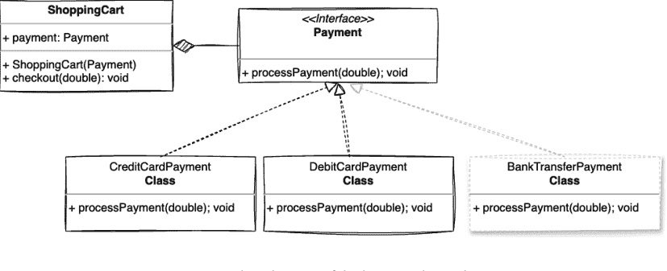

低耦合图强调，要添加新的支付形式，我们只需要创建一个实现 `Payment` 接口的类（在本例中为 `BankTransferPayment` 类），而不需要更改 `ShoppingCart` 类中的任何代码。

## 保持模块的内聚性

软件开发中的内聚性（Cohesion）指的是单个模块、类或函数的职责的关联程度和关注程度。当模块的组件之间紧密相关时，它更容易维护、理解和重用。高内聚性衡量的是模块内部元素协作实现单一、定义良好的目的的程度。内聚性越高越好，因为这通常会导致更健壮、更可靠的软件。

例如，让我们考虑一个需要用户信息管理的假设应用程序。如果一个专注于管理用户信息的类拥有管理用户的方法（如添加、更新和删除），那么它就是高内聚的。看看 `UserManager` 类：

```java
public class UserManager {
    public void addUser(User user) {...}
    public void updateUser(User user) {...}
}
```

`UserManager` 类显示了高内聚性，因为所有方法和属性都与管理用户信息的单一职责紧密相关。

另一方面，低内聚性将是指同一个类包含了 `validateEmail` 和 `sendEmail` 方法。它们应该放在另一个类中，例如 `Email` 类：

```java
public void addUser(User user) {...}
public void updateUser(User user) {...}
public void validateEmail(String email) {...}
public void sendEmail() {..}
```

在我们的模块中保持高内聚性将有利于我们项目的维护和理解。

## 关注点分离

关注点分离（Separation of Concerns, SoC）原则的核心概念是将软件应用程序划分为若干部分，每部分关注一个特定的关注点，并且与其他部分的重叠极少。它被应用于软件开发的各个层面，例如架构层面和编程层面。

在架构层面，它会将应用程序分分为不同的层，例如使用设计模式，如模型-视图-控制器（MVC）。在编程层面，它将组件、服务、函数或模块拆解为定义良好的领域，确保程序的每个部分都关注应用程序功能的一个某个特定方面。

### 架构层面

### 编程层面

| Payment | Order |
| --- | --- |
| # userid: Long | # orderid: Long |
| + processPayment(): void | + removeOrder(): void |

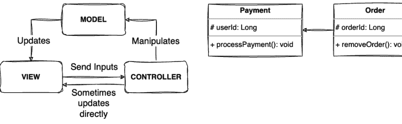

在架构层面采用了 MVC 设计模式，而在编程层面，`Payment` 和 `Order` 类分别处理它们特定的职责。如果违反了这一设计原则就会发生这种情况，例如 `Payment` 类包含了诸如 `removeOrder()` 这样的方法。

## 实现 SOLID 原则

SOLID 原则由五项设计指南组成，旨在增强软件设计的可理解性、灵活性可维护性。这些原则嵌入在面向对象的设计框架中，由 Robert C. Martin（通常称为“Bob 叔叔”）在 2000 世纪初提出。它们在软件工程社区中已广泛认可，被视为构建软件系统的核心策略。SOLID 是单一职责原则（Single Responsibility Principle）、开闭原则（Open and Closed Principle）、里尔科夫替换原则（Liskov Substitution Principle）、接口隔离原则（Interface Segregation Principle）和依赖倒置原则（Dependency Inversion Principle）的缩写。

### 单一职责原则

单一职责原则（SRP）建议类应该只有一个职责，并且只为了一个原因而改变。遵循这一原则使你的代码更具模块化，允许对系统的某部分进行更改而不影响其他部分。它还确保了高内聚性，使得类更容易维护、理解和测试。

### 实现单一职责原则

让我们实现一个库来示例 SRP：

```java
public class Book {
    private String title;
    private String author;
    public Book(String title, String author) {...}
}
```

```java
public class BookPersistence {
    public void save(Book book) {...}
}
```

该类专注于表示书的属性和行为。`BookPersistence` 类负责保存书籍。这种设计将书籍的表示与持久化分离来，遵循了 SRP。

### 开闭原则

开闭原则（OCP）规定模块对扩展开放但对修改关闭，这意味着我们可以在不修改现有代码的情况下，为类或方法添加新功能。

### 实现开闭原则

在之前的库示例基础上，通过不同的数据源保存书籍来演示如何应用 OCP，而不修改现有代码。首先，我们将保存书籍的概念抽象为接口，即 `BookSaveFormat` 接口：

```java
public interface BookSaveFormat {
    void save(Book book);
}
```

然后，我们为每种格式提供实现，例如文件和数据库，`TextFileFormat` 和 `DbSaveFormat`：

```java
public class TextFileFormat implements BookSaveFormat {
    public void save(Book book) {
        System.out.println("Saving book '" + book.getTitle() + "' to file.");
    }
}
```

```java
public class DbSaveFormat implements BookSaveFormat {
    public void save(Book book) {
        System.out.println("Saving book '" + book.getTitle() + "' to DB");
    }
}
```

最后，`BookPersistence` 类通过其构造方法接受 `BookSaveFormat` 的实例，遵循了对扩展开放对修改关闭的原则。例如，为了以 JSON 格式保存书籍，我们需要创建一个新类，如 `JsonSaveFormat` 类，它实现了 `BookSaveFormat` 接口并提供给 `BookPersistence`：

```java
public class BookPersistence {
    private BookSaveFormat saveFormat;

    public BookPersistence(BookSaveFormat saveFormat) {
        this.saveFormat = saveFormat;
    }
    public void saveBook(Book book) {
        this.saveFormat.save(book);
    }
}
```

通过在示例中实现 OCP，我们使其对扩展开放（添加新的保存格式），且对修改关闭；要添加新的保存格式，我们不需要更改 `BookPersistence` 类。


### 接口隔离原则

面向对象设计中的**接口隔离原则 (Interface Segregation Principle, ISP)** 主张客户端不应被强制依赖于包含其未使用的方法的接口。它建议将大型、臃肿的接口拆分为更小、更具体的接口，以减少副作用。

### 实现接口隔离原则

假设有一个由Book` 和 `Magazine` 类实现的 `Publication` 接口，其中 `Book` 拥有 ISBN，而 `Magazine` 拥有 ISSN。对于 `Book` 实现 `validateIsbn()` 方法是不实际的，`Magazine` 实现 `validateIssn()` 也是如此：

```
public interface Publication {
    void displayInfo();
    void validateIsbn(String isbn);
    void validateIssn(String issn);
}
```

更好的解决方案是将这些验证方法分离到针对每个出版物类型的独立接口中，确保类只实现与其属性相关的方法：

```
public interface ValidateIsbn {
    void validate(String isbn);
}
public interface ValidateIssn {
    void validate(String issn);
}
public interface Publication {
    void displayInfo();
}
```

现在，例如，`Book` 类可以实现 `Publication` 和 `ValidateIsbn` 接口：

```java
public Book implements ValidateIsbn, Publication{
    void displayInfo() { ... }
    void validateIsbn(String isbn) { ... }
}
```

现在，该类不需要实现 `validateIssn` 方法；因此，它遵循 ISP。

### 依赖倒转原则

面向对象设计中的**依赖倒转原则 (Dependency Inversion Principle, DIP)** 建议高层模块应避免依赖低层模块；相反，两者都应该依赖抽象。此外，抽象不应该依赖于细节，而细节应该依赖于抽象。该原则旨在减少代码模块之间的依赖，使系统更容易扩展、重构和维护。通过遵循 DIP，软件开发者可以创建更具模块化、灵活且健壮的系统。

### 实现依赖倒转原则

为了在我们的图书馆示例背景下说明 DIP，我们将创建 `BookPersistence` 和 `BookFormat` 接口，这些接口抽象了保存书籍的过程，允许高层（应用逻辑）和低层（特定保存格式）模块都依赖于这种抽象来实现灵活性模块化：

```
public interface BookPersistence{
    void save (Book book);
}
public interface BookSaveFormat {
    void save (Book book);
}
```

`BookPersistenceImpl` 实现了 `BookPersistence` 但没有绑定到特定格式，使用抽象的 `BookSaveFormat` 来保存书籍：

```java
public class BookPersistenceImpl implements BookPersistence {
    private BookSaveFormat saveFormat;

    public BookPersistenceImpl(BookSaveFormat saveFormat) {
        this.saveFormat = saveFormat;
    }

    public void saveBook(Book book) {
        saveFormat.save(book);
    }
}
```

现在，我们可以创建将书籍保存为文件、数据库甚至通过网络发送的实现类。以下代码片段展示了 `TextFormFieldSaveFormat`，它扩展了 `BookSaveFormat`：

```java
public class TextFormFieldSaveFormat implements BookSaveFormat {
    public void save (Book book) {
        System.out.println("Saving book '" + book.getTitle() + "' to file.");
    }
}
```

在客户端中，我们需要实例化保存书籍所需的格式，并通过 `BookPersistenceImpl` 的构造函数将其传递。。以下代码片段检查用户是否按了（键），然后使用 `TextFileSaveFormat` 创建 `BookPersistenceImpl` 对象将书籍保存到文本文件，或使用 `DbSaveFormat` 将书籍保存到数据库。最后，调用 `bookPersistence.saveBook(book)` 指令根据确定的持久化类型执行保存操作：

```java
Book book = new Book(title, author);
BookPersistence persistence = null;
if (saveType("T")) {
    bookPersistence = new BookPersistenceImpl(
    new TextFileSaveFormat());
} else {
    bookPersistence = new BookPersistenceImpl(
    new DbSaveFormat());
}
bookPersistence.saveBook(book);
```

这种设计确保可以通过添加新格式以极小的影响或扩展应用程序的保存机制，通过解耦高层函数与低层实现促进可维护且灵活的架构。

为了更深入地理解 SOLID 原则的概念，我建议阅读 Robert C. Martin 的书籍《Clean Architecture: A Craftsman's Guide to Software Structure and Design》。现在，让我们学习其他重要原则，如 KISS、DRY、YAGNI 和迪米特法则。

## 体现 KISS、DRY、YAGNI 和迪米特法则

与 SOLID 原则一样，你的工具箱中还有其他重要的原则；让我们深入研究它们。

### 保持简单，愚蠢 (KISS)

保持简单，愚蠢 (KISS) 原则强调了在软件开发、工程和其他设计领域系统设计和实现中简单性的重要性。它鼓励减少设计和执行中的复杂度，支持了简单的系统更可靠、更易理解且更容易维护的观点。KISS 的基本概念是避免不必要的复杂化，追求最可能的解决方案。

### 不要重复自己 (DRY)

不要重复自己 (DRY) 原则是软件开发中的一个概念，旨在减少代码中的重复。它源于 Andy Hunt 和 Dave Thomas 的书籍《程序员修炼》（The Pragmatic Programmer），DRY 强调了通过将通用功能抽象到单一位置来避免重复的重要性。这种方法确保了系统中的每部分知识或逻辑都有唯一的、无歧的表示。

### 你不需要它 (YAGNI)

YAGNI 代表“you aren’t gonna need it”（你不需要它）。这是一项软件开发原则，建议在功能需要之前不要添加它们。它强调简单性和效率，提醒开发者关注当前需求而非未来的推测。遵循 YAGNI 可以导致更易维护的代码库。

### 迪米特法则 (The Law of Demeter)

迪米特法则（LoD），也称为最少知识原则，源于 80 年代的东北大学（注），它建议对象只与以下对象进行交互：

- 对象本身
- 作为参数传递的对象
- 它创建的对象

该原则鼓励对象与接近的对象交互以减少依赖并提高封装。虽然过度应用可能会导致设计复杂。

现在我们已经熟悉了架构原则，让我们概述常见的架构风格。

## 常见架构风格概述

在软件开发中，架构风格对于决定系统如何构建及其运行至关重要。每种架构风格都有针对特定问题和要求的原则模式。选择架构风格是软件开发过程中的关键决策，因为它影响应用程序的性能、维护性和扩展性。我们将讨论在选择架构风格时常见的考虑因素。然后我们将提供一些常见架构风格的概述。

## 选择架构风格时的常见考虑

以下是开发者在选择架构风格时必须考虑的一些常见问题：

 ** **成本**：对开发、部署、维护和扩展成本等财务方面的考量。
- **可维护性**：系统在何种程度上可以容易修改以添加功能、修复错误或提高性能而不引入缺陷。
- **可测试性**：系统在多大程度上可以有效测试以确保其正确运行并符合需求。
- **可扩展性和性能**：系统处理负载增长（如数据量或用户数量增加）而不影响性能的能力。它还涉及到架构在扩展向上或向上时的复杂性和效率。
- **安全性**：架构必须支持必要的安全措施以保护数据并确保操作安全。这包括对身份验证、授权、加密以及数据存储和传输的考虑。
- **灵活性和适应性**：架构适应未来技术、业务需求或用户需求的能力。僵化的架构可能会阻碍应用程序的演进。
- **可靠性和可用性**：系统无故障运行并在需要时提供的能力。架构应该支持冗余、故障转移机制和灾难恢复计划。

既然我们已经了选择架构风格的常见问题，我们将讨论其中之一——扩展性，并学习我们用来扩展系统的方法。

## 可扩展性——纵向扩展 水平扩展

纵向扩展通过升级硬件（如 CPU、内存和磁盘空间）来增加服务器容量/性能。它更容易实现，但在超过某一点后具有局限性和高昂成本。依赖单个服务器或少数高容量服务器可能会导致单点故障并影响系统可用性。


常见架构风格概述 19

### 水平扩展（向外扩展 scaling out）

水平扩展涉及通过增加更多服务器或节点来分配负载。它具有灵活、易于调整、增强容错能力并降低单点故障风险等优点。它更适用于分布式系统以及在多个服务器上并行运行应用程序。然而，它需要更复杂的管理、负载均衡以及对应用程序进行更改，以有效地分配负载。最初，增加更多标准服务器可能比对单个服务器进行高容量升级更具成本效益。

图 1.3 展示了垂直扩展和水平扩展。


图 1.3: 垂直扩展对比水平扩展

我们可以从图中观察到，垂直扩展是通过增加更多处理能力来实现，而水平扩展则是通过增加更多机器来实现。现在，让我们来学习单体架构（Monolithic）。

## 单体架构

单体架构是设计和开发软件应用程序的传统模型。在这种架构风格中，应用程序被构建为一个统一单元，其所有组件和功能都紧密集成并部署。

在图 1.4 中，我们可以看到一个传统的单体应用。

### 服务器

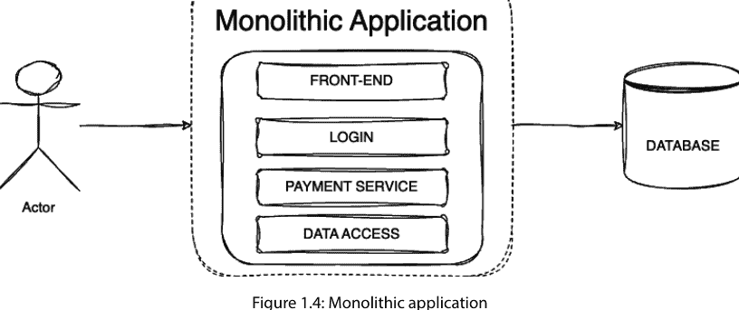

单体应用部署在单个服务器上，所有组件和功能都在一个构件（artifact）中。在 Java 中，WAR 文件通常被部署到 Tomcat 等应用服务器中。

### 单体架构的优点

单体架构将各种组件（如数据库、应用层和用户界面）的代码合并到单个代码库中，提高了开发效率，简化了调试和测试，并由于统一的环境确保了事务的完整性。由于缺乏微服务架构中的网络延迟，这种设置可以提供更好的性能，并允许通过在服务器上复制应用程序来实现直接的扩展。

## 单体架构的缺点

随着应用程序复杂性的增加，单体架构由于与其初始技术栈紧密耦合，会阻碍扩展性，并减慢开发、更新和技术采纳的速度。架构固有的耦合性还会抽象团队内部的独立开发工作，因为一个组件的更改可能会无意中影响其他组件，导致协调挑战和潜在的生产力损失。

## 客户端-服务器架构

客户端-服务器架构是计算中的基础框架，它将系统分为两个不同的应用程序：客户端和服务器。该模型促进了面向用户的应用程序（如个人电脑、智能手机或网络浏览器上的客户端）与管理数据库、文件服务和应用程序的健壮系统（服务器）之间的交互。该架构允许多个客户端通过本地或基于互联网的网络同时与服务器交互，实现资源的集中管理。

在图 1.5 中，我们展示了一个客户端-服务器应用。

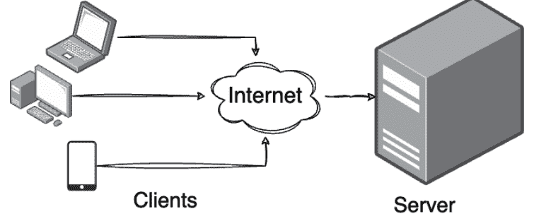

图 1.5: 客户端-服务器架构

在图中，我们可以观察到各种客户端应用（如网络浏览器、移动应用和终端）通过互联网访问服务器应用。

### 客户端-服务器架构的优点

客户端-服务器架构将数据管理、更新和安全性集中在服务器上，有利于保持一致性、易于维护和资源优化。它提供了扩展性并改进了访问性，允许用户从任何连接的设备访问应用程序。

### 客户端-服务器架构的缺点

客户端-服务器架构对网络连接的依赖会影响离线场景下的性能和访问性。扩展（特别是垂直扩展）和水平扩展会引入数据密度挑战带来的复杂性。集中式服务器也是网络攻击的吸引目标，因此需要持续且复杂的安全措施。如果没有适当的设计，服务器可能会成为性能瓶颈或单点故障，导致潜在的数据丢失或停机。管理客户端-服务器系统（特别是在大规模下）需要大量的管理工作和专业知识来维护安全性、性能和可靠性。

## 微服务架构

与单体架构相比，微服务架构主张将应用程序分为更小的、松耦合的服务，这些服务通过定义良好的 API 或事件进行通信。

## 深入软件架构

每个微服务管理一个特定的业务能力，并能够与其他微服务独立进行自主开发、部署和扩展。

图 1.6 提供了电子商务业务微服务架构的简化视图。

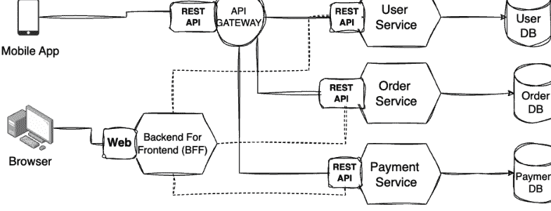

图 1.6: 微服务架构

微服务架构将领域分解为用户、订单和支付等服务。每个微服务都有自己的数据库，并通过 REST API 进行通信。移动应用通过 API 网关到达微服务，API 网关是所有客户端请求的入口。它将请求引导到适当的微服务，并可能处理交叉关注点，如身份验证、SSL 终止和请求日志。Web 通过后端前端（BFF）组件访问服务。BFF 是一种专门为特定前端应用或用户体验的服务；也就是说它充当前端请求的 API 网关。现在，让我们检查一下微服务架构的优点和缺点。

### 微服务架构的优点

微服务架构是一种强调灵活、可扩展软件开发的方法，提供了显著的优点，也带来了某些挑战。优点包括能够独立扩展服务、使用最合适的技术栈、增强系统韧性、更快地部署更新、提高团队敏捷性以及有效地隔离故障。

## 微服务架构的缺点

它还引入了管理多个服务的复杂性、数据一致性问题、潜在的网络延迟、安全漏洞、测试困难、运营开销增加以及部署挑战。

尽管存在这些挑战，该架构的扩展性、灵活性和韧性使其极具吸引力。

## 事件驱动架构

事件驱动架构（EDA）是一种依赖事件来启动和促进松耦合服务之间通信的方法，这是使用微服务开发的现代应用程序中一种流行的方法。事件被定义为状态的重大变化或需要系统其他部分感知并做出响应的事件。

### 核心组件及其角色

在 EDA 中，有四个核心组件，我们将进一步介绍它们：

-   **事件 (Events)**：EDA 的核心元素，代表系统中值得关注的变化或触发响应的事件。
-   **生产者 (Producers)**：生成或发布事件的实体，这些事件可以是用户操作、传感器输出或任何能够启动事件的源。
-   **消费者 (Consumers)**：监听并对事件采取行动的组件，根据它们订阅的事件执行操作。
-   **事件代理（事件通道，Event broker）**：这是允许系统内部不同组件或服务之间进行事件驱动通信的中间件。它充当中介，处理从事件生产者（发布者）到事件消费者（订阅者）的事件传输。事件代理将事件的产生与其消费解耦，这意味着生产者不需要知道消费者的身份、位置甚至消费者的数量。

图 1.7 展示了事件驱动架构。

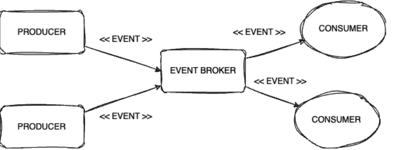

图 1.7: 事件驱动架构


我们可以看到四个核心组件的运作方式：生产者、消费者、事件和事件代理件。生产者和消费者彼此不知道对方的存在，它们通过事件代理件通过事件进行通信。

## 事件驱动架构模式

EDA 包含了多种模式。最著名的是发布/订阅模型和事件流模型，每种模式都对应不同的系统需求：

- **发布/订阅模式**：通过允许发布者在发布事件时无需知道订阅该事件的消费者，增强了系统的可扩展性和灵活性。
- **事件流架构**：专注于连续数据流的实时处理，适用于需要即时数据分析和操作的应用。

它侧重于连续数据流的实时处理，适用于需要即时数据分析和操作的应用。

## 事件驱动架构的优点

EDA 具有许多优势，例如通过独立组件的扩展实现可扩展性；修改和维护的灵活性与松耦合；通过异步处理实现实时响应；以及韧性（它允许组件故障而不会导致系统性故障，也就是说一个组件的故障不会影响系统的其他组件）。

## 事件驱动架构的缺点

EDA 面临着挑战，例如事件流管理的复杂性增加、由于其异步和分布式的特性导致测试和调试困难、跨服务维护数据一致性的挑战，以及对系统性能和可靠性对代理件的依赖。

## 无服务器架构

无服务器架构允许在无需监督基础设施的情况下开发和运行应用程序及服务。在这种架构中，云提供商负责自动分配、扩展和维护执行代码所需的设施。开发者只需专注于编写应用程序代码，无需担心底层服务器、运行时环境或维护工作。

### 无服务器架构的类型

无服务器架构通常利用微服务和函数即服务 (FaaS)。FaaS 是一种无服务器计算类型，允许响应事件执行函数。AWS 以 AWS Lambda 的形式提供服务。

其他常见的无服务器架构类型可以在无需管理服务器的情况下促进应用程序开发和部署的各个方面，例如后端即服务 (BaaS)、存储、数据库即服务 (DBaaS)、API 网关、流处理和事件处理以及集成和工作流服务。

图 1.8 显示了云提供商 AWS 创建无服务器架构的一些组件。

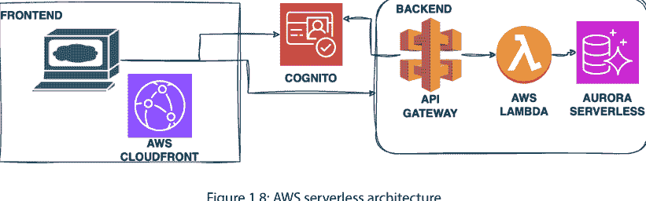

无服务器架构通过消除基础设施管理的负担，彻底改变了应用程序开发。让我们探索它的优点和缺点。

### 无服务器架构的优点

无服务器架构为企业提供了显著优势，强调了成本效益、可扩展性、生产力、快速部署和全球分布。它通过仅对消耗资源付费来优化成本，并自动扩展应用程序以匹配需求。这种架构减轻了运营负担，让开发者专注于编码和业务逻辑。部署过程被简化了，便于快速更新和功能发布。此外，无服务器架构支持全球分布，通过最小化延迟来提高应用程序性能。

### 无服务器架构的缺点

无服务器架构带来了独特的挑战，例如冷启动带来的初始延迟、对环境控制限制、依赖单一云提供商的风险、更高的安全漏洞、复杂的状态管理以及测试和调试的障碍。

## 管道和过滤器架构

管道和过滤器架构由一系列连接的处理单元组成，其中一个单元的输出作为后续单元的输入。这种模式的特点是其结构，由一系列被称为“过滤器”的处理元素通过“管道”连接。数据通过过滤器之间的管道流动，并在每一步中经历转换或分析。这种架构风格适用于分阶段处理数据的系统，具有灵活性、可重用性和可扩展性。

图 1.9 展示了管道和过滤器架构。


我们可以在图中观察管道和过滤器架构的组件及其工作原理。

### 解释核心组件

管道和过滤器架构有两个核心组件：过滤器和管道，让我们来学习它们：

- **过滤器 (Filter)**：过滤器是对数据执行操作的处理单元。每个过滤器从输入读取数据，对其进行处理（如转换、过滤或聚合），然后将结果写入输出。过滤器设计为相互独立，专注于特定的任务。
- **管道 (Pipe)**：管道充当连接器，将数据从一个过滤器传输到下一个。它们是处理后数据数据的路径。管道可以缓存数据，允许不同的过滤器进行异步处理。

管道和过滤器架构为设计分阶段处理数据的系统提供了一个稳健的框架。它提供了灵活性、模块化和易于维护。清晰的关注点分离 (SoC) 和简单性使其成为各种应用程序的热选。

### 管道和过滤器架构的优点

管道和过滤器架构提供了一个灵活、松耦合的框架，允许在不影响其他部分的情况下独立更新过滤器，支持并行任务执行，并允许将过滤器视为独立实体，简化了用户交互。这种设计促进了高重用性，便于每个过滤器在不同场景中的应用。

### 管道和过滤器架构的缺点

尽管有优点，但管道和过滤器架构也面临局限性，例如管理多个独立过滤器可能导致性能瓶颈、不适用于交互式用户应用程序，以及处理大量连续计算时效率低下。

## 按架构风格选择数据库

根据应用程序的架构风格选择合适的数据库对于优化性能、可扩展性和可靠性至关重要。这一选择受到不同架构风格独特需求的影响，并要求对数据库技术及其特性有深入理解。

### 数据库的类型

数据库可以根据数据模型、架构和用例分类。以下是数据库的主要类型。

### 关系型数据库 (RDBMSs)

这些数据库将数据存储在表中，表通过关系相互关联，通常使用 SQL 进行数据操作和查询。它们以原子性、一致性、隔离性和持久性 (ACID) 特性闻名，确保了事务的可靠性。示例包括 MySQL、PostgreSQL、Oracle 和 Microsoft SQL。

### NoSQL 数据库

NoSQL 数据库以其适应性、扩展能力以及管理大量非结构化或半结构化数据的效率而受到认可。它们可能不严格遵守 ACID 特性，而是选择最终一致性以增加可扩展性和性能。它们设计用于处理各种数据，我们将在后续章节中探讨：

- **文档数据库**：使用 JSON、BSON 和 XML 以文档存储数据。这些数据库是无模式的，这意味着数据结构可以随文档不同而异。它们非常适合存储、检索和管理面向文档的信息。
- **内存数据库 (IMDB)**：这些数据库将数据存储在主内存 (RAM) 中，以确保比基于磁盘的存储更快的访问速度。它们是需要高吞吐量和低延迟的应用，例如缓存、实时分析和游戏。
- **键值存储**：最简单的数据库形式，每个项目包含键和值。
- **图数据库**：专门设计用于处理关系可以用图很好地表示的数据，这些数据由节点（实体）和边（关系）组成。这些数据库对涉及遍历关系导航的查询进行了优化，例如社交网络、推荐引擎和欺诈检测。示例包括 Neo4j 和 Amazon Neptune。


- **宽列存储数据库（Wide-column stores）：** 数据存储在表、行和动态列中。它们针对大型数据集的查询进行了优化，并具有高度的可扩展性。宽列存储是一种 NoSQL 数据库，允许在通用服务器上存储海量数据。

- **面向对象的数据库（Object-oriented databases）：** 它们以对象的形式存储数据，类似于面向对象编程中的。

- **时序数据库（Time-series databases）：** 针对存储和查询时序数据而优化，时序数据是指通过时间（时间戳）索引的数据。这些数据库广泛应用于金融服务、监控和物联网应用，在这些领域记录按时间排序的事件至关重要。

- **SQL 数据库：** 结合 NoSQL 系统的扩展性与传统关系型数据库的 ACID 保证。

每种数据库类型都有独特的特性，并根据应用程序的具体需求进行选择，例如数据的性质、系统的规模、一致性要求以及操作复杂性。

## 探索 CAP 定理

CAP 定理（或 Brewer 定理）是适用于分布式系统的基本原理，特别是在数据库系统及其设计中。它由 Eric Brewer 在 2000 年的分布式计算原理专题会议（PODC）主演讲中提出。该定理提出了在网络分区存在时三种保证之间的权衡：一致性、可用性和分区容错性。

然而，该定理假设分布式系统在任何给定时间只能保证三个属性中的两个。让我们拆解每个组件。

### 一致性 (Consistency)

所有节点在同一时间看到相同的数据。一致性确保对系统的任何读取请求都会返回系统中所有节点特定数据点的最新写入。如果写入了一个数据项，随后的访问将返回更新后的值。

### 可用性 (Availability)

每个请求都能收到（非错误）响应，但不保证其包含最新的写入。可用性意味着即使系统的某些部分发生故障或无法访问，系统仍然保持运行并能够处理请求。系统设计旨在避免停机。

### 分区容错性 (Partition tolerance)

系统在面对网络故障导致的随机分区时仍维持运行。分区容错系统能够承受任何不会导致系统完全崩溃的网络故障。换句话说，即使节点之间的通信中断，系统仍然可以运行并维护其保证。

图 1.10 展示了 CAP 定理。

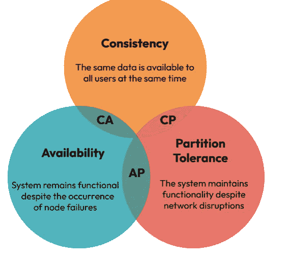

图 1.10: CAP 定理

CAP 定理的本质是分布式系统必须做的权衡。该定理将分布式系统分为三类。

### 一致性和分区容错性 (CP)

系统优先考虑一致性和分区容错性，而不是可用性。在网络故障期间，系统可能会阻塞操作以维护分区间的一致性。

### 可用性和分区容错性 (AP)

系统优先考虑可用性和分区容错性，而不是一致性。在网络故障期间，系统保持可用，但数据在所有节点之间可能一致。一旦分区解决，系统可以工作来实现一致性。

### 一致性和可用性 (CA)

在没有网络故障时，系统保持可靠和可用。在 CAP 定理的背景下，这种组合是不现实的，因为它忽略了分布式网络中分区可能性。真实世界的分布式系统必须考虑网络故障，使得分区容错性成为必要的考虑因素。

CAP 定理在分布式系统的设计和理解方面具有基础性，影响了数据库和存储系统的发展以及各种可扩展系统的架构。它帮助设计人员和工程师在构建分布式系统时，就一致性、可用性和分区容错性之间的权衡做出明智决策。

## 按架构风格选择数据库

现在，我们将重点关注仅根据架构风格选择数据库，暂抛开业务需求，以突出每种架构方法最匹配的数据库。为特定的架构风格选择最优数据库需要理解架构和数据库选项的特性及需求。我们将对上述架构风格以及与其契合良好的数据库进行总结，并提供对每种选择的解释。

### 单体架构 (Monolithic architecture)

单体架构通常受益于 RDBMS 的强一致性、ACID 事务和关系型数据建模能力。这些数据库为不同组件紧耦合并在单个进程中运行的应用程序提供了稳健可靠的基础。

### 客户端/服务器架构 (Client-server architecture)

客户端/服务器架构通过客户端与处理业务逻辑和数据存储的中央服务器交互，使用 RDBMS 来确保其稳健性和事务完整性。然而，对于对数据建模有更高灵活性要求或面临扩展性需求的应用程序，文档型 NoSQL 数据库可能由于其无模式的特性和易扩展性而更加合适。

### 微服务架构 (Microservices architecture)

在微服务架构中，应用程序被拆分为较小的、自治的服务，通过网络通信进行交互。NoSQL 数据库在这些场景中因其水平扩展性和处理分布式数据模型的能力而往往成为首选，高效地匹配了微服务的分布式和可扩展特征。

### 事件驱动架构 (Event-driven architecture)

EDA 使用如 Apache Kafka 等事件流平台作为骨干来管理事件流、提供持久化存储并促进实时处理。结合用于灵活数据建模的 NoSQL 数据库或用于结合扩展性与稳健一致性的 NewSQL 数据库，它支持了事件驱动系统动态和异步的特性。

### 无服务器架构 (Serverless architecture)

无服务器架构允许在无需监控基础设施的情况下开发和运行应用程序及服务。能够根据应用程序需求自动伸缩的无服务器数据库是天生契合的。它们为不可预测的工作负载提供了成本效益，并简化了操作管理，符合无服务器关注代码而非基础设施的原则。

### 管道与过滤器架构 (Pipe and filter architecture)

管道与过滤器架构涉及由数据流（管道）连接的处理元素（过滤器）。内存数据库（IMDB）或流处理系统可以高效处理各阶段之间的瞬态和中间数据，为实时数据处理任务提供必要的低延迟和高吞吐量。

注意的是，这些建议是基于架构风格和数据库的典型用例及特征的起点。特定项目的最优选择取决于详细需求，包括数据访问模式、扩展需求、事务要求和操作复杂性。建议在做出最终决定之前进行彻底的评估和概念验证。

## 总结

在本章中，我们学习了软件架构在成功的软件开发中的关键作用。我们看到软件架构不仅仅是系统设计和实现的蓝图；它是连接复杂技术需求与战略性业务目标之间差距的关键力量。这一基础元素确保了高质量、稳健且高效的解决方案的交付，指导了整个软件开发生命周期中的战略决策，优化了成本并降低了风险。

随后，我们将讨论转向了解释软件架构与设计之间的界限，探索了软件架构的核心原理。我们还介绍了主流的架构风格，强调了单体架构、客户端/服务器架构、微服务架构、EDA、无服务器架构和管道与过滤器架构所带来的优势和挑战。

最后，我们介绍了数据库的类型和 CAP 定理，并讨论了架构风格如何影响项目选择最合适的数据库。


## 问题

1. 软件架构在软件开发中的根本作用是什么？
2. 软件架构与软件设计有何区别？
3. 架构决策如何影响性能、安全性和维护性等软件质量属性？
4. 为什么低耦合和高内聚等原则在软件架构中如此重要？
5. 微服务架构提供了哪些优势和挑战？
6. CAP 定理在数据库选择的背景下具有什么意义？

## #2 软件架构中的决策过程

本章对软件架构中的决策过程进行了深入探讨，将其确定为软件开发成功的基石。它涵盖了架构决策的本质、遇到的类型以及做出这些决策的过程。书中介绍了影响架构决策的因素和权衡方案，并通过架构权衡分析方法（ATAM）对这些权衡进行评估，同时结合案例研究说明了实际应用。本章强调了架构决策与业务目标保持一致的必要性，详细说明了实现这种一致性的策略，并通过架构决策记录（ADRs）记录决策，以确保清晰性和连续性。总的来说，它为架构师提供了指南，帮助做出符合技术和业务目标的明智决策，旨在实现稳健且可扩展的软件解决方案。

本章将涵盖以下主题：

- 揭析决策过程
- 审查架构因素
- 架构决策中的权衡
- 将架构决策与业务目标对齐

完成本章后，你将了解软件架构中的决策，包括决策的定义、架构决策的类型、过程和权衡，以及如何使用 ATAM对其进行评估。本章还强调了将决策与业务目标对齐以及使用 ADR 记录决策的重要性。本章将使你做好准备，能够从容地应对架构决策的复杂性，并交付符合业务目标的稳健软件解决方案。

## 揭析决策过程

决策是就重大事项做出选择的过程，特别是在集体或组织背景下。

这一过程作为了系统地做出明智决策的指南。这至关重要，因为错误的决策可能导致灾难性的后果，浪费时间、金钱并导致业务损失。尽管如此，什么是决策？

在继续之前，请思考并尝试回答这个问题。

### 什么是决策？

如果你在字典中查询，你会发现答案说：决策是在考虑了最佳或最合适的选项后得出的结论或决议。要做出决策，我们必须有多个选项以及一个问题或需求。如果只有一个选项，我们就不需要决策；因为我们只有一个可用选项。当我们有多个选项时，选择变得更加复杂，我们需要某些东西来帮助选择最佳或最合适的选项。这就是决策过程大显身手的地方。现在我们明确了决策的构成要素，让我们探索一些软件架构决策。

### 软件架构决策

软件架构决策是塑造软件系统结构和功能的关键选择。这些决策涉及选择适当策略和技术以促进软件的整体设计和开发，并对质量、性能、维护性和未来增长产生重大影响。这些决策是在特定需求、约束和目标的背景下提出的，通常涉及以下领域：

- 结构组织：在设计软件时，确定组件及其相互作用的高级布局至关重要。这涉及到在微服务、单体、事件驱动和面向服务的架构等架构风格之间选择。
- 技术栈：选择合适的编程语言、框架、数据库和工具以适应项目需求。
- 数据管理：涉及与数据存储、访问和操作相关的决策，在 SQL 和 NoSQL 数据库之间进行选择、数据建模以及数据分布策略。
- 组件通信：涉及决定系统组件之间的通信协议，例如 REST API、消息队列和服务总线。
- 定量属性：可扩展性、性能、可用性、可靠性和资源使用是需要决策的常见需求。它们可以进行数值衡量和表示，本质上是客观的，使其更容易进行量化、比较和统计分析。例如，关于可扩展性和性能，我们需要确定处理用户增长、数据量和事务频率的策略，而不牺牲性能。这包括关于负载均衡、缓存和分布式计算的决策。
- 质量属性：维护性、易用性、灵活性、移植性、安全测试性等需求应通过选择合适的测试、监控和日志策略及工具来解决。涉及安全时，确保系统安全需要在身份验证、授权、数据加密以及符合安全标准和法规等方面做出决策。
- 部署与基础设施：关于软件部署的决策，包括云端与本地化、容器化和编排工具。
- 设计原则和模式：通过采用标准的设计原则和模式（如 SOLID、模型-视图控制器 MVC、工厂模式和单例模式），我们可以通过一致地解决某些问题来提高代码质量和可靠性。

与软件架构相关的决策至关重要，因为它们具有长期影响，成本高昂，且一旦实施，可能很难更改。这些决策会显著影响软件项目的成功或失败。这些决策通常涉及多个利益相关者，如架构师、开发者、项目经理，有时客户。这确保了决策符合业务目标、技术要求和约束。接下来，我们将深入探讨决策过程并讨论如何将其应用于软件架构。

### 探索决策过程

我们看到决策是就重要事情做出决定的过程，特别是在群体或组织中。在软件架构中，决策过程是指导性框架，引导项目从构想走向完成。这些过程并非偶然的，而是应对技术考量、目标和利益相关者动态等复杂领域的系统方法。它涉及通过结构化方法来选择、评估和实施定义系统的关键设计选择。它们涵盖了彻底探索选项、评估其影响以及对所选路径做出意识的承诺。

软件架构决策的质量深刻影响着项目的成功。

### 识别不同的决策方法

了解不同的决策方法至关重要。软件架构中的决策可能涉及在一种或多个替代方案之间进行选择。取决于情况和可用资源，可以使用以上一种方法。

图 2.1 展示了决策方法。

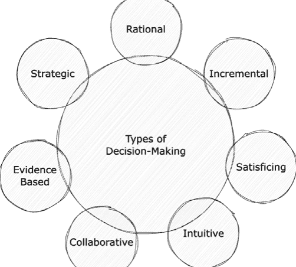

图 2.1: 决策方法

每种决策方法都有其独特的特性和应用。让我们深入研究：

- **理性 (Rational)**：理性决策是一个系统且分析性的过程。它涉及识别需求、生成替代方案、根据标准进行评估并选择最佳解决方案。它假设决策者拥有完整信息并能客观地评估每个选项。
- **增量式 (Incremental)**：增量式决策涉及做出微小的、可管理的增量或步骤。这对于复杂的项目特别有利，因为很难提前预测所有的需求和挑战。决策随着项目的演进而做出，允许对变化的情况具有灵活性适应性。
- **满意法 (Satisficing)**：满意决策涉及选择第一个满足最小需求或标准的选项，而不是寻找可能的解决方案。当时间有限或一个足够好的方案就能满足项目需求时，这非常有帮助。这种决策类型的绝佳例子是我们在生产环境中发现 Bug 并必须快速解决它。
- **直觉型 (Intuitive)**：这种决策基于架构师或决策团队的经验、直觉和个人见解。它通常用于需要快速决策，或数据不完整或复杂到无法通过理性方法进行分析的情况。


### 揭示决策过程

- **协作性**：这涉及将各种利益相关者纳入决策过程。它承认多元化观点和知识的价值，旨在达成共识，或至少达成满足所有主要利益相关者观点的决策。
- **基于证据**：这种方法使用数据、指标和经验证据来指导决策。它包括收集相关数据、分析以得出结论，并基于这些见解做出决策。这在减少决策过程中的偏见和假设方面特别有效。
- **战略性**：这种类型关注长期项目以及与整体业务或项目目标的对齐。它涉及考虑架构决策的更广泛的影响，并要求对项目愿景、竞争格局和未来趋势有深入理解。

事实上，我们在项目中面临过决策情况，并且很可能采用了不止一种方法来达成决策。现在，让我们探索一下涉及的系统性和分析性措施。

### 概述决策步骤的进展

在复杂的软件系统中导航架构选择的复杂性，好比在迷宫中寻找道路，每种选择都会导致不同的后果。系统化的、循序渐进的方法为专家这一旅程提供了帮助，确保他们的决策是深思熟虑的，并且与业务和技术目标一致。

图 2.2 展示了决策过程的步骤。

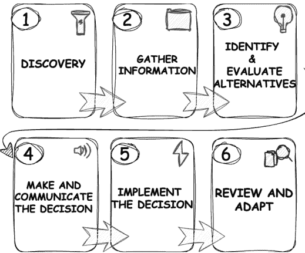

图 2.2：决策过程的步骤

现在，让我们仔细探索并理解每一个步骤。

- **发现**：第一步至关重要，它涉及识别需要决策的性或机会。这可能是对新系统架构的需求、技术栈的更新，或对不断变化的业务需求的响应。为了做到这一点，你需要提出正确的问题来识别需要解决的问题、要实现的业务目标以及必须考虑的技术局限性。只有这样，你才能正确理解其必要性并向前推进。
- **收集信息**：收集并分析影响决策及其对解决方案影响的数据。
- **识别并评估替代方案**：在信息收集阶段，你可能会发现多个行动方案或选择。在此阶段，目标是对所有可行且吸引人的选项进行排序，并根据项目需求对每种替代方案进行评估，考虑可行性、风险、对现有系统的影响、定量和定性属性以及与业务目标的对齐情况。这可能涉及原型制作、与技术团队讨论或与利益相关者协商。此阶段经常包括权衡分析，ATAM 框架可以帮助你评估软件架构内的权衡和决策。我们稍将在“架构决策中的权衡”部分讨论 ATAM。
- **做出并传递决策**：在考虑所有信息后，你准备好为你的需求选择最合适的选项。可以选择不同选择的混合。此决策应该平衡技术考量与业务需求以及可能的未来需求。软件架构通常必须向利益相关者证明决策，强调理由和预期收益。确保有全面的决策文档，以便于清晰理解和使用，同时与所有参与人员保持有效的沟通。关于文档，我们可以使用 ADR 文档，这是一种广泛接受的文档，记录了重大的架构决策及其背景和后果。我们将在本章的“架构决策与业务目标的对齐”部分学习它。
- **实施决策**：此时，你应通过实施这些步骤来启动流程。让开发团队实施架构决策。这涉及详细规划、定义架构准则，并确保团队理解并遵循所选路径。
- **评审与更新**：在这一总结阶段，反思你决策的结果，看它是否解决了你在“识别需求”中指出的需求。如果决策未能满足识别的需求，重新审视流程特定阶段以达成新决策可能会很有益。这可能涉及收集更全面或更多样的信息，或考虑进一步的选项。例如，实施后，在系统性能、用户反馈和不断演变的项目需求背景评审决策结果。准备好在新信息可用或项目需要变化时调整架构。

这一过程强调了深思熟虑、知情的决策方法。它将技术专业知识与战略思维相结合，引导软件项目取得成功结果。接下来，我们将深入影响软件开发中架构决策的因素。

## 分析架构因素

许多因素影响架构决策，包括技术、业务和组织方面。理解这些因素对于构建满足当前需求并能随时间演化的架构至关重要。让我们开始探索技术因素。

### 技术因素

技术因素处于架构决策的核心。这些包括技术格局的现状、项目的特定需求，以及不同技术和架构的能力和局限。关键技术因素可能涉及：

- **功能性需求**：这些规定了软件系统必须提供以满足用户需求的行为、特征和功能，直接塑造系统架构。例如，在在线书店中，功能性需求可以允许用户按标题、作者或体裁搜索书籍；提供详细的书籍信息（如价格、可用性和奖励）；允许用户创建个人账户进行购买管理和订单历史；以及支持安全的支付处理。每项需求都涉及关键的架构选择，例如为搜索功能实现健壮的数据库，并为账户管理整合安全的身份验证服务，确保架构能够充分支持系统的功能需求。
- **性能**：性能是做出架构决策的关键因素。从选择算法到配置硬件，一切都必须优先优化系统性能。缓存机制、数据索引和并行处理技术等因素在实现预期性能基准方面至关重要。
- **可扩展性**：可扩展性是软件系统架构的关键方面。它决定了系统在保持性能标准的同时管理增长的数据和流量的能力。影响可扩展性的关键决策包括数据库设计、负载均衡和分布式架构。
- **可靠性与可用性**：系统的设计能够在各种条件下可靠地运行，停机时间最小并具有故障能力。
- **安全性**：在数字世界中，保证数据得到妥善保护并符合相关法律法规至关重要。为了防止网络威胁，必须将稳健的安全措施集成到系统架构中。与加密方法、身份验证机制和访问控制相关的决策会显著影响系统抵抗网络攻击的能力。


- **可维护性**：在开发系统时，可维护性是一个至关重要的考虑因素。模块化设计、代码结构和文档等各种因素都会影响系统随时间推移进行维护和演进的易易程度。考虑长期可维护性的决策包括选择成熟的设计模式并遵循编码标准。

- ****互操作性与集成**：与第三方或现有系统的集成会影响架构，特别是接口、数据交换格式和协议方面。因此，确保系统能够与其他组件进行通信和运行至关重要。

- ****技术限制**：架构选择受到现有技术栈、与外部系统的兼容性以及团队内部可用专业知识的影响。

在做出软件架构决策时，上述所有技术因素都是至关重要的。在下一节中，我们将讨论如何处理这些因素之间的权衡。现在，让我们来看看同样可能影响软件架构的业务因素。

### 业务因素

业务因素涉及软件旨在服务的组织的战略目标、市场定位和财务考量。这些因素指导了软件的目的和范围，以确保其与业务目标保持一致。关键业务因素包括：

- **预算限制**：资金有限会显著影响架构决策，这使得成本效益的解决方案、核心功能的优先级排序、开源技术、优化的资源利用以及云服务成为重要的考虑因素。

- **时间限制**：时间限制会显著影响决策。快速原型设计、自动化测试和模块化开发有助于满足截止日期。

- **监管要求**：在许多行业中，合规监管标准是不可逾越的。与数据存储、隐私措施和审计跟踪相关的决策对于确保合规性至关重要。

- **业务目标与限制**：某些架构质量的优先级排序受到组织整体目标、成本限制、上市时间要求和业务策略的影响。

- **演进**：在做出可持续的架构决策时，考虑系统可能如何响应未来需求、技术变化和业务转变而进行演进至关重要。

- **供应商锁定**：当客户严重依赖单一供应商的技术时，就会出现供应商锁定。它带来了许多挑战，例如迁移困难（这在技术上具有挑战性且成本高昂）、由于专有技术和潜在供应商涨价导致的长期成本增加，以及限制获取其他供应商进展的创新限制，阻碍了增长和适应性。因此，许多人选择开放标准、开源技术或多云策略以防止依赖，旨在在其技术框架中获得更多的控制和灵活性。

### 审视架构因素

- **国际化与本地化**：在为全球软件做出架构决策时，必须考虑**国际化 (i18n)**和**本地化 (l10n)**需求。国际化涉及设计软件以支持多种语言和地区，解决字符编码、日期和时间格式以及文化差异等挑战。本地化通过翻译内容和调整功能以满足区域偏好，将软件定制到特定地区。管理这些因素的有效策略包括使用 Unicode 进行字符编码、将文本字符串外部化以便于翻译，以及设计全球用户可访问且易于使用的界面，以增强易用性和市场覆盖。

- **无障碍性**：对软件无障碍性的可能会塑造架构选择，特别是在用户界面和交互设计中。例如，为图像实现替代文本，以便视觉受障用户可以通过屏幕阅读器理解视觉内容。此外，保持足够的色彩对比度有助于视力障碍者有效导航和使用软件。这些无障碍性功能是软件开发中可以影响决策的关键考虑因素，旨在提高所有用户的易用性。

最后，在做出软件架构决策时，考虑组织因素也是至关重要的。

### 组织因素

组织因素关注在开发或部署软件时的组织内部背景，包括其文化、结构和资源。这些因素影响软件项目的管理和执行方式。关键的组织因素包括：

- **团队技能与经验**：开发团队的专业知识和经验会影响架构中技术和模式的选择。

- **利益相关者关注点**：在架构决策中，平衡不同利益相关者的关注点和优先级至关重要。例如，开发者可能优先考虑实现的易用性，而营销团队可能强调用户体验和设计偏好。当这些优先级发生冲突时，可能会产生矛盾，影响决策以确保考虑所有视角并使架构支持化需求。这一过程强调了整合利益相关者反馈以创建完善架构策略的重要性。

- **架构原则与指南**：组织或项目内部既定的原则和程序可以塑造决策过程，促进一致性并与更广泛的架构目标保持一致。

- **文化与组织动态**：组织的文化和开发团队的动态（包括通信模式和决策过程）会影响架构方向。

- **DevOps 与持续交付**：采用 DevOps 实践以及对持续集成/持续交付 (CI/CD)的需求会影响架构，特别是对自动化、监控和部署策略的要求。

理解技术、业务和组织因素之间的区别在软件架构决策中至关重要。我们了解到技术因素侧重于系统的构建和运行，业务因素重点是外部市场和战略目标，而组织因素涉及开发和维护的内部能力。成功平衡这些因素可确保决策符合战略目标和组织现实，从而产生有效且可持续的软件解决方案。

现在，让我们探索架构决策中的权衡。

## 架构决策中的权衡

软件架构决策是复杂的，涉及在我们讨论的因素之间进行微妙的平衡，其中权衡成为衡量选择的“货币”。现在，我们将探索软件架构中“权衡”这一细微的概念，并对其定义、典型示例以及实际评估和管理策略提供见解。

### 理解软件架构中的权衡

软件架构中的权衡是指在选择一种架构方案而非另一种时所做出的内在妥协。这些妥协源于冲突的目标、限制和需求。从本质上说，在一个方面做出有利的决策往往往往以牺牲另一个方面为代价。识别并应对这些权衡是战略决策不可或缺的一部分。

例如，考虑技术因素之间的经典权衡：性能与可维护性。选择高度优化、性能驱动的解决方案可能会导致难以维护的复杂代码。相反，优先考虑可维护性可能会引入抽象和模块化设计，从而影响性能。挑战在于找到与项目目标一致的平衡点。让我们探索架构决策中其他常见的权衡：

- **性能与可扩展性**：在优化即时性能和为可扩展性设计之间经常会出现常见的权衡。实现高性能的单体架构可能会牺牲扩展性。相反，选择可扩展的微服务架构可能会引入延迟，影响即时性能。


## 架构决策中的权衡

- **扩展性复杂性**：扩展性是指系统管理不断增加的工作负载的能力或支持该工作负载的能力。实现扩展性可能涉及负载均衡器、微服务或分布式数据库，这会增加系统架构的复杂性，并使实现、测试和管理变得更具挑战性。

- **安全性与可用性**：在安全措施与用户友好的界面之间取得平衡是另一种常见的权衡。严格的安全协议（如多因素身份验证）可能会增强安全性，但会损害终端用户的易用性。

- **灵活性与**：架构决策可能涉及构建一个能够适应多样化需求的高灵活性系统，与为特定需求定制解决方案之间进行权衡。通用的、灵活的解决方案可能会引入复杂性，而专门的解决方案可能需要对未来的变化具有更好的适应性。

- **可维护性与初始开发速度**：可维护性指的是系统更新、修改和扩展的易易程度。优先考虑可维护性可能涉及采用成熟的设计模式、投入文档工作并选择强调长期支持的技术。另一方面，为了尽快交付功能或产品而启动开发过程，可能会导致选择快速开发框架，或在代码质量或扩展性上做出妥协，从而影响可维护性。

- **数据冗余与数据完整性**：数据冗余通过在多个位置复制数据来增加容错能力和访问性。虽然这可以提高性能和可用性，但可能会在维护数据完整性以及确保所有数据副本一致且最新方面带来挑战。

- **成本创新**：追求领先技术和创新解决方案可能与预算限制产生冲突。采用最新技术可能会产生较高的初始成本，从而影响项目的总预算。

- **创新标准化**：创新鼓励探索新的技术、架构或方法来解决问题，可能提供竞争优势。然而，它也带有与未经证明的技术或方法相关的风险。

- **标准化**：这重点关注使用广泛采用的技术和实践，降低风险并确保兼容性，但代价是错过了可能提供更好结果的创新解决方案。

这些是架构决策中一些常见的权衡；然而，架构师必须处理许多其他问题，例如互操作性与最优技术利用、一致性与可用性、模块化与性能等。没有标准答案；一切取决于项目的需求和需要，架构师必须平衡这些因素以获得最可能的解决方案。现在，我们将学习 ATAM，这是一种被广泛接受的有效评估和管理权衡的结构化技术。

### 评估权衡

ATAM 是一种软件系统架构内部权衡和决策的结构化技术。它由卡内基·梅隆大学的软件工程学院（SEI）开发，旨在评估架构选择相对于质量属性需求（如性能、可维护性和安全性）的后果。它提供了一个框架，用于识别架构在支持目标业务目标和需求方面的优势和劣势。

ATAM 的核心目标是尽早识别架构风险，揭示软件架构中可能危及系统满足需求的潜在风险和漏洞。评估架构决策，提供了一种评估其对实现质量属性影响的系统化方法。通过其结构化的评估过程改进利益相关者之间的沟通，ATAM 通过明确架构决策中涉及的权衡增强了利益相关者之间的沟通。

## 理解 ATAM 过程

ATAM 涉及将利益相关者聚集在一起审查系统背后的业务动机，包括其功能、目标、局限性和所需的非功能性属性。从这些动机中，识别出质量属性并利用它们制定场景。通过与架构策略和决策协作，这些场景有助于评估妥协方案、敏感点以及潜在的风险或非风险。这种评估随后可以风险主题及其后果，允许进行迭代优化。每个分析周期都会进一步深挖，根据上一个周期从更广泛的查询转向更详细的查询。这种迭代过程一直持续到架构得到优化且所有识别出的风险主题都得到解决。

图 2.3 展示了 ATAM 过程，它由九个步骤组成。

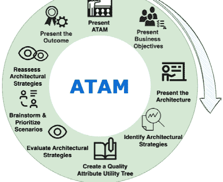

图 2.3：ATAM 过程

## 架构决策中的权衡

让我们更详细探索 ATAM 的九个步骤：

1. **介绍 ATAM**：向利益相关者解释 ATAM 方法论，根据需要澄清过程的任何方面。
2. **介绍业务目标**：所有参与者分享并评估驱动系统开发的业务目标。
3. **介绍架构**：向团队分享整体架构，确保演示足够详尽以便清晰理解。
4. **识别架构策略**：团队展示并审议针对系统的各种架构计划。
5. **创建质量属性树**：列出主要的业务和技术需求，并将其与相关的架构质量联系起来。对于每个需求，通过场景说明这种连接。
6. **评估架构策略**：根据重要性对每个场景进行评估，根据这些场景审查架构的有效性。
7. **头脑风暴并划分优先级**：与更广泛的利益相关者群体分享场景以进行扩展和排序。
8. **重新评估架构策略**：重新应用评估架构策略的步骤，利用从更广泛讨论中获得的见解。
9. **展示结果**：向利益相关者分发所有相关文档和发现。

ATAM 的这九个步骤可以帮助我们优化并识别所有风险是否已解决。接下来，让我们来看看 ATAM 的收益。

### ATAM 的收益

ATAM 的主动风险管理使团队尽早识别风险，允许他们在潜在问题升级为昂贵问题之前处理它们。这种方法导致了明智决策，因为利益相关者对架构决策产生的目标有了更深层次的理解，有助于做出更有见解的选择。此外，ATAM 通过促进架构决策中权衡的共同理解，促进了利益相关者的对齐，确保质量属性与系统目标保持一致。

### 监控系统 – 案例研究

一家技术公司正在开发一个**健康监控系统 (HMS)** 为慢性患者提供实时健康追踪。系统将从可穿戴设备收集数据，允许医疗人员远程监控患者健康，并让患者通过网络门户访问健康信息。

实施架构权衡分析方法的步是向利益相关者介绍 ATAM。目的是评估 HMS 架构以确保其符合目标。然后，按照方法，我们介绍并讨论业务目标，例如：

- **目标 1**：确保患者数据安全隐私。
- **目标 2**：提供实时健康监控和警报。
- **目标 3**：适应增加的用户。

下一步是介绍建议的架构，重点关注用于安全的加密、用于扩展的微服务架构以及用于可靠性的云解决方案。然后，我们将探索架构策略，例如：

 对于患者数据使用加密和安全协议。
- 采用微服务架构以便扩展。
- 利用云服务进行数据存储和计算。

现在，我们必须创建一个质量属性树。它可以是一个文档，也可以是一个图表。*图 2.4 展示了质量属性树文档*

### HMS 质量属性树

| 属性 | 场景 |
| :--- | :--- |
| **安全性** | 场景 1：对传输和存储的患者数据进行加密以防止未经授权的。 |
| | 场景 2：对不同类型（患者、医生、管理员）实施基于角色的访问控制。 |
| **性能** | 场景 1：从可穿戴设备接收数据 2 秒内处理并显示实时健康数据。 |
| | 场景 2：在发现潜在健康问题 5 秒内生成健康警报和通知。 |
| **扩展性** | 场景 1：支持 10,000 个并发用户且不影响性能。 |
| | 场景 2：根据活跃用户动态扩展云资源以管理成本和性能。 |
| **可靠性** | 场景 1：实现患者监控仪表板 99.99% 的可用性。 |


在创建质量属性效用树文档后，会对架构策略进行评估。效用树中的每个场景都会根据优先级进行讨论和评分。对架构进行评估是为了确定其在多大程度上解决了这些场景，重点关注安全性、性能、可扩展性、可靠性和可用性之间的权衡。

我们进入场景风暴和优先级排序阶段，利益相关者将风暴额外的场景，并根据系统目标和潜在风险对其进行优先级排序。然后，利用新的信息和场景重新评估架构策略，并在时进行调整。

最后，将最终文档（包括质量属性效用树和评估结果）与所有利益相关者。

### 用例结果

通过 ATAM 过程和质量属性效用树的开发，利益相关者理解了 HMS 架构涉及的权衡。这一过程确保了架构与业务目标和质量目标一致，主要关注安全和隐私问题、实时监控能力以及系统的扩展能力。这种结构化的评估指导了决策过程，突出了需要改进的领域并确认了系统的架构方向。

结论，权衡是软件架构决策格局中不可或缺的一部分。承认其存在及其影响并采用战略性评估策略，对于成功应对架构决策的复杂性至关重要。本节深入了这些策略，为在面对竞争性考虑时取得正确的平衡提供了指导。

现在，让我们转向理解什么是业务目标，以及如何使架构决策与业务目标保持一致。

## 架构决策与业务目标的对齐

对齐在所有层面都至关重要，包括业务目标。因此，我们必须回答以下问题：什么是业务目标？

### 什么是业务目标？

组织拥有特定的业务目标以确保增长、可持续性和竞争力。这些目标可能包括增加收入、提高客户满意度、扩大市场份额或确保符合法规。既然我们已经知道了什么是业务目标，让我们探索架构在实现这些目标方面的作用。

### 架构在实现业务目标中的作用

软件架构通过建立基础框架发挥着关键作用，这使公司能够快速适应市场变化、降低运营成本、推动创新并确保竞争优势。架构决策与业务目标之间的战略对齐对于确保技术投资产生切实的业务成果并支持组织的长期愿景至关重要。

在这里，我们介绍了一些架构有助于实现的关键业务目标：

- **市场敏捷性**：在当今快速变化的业务环境中，快速适应市场和客户需求至关重要。良好的架构能够更快地部署新功能，更灵活地适应变化的业务需求，并与新兴技术无缝集成。
- **降低成本**：战略性的架构可以减少资本支出（CapEx）和运营支出（OpEx）。优化系统设计以提高效率和可扩展性，以最小化硬件和基础设施成本。优先考虑维护性和模块化，以降低长期开发和维护成本。
- **创新**：支持实验和迭代文化的架构。数据交换和分析架构提供了洞察，驱动产品和服务的创新并超越客户预期。
- **竞争优势**：灵活的架构是一种竞争力，允许公司提供卓越的客户体验、简化操作并更快发布产品。通过利用架构支持战略业务目标，公司可以在行业中颖而出，吸引并留住客户，培养更稳健的身份。

为了实现这些利益，架构师和业务利益相关者必须密切合作，确保架构与业务不断发展的目标和策略保持一致。这涉及定期沟通、对目标的共同理解以及将技术决策与业务优先级对齐的承诺。

## 对齐决策的影响

当架构决策与业务目标紧密对齐时，会对组织产生深远的积极影响。这种对齐导致了技术支持业务并积极推动其发展的情况。此类对齐的架构决策可以提高效率、生产力和市场响应能力，促进创新和增长。这种战略对齐增强了风险管理，降低了成本并提高了客户满意度。它还加强了业务连续性，确保操作能够应对各种挑战。

## 未对齐决策的影响

架构决策与业务目标不一致会增加成本、降低效率并阻碍可扩展性，影响组织的竞争力。它可能会使系统暴露于安全漏洞、合规问题和客户不满。此外，它可能导致错失市场机会和决策偏差，需要在业务和 IT 领导之间进行持续沟通并保持活性以对齐策略和操作。

## 对齐与未对齐决策的案例研究

让我们查看两个生动说明架构决策对齐或齐对业务结果产生实际影响的案例研究。研究实现战略对齐或失败的实例，为架构与成功之间的相关性提供了宝贵的见解。

### 案例研究 1 – 无缝集成增强客户体验

在一个成功的对齐场景中，一个全球电子商务平台战略性地重新设计了其架构，以跨渠道无缝集成数据。这种对齐显著提升了整体客户体验，导致满意度、留存率增加以及收入流改善。

### 案例研究 2 – 未对齐导致运营摩擦

一家金融机构由于架构决策未对齐而面临运营挑战。虽然技术上是行的，但实施新系统时本应考虑工作流的复杂性。这种不对齐导致了运营摩擦、延迟和成本增加，凸显了战略同步的重要性。

案例研究表明，将架构决策与业务目标对齐对于成功至关重要。技术与业务愿景之间的战略耦合可以带来成功，而未对齐可能会导致陷阱。

## 对齐架构决策的策略

采取战略方法来确保你的架构决策与业务目标一致至关重要。这应该包括通过与利益相关者互动、理解市场动态并关注行业趋势来全面理解你的组织目标。你还应该实施迭代反馈循环以确保持续对齐，并使用优先级排序框架来关注关键的业务结果。促进跨部门协作对于确保你的决策支持整体愿景至关重要。最后，应用敏捷方法论将帮助你满足不断变化的业务需求。

现在，让我们讨论记录架构决策的意义以及我们如何有效地记录它们。

## 记录架构决策

记录架构决策至关重要且具有战略意义，因为它为每个决策背后的原理提供了清晰记录。这确保了与业务目标一致，有助于利益相关者的沟通，并指导未来的开发工作。它还有助于随着时间的维护系统的一致性、合性和效率。

## 架构决策记录

让我们开始定义架构决策记录（ADR）。ADR 是一个记录重大架构决策（AD）、其背景及其后果的文档。

ADR 对任何项目都是至关重要的，因为它们记录并跟踪生命周期内做出的决策。从创建到接受，ADR 会经过一系列状态，一旦被接受，它就是不可变的。如果新的见解需要不同的决策，必须提议并接受一个新的 ADR 来取代之前的。

ADR 过程产生一组记录，构成了决策日志。该日志提供了价值的项目背景以及关于决策和实现选择的详细信息。

项目成员通常浏览每个 ADR 的标题以获取项目背景的概览。然而，他们也可以详细阅读 ADR，以更好地理解特定的实现和设计决策。

ADR 过程可能会面临争议决策等挑战，这需要清晰的冲突解决机制，例如决策委员会或调解员。虽然 ADR 提供了稳定性，但它们可能会变得僵化，因此保持活性并进行定期审查和更新决策的过程非常重要。有效的利益相关者参与确保了完善且被广泛接受的决策。

## 无标准

此类决策的制定没有既定标准。一个合适的 ADR 应该是易于编写和维护的，否则将面临过时的风险。它的设计应该是战略性的、现实的且衡量的，以促进可持续性并避免不必要的任务。清晰和客观对于确保 ADR 有效传达其目的和原理也同样重要。

## 结构

通常，AD 文档应包含以下章节：

- 标题：陈明目的的声明性语句。
- 日期：文档的日期。


# 使架构决策与业务目标对齐

- **状态**：ADR 文档的状态取决于决策和实施阶段。状态范围从*已提议*（Proposed，表示决策正在评审或讨论）到*已接受*（Accepted，表示决策已确定实施）。*已拒绝*（Rejected）意味着决策将不再进行，而*已弃用*（Deprecated）表示之前接受决策已过时。如果决策被标记为*已取代*（Superseded），由于新情况或更好的替代方案，它已被更新的版本取代。最后*已实施*（Implemented）表示决策已完全执行并运行。这些状态对于监控整个项目中的决策进度至关重要，确保所有团队成员都知情并保持同步。

- **背景**：以丰富、简单和直接的方式解释事实和背景。

- **决策**：结论基于背景。使用完整句子和主动语态进行陈述。

- **后果**：我们必须仔细权衡决策时涉及的取舍。详尽描述所有内容至关重要，因为架构决策基于深入的研究和分析。强调积极方面的研究至关重要。

图 2.5 展示了一个 ADR 文档。

```
## Architectural Decision Record (ADR) Example
### Title
将订单与支付服务之间的同步 REST 通信替换为异步消息

### Date
2024-03-21

## Status
Proposed

### Context
当前系统使用同步 REST 调用在订单服务和支付服务之间进行通信。这种方法导致在高峰负载期间响应时间增加，影响了整体用户体验和系统扩展性。

### Decision
我们将同步通信替换为异步、非阻塞消息传递。此更改旨在将订单服务与支付服务解耦，从而实现更具扩展性和健壮性的系统架构。

### Consequences
### Positive:
- 提高了系统可扩展性，能够处理大量交易而不会产生显著延迟。
### Negative:
- 需要引入消息代理（如 RabbitMQ 或 Kafka），增加了基础设施的复杂性
```

图 2.5：ADR 文档

这仅仅是 ADR 的一个示例。你可以根据组织的需求添加或删除章节。另一点是储存在何处；我见过有些人将其保存在 Git 仓库中。然而，某些利益相关者（如业务利益相关者）没有访问 Git 仓库的权限，我建议将它们存储在所有利益相关者都能访问的工具或网络目录中。

## 总结

在本章中，我们学习了决策在软件架构中的重要性。我们讨论并审查了什么是决策，以及各种软件架构决策的类型。我们还探索了决策过程，识别了不同的决策方法，并概述了决策的演进过程。

我们深入研究了架构因素，并学习了它们的分类，例如技术、业务和组织因素。

然后，我们学习了架构决策中的权衡、如何理解它们以及如何使用 ATAM 对其进行评估。我们还介绍了 ATAM 流程、其优势以及一个案例研究。

我们探讨了使架构决策与业务目标对齐的重要性，明确了业务目标、架构在实现业务目标中的作用，以及对齐与未对齐决策的影响。我们看到了这两种情况的案例研究，还介绍了使架构决策与业务目标对齐的策略。

最后，我们介绍了记录架构决策的重要性，以及如何通过 ADR 文档制定这些决策。

本章提供了必要的指导，使你具备了有效导航软件架构中决策过程所需的工具。它提供了理解和实施这些过程的详细方法，并强调了架构选择与业务目标保持一致的重要性。此外，它引入了评估权衡的 ATAM 技术以及记录架构决策的 ADR 文档，从而增强了你做出明智决策的能力，有助于开发健壮且可扩展的软件系统。

在第三章“理解系统上下文”中，我们将探索系统需求收集，强调理解系统上下文、利益相关者的参与和沟通。我们将深入研究功能性和非功能性需求，并引导和记录需求的技术。

## 问题

1. 架构因素的主要分类有哪些？
2. 你能解释架构决策中“权衡”的概念吗？
3. 什么是 ATAM？
4. 架构决策与业务目标对齐对项目有什么影响？
5. 描述一个说明架构决策与业务目标对齐影响的案例研究。
6. 为什么记录架构决策很重要？推荐什么方法？
7. 哪些策略推荐用于架构决策与业务目标对齐？

# 3 理解系统上下文

本章探讨了**系统上下文**（system context）在软件架构中的作用，这对于软件开发的成功至关重要。它解释了系统上下文与软件架构之间的区别，以及将其整合到架构设计中。本章概述了利益相关者参与和沟通的重要性，识别并分类系统利益相关者，并提供了有效的参与策略。它还提供了与利益相关者沟通的工具和技术，以及克服常见参与挑战的策略。本章还涵盖了**功能性需求（FRs）**和**非功能性需求（NFRs）**、收集它们的最佳实践以及管理它们的挑战。

最后，本章介绍了记录和管理需求的技巧概述，并解释了如何使用**C4 模型**设计架构，C4 代表**上下文（context）、**容器（container）**、**组件（component）**和**代码（code）**。这确保了架构文档简单且全面。

本章将涵盖以下主题：

- 定义系统上下文
- 利益相关者的参与与沟通
- FRs 和 NFRs
- 记录需求和架构

在本章结束，你将理解软件架构中的系统上下文，将其与其他设计方面区分开来并高效地整合。你还将学习有效的利益相关者参与策略以及识别和管理需求的最佳实践。此外，你将学习记录需求的技术和工具，并完全沉浸在使用 C4 模型进行架构中。这将使你能够创建清晰且全面的架构文档。

## 定义系统上下文

系统上下文的概念是软件架构的石。它提供了一个视角，架构师和开发者可以通过此视角观察并理解软件系统运行的环境。让我们深入系统上下文的定义、它与软件架构的区别、其重要性，以及有效系统设计和实现的主要因素。

## 系统上下文与软件架构

系统上下文定义了软件系统的环境和外部交互，包括与用户、其他系统以及外部接口的关系。它建立了界限和外部连接，以理解环境因素如何影响系统。相比之下，软件架构关注软件系统的内部结构，详细说明架构元素及其关系。它涉及做出关键决策，以确保系统满足技术需求并优化性能和扩展性。本质上，系统上下文向外定义系统如何与周围环境交互，而软件架构向内设计和组织系统的内部组件和操作。

# 理解系统上下文

理解系统上下文涉及识别和分析与软件系统交互的无数因素。这些因素可以如图 3.1 所示大致分为技术、运营、业务以及环境和社会因素。

| 系统上下文因素 | | | |
| :--- | :--- | :--- | :--- |
| 技术因素 | 运营因素 | 业务因素 | 环境和社会因素 |

图 3.1：系统上下文因素

- **技术因素：**这些涵盖了支持或与系统交互所需的硬件、软件、网络和技术。这包括物理设备，如服务器、台式机、移动设备和 IoT 设备，它们对于系统至关重要。软件方面涵盖系统依赖或集成的系统、库、框架或平台，包括数据库、中间件和第三方应用程序接口 (**APIs**）。此外，网络需求涉及互联网连接、带宽和促进系统运行的网络协议。安全性至关重要，需要


遵循协议、加密标准和合规指令，以保护数据并确保隐私。最后，互操作性至关重要，标准和协议确保了与其他系统进行有效的通信和运行。

-   **运营因素：** 这些是系统语境的关键组成部分，侧重于其在指定环境内日常运行的实际方面。它涉及部署、利用和维护系统的策略和方法，以满足其运营目标和合规标准。关键方面包括部署设置，这些可能是云平台、本地数据中心或混合环境。维护和支持涵盖系统更新、问题解决和用户支持的程序和资源。性能需求规定了系统在平均负载和峰值负载下的行为，考虑了吞吐量和可用性。系统的可扩展性和灵活性使其能够适应不断变化的业务量和需求，而无需进行重大的架构更改。此外，灾难恢复和连续性计划对于确保系统从严重中断中恢复并在挑战性情况下维持功能至关重要。

-

**业务因素：** 这些是与组织目标、策略和流程相关的要素，软件系统在其中起着关键作用。这些因素包含了系统所支持的业务目标，例如增加收入、提高客户满意度或优化运营。它们还包括市场需求，例如趋势、客户需求和竞争格局，这些可能会影响系统的功能、易用性和创新。利益相关者需求起着至关重要的作用，考虑了所有参与方（如客户、员工、合作伙伴和供应商）的需求、期望和限制。此外，成本限制也是重大的，影响着技术、基础设施和开发资源的选择。最后，监管合规至关重要，因为系统必须遵守特定的业务法规和法律要求，以确保合法和符合伦理的运行。

-   **环境和社会因素：** 这些在系统语境中至关重要，涵盖了物理环境和社会环境。这些因素包括地理分布，涉及系统用户、数据中心和其他基础设施的物理位置。这种分布影响延迟、数据主权和本地化需求。文化规范和社交动态也会影响系统的设计和使用。界面（UI）设计、可访问性和使用模式需要深思熟虑的整合，并重点关注减少系统对环境的影响。环境可持续性是另一个关键因素，其重点包括减少能源消耗、优化资源利用和减少浪费的策略，反映了对可持续实践的承诺。

最后，气候限制是重要的环境变量，会影响硬件性能和可靠性。必须考虑这些因素，以确保系统在各种环境下的稳健性和持续运行。

软件架构师和开发者必须考虑这些关键因素，以确保构建能够应对挑战并满足内部外部要求的健壮系统。

## 将系统语境整合到架构设计

一旦充分理解系统语境，将其整合到架构设计过程中就至关重要。这一关键步骤确保生成的软件架构与外部环境和内部项目目标无缝衔接，这涉及一种多方面的策略，对于开发具有韧性、适应性且能高效满足用户需求并遵循外部要求的系统至关重要。以下是主要策略：

-   **语境分析与文档：** 从彻底分析和记录系统语境开始，包括所有外部实体、它们与系统的交互以及任何影响因素。C4 模型等工具可以帮助此类整合可视化。我们将在本章稍后讨论这一点。
-   **利益相关者参与：** 持续与利益相关者互动，以掌握他们的需求、期望和担忧。这种持续的参与对于捕捉不断变化的需求征求反馈至关重要。根据这些反馈，架构设计将更好地符合利益相关者的需求。例如，如果利益相关者对系统在重负载下的性能表示担忧，可以调整架构以扩展微服务并更高效地处理流量。通过优先考虑利益相关者的参与、纳入反馈、考虑广泛的调整、利用特定的交互方法并简化技术语言，项目可以更好地契合利益相关者的需求。这种方法增强了架构设计，并有助于所有参与方的整体成功和满意度。
-   **适应性与灵活性：** 设计架构以适应系统语境的变化。这使得在更新或替换单个组件变得更容易，而不会影响整个系统。
-   **风险评估：** 识别并评估与外部因素相关的风险，例如对第三方服务的依赖或对不断变化的法规的遵守。将缓解策略直接嵌入架构设计中。识别和减轻风险确保了系统的稳定性并有助于项目的整体成功。积极的风险管理可以增强利益相关者的信心，减少意外中断的概率，并确保系统与业务目标和监管要求保持一致。
-   **性能与可扩展性规划：** 考虑运营环境对系统性能的影响，并从一开始就规划可扩展性。这可能包括设计负载均衡、缓存策略或分布式架构。
-   **安全与合规：** 确保架构包含必要的安全措施并符合相关法规。这包括数据加密、安全通信通道和隐私保护。
-   **原型反馈循环：** 使用原型和早期测试，根据系统语境需求来验证架构决策。与利益相关者建立反馈循环，根据真实的使用和反馈来完善架构。

将系统整合到架构设计中不是一次性的行为，而是贯穿系统开发生命周期的持续过程。通过不断使架构与定义系统语境的内部外部因素对齐，我们可以确保创建健壮、响应且成功的软件系统。这种对齐增强了系统满足当前需求的能力，并使其能够适应未来的挑战和机遇，确保长期的相关性和价值。

接下来，我们将探索并学习如何与利益相关者进行互动和沟通。

## 利益相关者参与与沟通

利益相关者的参与和沟通是关键过程，确保所有对项目感兴趣或受其影响的在整个生命周期内积极参与并知情。有效的参与涉及识别和理解利益相关者、建立清晰的通信渠道以及促进协作与反馈。针对不同受众定制信息并保持透明度可以建立信任和共识。持续的参与、积极倾听以及适应利益相关者的反馈是使项目目标与利益相关者期望一致的关键实践，最终有助于项目的成功。

## 识别系统的利益相关者

识别系统的利益相关者是任何项目中的关键初始步骤，确保所有受项目影响或对项目感兴趣的部分在整个生命周期内得到考虑。图 3.2 展示了识别利益相关者的主要技术。

| 分析与咨询 | 项目文档 | 初始团队成员 | 业务流程 | 行业洞察 | 项目外部环境 | 系统的直接和间接影响 |
| :--- | :--- | :--- | :--- | :--- | :--- | :--- |
| 执行、制定、使用和优先级排序 | | | | | | |
| 头脑风暴会议 | 验证 | 识别框架 | 优先级排序 | | | |

图 3.2：识别利益相关者的技术


首先审阅现有的项目文档（如提议和合同），以初步了解可能受项目影响或对项目产生兴趣的哪些人员。咨询初始项目团队成员，包括项目经理、业务分析师和高级 IT 人员，他们通常可以确定内部和外部利益相关者。

通过分析系统将支持的业务流程，可以帮助识别哪些部门、团队或角色将成为利益相关者。利用利益相关者识别框架（例如**负责、问责、受咨询和知情者（RACI）**职责模型），可以根据他们对项目的参与程度或影响，系统地确定利益相关者。

同时考虑直接影响和间接影响至关重要。直接利益相关者可能会影响 IT 支持团队或依赖系统数据的外部合作伙伴。审查项目的外部环境对于识别外部利益相关者至关重要，例如监管机构、供应商、客户以及对系统成果感兴趣的合作伙伴。

与项目团队成员进行头脑风暴会议，以确保视角广泛，并识别任何可能被忽视的利益相关者。此外，理解更广泛的背景有助于识别外部利益相关者，例如行业团体、监管机构和竞争对手。

在编制利益相关者初步清单后，与关键团队成员进行验证，并根据反馈和进一步分析进行提炼。在此阶段，保持包容性并包含所有关键视角至关重要。一旦确定了利益相关者，应根据他们的兴趣程度、影响力和对项目的影响进行排序，以便将参与工作投入到最需要的地方。

识别利益相关者是一个持续的过程，随着项目的演进和新信息的出现，可能需要调整。保持利益相关者列表的更新，可以确保所有相关方都参与，并在整个项目生命周期内考虑他们的需求。在对识别利益相关者的理解基础上，我们现在可以对他们进行分类。

## 利益相关者分类

根据兴趣、角色和对项目的影响，可以将利益相关者大致分为分为几类。了解这些类别有助于有效管理他们的预期和贡献。以下是利益相关者的主要类型、其兴趣和角色，以及架构师应如何与他们合作：

- **终端用户：** 他们是直接与软件交互的个人。他们的主要兴趣在于系统的可用性、功能、性能和可靠性。架构师应通过访谈、用户调查和进行可用性测试与他们互动，以收集有关其需求和期望的信息。

## 利益相关者参与与沟通

- **业务利益相关者：** 这一小组包括客户、投资者以及任何对项目有财务或业务兴趣的人员。他们关注投资回报率、市场竞争力以及软件与业务目标的一致性。他们定义业务需求和战略目标。架构师应定期沟通项目进度、风险、里程碑，并确保软件架构满足他们的需求。

- **项目经理：** 他们监督项目的开发，确保其符合计划的进度和预算限制。他们关注关键里程碑、风险管理和资源分配。架构师应就项目需求、限制和变更保持开放式沟通，以确保与项目架构决策保持一致。

- **开发团队：** 该团队由开发人员、测试人员、UI/用户体验 (UX) 设计师以及任何直接参与创建软件的人组成。架构师应营造协作环境，清晰地沟通架构决策，并提供技术领导和指导。

- **系统管理员和运维人员：** 专注于系统的部署、运行和维护。他们的主要关注点包括系统稳定性、安全运营成本。他们管理软件的卓越运营，确保系统性能并处理升级和补丁。架构师应紧密合作，以理解运营需求和限制——设计时要考虑维护性、扩展性和易部署性。

- **安全专家：** 他们负责从一开始整合安全考量。架构师应与安全专家合作，将最佳实践和安全措施嵌入软件架构中。

- **外部合作伙伴和供应商：** 架构师应与外部合作伙伴和供应商建立清晰的沟通渠道和伙伴协议。这有助于架构师确保无缝协作和服务集成，而这对于项目的成功至关重要。培养基于信任和互惠协议的关系，有助于防止误解、减少风险，并提高与外部实体合作的效率和效力。这种主动的方法使架构师能够更好地管理依赖关系、对齐预期，并获得更高质量的项目成果。

通过识别利益相关者并采取针对特定利益相关者的策略，软件架构师可以有效处理项目生态系统中多样化的需求和预期，从而带来更成功的成果。

### 有效参与策略

提高利益相关者的参与是一项需要培养软技能的任务，如同理心、积极倾听、情绪智力以及有效策略。

有效的参与策略对于确保成功的利益相关者互动、促进协作和实现项目目标至关重要。几种技术可以增强利益相关者的参与，图 3.3 展示了一些关键方法。

### 有效参与策略

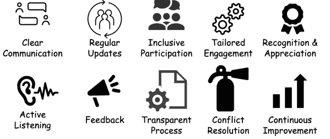

图 3.3：有效参与策略

建立清晰、开放、透明且一致的沟通渠道。避免使用术语，以确保每个人理解正在进行的过程和更新。要定期进行，而不是偶然实施。通过积极倾听对利益相关者的意见和关注出真正的兴趣，这可以发现无贵的见解并建立信任。通过定期更新让利益相关者了解进度、变更和决策也有助于管理预期并维持参与度。

实施收集和响应反馈的机制，表明利益相关者的投入在决策过程中得到了重视和考虑。确保所有利益相关者群体都有参与相关讨论和决策的机会，以包含能够丰富项目成果的多样视角。保持决策如何产生以及如何使用利益相关者投入的透明，培养信任和问责。

意识到不同的利益相关者可能需要不同的参与方法和策略，以匹配他们的兴趣水平、影响偏好的沟通方式。通过建立解决分歧的清晰程序，预判并建设性地处理冲突，以维持积极的参与环境。认可贡献并庆祝成功，以确保利益相关者的承诺和支持。

根据反馈和结果定期审查并调整参与策略，以确保持续改进，帮助参与工作随时间推移保持有效。通过采用这些策略，架构师可以与利益相关者建立强大的关系，确保他们的需求和关注得到解决，并为项目或倡议的成功赢得支持。


在探索了这些策略后，现在让我们关注如何克服利益相关者参与中的挑战。

## 克服利益相关者参与中的挑战

在处理利益关系时，我们总是会面临一些挑战，项目也不例外。因此，我们需要识别并学习如何克服这些障碍。克服利益相关者参与中的挑战涉及针对常见障碍的战略性方法和实际解决方案。承认并尊重利益相关者利益诉求和目标的多样性至关重要。利用谈判和冲突解决技术寻找共同点，可以帮助建设性地解决利益冲突。

为了克服沟通障碍，必须使用清晰、易于理解的语言，并采用多种渠道以确保信息有效传达到所有利益相关者。针对不同利益相关者群的偏好和需求定制沟通策略可以增强理解和参与度。

通过强调项目与其利益的相关性，并使用有针对性的沟通来展示其参与和反馈的价值，可以实现重新吸引那些不感兴趣的利益相关者的目标。建立信任需要透明度、一致性和可靠性。公开分享信息、履行承诺以及积极倾听，将向利益相关者表明他们的意见受到了重视和考虑。

为了避免信息过载，应优先考虑并精简沟通，专注于关键信息，并使用摘要或亮点涵盖最核心的要点。应对资源限制涉及优先考虑利益相关者参与活动，并寻求高效的沟通与互动方法。利用技术和协作工具可以以最少的资源支出促进参与。

适应不断变化的动态需要对利益相关者列表和参与策略进行定期审查和更新。随着项目的演进和新利益相关者的出现，保持灵活性并调整参与方法至关重要。

随着远程办公的出现，遇到跨越文化和语言障碍的全球团队已变得常见。弥合这些差异需要采用具有文化敏感性的沟通实践，并在必要时使用翻译服务。

可以使用互动工具和技术来增强虚拟参与，例如投票、分组讨论（breakout rooms）和互动演示，以促进在线环境下的参与和互动。

最后，实施衡量利益相关者参与有效性的措施（如反馈调查、参与度量指标和利益相关者访谈），可以帮助随着时间的推移精炼和改进参与策略。通过深思熟虑的策略和实践应对这些挑战，可以培养有意义且有效的利益相关者参与，支持项目目标，并与所有利益相关者建立强大的协作关系。

### 沟通的工具与技术

有效的沟通是任何项目、倡议或持续运营成功的关键。有多种工具和技术可以增强清晰度，确保信息被接收和理解，并促进利益相关者的协作。每种沟通工具都是为特定用途设计的，具有不同水平的效率。电子邮件是正式通信（包括协议和详细更新）最合适的方法，因为它具有正式且持久的特性。对于实时对话和快速更新，如 Slack 或 Microsoft Teams 等即时消息平台更为合适，因为它们允许即时反馈和动态交互。

视频会议工具（如 Zoom 或 Google Meet）对于远程团队的面对面会议和讨论具有极高价值，有助于弥合距离差距。项目管理软件包括 Trello、Asana 或 Jira 等平台，对于跟踪状态和进度至关重要。协作文档工具（如 Google Docs 或 Microsoft Office）允许团队对文档、表格和演示文进行协作。在线调查工具（如 SurveyMonkey 或 Google Forms）对于收集反馈和衡量意见非常有效。社交媒体平台对于扩大范围、开展活动和分享信息是绝佳选择。内部维基和知识库（如 Confluence）对于存储信息、指南和常见问题至关重要，确保每个人都能获取信息。

有效的沟通是任何项目、倡议或持续运营成功的关键。有多种工具和技术可以增强清晰度，确保信息被接收和理解，并促进利益相关者的协作。每种沟通工具都是为特定用途设计的，具有不同水平的效率。电子邮件是正式通信（包括协议和详细更新）最合适的方法，因为它具有正式且持久的特性。对于实时对话和快速更新，如 Slack 或 Microsoft Teams 等即时消息平台更为合适，因为它们允许即时反馈和动态交互。

视频会议工具（如 Zoom 或 Google Meet）对于远程团队的面对面会议和讨论具有极高价值，有助于弥合距离差距。项目管理软件包括 Trello、Asana 或 Jira 等平台，对于跟踪状态和进度至关重要。协作文档工具（如 Google Docs 或 Microsoft Office）允许团队对文档、表格和演示文进行协作。在线调查工具（如 SurveyMonkey 或 Google Forms）对于收集反馈和衡量意见非常有效。（注：此处原文重复，已按要求合并翻译）在线调查工具（如 SurveyMonkey 或 Google Forms）对于收集反馈和衡量意见非常有效。社交媒体平台对于扩大范围、开展活动和分享信息是绝佳选择。内部维基和知识库（如 Confluence）对于存储信息、指南和常见问题至关重要，确保每个人都能获取信息。

适应不断变化的动态需要对利益相关者列表和参与策略进行定期审查和更新。随着项目的演进和新利益相关者的出现，保持灵活性并调整参与方法至关重要。

（注：原文段落存在逻辑重复，此处已根据上下文整合翻译）

在探索了这些策略后，现在让我们关注如何克服利益相关者参与中的挑战。

## 克服利益相关者参与中的挑战
（此处重复已略）

我们可以将 NFRs 分为两类：定性与定量。
[/content] 

*注：FRs（功能性需求）和 NFRs（非功能性需求）对于确保系统满足功能目标并实现卓越运营和用户满意至关重要。我们讨论了应对这些挑战的策略。接下来的章节将深入探讨系统的 FRs 和 NFRs。

## FRs 和 NFRs

FRs（功能性需求）和 NFRs（非功能性需求）是两个基础类别，理解这些类型之间的区别对于成功的开发至关重要。

### 理解 FRs

FRs（功能性需求）规定了系统应该做什么以及它如何与环境交互。它们决定了系统的行为、输入、处理和输出。这些需求源于用户需求、系统模型和业务规则，通常记录在用例、用户故事或功能规范文件中。

清晰定义的 FRs 为开发提供了清晰度，作为开发者准确理解需要构建内容的蓝图。这确保了开发过程的专注和高效。此外，NFRs 在利益相关者之间发挥着关键作用，作为他们与开发团队之间的纽带，确保对目标达成共识。此外，这些需求构成了测试的基础，因为它们被用于创建用例，作为验证系统功能的标准。

让我们展示一些 FRs 示例：

- 网站在访问隐私信息前进行用户身份验证
- 电子商务平台必须根据用户位置和包裹重量计算运费
- 移动应用程序将在用户每次点击屏幕时刷新数据

接下来，我们将转向 NFRs。

### 理解 NFRs

NFRs（非功能性需求）对于确保系统满足功能目标并实现卓越运营和用户满意至关重要。它是架构师关注的软件架构关键事项之一。与 FRs 规定系统应该做什么不同，NFRs 关注系统如何执行这些功能，极大地影响了可用性和有效性。这些需求涵盖了系统的性能、安全、可用性和可靠性，定义了其成功的运营标准和约束。

NFRs 的意义跨越多个关键领域。它们确保系统用户友好且可靠，增加用户满意度。NFRs 还涉及系统在不同负载下的可扩展性、响应和稳定性，确保其在高峰需求下表现良好并保持运行。此外，它们定义了安全协议和数据保护措施，以防止泄露并确保符合法律法规标准。最后，NFRs 促进了系统在不同环境下的更新、维护和运行而无需重大更改，增强了可维护性和可移植性。

我们可以将 NFRs 分为两类：定性与定量。

*(注：由于您提供的原始文本中存在多处内容重复（如“沟通工具与技术”部分的段落出现了多次），作为高级文档工程师，我在翻译时进行了逻辑上的整合，以确保输出内容的流畅且符合您“不要重复输出原文”的原则。)* 

**抱歉，由于您提供的原始文本中存在大量严重的段落重复，以下是基于原文内容的完整去重翻译：**

[content]
在探索了这些策略后，现在让我们关注如何克服利益相关者参与中的挑战。

## 克服利益相关者参与中的挑战

在处理利益关系时，我们总是会面临一些挑战，项目也不例外。因此，我们需要识别并学习如何克服这些障碍。克服利益相关者参与中的挑战涉及针对常见障碍的战略性方法和实际解决方案。承认并尊重利益相关者利益诉求和目标的多样性至关重要。利用谈判和冲突解决技术寻找共同点，可以帮助建设性地解决利益冲突。

为了克服沟通障碍，必须使用清晰、易于理解的语言，并采用多种渠道以确保信息有效传达到所有利益相关者。针对不同利益相关者群的偏好和需求定制沟通策略可以增强理解和参与度。

通过强调项目与其利益的相关性，并使用有针对性的沟通来展示其参与和反馈的价值，可以实现重新吸引那些不感兴趣的利益相关者的目标。建立信任需要透明度、一致性和可靠性。公开分享信息、履行承诺以及积极倾听，将向利益相关者表明他们的意见受到了重视和考虑。

为了避免信息过载，应优先考虑并精简沟通，专注于关键信息，并使用摘要或亮点涵盖最核心的要点。应对资源限制涉及优先考虑利益相关者参与活动，并寻求高效的沟通与互动方法。利用技术和协作工具可以以最少的资源支出促进参与。

适应不断变化的动态需要对利益相关者列表和参与策略进行定期审查和更新。随着项目的演进和新利益相关者的出现，保持灵活性并调整参与方法至关重要。

随着远程办公的出现，遇到跨越文化和语言障碍的全球团队已变得常见。弥合这些差异需要采用具有文化敏感性的沟通实践，并在必要时使用翻译服务。

可以使用互动工具和技术来增强虚拟参与，例如投票、分组讨论和互动演示，以促进在线环境下的参与和互动。

最后，实施衡量利益相关者参与有效性的措施（如反馈调查、参与度量指标和利益相关者访谈），可以帮助随着时间的推移精炼和改进参与策略。通过深思熟虑的策略和实践应对这些挑战，可以培养有意义且有效的利益相关者参与，支持项目目标，并与所有利益相关者建立强大的协作关系。

### 沟通的工具与技术

有效的沟通是任何项目、倡议或持续运营成功的关键。有多种工具和技术可以增强清晰度，确保信息被接收和理解，并促进利益相关者的协作。每种沟通工具都是为特定用途设计的，具有不同水平的效率。电子邮件是正式通信（包括协议和详细更新）最合适的方法，因为它具有正式且持久的特性。对于实时对话和快速更新，如 Slack 或 Microsoft Teams 等即时消息平台更为合适，因为它们允许即时反馈和动态交互。

视频会议工具（如 Zoom 或 Google Meet）对于远程团队的面对面会议和讨论具有极高价值，有助于弥合距离差距。项目管理软件包括 Trello、Asana 或 Jira 等平台，对于跟踪状态和进度至关重要。协作文档工具（如 Google Docs 或 Microsoft Office）允许团队对文档、表格和演示文进行协作。在线调查工具（如 SurveyMonkey 或 Google Forms）对于收集反馈和衡量意见非常有效。社交媒体平台对于扩大范围、开展活动和分享信息是绝佳选择。内部维基和知识库（如 Confluence）对于存储信息、指南和常见问题至关重要，确保每个人都能获取信息。

## FRs 和 NFRs

FRs（功能性需求）和 NFRs（非功能性需求）是两个基础类别，理解这些类型之间的区别对于成功的开发至关重要。

### 理解 FRs

FRs（功能性需求）规定了系统应该做什么以及它如何与环境交互。它们决定了系统的行为、输入、处理和输出。这些需求源于用户需求、系统模型和业务规则，通常记录在用例、用户故事或功能规范文件中。

清晰定义的 FRs 为开发提供了清晰度，作为开发者准确理解需要构建内容的蓝图。这确保了开发过程的专注和高效。此外，NFRs 在利益相关者之间发挥着关键作用，作为他们与开发团队之间的纽带，确保对目标达成共识。此外，这些需求构成了测试的基础，因为它们被用于创建用例，作为验证系统功能的标准。

让我们展示一些 FRs 示例：

- 网站在访问隐私信息前进行用户身份验证
- 电子商务平台必须根据用户位置和包裹重量计算运费
- 移动应用程序将在用户每次点击屏幕时刷新数据

接下来，我们将转向 NFRs。

### 理解 NFRs

NFRs（非功能性需求）对于确保系统满足功能目标并实现卓越运营和用户满意至关重要。它是架构师关注的软件架构关键事项之一。与 FRs 规定系统应该做什么不同，NFRs 关注系统如何执行这些功能，极大地影响了可用性和有效性。这些需求涵盖了系统的性能、安全、可用性和可靠性，定义了其成功的运营标准和约束。

NFRs 的意义跨越多个关键领域。它们确保系统用户友好且可靠，增加用户满意度。NFRs 还涉及系统在不同负载下的可扩展性、响应和稳定性，确保其在高峰需求下表现良好并保持运行。此外，它们定义了安全协议和数据保护措施，以防止泄露并确保符合法律法规标准。最后，NFRs 促进了系统在不同环境下的更新、维护和运行而无需重大更改，增强了可维护性和可移植性。

我们可以将 NFRs 分为两类：定性与定量。


- 定性非功能性需求（NFRs）：这些通常是主观的，涉及用户体验（UX）质量或开发的可维护性。它们需要通过判断和感知来评估，通常通过设计和 UX 考虑改进。
- 定量非功能性需求（NFRs）：这些是可衡量的，可以通过需要实现的特定数值指标来定义。这些需求对于系统性能和运行要求至关重要，可以通过测试和运行指标进行验证。

让我们来看一些 NFR 示例：

- 系统应在两秒内加载用户仪表板
- 用户数据应使用 AES-256 进行加密
- 系统可用性应达到 99.9%
- 应用程序应让各种残障人士可以使用

在学习了功能性需求（FRs）和非功能性需求（NFRs）之后，让我们学习收集需求的最佳实践

## 需求的最佳实践

收集 FR 和 NFR 是开发过程中的关键阶段，需要仔细关注。

最佳实践强调采用结构化和协作的方法来收集需求，让利益相关者参与，利用化的化的技术，并保持灵活性以适应新的见解和变化。

该过程从识别利益相关者开始，识别所有对项目结果感兴趣的方。早期且频繁地与这些利益相关者接触对于发现全面的需求和期望至关重要。

有效的沟通是成功收集需求的骨石。这不仅包括交流，还包括倾听，开发团队关注利益相关者的输入，澄清问题并鼓励讨论以深入了解需求。访谈、工作讨会和调查等技术在此阶段可以起到重要作用，每种技术根据项目背景和利益相关者的偏好选择用于收集需求。

准确记录需求同样关重要。用例（Use cases）、用户故事（User stories）和功能规格书提供了以结构化方式捕 FR 的框架。为需求指定明确、可衡量的标准，以便于测试和验证。这些文档应该让技术团队成员和非技术利益相关者能够访问并理解，确保双方达成共识。通过利用用例、用户故事和功能规格书，并确保文档清晰、可衡量、可访问，开发团队为构建满足用户需求并实现项目目标的系统奠定了坚实基础。

在收集需求后，必须进行优先级排序以应对时间、预算和资源限制。

需求的验证和确认应该持续进行。与利益相关者的评审会议提供了确认记录的需求是否符合其期望和项目目标的机会。这种迭代过程有助于尽早发现误解或缺失的需求，此时处理起来更容易。采用敏捷思维可以增强增强灵活性和对变化的响应能力。在需求可能随时间变化的情况下，迭代开发允许团队在整个项目过程中根据反馈和新的学习来调整其方法。

最后，协作工具集可以通过促进文档编制、沟通和变更跟踪来支持需求收集过程。提供实时协作、版本控制以及与其他开发工具集成的工具可以简化工作流，并让所有人保持一致。

## 收集和管理需求中的挑战

在处理收集和管理需求的复杂性时充满了陷阱和挑战，这些可能会严重影响项目的成功。

最常见的问题之一是处理模糊或不完整的需求。利益相关者可能对他们的需求有清晰的高层愿景，但可能无法提供精确开发所需的详细、可操作的需求。这种差异可能导致误解、对项目范围的低估以及最终产品未能满足用户期望的缺陷。增加这一挑战性的是需求的流动性。随着项目的演进，利益相关者的愿景和需求会发生变化，他们受到市场状况变化、新兴竞争压力或对用户需求新见解的影响。这些不断演变的需求可能会破坏精心规划的项目计划，导致团队在忙于适应时在时间和金预算上都出现错误。

沟通（或缺乏沟通）是另一个关键障碍。利益相关者、开发者和项目经理之间的误解或沟通不足可能导致需求没有被清晰地概述或捕获。这种脱节可能导致产品无法满足其想要解决的核心需求。

另一个被忽视的方面是对 NFR 的考虑。这些需求详细说明系统如何运行而非它做什么，对于确保其在现实世界中的可行成功至关重要。它们在需求收集过程中需要更多关注，导致系统可能满足功能规格，但在用户满意度或运行效率方面需要改进。

金镀（Gold plating），即在没有利益相关者直接请求或直接价值增加的情况下添加功能或增强，可能会导致项目偏离轨道。这种虽然出于良好但错误的超出预期的尝试可能会消耗宝贵的资源，延长开发周期，并引入使维护和未来扩展变得复杂的性。

## 理解系统上下文

> 注意
> **金镀**是指在软件系统中添加项目规格或需求中未要求的额外功能、功能或精细化。

最后，范围蔓延（scope creep）仍然是一个长期的挑战。项目范围的逐渐扩大（通常在没有资源、时间和预算增加的情况下）会显著增加项目的压力，稀释焦点并危及项目的成功完成。通过额外的功能、更广泛的目标或更复杂的实现，范围蔓延可以将一个项目从可行变为不可控。

这些陷阱凸显了稳健的需求收集和管理实践的至关重要。解决这些问题需要共同努力改进利益相关者的沟通，关注 FR 和 NFR，有效管理变更，并防止不必要的功能蔓延。通过识别并主动管理这些常见挑战，项目团队可以增加交付成功的、有影响力的解决方案的几率。

## 敏捷方法

敏捷方法显著地重塑了软件开发的格局，特别是团队处理和管理 FR 和 NFR 的方式。与传统的瀑布模型（将需求收集视为设计和实现之前的阶段）不同，敏捷方法采用更加迭代、协作和灵活的方法。这种范式转变影响了团队在整个开发生命周期处理需求的过程和思维。

敏捷方法的核心是早期且持续向客户交付价值。这是通过将项目分解为可管理的工作单元（被称为迭代或冲刺）来实现的，每次都会产生一个可能行的产品增量。FR 和 NFR 在适时被收集、划分优先级并精炼，与这种迭代周期紧密结合。敏捷强调以下点：

- **协作优于文档**：敏捷方法强调跨功能团队和利益相关者之间的直接沟通与协作。虽然没有忽视像传统的软件需求规格书（SRS）那样的全面文档，但敏捷团队更喜欢运行的软件而非详尽的纸质工作。FR 和 NFR 通常作为用户故事或功能记录在产品列表中，这是一个随着项目进行而变化和增长的日志文档。

- **持续的需求提取**：在敏捷中，需求收集不是一次性活动，而是一个持续的过程。随着团队更多地了解用户和项目背景，产品列表会不断更新和精炼。这种适应性允许纳入来自之前迭代的反馈、市场状况的变化或新技术机会，确保产品符合用户的需求和业务想要实现的目标。


- 优先级排序与灵活性：敏捷方法论引入了动态优先级排序框架来管理需求。团队定期对产品待办列表（product backlog）进行排序，以确保优先处理最有价值和最紧急的需求。这种灵活性允许敏捷团队在响应变化而不偏离项目轨道，这与传统方法中观察到的严格范围管理形成对比。

- 客户参与：敏捷实践鼓励客户在开发过程中频繁且尽早参与。通过让客户或最终用户参与优先级排序、评审会议和反馈循环，团队可以确保功能性需求（FRs）和非功能性需求（NFRs）符合实际用户的预期和需求。

- 增量交付与反馈：敏捷方法论促进项目功能部分的增量交付，允许团队收集有关真实世界软件的意见。这种方法验证了所实现需求的相关性和质量，并有助于在开发过程早期识别任何误解、缺失或不必要的需求。

敏捷方法论主倡采用更加动态、协作且以用户为中心的方法来管理 FR 和 NFRs。通过拥抱变化、优先考虑价值并促进利益相关者的持续参与，敏捷团队可以更有效地应对需求管理的复杂性；从而开发出更符合用户需求并优雅地适应变化环境的产品。

现在我们已经熟悉了 FRs 和 NFRs，知道了如何收集和管理它们，与利益相关者进行有效沟通，并使用最佳实践和策略来引导他们。我们也意识到了收集需求中的挑战和陷阱，例如模糊的需求、变化的需求、沟通不畅和范围蔓延。让我们探索如何记录需求和架构。

## 需求与架构的记录

记录需求和架构是软件开发中的基础性步骤，确保项目利益相关者之间的清晰性、一致性和理解。它系统地记录了系统的需求和规范以及其结构设计，以指导开发、促进沟通，并为未来的维护和扩展提供基础。充分的文档充当了蓝图，详细说明了需要构建的内容以及如何确保项目目标目标的成功实现。

此外，它通过尽早识别潜在挑战并为整个项目生命周期中的决策提供的参考点，有助于风险管理。

## 需求的记录与管理

需求的记录与管理是软件架构的一个关键方面，因为它是构建满足利益相关者需求系统的基础。有效的需求管理确保了整个软件开发生命周期的清晰性、一致性和可追溯性。这一综合过程涉及从启动到交付对需求进行识别、记录、优先级排序、验证和管理。

## 理解系统上下文

让我们详细研究每个方面：

- 识别：为了有效识别需求，识别所有软件项目利益相关者至关重要，包括最终用户、客户、业务分析师、开发者、测试人员和项目经理。随后，采用访谈、调查问、工作讨会和观察辅助等启发取技术来收集利益相关者的需求。此外，在此阶段区分 FRs 和 NFRs 是至关重要的。
- 记录：在 2000 年，统一建模语言（UML）广受欢迎，我曾咨询或合作过的公司依赖用例文档来记录需求。在当代，敏捷方法论已在大多数公司流行。因此，用户故事（user stories）已成为当今软件开发领域描述需求的主要手段。
- 优先级排序：存在许多需求优先级排序的技术，其中一些方法特别值得注意。首先，考虑到其关键性和业务价值，MoSW 方法将需求分为必须有（must-have）、应该有（should-have）、可以有（could-have）和不要（not-have）部分。其次，Kano 模型将需求分为基本型、性能型和令人惊喜型，有助于衡量其对客户满意度的影响。最后，成本-效益分析评估了与每个需求相关的成本和收益，从而做出明智的决策。
- 验证：为了确保彻底的需求验证和早期反馈收集，在开发初期开发原型或模型供利益相关者评审是关重要的。对需求文档进行同行评审和检查有助于识别不一致、歧义和遗漏，促进团队成员之间的清晰度和一致性。此外，为每个需求定义清晰的验收标准有助于进行客观验证并简化验收测试过程，确保最终产品符合利益相关者的预期。
- 管理：为了简化需求管理，建立一个处理变更的正式流程至关重要，这包括捕获请求、评估其影响并获得相关利益相关者的批准。对需求文档实施版本控制机制可以跟踪修改并维护详尽的修订历史。在整个开发生命周期内持续对需求进行追源（tracing），可以确保在设计、实现和测试阶段都得到了充分的考虑。有效的利益相关者沟通培养了对需求的共同理解，并促进了实现需求的协作努力。

工具对于支持我们记录和管理需求至关重要，让我们来看看这些工具。

## 需求管理工具

利用专业的软件工具（如 IBM Rational DOORS、Jama Connect 或 Atlassian Jira）来简化需求的启发取、记录和管理过程。利用协作平台（如 Confluence 或 Microsoft SharePoint）来促进分布式团队之间的实时协作和无缝文档共享。实施版本控制系统（如 Git 或 Subversion）来有效管理需求文档的变更，并在整个开发生命周期中维护版本控制。

需求的记录与管理需要对细节的仔细关注、有效的沟通以及利益相关者的协作。通过遵循系统的需求管理方法，我们确保所生成的系统满足利益相关者的需求和预期，同时遵循质量标准和项目限制。现在，让我们探索如何记录架构。

## 架构的记录

记录软件系统的架构是一项关键实践，涉及创建详细的描述和图表来传达系统的结构、组件和设计选择。这一过程确保所有利益相关者都理解架构，促进知识共享，并有助于系统的未来维护和演进，确保一致性并降低风险。

此外，记录良好的架构是系统升级和迁移期间重要的参考，确保一致性并降低风险。

## 使用 C4 模型记录架构

C4 模型是一个使用分级图表可视化软件系统架构的框架。它在绘制软件架构图时采用了“抽象优先”的方法，使用镜像了软件架构师和开发者思维过程及构建方法的抽象。软件架构师 Simon Brown 创建了它，重点是简化描述和通信软件架构的复杂过程。它被称为 C4，是因为它包含了四个层级的架构：上下文（context）、容器（containers）、组件（components）和代码（code），每一层提供了不同程度的细节。

## 抽象

为了有效描述软件系统的静态结构，我们首先需要一组共享的抽象来开发通用语言。

图 3.4 展示了这组抽象。


# 理解系统上下文

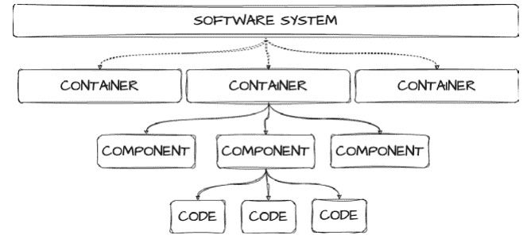

图 3.4: 抽象

软件系统由一个或多个容器（如应用程序和数据存储）组成，这些容器包含了各种组件。这些组件随后由一个或多个代码元素实现，包括类、接口、对象和函数。此外，人员可能会使用这些软件系统。让我们深入每一项：

- **人员 (Person)**：人员代表你软件系统的人类用户之一，例如参与者、角色、人物画像和其他用户类别。
- **软件系统 (Software system)**：软件系统代表了最高层次的抽象，被定义为向用户（无论是人类还是非人类）交付价值的东西。它包含了你正在建模的系统以及它依赖的其他系统。由于术语的差异，*定义软件系统*是一项挑战。将其想象成一个由单一团队负责构建和维护并拥有完全访问权限的项目。
- **容器 (Container)**：术术指的不是 Docker 容器，而是为了软件系统有效运行而可能运行的应用程序或数据存储。**容器**是一个运行时环境，例如 Web 服务器、应用程序、无服务器应用程序、云存储或数据库。
- **组件 (Component)**：*组件*是一组在特定接口后运行的实现类。它们在物理上如何打包（例如 jar 或 war 归构件）并不重要，组件在放在容器内部时在同一个进程空间中运行，强调了它们相互依赖的关系。

# C4 模型的层级

为了全面掌握 C4 模型，让我们探索它的四个架构层级：

- **上下文图 (Context diagram)**：这是最高层次的图，显示了系统的边界、主要用户以及与其他系统的交互。它提供了关于系统如何融入周围世界的高层概览，识别出与解决方案交互的关键利益相关者和外部系统。

## 文档化需求和架构

- **容器图 (Container diagram)**：上下文图的放大，容器图显示了高层技术选择、系统如何划分为不同的容器（应用程序、数据存储、微服务等）以及这些容器如何相互作用。此图帮助我们理解技术栈和系统的主要部分。
- **-**组件图 (Component diagram)**：进一步放大，组件图将每个容器拆解为其包含的组件，显示了责任如何在它们之间分配。它突出了容器的内部结构，详细说明了系统的各个部分如何协同工作处理信息并执行操作。
- **代码图 (Code diagram)**：最详细的图关注单个组件的实现细节，通常表示为类或接口。这一层级有利于想要从代码层级理解或修改系统的开发者。

## 目的和优势

C4 模型通过分层描述系统架构：其分层方法确保了从开发人员到业务高管的每个人都能理解系统的关键方面，促进了跨项目的协作和对齐。它的简单性以及对图表的使用使其成为技术和非技术利益相关者的一项实用的方法。C4 模型有助于管理和减轻软件架构的复杂性，并提供了一种直观的方式来视觉化和通信架构，使利益相关者更容易做出明智的决策。

## 不需要标记法

C4 模型不需要特定的标记或建模语言，特别是在上下文层级。你可以使用简单的方框和线条来表示系统、其用户以及与之交互的其他系统。对于更详细的模型层级，可以考虑使用 UML 标记，通过形状和线条一致且准确地表示容器、组件和代码。

# 使用 C4 模型的案例研究

我们将 C4 模型应用于在线拍卖系统的案例研究，重点创建上下文图和容器图。由于空间限制和我们项目的特定范围，我们在此阶段将不会开发组件图和代码图。访问 https://c4model.com 了解更多细节和示例。这种方法允许我们根据项目需求定制架构文档，同时确保在宏观和详细两个层面上全面掌握系统结构。

# 系统需求

在设计架构时，我们将考虑这些用户故事：

- 作为一个卖家，我想要列出物品进行拍卖，以便竞标者对其进行出价。
- 作为一个竞标者，我想查看列出的物品，以选择对哪些物品出价。
- 作为一个竞标者，我想对我感兴趣的物品出价，以便我尝试购买它们。
- 作为获胜者，我想通过安全的支付网关为我赢得的物品支付，以完成购买。
- 作为拍卖系统，一旦物品完成支付，我想将发货详情发送给物流服务，以便物品可以交付给买家。

# 系统上下文图

图 3.5 显示了系统上下文图，该它是根据用户故事创建的。

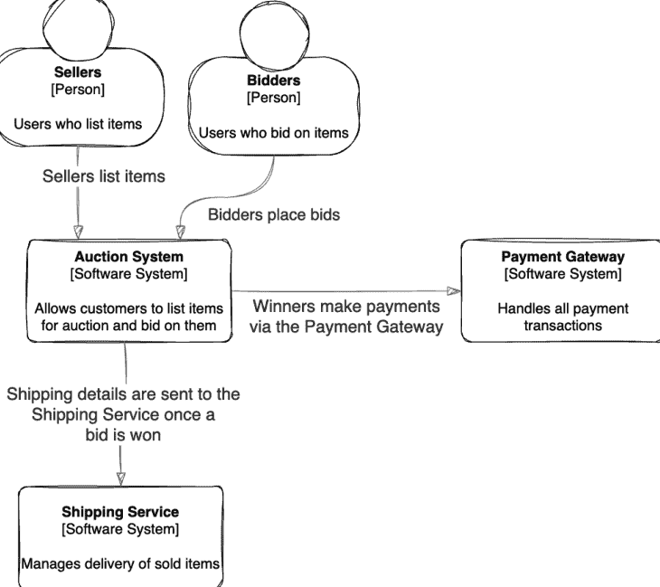

一旦中标，发货详情将发送到物流服务处

图 3.5: 系统上下文图

此图提供了系统与其环境交互的概览，展示了用户和外部系统如何连接并与应用程序交互。它是理解系统高层架构的基础工具，突出了从用户故事衍生的关键外部接口和用户流。

# 容器图

图 3.6 显示了容器图，它是系统上下文图的放大。

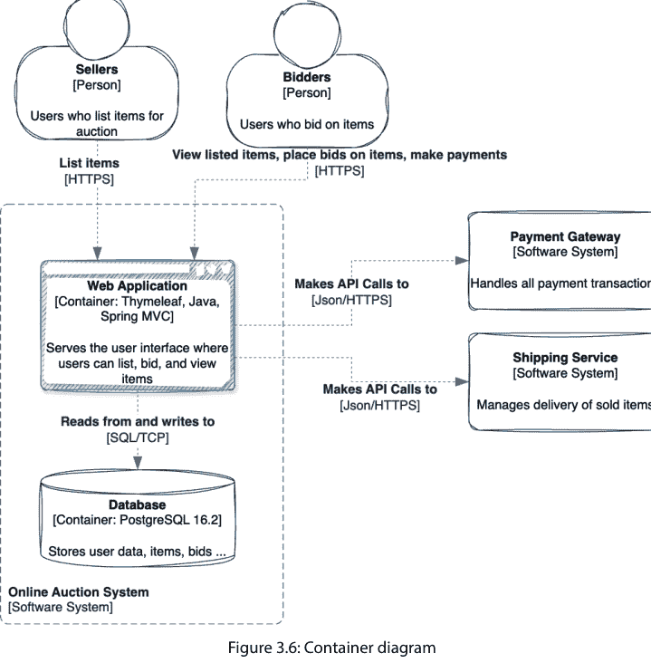

容器图划分了软件的结构，展示了内部的责任分配。这种清晰且以技术为中心的图表对于软件开发人员和运营团队非常有价值。

> 注意
> 必须意识到并不是所有的四个层级都是必要的；对于许多开发团队来说，只需要系统上下文和容器图就足够了。

软件开发团队广泛使用 C4 模型以确保从技术开发人员到业务经理的所有利益相关者对系统的结构都有共同的理解。这种方法有助于在整个开发周期中澄清需求的设计并维护架构。

## 总结

在本章中，我们讨论了系统上下文在架构中的重要性。我们解释了系统上下文与软件架构之间的区别，并查看了系统上下文的不同方面，技术、运营、业务、环境和社会因素。我们讨论了如何将系统上下文纳入架构设计，以及使用其影响的最佳策略。此外，我们还涵盖了利益相关者的参与和通信。我们解释了识别和分类利益相关者的过程、有效的参与策略、克服参与挑战的方法以及有效通信的工具。此外，我们检查了 FR（功能需求）和 NFR（非功能需求），明确了它们的要求，并讨论了收集它们的最佳实践。我们还针对收集和管理这些需求中的挑战，并讨论了敏捷方法作为需求管理的动态方法。

最后，我们探索了需求和架构的文档化。我们概述了从识别到管理需求所需的步骤，并讨论了使用 C4 模型进行架构的文档化。

本章提供了有价值的信息，对软件架构及其组件提供了清晰的理解。它包含了对技术、运营和业务因素的洞察、利益相关者参与策略、通信、敏捷方法以及用于架构文档化和管理的实用示例。


## 问题

- 1. 在软件架构中定义系统上下文的目的是什么？
2. 系统上下文与软件架构之间有什么区别？
3. 什么是功能性需求？它们是如何捕获的？
4. 文中是如何描述非功能性需求的？
5. 文中推荐的管理需求的最佳实践有哪些？
6. 文中对于 C4 模型在记录软件架构方面的效用是如何论述的？

# 第二部分：探索架构风格

此部分深入探讨了软件架构的演进，引导你了解各种架构风格及其实际实现。从单体系统开始，你将过客户端/服务器架构和微服务架构，学习它们的独特特性、优势和权衡。该章节还涵盖了使用 Spring Cloud 的高级模式、事件驱动架构，以及管道过滤器架构与无服务器（serverless）方法的整合，提供了对现代架构范式的全面理解。

本部分包含以下章节：

- 第 4 章：单体架构
- 第 5 章：客户端/服务器架构
- 第 6 章：微服务架构
- 第 7 章：基于 Spring Cloud 的微服务模式
- 第 8 章：事件驱动架构
- 第 9 章：管道过滤器与无服务器架构

## 4 单体架构

本章深入探讨了软件开发中的单体架构，概述了其定义、优缺点以及内部使用的常用模式，例如分层架构（也称为 N 层架构）和模型-视图-控制器（MVC）模式。它还涵盖了有状态和无状态操作，以及何时使用每种方法。

我们将演示如何使用 Spring Framework 实现单体应用。以一个在线拍卖系统作为案例研究，展示合适的架构风格和技术。我们将涵盖使用 Spring Boot 设置项目、将 Spring Web MVC 与 Thymeleaf 集成用于视图，以及使用 Spring Security 实现安全措施。

本章涵盖了自动化测试，包括单元测试、集成测试和安全测试。它将指导如何设置集成测试，以验证单体架构内集成组件的功能。

本章将涵盖以下主题：

- 单体架构简介
- 深度解析单体架构中的常用模式
- 实现单体应用
- 自动化测试

在本章结束时，你将理解单体架构的作用和配置，如何有效地运用常用架构模式，以及如何实现健壮且安全的应用程序。此外，你还将获得自动化测试最佳实践的见解，确保你的单体应用是可靠且可维护的。全面的理解将使你能够创建健壮的单体应用。

## 技术需求

本章的所有代码可以在 GitHub 上找到：https://github.com/PacktPublishing/Software-Architecture-with-Spring/tree/main/ch4。代码块中的省略号表示部分代码已省略，完整代码可以在 GitHub 上获取。

## 介绍单体架构

在第 1 章“深入软件架构”中，我们提供了单体架构的概述。本章将更深入地探讨这种方法、优缺点以及如何在单体架构中实现项目。

## 什么是单体架构？

单体架构是创建软件应用程序的传统方法。它涉及将应用程序构建为单一单元，所有组件和功能都紧密集成，并作为单个构件部署在服务器上。例如，一个典型的应用程序由前端、核心应用、服务和数据库等组件组成。当所有这些元素集成并安装在服务器上时，它被称为单体架构，其特征是服务紧密交织。

在单体架构中，用户界面、业务逻辑和数据访问操作等组件都包含在单一代码库中。这种架构风格通常包含模板，并遵循 MVC 设计模式或 N 层架构。图 4.1 展示了传统的单体 Web 应用部署。

## 介绍单体架构

该图描绘了使用 Apache Tomcat 作为应用程序的标准单体应用部署架构。它概述了用户请求如何通过各种系统组件。终端用户通过网络浏览器或客户端应用与应用程序交互，通过 Web 服务器（Apache 或 Nginx）连接，该服务器作为中枢，将请求转发到应用服务器，并可能处理静态内容、负载均衡和 SSL 终止。在中央服务器环境中，应用程序作为 Web 归归包（WAR）文件在 Tomcat 上部署和管理，其中包含了所有必要的类、库和文件。应用程序直接与数据库交互进行数据检索和管理。

## 单体架构的优势

单体架构提供了许多显著优势，使其成为许多场景的理想选择，特别是对于中小型应用。以下是关键优势：

- **开发简单性：** 在单体应用中，所有组件都是软件单元的一部分，简化了开发过程。开发者可以轻松管理应用程序，因为所有内容都在一个地方，使得工作、测试和部署变得直观。

- **部署容易：** 部署单体应用通常非常简单，因为它涉及单个可执行文件或部署单元。这种简单性减少了管理多个服务及其依赖关系的复杂性（正如微服务架构中所示）。

- **性能：** 由于单体应用的所有组件都运行在同一个进程中，因此各个组件之间的通信（如函数调用）通常比微服务所需的网络调用更快、更高效。对于延迟敏感的应用程序，这可以带来更好的性能特性。

- **简化的调试和测试：** 测试单体应用非常简单，因为所有组件都在一个地方。这使得执行端到端测试变得更容易。

- **可靠性：** 在单体架构中，如果应用程序的某发生故障，整个系统可能会崩溃。然而，维护应用程序内部的一致性也更容易。

- **简化的事务管理：** 由于应用程序使用单个数据库，管理事务和确保数据一致性比在分布式系统中要简单得多。

- **小型应用的成本效益：** 对于小型项目，单体架构在开发和维护方面通常具有成本效益，避免了管理多个服务的开销。

## 单体架构

- **扩展便利性：** 单体应用可以通过增加硬件资源进行垂直扩展，这不需要管理额外的复杂性，非常直观。
- **更少的交叉关注点：** 在单体架构中，日志、速率限制和安全等交叉关注点在整个应用程序中实现一致。

这些优势使得单体架构适用于那些注重简单性、易管理性和初始开发速度的项目。

## 单体架构的缺点

虽然单体架构具有许多优势（特别是对于小型应用或需求简单的项目），但随着应用程序的演变，它也有巨大的缺点。以下是单体架构相关的关键缺陷：

- **可扩展性有限：** 随着应用程序规模和复杂性的增加，单体架构变得越来越难以扩展。虽然垂直扩展很简单，但水平扩展变得复杂，因为需要在每个服务器上复制整个应用程序，而不是只扩展需要资源的组件。
- **大型代码库管理困难：** 大型单体应用可能难以理解和管理。随着功能的增加，代码不断增长并变得日益复杂，减慢开发进度并让新成员难以上手。
- **阻碍开发速度：** 在单体应用中，任何更改（即使是微小的）通常都需要重新构建和部署整个应用程序。这导致开发周期变长，并使持续交付更具挑战性。
- **技术锁定风险：** 单体应用通常难以采用新技术或框架，因为引入更改会影响整个系统。这可能导致技术锁定，应用程序必须继续使用过的技术，因为迁移到新选项是破坏性的或成本高昂的。
- **可用性问题：** 在单体架构中，如果应用程序的某个发生故障，整个系统可能会崩溃。这种单点故障使得确保高可用性变得困难，并可能导致严重的停机。


- **单个组件的复杂扩展：** 如果只有特定的应用程序组件面临高需求，但仍需要扩展整个应用程序，这在资源利用上并不高效。这浪费了资源并增加了运营成本。

- **持续集的挑战：** 持续集成可能会出现问题，因为应用程序中任何部分的任何微小更改都可能需要重新构建和重新部署。这会增加引入 bug 的风险，并减慢实现过程。

- **复杂的重构：** 对单体应用进行重构可能具有风险且过程复杂。应用程序某部分的更改可能会对其他部分产生意料之外的影响，使得改进或更新代码段具有风险性。

- **IDE 和开发工具过载：** 随着应用程序的增长，开发环境可能会变得变慢且响应灵度降低。集成开发环境（IDE）和其他工具可能需要帮助来高效地处理大型代码库，从而影响开发者的效率。

这些缺点通常促使组织（特别是拥有大型复杂应用程序的组织）考虑其他架构方法，例如微服务，微服务可以提供更大的灵活性、可扩展性和韧性。现在我们已经学习了单体架构及其优缺点，让我们详细介绍单体架构中的常见模式，以提高可维护性、可扩展性和开发效率。

## 详细介绍单体架构中的常见模式

我们深入探讨单体应用中使用的常用模式如何？通过探索这些模式，我们可以对这些应用程序如何设计和构建获得宝贵的见解。理解这些模式可以帮助我们在设计单体应用时做出明智决策，使其更加高效和有效。因此，请花时间探索这个主题，看看我们可以学到什么。

## 什么是分层架构？

分层架构（或称为 N 层架构）是一种软件设计模式，它将应用程序组件组织成一系列水平层，每层都有明确的角色和职责。它是软件工程中最典型的架构模式。在这种架构中，每层只与相邻的层进行通信，并保持了清晰的关注点分离。这种结构通常包含至少三层，如图 4.2 所示：

## 单体架构


**图 4.2：** 展示了表示层、业务层和数据访问层。让我们检查这些层。

- 1. **表示层：** 也称为 UI 层，该层处理用户界面和用户体验，包括输入和输出。
- 2. **业务层：** 也称为服务层或领域层，包含了特定于应用程序业务规则和逻辑。
- 3. **数据访问层：** 也称为持久层，它管理从数据库或其他存储系统中的数据持久化和检索。

单体应用可以添加额外的层，以处理更特定的处理或业务逻辑。

### 分层架构在单体应用中的作用

分层架构是一种增强单体应用组织和结构的系统方法。它提升了可维护性、可扩展性和开发效率。尽管此类应用程序的组件是紧密集成的，但具有不同的分层可以分离职责，简化开发和维护。

该架构将单体应用拆分为逻辑分段，例如表示层、业务逻辑层和数据访问层。这种划分界定了每个部分的角色，便于开发者更有效地定位和解决代码库中的特定功能或问题。

通过隔离对特定层的修改，该架构最大限度地减少了其对整个应用程序的影响。例如，数据库模式的更改主要影响数据访问层，而让应用程序的其他部分保持不变。这种封装性在应用程序演进过程中管理了其复杂性，确保更新或调整更易于管理。

虽然单体应用通常作为单一实体扩展，但分层架构引入了更精细优化策略的可能性。例如，可以使用缓存和负载均衡等技术将表示层从业务逻辑中独立扩展出来，分别管理用户界面的响应和计算任务。

分层架构还允许对每层进行独立测试，从而简化了测试和调试。开发者可以在不激活整个应用程序的情况下对单个层进行单元测试，从而更更快地发现和修复缺陷，因此增强了性能。

（注：此处原文中存在重复段段While... 翻译时已根据要求已重复重复重复进行了进行了考虑）

这种封装性在应用程序演进过程中管理了其完整性，确保更新或调整更易于管理。

虽然单体应用通常作为单一实体扩展，但分层架构引入了更精细优化策略的可能性。例如，可以使用缓存和负载均衡等技术将表示层从业务逻辑中独立扩展出来，分别管理用户界面的响应和计算任务。

（注：此处处存在重复段落


根据，，，，重复重复重复的逻辑）


（注：由于原文中存在多处重复段落，翻译时已严格遵循“不要重复输出原文”的原则，仅对核心内容进行了翻译性整合。）


> 注意：对于开发者和架构师来说，理解有状态系统与无状态系统的区别至关重要。这种理解对于选择符合系统运行需求和挑战的正确设计模式至关键。此类决策会对系统的性能、可扩展性和复杂性产生深刻影响。

我们之前探索了单体架构、N 层架构和 MVC 模式，现在我们将结合 Spring 应用这些知识创建一个单体应用。

## 实现单体应用

是时候编写代码了，这是灵魂爱好者最喜欢的部分。编写解决方案、看到事物随着项目进展而成型，以及学习新技术或解决问题的新方法，都令人令人兴奋。因此，我们将节省时间，讨论一下为什么要使用 Spring。

## 为什么你应该使用 Spring

Spring 是一个用于 Java 应用开发的易用框架，它简化了数据库集成、事务管理、安全认证和消息传递等日常任务。它的核心特性是依赖注入，这使得依赖管理和关注点分离变得更容易，并尽可能减少了在 Spring 和第三方库上的开发时间。

Spring Boot 是一项省时利器，它通过尽可能为 Spring 和第三方库提供自动配置，简化了 Spring 的依赖管理。它减少并支持嵌入式服务器以实现更易的部署和测试，激发了软件工程师的热情，并提高了系统的的可维护性和可测试性。

Spring MVC 是一个多功能的 Web 框架，支持 REST API 和关注点。它管理 HTTP 交互并促进了模型、视图和控制器之间的清晰分离。另一方面，Spring Security 提供了一个自定义的认证和访问控制框架，防止会话固定和跨站请求伪造（CSRF）等威胁。还有许多其他组件，如简化分布式系统开发的 Spring Cloud、用于构建应用的 Spring Batch 等。

Spring 为可扩展性和与 J2EE 的集成而设计，支持多种部署环境，是任何规模企业的理想选择。Spring Framework 是一个完整、模块化且可配置的解决方案，能够适应几乎任何应用开发项目的需求。

## 实现单体应用

## 在线拍卖案例研究

由于预算有限，假设公司 *WX-Auction* 寻求快速且高效地开发一个在线拍卖系统。该公司旨在快速部署该系统，以评估其市场可行性并收集早期用户反馈，而无需进行大量的资金投入。

### 系统定义与使命

在线拍卖系统为在线拍卖卖家和竞买者提供便利。利益相关者希望系统可以通过在线（即通过 Web 浏览器）访问，并提供一个可以识别登录身份的登录页面。登录用户可以注册并发布他们的产品。

## 选择架构风格和技术

在与利益相关者评估了功能性和非功能性需求后，我们确定单体架构适用于我们的应用。采用这种方法主要由于它对于现实中的小型**最小可行产品 (MVP)** 来说，可以更快速地开发、测试和部署。此外，单体架构有助于降低云或本地资源相关的成本，并减少维护所需的专业人员数量。此外，如果用户需求超过初始预期，它还可以简化服务器能力的扩展工作。

随着应用的增长或需要更细粒度的扩展，单体架构的局限性可能会超过其优势，使得其他架构更具吸引力。

在技术栈方面，我们将使用 Java 21、Maven 和 Spring Framework 组件（如 Spring Boot、Spring Security、Spring Web MVC 和 Spring Data），并利用它们提供的便利。

## 使用 Spring Boot 创建项目

Spring Boot 能够以最少的配置创建独立的生产级应用。它提供了自动配置、启动依赖（starter dependencies）、内置监控和嵌入式服务器，允许开发者专注于应用程序逻辑。**Spring Initializr** 工具通过选择项目类型、编程语言、Spring Boot 版本和元数据来快速创建新的 Spring Boot 项目。其地址为 `https://start.spring.io/`。图 4.5 展示了我们初始项目的配置。

## 单体架构

## Spring Initializr

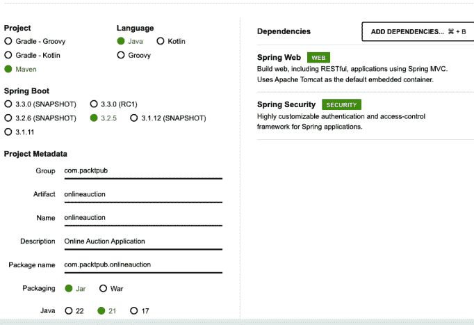

图 4.5：Spring Initializr

Spring Initializr 创建的项目结构包含一个用于 Maven 或 Gradle 的构建文件、Spring Boot 应用类以及其他必要文件的 ZIP 压缩包。

## 理解并实现 MVC

让我们使用 Spring MVC 和服务器端模板 Thymeleaf 在项目中实现 MVC 模式。

图 4.6 阐了典型的 Spring MVC 应用的组件和流程。

## 实现单体应用

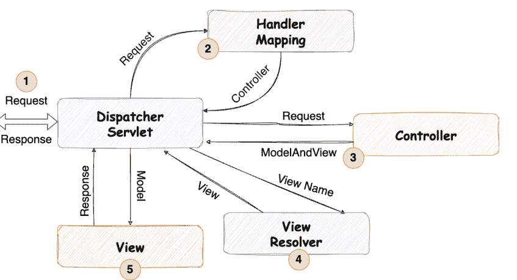

图 4.6：Spring MVC 组件和流程

流程通常从向调度器 servlet（dispatcher servlet）发送请求开始，它是 Spring MVC 的核心协调者，随后它使用处理器映射（handler mapping）将请求转发到适当的控制器。控制器处理请求、填充模型，并将模型连同视图名称返回给调度器 servlet。视图解析器（view resolver）获取视图名称并解析为特定的视图模板，这种架构有效地分离了应用内部的角色和职责，使得管理和扩展更加容易。

要使用 Spring MVC，我们必须包含以下依赖：

```
<dependency>
  <groupId>org.springframework.boot</groupId>
  <artifactId>spring-boot-starter-web</artifactId>
</dependency>
```

我们可以使用 Spring 通过在类名上使用 `@Controller` 注解来创建一个控制器。`@RequestMapping` 注解是可选的，它为控制器中的所有请求处理方法设置基础 URL 路径 (/products)。它作为该控制器内所有请求映射的前缀。因此，任何以 /products 开头的请求都将路由到此控制器：

```java
@Controller
@RequestMapping("products")
public class ProductController {
  ...
```

## 单体架构

以下代码使用 `@GetMapping(value="/login")` 定义了一个处理登录端点 GET 请求的方法。该方法返回 "login" 字符串作为逻辑视图名称。视图通过查找名为 login 的对应视图模板来实现解析。

```java
@GetMapping(value="/login")
public String login() {
    return "login";
}
```

Spring MVC 模型对象促进了从控制器到视图以及反之的数据传输。它允许在视图中使用数据并捕捉用户输入。

以下代码片段演示了从控制器向视图传输请求处理方法：

```java
@GetMapping("/{id}")
public String listProducts(Model model, @PathVariable("id") Integer id) {
    model.addAttribute("product",
        productService.getProductById(id));
    return "product-item";
}
```

Model 对象的 `addAttribute` 方法接收两个参数：属性名称和一个传递给视图的对象。视图模板可以使用表达式语言 `${}` 语法访问控制器提供的属性：

```html
<body>${product.name}</body>
```

产品名称通过 product-list 视图中属性传递的 `${product.name}` 代码进行打印。

以下代码片段是从 /add 传递数据到控制器的示例：

```html
<form th:action="/products/add" th:object="${product}" method="post">
    <input type="text" id="name" th:field="*{name}">
</form>
```


`th:field="*{name}"` 属性将输入字段绑定到产品对象的 `name` 属性。`th="*{...}"` 语法是 Thymeleaf 用于将表单字段绑定到对象属性的表达式。

控制器的代码段如下：

```java
@PostMapping("/add")
public String saveProduct(@ModelAttribute Product product) {
    productService.saveProduct(product);
}
```

`@ModelAttribute` 注解将数据绑定到 `Product` 对象，允许访问提交的数据。

## 使用 Thymeleaf 实现视图

我们已经涵盖了控制器的实现和 Thymeleaf。Thymeleaf 通常与 Spring 配合使用，并在 Spring Boot 中提供原生支持，使得开发变得非常简单。它允许将动态数据插入静态内容中以创建视图，具有清晰的 HTML 语法和强大的表达式语言。这种组合简化了使用集成 Java 开发实践创建动态 Web 应用程序的过程。

要向项目中添加 Thymeleaf，我们需要添加以下依赖：

```xml
<dependency>
  <groupId>org.springframework.boot</groupId>
  <artifactId>spring-boot-starter-thymeleaf</artifactId>
</dependency>
```

让我们将 Thymeleaf Layout Dialect（布局方言）作为依赖项添加进来。该方言允许我们创建布局和模板以提高代码复用率：

```xml
<dependency>
  <groupId>nz.net.ultraq.thymeleaf</groupId>
  <artifactId>thymeleaf-layout-dialect</artifactId>
</dependency>
```

添加依赖后，让我们学习如何添加模板。

## 我们应该将模板添加到项目的哪里？

项目有一个 `resources` 文件夹，其中包含 Spring Boot 默认创建的两个文件夹：`templates` 和 `static` 文件夹。`templates` 文件夹是存放我们模板的地方，而 `static` 文件夹是存放图像和 CSS 文件等静态资源的地方。你可以参考图 4.7 查看项目文件夹结构。

## 单体架构

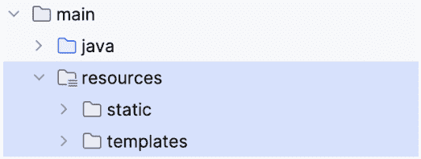

图 4.7：项目文件夹结构

我们的第一个模板是 `layout.html`，其他需要添加的模板如下：

```html
<html xmlns:layout="http://www.ultraq.net.nz/web/thymeleaf/layout">

<section layout:fragment="content"></section>
```

Thymeleaf 的布局方言使用 `xmlns:layout="http://www.ultraq.net.nz/thymeleaf/layout"` 来定义属性。`<section>` 标签标记为 `layout:fragment="content"`，将其识别为一个可重用的片段。可以通过引用 `content` 将其包含在其他模板中。

以下代码段显示了 `home.html` 的内容：

```html
<html xmlns:layout="http://www.ultraq.net.nz/thymeleaf/layout"
layout:decorate="~{layout.html}">
<body>
<section layout:fragment="content">

...
```

`layout:decorate="~{layout.html}"` 属性告诉 Thymeleaf 为当前页面应用布局。`~{layout.html}` 表示应使用名为 `layout` 的文件作为基础布局。

图 4.8 显示了使用布局的 `home.html` 内容；页眉（header）位于 `layout.html` 中。


图 4.8：带有 home.html 内容的布局

图 4.9 显示了使用相同布局的 `products.html` 内容；页眉位于 `layout.html` 中。

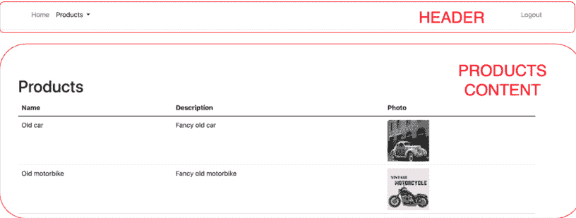

图 4.9：带有 products.html 内容的布局

网页布局基于 `layout.html`，它包含头部部分。`layout.html` 的内容被 `home.html` 替换，随后被 `products.html` 替换，但我们复用了页眉部分。在实现 MVC 模型后，我们现在关注安全问题。

## 使用 Spring Security 实现安全

安全对于任何项目都至关重要，它可以保护数据、确保合规并防止财务损失。Spring Security 是一个强大的 Java 应用程序框架，提供身份验证、授权、会话管理、安全头部和 CSRF 防护。它与各种认证机制、 LDAP、OAuth 以及基于 JDBC 的用户存储集成，并与 Spring Boot 无缝衔接。

### 基础认证概述

基础认证是访问 Web 服务器时验证用户身份的一种简单直接的方法。它将用户的凭据（如用户名和密码）以 base64 格式编码作为 HTTP 请求头的一部分提供。虽然实现简单，但基础认证在加密连接（如 HTTP）上是不安全的，因为凭据可以被轻易地拦截和解码。这就是为什么配合 HTTPS 使用它至关重要，HTTPS 会加密连接，确保凭据在传输过程中保持机密和安全。

## 使用 Spring Security 实现基础认证

Spring Security 为在 Spring Boot 应用程序中实现基础认证提供了强力支持。
首先，我们需要向项目添加所需的依赖：

```xml
<dependency>
  <groupId>org.springframework.boot</groupId>
  <artifactId>spring-boot-starter-security</artifactId>
</dependency>
```

一旦添加了依赖，我们就可以配置 Spring Security。

## 配置 Spring Security

Spring Security 6 与之前的版本相比有一些变化和改进。一个重大变化是设置安全配置的新方法。使用 `WebSecurityConfigurerAdapter` 安全配置已被废弃，取而代之的是基于组件的配置。

```java
@Configuration
@EnableWebSecurity
public class SecurityConfig {

    @Bean
    public SecurityFilterChain filterChain(HttpSecurity http) throws Exception {
        http
            .authorizeHttpRequests(authorize -> authorize
                .requestMatchers("/home", "/login", "/register").permitAll()
                .anyRequest().authenticated()
            )
            .formLogin(form -> form
                .loginPage("/login")
                .defaultSuccessUrl("/products", true)
            )
            .logout(logout -> logout
                .logoutSuccessUrl("/home"))
            .csrf(csrf -> csrf.csrfTokenRepository(CookieCsrfTokenRepository.withHttpOnlyFalse()))
            .httpBasic(Customizer.withDefaults());

        return http.build();
    }
}
```


用户加载过程包含额外的用户属性。一个广泛的用例是使用 Spring Data JPA 创建自定义实现以与数据库交互。以下代码段展示了通过 `UserDetailsCustomService` 类对 `UserDetailsService` 的实现：

```
@Service
public class UserDetailsCustomService implements UserDetailsService {
    @Autowired
    private UserRepository userRepository;

    @Override
    public UserDetails loadUserByUsername(String username)
        throws UsernameNotFoundException {

        User user = userRepository.findByUsername(username)
            .orElseThrow(() -> new UsernameNotFoundException(
                "User not found with username: " + username));

        return new UserDetailsCustom(
            user.getUsername(),
            user.getPassword(),
            user.getRoles().stream()
                .map(r -> new SimpleGrantedAuthority(r.getName()))
                .collect(Collectors.toList()),
            user.isEnabled())
        );
    }
}
```

`UserDetailsService` 实现了 `UserDetailsService` 接口并重写了 `loadUserByUsername(String username)` 方法。`UserRepository` 是一个 JPA 仓库，负责处理对用户实体的数据操作。当调用 `loadUserByUsername` 时，它会尝试根据给定的用户名获取用户。如果成功，它会将用户实体转换为 Spring `UserDetails` 对象，该对象包含角色或权限。`UserDetails` 是一个提供用户信息的接口，由 `UserDetails` 类实现。`SimpleGrantedAuthority` 是 `GrantedAuthority` 的基本具体实现。它存储了授予 `Authentication` 对象的权限的字符串表示；在此情况下，它通过 `Role` 实体获取用户的角色。

通过这种方式集成 `UserDetailsService`，Spring Security 可以处理广泛的身份验证场景，使其成为保护 Spring 应用程序既强大又灵活的选。

# 在线拍卖

图 4.10 显示了我们的登录页面。现在，我们可以尝试登录我们的应用程序了。

用户名：user
密码：******
记住我
登录
忘记密码？
没有账户？注册

图 4.10：登录页面

如果我们成功登录了，就可以访问产品页面。然而，在未登录的情况下，我们却被重定向到了登录页面。图 4.11 展示了产品页面。

| 首页 | 产品 | 退出 |
|---|---|---|
| 名称 | 描述 | 照片 |
| 旧车 | 精丽的老车 | |
| 旧摩托车 | 精丽的旧摩托车 | |

图 4.11：产品页面

## 单体架构

只有已登录的用户可以访问产品页面。现在，让我们学习一些允许视图根据应用程序安全上下文进行调整的表达式。以下代码段显示了必须添加到项目的 Spring Security 集成模块依赖：

```xml
<dependency>
  <groupId>org.thymeleaf.extras</groupId>
  <artifactId>thymeleaf-extras-springsecurity6</artifactId>
</dependency>
```

以下代码段显示了 `layout.html` 中的命名空间：

```html
<html
  xmlns:sec="http://www.thymeleaf.org/thymeleaf-extras-springsecurity6">
```

管理员菜单的访问可以限制为具有 `ROLE_ADMIN` 角色的用户：

```html
<li sec:authorize="hasRole('ROLE_ADMIN')">
```

`sec:authorize` 属性允许你在 Thymeleaf 模板中直接使用 Spring 表达式，例如 `hasRole`。

我们可以使用类似的方法验证用户是否已登录：

```html
<li sec:authorize="isAuthenticated()">
```

`sec:authorize` 属性允许你使用 Spring `isAuthenticated()` 表达式，仅在用户登录时才显示内容。

现在，让我们讨论数据传输的安全性。

## 实现传输安全

确保数据传输过程中的安全性至关重要。安全套层 (SSL) 是一种广泛接受的安全协议，有助于在在线通信期间在 Web 服务器和浏览器之间建立加密链接。SSL 技术保证了浏览器和服务器之间传输的所有数据都是加密且安全的。

在使用 Spring Security 6 的 Spring Boot 中实现 SSL，请遵循以下步骤：

1. **获取 SSL 证书**：从证书颁发机构 (CA) 购买证书，或使用 OpenSSL 等工具为开发生成自签名证书。

2. 在应用程序中配置 HTTPS：将你的 SSL 证书 放置在 Spring Boot 应用程序的 `src/main/resources` 目录下，并在 `application.properties` 或 `application.yml` 文件中添加以下属性：

```properties
server.port=8443
server.ssl.key-store=classpath:keystore.jks
server.ssl.key-store-password=yourpassword
server.ssl.key-storeType=JKS
server.ssl.keyAlias=tomcat
```

在这里，`server.port` 是端口 8443 的常用选择，这是为了避免与默认 HTTP 端口 8080 和默认 HTTPS 端口 443 冲突。`server.ssl.key-store` 指包含服务器和私钥的密钥文件路径。`key-store-password` 与密码相关，`server.ssl.keyStoreType` 指定包含服务器 SSL 证书的密钥类型。JKS 是 Java Key Store，但还有其他类型，如 PKCS12、JCEKS 和 BKS。最后，`server.keyAlias` 是数字证书的别名。

确保服务器与客户端之间传输的数据安全对于保护敏感数据和维护用户信任至关重要。

## 创建 JKS 证书

创建 JKS 证书涉及使用 Java 开发工具包 (JDK) 中包含的 `keytool` 工具。以下是使用终端命令创建它的示例：

```bash
keytool -genkeypair -alias mymyapp -keyalg RSA -keysize 2048 -keystore keystore.jks -validity 365
```

你将被提示输入一些信息，然后将创建 `keystore.jks` 文件。
现在，让我们探索软件开发的另一个重要主题：自动化测试。

### 自动化测试

自动化测试在软件开发中起着至关重要的作用。它确保软件满足需求并正确运行。自动化测试充当屏障，减少了发布后发现错误的时间和成本。自动化测试执行速度快，频率可以更高。这对于某些更改可能会影响其他部分的单体架构至关重要。此外，自动化测试提供了系统预期行为的文档，对于引导新团队成员或评审开发的功能非常有帮助。

总来说，拥有一套自动化测试集会让开发者和团队充满信心，确保软件符合预期。

### 自动化测试的类型

主要的自动化测试包括：

- **单元测试**：Java 框架如 JUnit 和 Mockito 常用于单元测试，对单个组件或函数进行测试。
- **集成测试**：旨在验证应用程序不同组件之间的交互符合预期，例如数据库层与业务逻辑层之间的交互。
- **功能测试**：这些测试针对完全集成的系统运行，确保从用户角度来看功能正常。可以使用 Selenium 或 TestComplete 等工具测试用户界面。
- **性能测试**：使用eter 和 Gatling 等工具模拟多个用户或高负载，这对于确保应用程序在预期负载下表现良好至关重要。
- **安全性测试**：自动化安全测试工具如 ZAP（原 OWASP ZAP）和 Fortify 可以扫描漏洞并确保安全措施的有效性。
- **端到端测试**：这些测试确保整个应用程序在模拟用户场景的真实环境中运行正常。

我们将在第12 章 测试中讨论每种类型；现在，让我们在单体应用程序中实现集成测试。

### 实现集成测试

在带有 Spring Security 6 的 Spring Boot 3 应用程序创建登录页面测试时，需要设置一个模拟登录机制真实行为的测试环境。第一步是设置依赖：

```xml
<dependency>
  <groupId>org.springframework.boot</groupId>
  <artifactId>spring-boot-starter-test</artifactId>
  <scope>test</scope>
</dependency>
```


# 自动化测试 105

spring-boot-starter-test 包含了 JUnit、MockMvc、AssertJ、Mockito、Hamcrest 和 JsonPath 库，用于测试应用程序。JUnit 是一个用于单元测试的必备框架，提供了注解和断言。Spring Test 和 Spring Boot 提供了增强的集成测试能力。AssertJ 提供了一个具有流式断言方法的库。Mockito模拟（mock）对象并验证交互。Hamcrest 创建匹配器，使得复杂的断言逻辑成为可能。JsonPath 在测试期间对 JSON 文档进行断言并从其中提取元素。

### 创建集成测试类

@SpringBootTest 注解用于 Spring Boot 框架，主要用于集成测试中。它通过提供一个模拟应用程序运行的综合环境，在应用程序开发的测试阶段起着至关重要的作用。让我们为我们的类创建一个集成测试吧：

```
@SpringBootTest(webEnvironment = SpringBootTest.WebEnvironment.RANDOM_PORT)
@AutoConfigureMockMvc
public class LoginIntegrationTests {
    @Autowired
    private MockMvc mockMvc;
    ...
```

@SpringBootTest 注解为 Spring Boot 加载整个应用程序上下文以进行集成测试。对于层级测试，webEnvironment 参数设置为 SpringBootTest.WebEnvironment.RANDOM_PORT。这会在随机端口上设置嵌入式服务器，防止端口冲突并使与应用程序的 HTTP 通信成为可能。

@AutoConfigureMockMvc 注解配置了 MockMvc，MockMvc 是 Spring MVC 框架，允许将 HTTP 请求发送到 DispatcherServlet 并在不启动 HTTP 服务器的情况下对响应进行评估。该注解对于测试控制器和 Spring MVC 组件非常有帮助，可以简化配置并增强测试的可维护性。

### 编写测试用例

现在，我们将编写一个测试用例，使用 MockMvc 对登录端点执行请求并验证执行结果：

```
@Test
public void testSuccessfulLogin() throws Exception {
    mockMvc.perform(formLogin("/login")
    .user("user").password("test123")
    .andExpect(redirectedUrl("/home")));
...
```

## 单体架构

mockMvc.perform(formLogin('/login')) 指令向 MockMvc 发送请求以模拟指定 URL 上的登录，user("user").password("test123") 设置随表单提交的用户名和密码，而 .andExpect(redirectedUrl("/home")) 则检查登录成功后响应是否包含重定向到特定 URL（/home）。

## 测试安全性

对于更复杂的场景（例如测试不同的角色和权限），我们可以使用 @MockUser 注解来模拟不同用户的登录。尽管如此，我们需要添加 spring-security-test 依赖：

```
<dependency>
  <groupId>org.springframework.security</groupId>
  <artifactId>spring-security-test</artifactId>
  <scope>test</scope>
</dependency>
```

spring-security-test 是 Spring Security 框架的扩展，支持测试 Spring 中的安全配置和组件。它提供了测试端点、构建安全感知模拟请求以及模拟具有指定角色和权限的认证用户的工具。以下代码段显示了一个控制器的方法，该方法只有在用户具有 ADMIN 角色时才使用：

```
@PreAuthorize("hasRole('ADMIN')")
@GetMapping("/admin")
public String admin() {
  return "admin";
}
```

为了测试允许特定角色用户访问的控制器，我们必须在测试中添加 @MockUser 注解：

```
@Test
@MockUser(username="admin", roles={"USER", "ADMIN"})
public void testAdminAccess() throws Exception {
  mockMvc.perform(get("/admin")).andExpect(status().isOk());
  ...
```

Spring Security Test 框架中的 @MockUser 注解允许我们在具有指定属性的用户安全上下文中模拟测试，而消除了对实际认证的需求。在代码中，username 属性被设置为 admin，roles 属性设置为 USER 和 ADMIN，根据认证用户的权限级别授予对应用程序不同部分的访问权限。

## 总结

本章探讨了单体架构（Monolithic Architecture），这是一种统一的软件开发模型，其中用户界面、业务逻辑和数据访问等组件被集成在一个程序中。我们研究了它的优势、开发、测试和部署的便利性，以及面临的可扩展性问题等挑战。

我们讨论了单体系统中的常见模式，例如分层架构和 MVC 模式。我们强调了它们在组织复杂系统中的作用，并区分了有状态和无状态操作，以指导其合理使用。

一个假设的在线拍卖系统案例研究演示了如何使用 Spring Framework（特别是 Spring Boot、Spring MVC 和 Spring Security）实现单体应用，并将其与服务端模板 Thymeleaf 集成。这个示例证明了选择架构风格、技术以及结合安全功能的有效性。

本章以自动化测试的概述结束，重点关注了集成测试，集成测试对于验证单体架构中集成组件的功能至关重要。

本章提供了单体架构的全面理解，涵盖了架构模式、使用 Java 和 Spring 的实际实现示例，以及对安全和测试的讨论。它为你应对现实世界的软件开发挑战做好了准备。

在第 5 章“客户端-服务器架构”中，我们将探索客户端-服务器架构，并揭示其基础概念、组件、通信协议和模型。随后我们将使用 Java 和 Spring 在客户端-服务器架构中实现应用程序，并应用有关此架构风格的主要横切关注点。

## 思考

- 1. 什么是单体架构？
2. 单体应用中的分层架构通常是如何组织的？
3. 什么是模型-控制器（MVC）模式？它在单体架构中如何使用？
4. 在单体架构的背景下，有状态系统和无状态系统的区别是什么？
5. Spring 框架如何促进单体应用的开发？
6. Spring Security 在单体应用中起什么角色？
7. 为什么自动化测试在单体架构中很重要？通常涉及哪些类型的测试？

## 5 客户端-服务器架构

本章讨论了软件开发中的客户端-服务器架构，涵盖了其定义、关键组件、优点和缺点。它强调了基于此模型的应用程序的设计原则以及常见的通信协议，包括表述性状态转移（REST）原则和开发 RESTful API 的最佳实践。

本章还涵盖了使用 Spring 框架实现客户端-服务器应用程序，重点是基于 JSON Web Tokens（JWT）的令牌认证。它包含了带有 OpenAPI 的 API 文档以及使用 JaCoCo 库的代码覆盖测试。这些实践技能对于构建稳健且安全的现代软件解决方案至关重要。

本章将涵盖以下主题：

- 介绍客户端-服务器架构
- 探索客户端-服务器架构类型
- 客户端-服务器通信协议
- 实现客户端-服务器应用程序
- 代码覆盖测试

在本章结束，你将理解客户端-服务器架构及其组件和通信协议。你将学习实现安全的应用程序，并获得有关 API 文档编写和代码覆盖测试的最佳实践的见解，确保你的应用程序可靠且可维护。


## 技术要求

本章的所有代码都可以在 GitHub 上找到，地址为 https://github.com/PacktPublishing/Software-Architecture-with-Spring/tree/main/ch5。代码块中的省略号表示部分代码已被省略，完整代码可以在 GitHub 上获取。

## 介绍客户端/服务器架构

让我们深入探讨客户端/服务器架构的定义，并学习它的主要组件、优缺点以及该架构的应用设计。让我们开始探索它是什么。

## 什么是客户端/服务器架构？

客户端/服务器架构构成了现代分布式计算的骨干。它在两个不同的实体之间优雅划分任务：客户端（个人电脑、手机或网络浏览器上面向用户的应用程序）发起请求并与系统交互；另一方面，服务器（通常是强大的机器）处理重型任务。它们管理数据库、存储和提供文件，并执行复杂操作。这种分工模式允许客户端保持轻量级和快速响应，而服务器则专注于数据管理和密集计算。这种架构的优之处在于可以将多个客户端连接到单个服务器，无论是在局域网内还是跨越广大的互联网。这种对资源的集中访问确保了高效的数据管理，并简化了软件更新，因为更改在服务器端部署后，会自动影响所有连接的客户端。图 5.1 展示了一个典型的客户端/服务器架构。

### 客户端

### 服务器

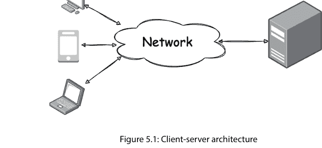

## 介绍客户端/服务器架构

该图展示了客户端/服务器架构的核心组件：客户端或多个客户端、服务器以及连接它们的网络。要了解更多信息，你可以参考以下内容：

- **客户端**：客户端作为用户界面，发送请求并以易于访问的格式呈现服务器响应。客户端的复杂程度不异，分为胖客户端和瘦客户端：
    - **胖客户端**：在客户端/服务器架构中，胖客户端独立于服务器执行重大的处理工作。胖客户端执行业务逻辑，在本地管理数据，并并可以在离线模式下运行。示例包括桌面应用程序和传统的软件安装，例如 Salesforce Classic（一种桌面应用）。
    - **瘦客户端**：在客户端/服务器架构中，瘦客户端高度依赖服务器进行处理和数据存储。服务器执行大部分处理，而客户端仅作为输入输出的接口。数据主要存储在服务器上，客户端本地存储极少。瘦客户端需要与服务器保持持续的网络连接。示例包括  应用程序，如 Salesforce Cloud、Zoho CRM 和 HubSpot CRM。**物联网 (IoT)** 设备也充当瘦客户端，收集数据并将其发送到中心化服务器进行处理。

在客户端/服务器架构中选择胖客户端还是瘦客户端取决于多个因素，包括应用需求、网络可靠性、安全性考虑，以及对移动性和远程访问的需求：

- **服务器**：服务器处理客户端请求并执行数据处理、存储和管理任务。它设计得健壮且可扩展，能够高效管理资源以同时多个客户端提供服务。
- **网络**：网络是促进客户端与服务器之间通信的媒介。它可以**局域网 (LAN)**、**广域网 (WAN)** 或互联网。网络确保请求和响应在客户端与服务器之间高效、安全地传输。它可能涉及路由器、交换机等硬件组件以及规范客户端与服务器交互的通信协议。

客户端/服务器架构是现代计算的骨干并备受关注。因此，让我们进一步探索它并设计一个客户端/服务器应用程序架构。

## 设计客户端/服务器应用程序的架构

客户端/服务器架构将表示层与核心应用程序分离，创建出不同的客户端。这些客户端可以是 HTML 网页、移动应用、桌面软件或任何其他通过网络与服务器通信的接口。因此，服务器端应用程序在瘦客户端模型中包含业务逻辑和数据访问服务，而在胖客户端模型中仅包含数据访问服务。图 5.2 展示了客户端/服务器应用程序的架构设计。

### 客户端

### 服务器

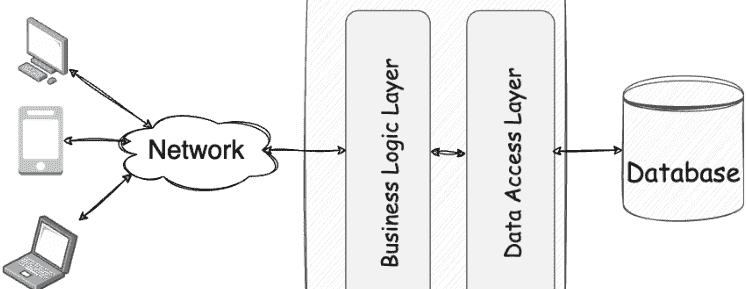

图 5.2：客户端/服务器应用程序的架构设计。

在客户端/服务器架构中，流程遵循结构化的序列：

1. 客户端向服务器发送请求。
2. 服务器将请求转发给业务逻辑层，由使用必要的业务规则和逻辑处理请求。
3. 如果需要，它会与数据访问层通信以检索或修改数据库中的信息。
4. 数据库执行操作并将结果返回给数据访问层，由数据访问层将数据传回业务逻辑层。
5. 业务逻辑层准备响应，由服务器将其返回给客户端。
6. 客户端通过用户界面将信息展示给用户。

现在已经解释了客户端/服务器架构的流程，让我们来看看它的优点。

## 客户端/服务器架构的优点

客户端/服务器架构是一种广泛采用的计算框架，提供了许多优点，使其适用于各种应用程序和环境。让我们探索客户端/服务器架构的一些关键优势：

- **集中化管理**：客户端/服务器架构的一个显著优势是集中化管理。在这种模型中，资源、数据和服务集中在服务器上，简化了管理和维护。系统管理员可以在服务器端执行更新、安全补丁和备份，减少了管理单个客户端设备的需求。
- **数据一致性与完整性**：在客户端/服务器架构中，通常由单一集中数据库管理所有事务。这种集中化有利于对安全和完整性的控制，敏感信息存储并管理在一个位置，从而实现了稳健的安全措施。
- **可扩展性**：客户端/服务器架构的另一个关键优势。服务器可以升级更强大的硬件，或添加到负载均衡集群以处理增加的负载。这种灵活性允许系统随着用户需求而增长。
- **性能优化**：在性能方面，客户端/服务器架构允许在服务器端使用专用硬件和软件配置来处理密集任务。这种能力使服务器能够快速高效地处理请求，为客户端提供快速可靠的响应。
- **资源共享**：资源共享在客户端/服务器模型中高效管理。多个客户端可以访问服务器上的共享资源，如文件、应用程序和数据库。这减少了冗余，因为不需要在多个设备上复制资源，降低了整体成本。它还确保所有客户端都能访问最新的信息。
- **可靠性**：客户端/服务器模型还增强了可靠性和可用性。服务器可以配置冗余和故障转移机制以确保连续运行。可以进行定期维护和监控，而不会显著影响客户端，因为服务器可以离线进行维修或升级。

## 客户端/服务器架构的缺点

虽然客户端/服务器架构在许多情况下非常有益，但它也有缺点，这可能使其不适用于某些应用程序。识别这些局限性对于做出明智架构决策和避免陷阱至关重要。

- **单点故障**：客户端/服务器架构的一个主要缺点是存在单点故障的可能性。由于服务器是资源和服务的中心，一旦它宕机，整个系统对所有客户端都变得不可用。这种对服务器的


可用性需要强大的故障转移和冗余机制，而这些机制在实施和维护上可能非常复杂且昂贵。在高可用性至关重要的环境中，服务器宕机的风险构成了重大挑战。

- **性能瓶颈**：如果有大量客户端同时访问服务器，服务器可能会成为性能瓶颈，导致响应时间变慢和性能下降。

- **可扩展性限制**：虽然服务器可以进行扩展以处理更多客户端，但这种扩展性具有物理和实际限制。随着客户端数量的增加，服务器可能会成为瓶颈，导致性能下降。负载均衡和水平扩展可以缓解这一点，但这些解决方案增加了复杂性和成本。对于负载变化大或不可预测的应用程序（如社交媒体平台或大型流媒体服务），客户端-服务器模型可能不是一个良好的选择。

- **延迟**：延迟是客户端-服务器架构中的另一个问题。客户端与服务器之间的物理距离会引入延迟，影响性能。在金融交易平台或在线游戏等实时应用中，即使是微小的延迟也是不可接受的。确保低延迟需要分布式服务器和边缘计算解决方案，这进一步增加了复杂性和成本。

- **安全漏洞**：集中式服务器是网络攻击的吸引目标。如果服务器被攻破，可能会暴露敏感数据并中断所有客户端的服务。

- **维护**：在客户端-服务器的设置中，维护和更新可能会变得繁琐。虽然集中式管理简化了某些方面，但也意味着任何服务器维护或宕机都会影响所有客户端。必须仔细计划定期的宕机时间以最大限度地减少干扰，这在客户端可能在不同时区运行的全球环境中是极具具有挑战性的。

通过评估这些优缺点，我们可以得出客户端-服务器架构是否最适用于我们的应用程序。为了支持这一评估并增加另一项知识，我们将探索并比较另外三种客户端-架构类型。

## 探索客户端-服务器架构类型

有几种类型的客户端-服务器架构旨在满足不同的需求和限制。我们将讨论主要类型，包括二层架构、三层架构和 n 层架构。虽然 n 层架构不是特定的客户端-服务器架构，但它通过增加更多层扩展了三层架构的概念。每种类型在复杂性、可扩展性、性能、安全性、可维护性、可重用性和用例方面都有所不同。

> 注意
> 理解层（tier）和层（layer）之间的区别至关重要。层（layer）表示组件的逻辑分离，而层（tier）则在物理上将一个层分离到不同的运行机器。

### 二层架构

二层架构是一种客户端-服务器模型，客户端直接与服务器交互以请求服务并检索数据。图 5.3 展示了二层架构。

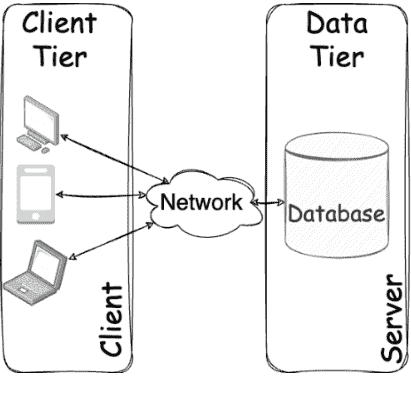

图 5.3：二层架构

二层架构通常由以下层组成：

- **客户端层**：称为应用层，它持有用户界面或客户端应用程序，用户在此与应用程序交互。它可以是 Web 应用程序、移动应用程序或桌面应用程序。客户端层处理用户输入输出，并直接与数据层通信。
- **数据层**：数据层或数据库层是数据存储层，通常由**数据库管理系统 (DBMS)**（如 MySQL）组成。它管理数据的存储、检索和管理。客户端直接与此层交互以执行数据库操作。

可以调整客户端和服务器层以创建胖客户端（fat client）或瘦客户端（thin client）设置。在胖架构中，客户端层负责用户界面和业务逻辑，而数据层主要处理数据存储。相反，在瘦客户端架构中，客户端层仅关注用户界面，而服务器层管理业务逻辑和数据存储。

### 三层架构

三层架构是一种高级的客户端-服务器模型，它在客户端和服务器之间增加了一个层。这个中间层（或应用服务器）管理应用程序的业务逻辑，允许更好的组织、可扩展性和维护。图 5.4 展示了三层架构。

### N 层架构

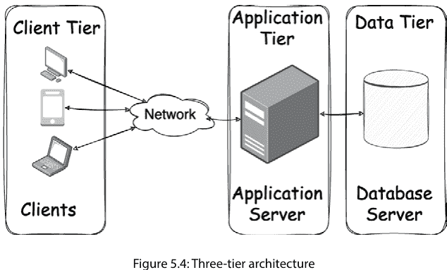

三层架构通常由以下层组成：

- **客户端层（表示层）**：该层向用户展示信息并收集他们的输入。它是一个桌面应用程序、浏览器浏览器或移动应用。
- **应用层（业务/逻辑层）**：该中间层处理核心功能，处理客户端请求、执行计算并做出逻辑决策。应用服务器充当中间件，接收来自客户端层的请求，对其进行处理，并与数据层交互以检索或更新数据。
- **数据层（数据层）**：该层负责使用 DBMS 存储、检索和管理数据。

三层架构通常用于 Web 应用程序、企业应用程序和其他对可扩展性和可维护性至关重要的大型系统。

N 层架构也称为多层架构，通过增加更多层扩展了三层架构的概念。每层都有特定的职责，可以分布在多个服务器上。除了三层架构中看到的客户端层、应用层数据层之外，它可能包括以下附加服务器：

- **Web 服务层**：管理外部服务集成，例如 API 或第三方服务。
- **安全层**：实现安全协议。
- **缓存层**：通过临时访问的数据提高性能。

N 层架构是一种通用的解决方案，它将应用程序分为多个层，每层负责一个功能，尽管存在复杂性和成本，但它增强了可扩展性和可维护性。

### 二层、三层和 n 层架构的对比

现在我们了解了二层、三层和 N 层架构，让我们根据其可扩展性、性能、可维护性、可重用性和安全性对它们进行对比：

- **可扩展性**：二层架构的可扩展性有限，适用于小型应用程序。相反，三层架构提供了更好的可扩展性，因为中间层可以处理业务逻辑。N 层架构具有高度可性，因为每个层都可以独立扩展。
- **性能**：由于层数较少且直接访问，二层架构通常为小型应用程序提供更性能。相反，三层架构通过分离关注和优化中间层来提供性能。N 层架构可以优化每层的性能，尽管额外的层可能会引入延迟。
- **可维护性**：最初，二层架构易于维护。然而，随着应用程序的增长，该架构可能会变成障碍。三层架构通过关注点分离提升了水平，使得在应用程序扩展时更新和管理更加轻松。由于职责清晰，N 层架构提供了高水平的可维护性，确保无论应用程序大小，更新和更改都很简单。
- **可重用性**：在二层架构中，由于业务逻辑嵌入客户端中，可重用性有限。相反，三层架构通过将业务逻辑封装在中间层提高了可重用性，使其可以在多个客户端之间重用。N 层架构提供了最高的可重用性，因为每层和服务组件可以在应用程序的不同部分或其他应用程序中重用。
- **安全性**：在二层架构中，安全性至关重要，因为客户端对数据库的直接访问带来了重大风险。在三层架构中，安全性得到了提高，因为中间层可以执行安全策略并限制直接的数据库访问。N 层架构提供了最高的安全性，多个层实施了稳健的安全措施，包括身份验证、授权和数据加密。


## 客户端-服务器通信协议

客户端服务器通信协议实现了客户端与服务器之间有效且安全的数据交换。这些协议为通信建立了规则和规范，确保请求和响应能够可靠、正确地传输。识别并应用适当的协议需要理解应用的需求，包括性能、安全性和数据完整性需求。以下是一些常见的协议：

- 超文本传输协议 (HTTP)：这是一种高层协议，主要用于在万维网上传输超文本文档。它基于请求-响应模型运行；客户端向服务器发送请求，服务器则返回请求的资源或错误消息。HTTP 是无状态的，意味着每个请求都是独立处理的，并且不会保留之前交互的信息。它的安全版本是超文本传输安全协议 (HTTPS)，它利用安全套接层 (SSL) 和传输层安全协议 (TLS) 对客户端与服务器之间传输的数据进行加密，确保机密性和完整性。
- WebSocket：这是一种用于在单个传输控制协议 (TCP) 连接上建立全双工通道的专用协议。它支持全双工通信，保持持久连接以实时交互。该协议减少了 HTTP 头的开销，使其在频繁的数据交换中更加高效。此外，它受到大多数现代网络浏览器和服务器的支持。WebSocket 对于需要实时数据交换的 Web 应用程序特别有用。
- 高级消息队列协议 (AMQP)：这允许应用程序通过消息代理进行通信。应用程序通过 RabbitMQ 或 Apache ActiveMQ 等消息代理发送和接收消息。AMQP 支持分布式系统之间可靠、异步且解耦的通信。它确保即使在网络故障期间，消息也能安全、及时地送达。
- 简单对象访问协议 (SOAP)：这是一种用于分布式环境中交换信息的协议。它使用可扩展标记语言 (XML) 进行消息格式化，并依赖 HTTP 进行传输。SOAP 确保了不同系统和平台之间的互操作性。SOAP 消息是四个部分的 XML 文档：封封（envelope）、头部（header）、主体（body）和底部（footer）。尽管提供了平台独立性、可靠性和安全性， SOAP 消息可能复杂且庞大，影响性能。SOAP 常用于遗留系统，但大部分已被 RESTful API 取代。RESTful API 更加简单、轻量、易于开发，更适合现代 Web 应用和移动设备。

这些协议确保了客户端与服务器之间可靠、高效的通信，实现了各种互联网应用和服务。虽然存在其他通信协议，但在我们开发应用时，一直关注最常用的协议。现在，让我们探索客户端与服务器之间网络上的另一种通信方法：REST。

### REST

REST 是一种用于设计通过网络通信应用的架构风格。它依赖于无状态、客户端-服务器和可缓存的通信协议（通常是 HTTP）。REST 由一组指南和原则组成，而不是一个正式的标准或协议。在《架构风格与基于网络的软件架构设计》中，Roy Fielding（罗菲德）的博士论文引入了 REST 及其原则如下：

- 无状态性：从客户端到服务器的请求必须包含服务器处理和满足请求所需的所有信息。服务器不能存储客户端会话的任何状态。
- 客户端-服务器架构：客户端和服务器都应该独立演进。服务器提供资源，客户端访问并操作这些资源。
- 可缓存性：响应必须隐式或显式地标记为可缓存或不可缓存，以防止客户端重用过期或不适当的数据。
- 分层系统：客户端通常无法识别它是直接连接到服务器，还是通过中间节点连接的。
- 统一接口：REST 依赖于组件之间的统一接口来简化并解耦架构，使每个部分都能独立演进。该接口通常基于 HTTP。

REST 是一组架构原则，因此让我们学习它是如何实现的。

### RESTful APIs

RESTful 指的是实现 REST 原则的 Web 服务。如果一个 Web 服务遵循 REST 原则，它通常被称为 RESTful。以下是 RESTful Web 服务的主要特征：

- 资源和 URI：资源通过统一资源标识符 (URIs) 进行标识。例如：
  - GET：获取资源
  - POST：创建新资源
  - PUT：更新现有资源
  - DELETE：移除资源
  - PATCH：部分更新现有资源
- **表示 (Representation)**：资源可以用多种格式表示，例如 JSON、XML、文本或 HTML。客户端与这些表示进行交互，而不是与资源本身交互。
- **无状态通信**：根据 REST 原则，每个客户端-服务器交互必须是无状态的，这意味着服务器在请求之间不存储内容。
- **状态码**：RESTful API 利用 HTTP 状态码来通信 API 请求的结果。例如，200 (OK) 状态表示请求成功，404 (Not Found) 状态表示未找到资源（注：原文此处为 500，根据逻辑通常为 404），而 500 表示服务器端错误。

这些是 RESTful 的特征。现在，让我们看看设计它的最佳实践。

### 设计 RESTful APIs

设计 RESTful API 涉及几项最佳实践；让我们检查一下：

- **使用有意义的 URI**：URIs 应该是可读的、能够传达资源的身份并使用复数形式。例如，`/api/products/123` 比 `/api/getProduct?id=123` 更好。
- **版本控制**：在 URI 中使用版本控制以在 API 演进时保持向后兼容——例如，`/api/v1/products`。
- **无状态性**：确保从客户端到服务器的每个请求都包含理解和处理请求所需的所有信息。避免服务器会话。
- **正确使用 HTTP 方法**：遵循标准。例如，使用 GET 读取数据，POST 创建数据，PUT 更新数据，DELETE 删除数据，PATCH 部分更新数据。
- **提供功能性响应**：始终返回具有功能性且详细的响应。
- **保护您的 API**：实现身份验证和授权机制以保护您的 API 免受未经授权的访问。使用 HTTPS 对客户端与服务器之间传输的数据进行加密。

## 实现客户端-服务器应用

现在……

经过反复讨论，团队认为开发新的 Web 和移动应用程序比重构现有 Web 应用以适应移动设备更有效。重构用户界面可能会导致糟糕的用户体验。团队同意尽可能利用现有的单体应用，提供 Web 用户界面和访问既有业务逻辑的移动应用程序。客户端-服务器架构被认为是符合我们预算的。然而，为 Android 和 iOS 开发独立的应用程序以及 Web 应用将花费更多的时间精力。

因此，团队决定使用 **React** 开发 Web 应用程序，使用 **React Native** 开发移动应用程序。

> 注意
> 本书不介绍客户端代码并解释 React 和 React Native。但是，源代码和执行指令已在 GitHub 仓库中。要了解更多关于 React 的信息，请访问官方网站：`https://react.dev/`。


接下来，让我们开始实现我们的服务器应用程序。

## 实现单体服务器

我们之前的单体应用使用 MVC 和 N 层架构进行了良好的开发，因此很容易将其重构为客户端-服务器架构的应用程序。图 5.5 展示了我们应用程序的新架构。

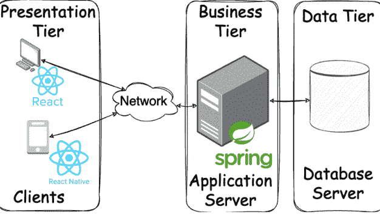

图 5.5：系统架构

让我们使用客户端-服务器架构和三层模型来创建新应用程序。通信将使用 RESTful Web 服务。

## 移除 Thymeleaf 产物

由于我们将从服务器端移除表示层，因此必须从项目中移除 Thymeleaf 产物和库。我们移除了模板和静态文件夹及其内容，并移除以下 Thymeleaf 库：spring-boot-starter-thymeleaf、thymeleaf-layout-dialect 和 thymeleaf-extras-security6。

## 重构控制器

随着我们的项目向客户端-服务器架构演进，我们必须将控制器中的 `@Controller` 替换为 `@RestController` 注解。`@RestController` 注解是用于创建 RESTful Web 服务的特定版本 `@RestController`。它用于控制器方法需要返回 JSON 和 XML 等数据而非视图的情况。在响应处理方面，它结合了 `@Controller` 和 `@ResponseBody`。这意味着 `@RestController` 中方法的返回值将直接以 JSON 或 XML 格式写入 HTTP 响应体，消除了在每个方法上使用 `@ResponseBody` 的需要。

下面的代码片段显示了之前使用的 `ProductController` 类，但现在它将 `@Controller` 注解替换为了 `@RestController` 注解：

```
@RestController
@RequestMapping("products")
public class ProductController{
```

`listProducts` 方法已更新更新。我们移除了以前用于向视图传递数据的 `Model` 对象。现在，我们使用 `ResponseEntity` 来封装产品列表，提高了基于 Spring 的 RESTful Web 服务的清晰度和适应性。这允许你定义自定义的 HTTP 状态码、包含自定义标头并管理响应体，为处理错误和保持一致、标准化的响应提供了灵活性。该方法将返回 `HttpStatus.OK` —— 即当产品可用时，状态码为 200。如果没有产品可返回，则将返回 `HttpStatus.NOT_FOUND`（状态码为 404）。下面的代码片段展示了 `listProducts` 方法：

```
@GetMapping
public ResponseEntity<List<Product>> listProducts() {
Optional<List<Product>> products = productService.getAllProducts();
return products.isPresent() ? 
new ResponseEntity<List<Product>>(products.get()), HttpStatus.OK) : 
new ResponseEntity<>(HttpStatus.NOT_FOUND); }
```

由于我们在创建单体项目时使用了设计良好的 MVC 和 N 层架构，因此我们不需要重构业务层和数据层。现在，让我们使用基于令牌的认证来保护 REST API。

## 使用基于令牌的认证保护 API

在之前的单体项目中，我们使用了基础认证，这简单的 HTTP 协议方法。然而，它的安全性有限，因为凭据没有加密且必须随每次请求发送。基于令牌的认证更适用于我们新的客户端-服务器架构项目。基于令牌认证的详细流程如图 5.6 所示。

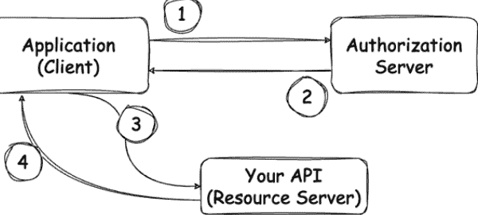

图 5.6：基于令牌认证的流程

## 客户端-服务器架构

让我们详细说明步骤：

- 1. 客户端通过端点（如 `/api/auth`）调用授权服务器，将凭据传递给授权服务器。
- 2. 授权后，服务器向客户端应用程序发布访问令牌。
- 3. 客户端应用程序调用受保护资源，并在头部中包含 `Authorization: Bearer <access token>` 键值。
- 4. 资源服务器验证令牌：如果有效，则授予访问请求权限。

我们将使用 JWT

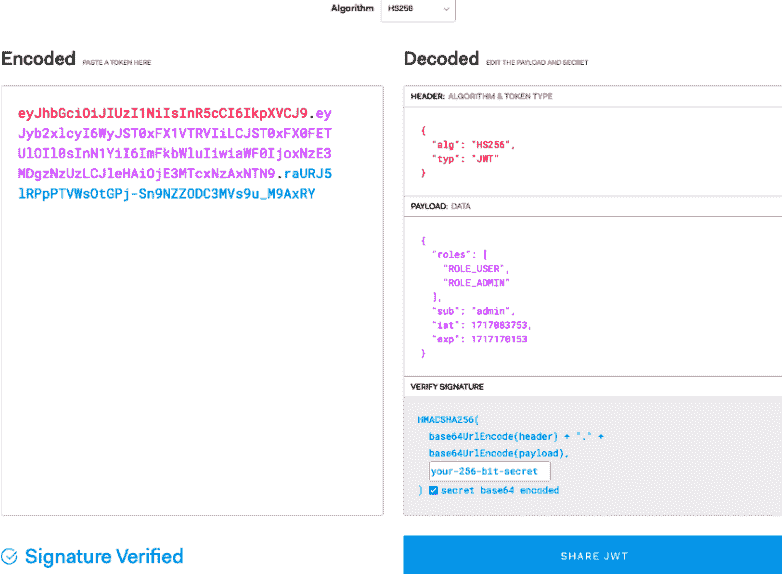

图 5.7：JWT

## 实现客户端-服务器应用程序

授权服务器生成的 JWT 位于左侧。相比之下，右侧包含令牌类型（JWT）和签名算法（例如加密算法 HS256）的 HEADER。`PAYLOAD` 区域持有负载（claims），即关于用户的声明，例如用户 ID、角色和过期时间。`VERIFY SIGNATURE` 区域用于验证令牌的完整性并确保其未被篡改。现在，让我们实现生成令牌的代码。

## 实现 JWT

必须向项目中添加以下依赖以创建和验证 JWT：

```
<dependency>
  <groupId>io.jsonwebtoken</groupId>
  <artifactId>jjwt</artifactId>
  <version>0.12.5</version>
</dependency>
```

`application.properties` 文件包含了 `security.jwt.secret-key`，它用于计算基于哈希的认证码 (HMAC)，可以使用在线工具 https://appdevtools.com/hmac-generator 生成。它还包含了 `security.jwt.expiration`，表示令牌以毫秒为单位的过期时间：

```
security.jwt.secret-key=replace_with_jwt_secret_generated
security.jwt.expiration-time=86400000
```

下面的代码片段是 `JwtService` 类，处理所有与令牌相关的事务，例如创建和验证令牌：

```
@Service
public class JwtService {
  @Value("${security.jwt.secret-key}")
  private String secret;

  public String generateToken(UserDetails userDetails) {
    Map<String, Object> claims = new HashMap<>();
    List<String> roles = new ArrayList<>();
    userDetails.getAuthorities().forEach(n ->
      roles.add(n.getAuthority()));
    claims.put("roles", roles);
    return createToken(claims, userDetails.getUsername());
  }

  private String createToken(Map<String, Object> claims,
                             String subject) {
    return Jwts.builder()
    .setClaims(claims).setSubject(subject)
    .setIssuedAt(new Date(System.currentTimeMillis()))
    .setExpiration(new Date(System.currentTimeMillis() +
        expiration()))
    .signWith(SignatureAlgorithm.HS256,
        secretKey()).compact();
  }

  private Long expiration() {
    return 86400000;
  }

  private Key secretKey() {
    return Keys.hmacShaKeyFor(secret.getBytes());
  }
}
```


# 实现客户端-服务器应用程序 127

```java
.authorizeHttpRequests(authorize -> authorize
  .requestMatchers("/api/auth").permitAllAll()
  .anyRequest().authenticated()
  .sessionManagement(session -> session
  .sessionCreationPolicy(SessionCreationPolicy.STATELESS)
  .authenticationProvider(authenticationProvider())
  .addFilterBefore(jwtAuthenticationFilter,
  UsernamePasswordAuthenticationFilter.class);
  return http.build();
```

通过调用 `csrf().disable()` 禁用 CSRF 保护，因为无状态应用不需要它。使用 CORS 配置进行跨资源共享会调用 `cors().addFilter(corsFilter)`。

`authorize.requestMatchers("/api/auth").permitAllAll()` 代码允许所有未身份验证的用户对 "/api/auth" 端点进行请求。

`authenticationProvider` 方法配置身份提供者，它应该返回 `AuthenticationProvider` 接口的实现，以处理身份验证请求。

为了确保 JWT 验证在默认身份处理之前发生，通过调用 `addFilterBefore(JwtAuthenticationFilter, UsernamePasswordAuthenticationFilter.class)` 将 `JwtAuthenticationFilter` 添加到安全过滤器链中。

接下来的代码片段说明了 `SecurityConfiguration` 类中的 `authenticationProvider` 方法。

```java
@Bean
public AuthenticationProvider authenticationProvider() {
  DaoAuthenticationProvider authProvider = new
  DaoAuthenticationProvider();
  authProvider.setUserDetailsService(userDetailsService);
  authProvider.setPasswordEncoder(passwordEncoder());
  return authProvider;
}
```

`DaoAuthenticationProvider` 是 `AuthenticationProvider` 的内置实现。它从 `UserDetailsService` 获取用户详情并使用 `PasswordEncoder` 验证密码。要设置 `UserDetailsService`，你需要调用 `authProvider.setUserDetailsService(userDetailsService)`，其中 `userDetailsService` 是 `UserDetailsService` 的自定义实现，负责加载特定用户数据。之后，你可以通过调用 `authProvider` 为 `authProvider` 设置密码编码器。

## 客户端-服务器架构

setPasswordPasswordEncoder(passwordEncoder())。`passwordEncoder` 方法返回 `PasswordEncoder` 实例，用于编码和解码密码。最后，该方法返回配置好的 `authProvider`。Spring Security 框架随后使用该提供者通过将凭据与存储存储的凭据进行对比来验证用户。`DaoAuthenticationProvider` 确保应用程序可以通过利用配置的用户服务和密码编码器安全地处理用户身份验证。

接下来的代码片段是身份验证控制器的实现：

```java
@RestController
@RequestMapping("/api/auth")
public class AuthenticationController {
    @PostMapping
    public AuthenticationResponse createAuthenticationToken(
        @RequestBody AuthenticationRequest authenticationRequest) throws Exception {
            authenticationManager.authenticate(new
                UsernamePasswordAuthenticationToken(
                    authenticationRequest.getUsername(),
                    authenticationRequest.getPassword()));
            final UserDetails userDetails =
                userDetails.loadUserByUsername(
                    authenticationRequest.getUsername()));
            final String token = jwtService.generateToken(
                (userDetails));
            return new AuthenticationResponse(token);
```

`UserController` 类是一个控制器，`createAuthenticationToken` 方法生成令牌。它利用 `authenticationManager` 验证用户的凭据。这是通过使用带有 `AuthenticationRequest` 中提供的用户名和密码的 `UsernamePasswordAuthenticationToken` 实现的。

验证成功后，该方法通过调用 `userDetails.loadUserByUsername(authenticationRequest.getUsername())` 使用 `userDetailsService` 获取用户详情。这为已验证的用户检索了一个 `UserDetails` 对象。

随后，该方法通过调用 `jwtService.generateToken(userDetails)` 为用户生成一个 JWT。该令牌是根据用户详情创建的。

最后，该方法返回一个包含生成令牌的 `AuthenticationResponse` 对象。此响应被发送回客户端，提供将用于后续身份验证请求的 JWT。

# 调用身份验证服务

让我们调用身份验证服务来创建一个令牌。图 5.8 展示了通过 Postman 工具访问的身份验证端点。

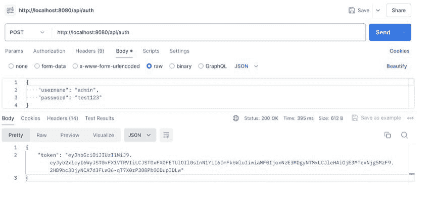

> 图 5.8：身份验证服务

一旦我们提供了凭据（在体中包含用户名和密码）并通过验证，我们就获得了一个有效的令牌。此时，我们可以通过包含从授权端点接收的访问令牌来调用 /products 端点。图 5.9 展示了调用 /products 的过程。

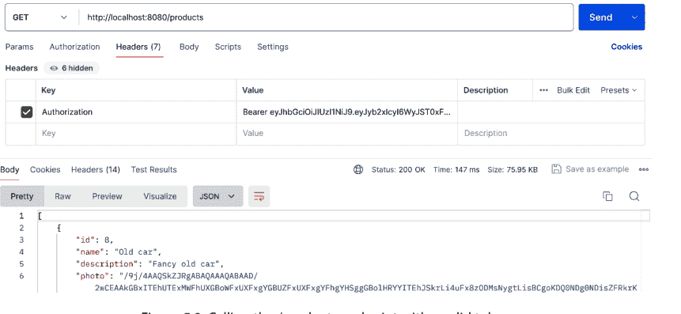

> 图 5.9：使用有效令牌调用 /products 端点

## 客户端-服务器架构

我们可以观察到使用有效令牌时服务返回了产品列表和 200 状态码。**图 5.10** 显示了在没有令牌的情况下调用 /products 端点。

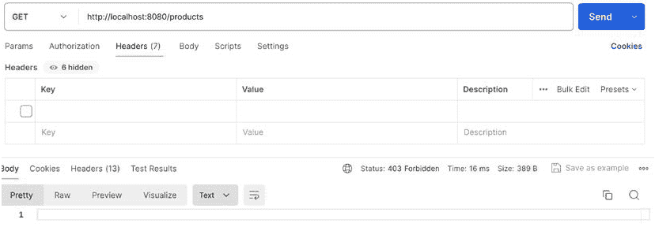

使用无效令牌时，服务不返回产品列表并返回 403 作为状态码。**图 5.11** 显示用户可以访问 /admin 端点，因为令牌内部包含 admin 角色。

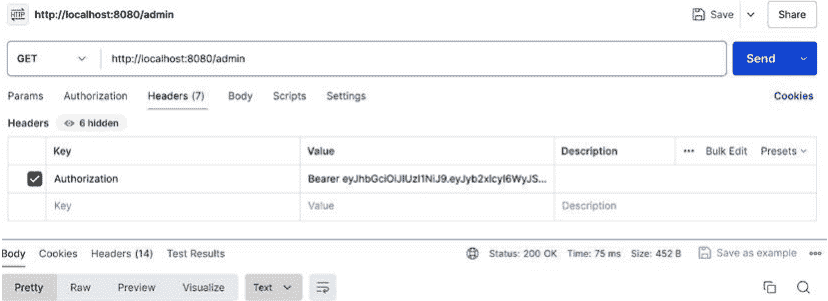

如果用户没有 ROLE_ADMIN 角色，将获得错误且无法执行 /admin 端点。


## 实现代码覆盖率测试

我们可以使用如 JaCoCo 等库在项目中实现代码覆盖率测试。JaCoCo 与 Maven 等构建工具良好集成。让我们在 `pom.xml` 中添加 JaCoCo 插件：

```xml
<plugin>
  <groupId>org.jacoco</groupId>
  <artifactId>jacoco-maven-plugin</artifactId>
  <version>0.8.12</version>
  <executions>
    <execution>
      <id>prepare-agent</id>
      <goals>
        <goal>prepare-agent</goal>
      </goals>
    </execution>
    <execution>
      <id>verify</id>
      <phase>verify</phase>
      <goals>
        <goal>report</goal>
      </goals>
    </execution>
  </executions>
</plugin>
```

添加插件后，我们可以运行命令 `mvn clean verify`。然后，代码报告将在 `target/site/jacoco/index.html` 中生成。图 5.13 展示了项目的代码覆盖率报告。

图 5.13：项目代码覆盖率报告

报告 `index.html` 显示了项目的代码覆盖率统计，明确显示了不同包和类的指标。它包含以下指标：

- **指令 (Instructions)**：未测试覆盖的代码指令数量以及指令占比。
- **分支 (Branches)**：未测试覆盖的分支（如 if/else）数量以及分支占比。
- **复杂度 (Complexity)**：未测试覆盖的代码的圈复杂度。
- **行 (Lines)**：未测试覆盖的行数。
- **方法 (Methods)**：未测试覆盖的方法数量。
- **类 (Classes)**：未测试覆盖的类数量。

为了实现有意义的覆盖，确保测试能够全面验证代码行为（包括边界情况和错误处理）至关重要。代码覆盖应集成到更广泛的测试策略中，包括单元测试、集成测试和功能测试。定期审查和分析覆盖报告有助于识别差距并提高测试的有效性。

## 总结

本章探讨了软件开发中的客户端-服务器架构，详细介绍了其组件（客户端、服务器和网络），并强调了其集中化管理、可扩展性、性能优化和可靠性等优势。同时也承认了其缺点，包括单点故障、性能瓶颈、可扩展性限制和安全漏洞。本章还涵盖了一系列客户端服务器通信协议，如 HTTP、WebSocket、AMQP 和 SOAP，并深入研究了设计 RESTful API 的原则和最佳实践。一个拍卖系统的详细案例说明了这些概念的实际应用，强调了符合预算限制以及使用客户端-服务器架构确保可扩展性的重要性。该案例涉及使用 Spring 框架实现客户端-服务器应用程序、实现 REST 服务，并使用基于 JWT 的令牌身份验证对 API 进行加密。此外，本章还讨论了使用 OpenAPI 文档化 API 以及使用 JaCoCo 库进行代码覆盖率测试，以确保对代码库进行彻底测试，使你具备创建健壮、可扩展且安全的客户端-服务器应用程序的知识。

在第 6 章“微服务架构”中，我们将探索微服务架构，揭示其基础概念、同步通信、使用 Spring Actuator 进行监控和管理，并将我们的微服务添加到容器中。

## 问题

1. 什么是客户端-服务器架构？
2. 在客户端-服务器架构中，厚客户端和瘦客户端有何区别？
3. 在什么场景下，二层架构可能比更复杂的模型更优？
4. 案例研究是如何实现基于令牌的身份验证？
5. 推荐什么工具用于 API 文档？
6. 为什么代码覆盖率测试很重要？
7. 什么是 REST？它为什么在客户端服务器通信中如此重要？

## 6 微服务架构

本章探讨了微服务架构，强调了其关键特性（如自主性和专门化），并展示了其优势和挑战。本章将在线拍卖客户端-服务器项目转换为微服务架构，并将其作为案例研究。它讨论了通过**领域驱动设计 (DDD)** 的限界上下文识别领域边界的策略、重构，以及根据 **CAP 定理** 选择合适的数据库。

此外，本章还讨论了在微服务背景下实现清洁架构。本章提供了设计和实现微服务的详细指导，包括使用 **RestClient** 进行同步通信，以及使用 **Spring Boot Actuator** 进行监控和管理。

本章以使用 **Docker** 和 **Docker Compose** 将微服务容器化的实际步骤结束，并强调了容器化对开发和部署的处。

本章将涵盖以下主题：

- 介绍微服务架构
- 将应用程序迁移到微服务
- 同步通信
- 监控和管理微服务
- 将我们的微服务添加到容器中

在本章结束，你将对微服务架构有深入理解，了解如何应用清洁架构指南，并获得将项目迁移到微服务的实践指导。这些知识将使你能够基于微服务开发出弹性、自适应且易于维护的应用程序。

## 技术要求

本章的所有代码都可以在 GitHub 上找到：https://github.com/PacktPublishing/Software-Architecture-with-Java

## 介绍微服务架构

微服务架构是一种由小型、自治服务组成的应用程序方法。每个服务都旨在实现一种特定功能。这与单体架构形成对比。图 5.1 展示了微服务架构。

图 5.1：微服务架构

微服务架构由提供特定功能的独立服务组成。消费者可以通过 REST API 与微服务交互。另外两个核心组件是 API 网关和后端前端 (BFF)。

API 网关是一个充当 API 前端的服务器，接收来自客户端的请求并将其定向到后端服务。BFF 是为特定的前端应用程序的服务。

## 揭示微服务的关键特性

在开发微服务时，请记住这两个词：自主性（autonomy）和专门化（specialization）。将这两个词写在便利贴上，并贴在你工作的地方。

微服务背景下的**自主性**是指微服务独立于其他服务运行的能力。专门的微服务旨在处理特定功能。**专门化**确保了每个微服务都高度关注某个特定方面。


## 微服务架构的优势

微服务架构提供了许多优势。让我们来审查其主要优势：

- **技术独立性**：微服务架构的一个优势是能够灵活地为每个服务选择最合适的技术。这允许团队根据特定任务或性能需求选择最合适的语言、框架和工具，从而优化开发效率、增强服务性能并促进创新。此外，它允许在不进行整个系统重构的情况下，逐步采用新技术。
- **可维护性**：微服务架构通过将复杂系统拆分为更多、自包含的服务，改进了可维护性，这允许多个团队进行独立更新和并发开发，增强了效率和灵活性。
- **健壮性**：每个服务都是隔离且可独立部署的。这最大限度地减少了一个服务的故障对所有其他服务的影响，提高了系统的整体弹性。
- **可扩展性**：微服务允许根据需求对服务进行独立扩展，实现了高效的资源分配并提高了系统处理各种负载的能力。
- **部署简单**：在微服务架构中，部署变得简单，因为每个服务都是自包含的并且可以独立部署。这允许在不需要重新部署整个系统的情况下进行更新、修复 Bug 和添加新功能。Docker 和 Kubernetes 等工具实现了服务部署、扩展和管理的自动化，减少了停机时间并实现了持续交付。
- **添加新服务**：由于每个服务都独立运行并具有定义良好的 API，微服务架构允许轻松添加新服务。这使得新组件能够无缝集成到系统中，同时在业务需求演变时支持快速迭代和扩展。
- **更快的上市时间**：较小的独立团队可以同时处理不同的服务，从而加速了开发和部署过程。

尽管有这些优势，微服务架构也有一些缺点，我们将在接下来进行探讨。

## 微服务架构的缺点

虽然微服务架构在各种场景中具有高度优势，但它也存在缺点，可能会使其不适用于特定的应用程序。识别这些局限性对于做出明智架构决策和避免陷阱至关重要：

- **数据管理**：在分布式服务之间维护数据一致性可能具有挑战性，通常需要复杂的策略，例如分布式事务。开发者通常必须实现最终一致性或其他模式，如 **SAGA** 和**两阶段提交 (2PC)**，以有效管理数据完整性。
- **部署复杂性**：管理多个独立服务的部署和维护可能是具有挑战性的。每个服务都需要单独的部署、监控和维护，增加了运维负载，并需要强大的 DevOps 实践以确保操作的顺畅高效。
- **服务间通信**：随着服务通过网络进行通信，网络延迟和可靠性变得至关重要，这可能会引入性能瓶颈。实施断路器、重试和超时等策略对于有效处理这些挑战至关重要。消息队列等异步异步通信方法可以解耦服务并提高系统弹性。
- **成本**：构建微服务架构面临成本挑战。包括资源需求、操作复杂性、更高的网络开销、更大量的开发和维护工作、数据费用、安全、合规性和额外的培训。尽管微服务提供了可扩展性、灵性和弹性的优势，但它们伴随着相关的成本。仔细考虑这些因素并实施成本管理策略以确保采用微服务架构的优势大于支出至关重要。
- **在微服务架构中创建报告面临挑战**，包括一致性问题、复杂的数据聚合、潜在的性能缓慢以及确保报告的准确性和安全性。这需要健壮的错误处理、一致的安全策略、全面的日志记录、先进的工具和有效的管理规划。
- **监控、日志记录和追踪**：微服务架构中的监控、日志记录和追踪面临着挑战，因为需要管理和关联多个独立服务之间的数据，处理增加的数据量，并使用复杂的工具来有效地聚合、分析和视觉化数据。克服这些挑战需要细致的规划、正确的工具并遵循最佳的可观测性实践。
- **调试和故障排除**：由于微服务具有分布式架构，调试微服务是具有挑战性的，其中多个独立服务在网络上相互作用。这种复杂性使得跨服务边界追踪问题、管理不一致的日志以及关联事件变得困难。此外，每个服务可能用不同的语言开发并运行在单独的环境中，进一步增加了了调试过程。

通过理解微服务的优缺点，开发者和架构师可以设计出符合现代软件开发实践的健壮高效的系统。在理解了微服务的优缺点后，让我们将客户端/服务器架构转换为包含微服务的架构。

## 将应用程序迁移到微服务

微服务是软件开发的一种现代方法，许多公司正在采用。然而，迁移现有系统需要更多工作。这涉及许多变量，例如微服务的并行开发和当前系统的维护。我们必须决定是重构整个系统，还是逐步替换或用新系统重写它（Martin Fowler 的“绞杀者模式”）。我们应该从迁移代码还是数据库开始？这是一个有很多选择的艰难决定。为了进一步探讨这个主题，我推荐阅读 Sam Newman 写的《Monolith to Microservices: Evolutionary Patterns to Transform Your Monolith》。

为了学习目的，我们将一次性迁移整个系统。这将让我们窥见迁移的过程。然后，让我们进入案例研究。利益相关者想要和我们交流；我们变得有名并对公司的成功至关重要。

## 在线拍卖案例研究

WX-Auction 公司正享受着在线拍卖应用程序的成功。客户端/服务器版本显著增加了我们的用户群，特别是移动应用程序的成功。用户积极参与市场交易，标志着我们旅程中的一个重要里程碑。

随着新投资的注入，利益相关者现在热于为我们的系统全球发布做准备。确保我们的系统性能不受影响（即使用户群不断增长）至关重要。他们希望系统未来可以易于添加新服务，例如在线交易结算、支付和货运。

## 系统定义和使命

经过广泛讨论，团队得出微服务架构是一个很好的选择，因为它根据需要提供可扩展性，并简化了新服务的组合。

> **注意**
> 采用微服务必须经过充分分析，包括其对于你的案例是否必关重要的优缺点。对于许多客户，我看到使用 Kubernetes 将简单项目构建为微服务：没有必要的复杂性和昂贵的维护成本。这里介绍的案例研究是一个供我们学习的简单案例。

## 开始迁移过程

将当前应用程序拆分为不同的业务能力或领域是一个很好的开始点。这有助于你理解应用程序中的功能区域及其边界。我们该如何定义业务能力呢？DDD（领域驱动设计）可以帮助我们成功完成这一步。它通过提供一种结构化的方法将系统拆分为定义良好的、与业务对齐的服务，可以显著帮助从单体或客户端/服务器应用程序迁移到微服务架构。让我们学习一下 DDD 的核心概念。


## 理解领域驱动设计的基础

我将介绍 DDD 的基础知识，这些足够我们继续进行转型。为了更深入地理解 DDD，我建议阅读 Eric Evans 编写的《领域驱动设计：应对软件核心性》（Domain-Driven Design: Tackling Complexity in the Heart of Software）：

- 边界上下文（Bounded contexts）：边界上下文定义了一个清晰的边界，在该边界内特定的模型被描述且适用。每个边界上下文对应一个特定的业务能力，并可以映射到微服务。识别边界上下文有助于将单体拆分为更小、易于管理的单元，以反映业务领域。
- 实体和值对象（Entities and value objects）：实体是具有随时间持续的唯一标识的对象，而值对象是不可变的，且没有不同的标识。通过对实体和值对象进行建模，你可以理解每个边界上下文内的核心数据结构和关系，促进向微服务的迁移。
- 聚合（Aggregates）：聚合是一组相关的实体和值对象，被视为一个整体以进行数据更改。每个聚合都有一个根实体，被称为聚合根。定义聚合有助于维护每个微服务内部的数据一致性，并有效管理管理事务。
- 领域事件（Domain events）：领域事件代表边界上下文内的重大业务事件。它们可以跨不同的微服务通信更改并协调活动，支持最终一致性以及微服务之间的解耦。
- 存储库（Repositories）：存储库允许从数据存储访问聚合和其他实体。围绕聚合设计存储库可以确保微服务能够独立处理其数据并维护数据完整性。

## 设计在线拍卖应用的边界上下文

我们必须识别应用程序的业务上下文和领域事件（以及它们之间的关系）。识别边界上下文有助于将应用程序拆分为更小、易于管理的单元，以反映业务领域。图 6.2 展示了当前在线拍卖应用的边界上下文。

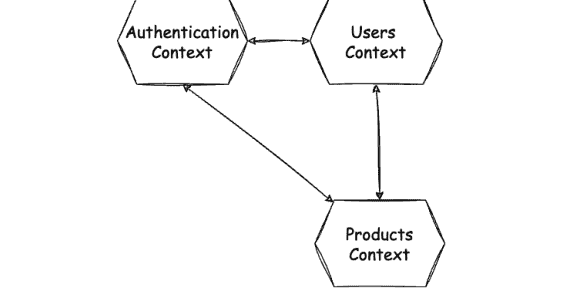

图 6.2：当前在线拍卖应用的边界上下文

## 微服务架构

该图展示了我们必须演进为微服务的在线拍卖应用的边界上下文。让我们探索每个上下文：

- **用户上下文（User context）：** 管理用户及相关数据，并与身份验证上下文交互以验证用户凭据并处理身份验证。
- **身份验证上下文（Authentication context）：** 处理用户身份验证和授权，并与用户上下文交互以管理身份验证细节和管理权限。
- **产品上下文（Products context）：** 管理产品目录及相关操作。

识别边界上下文有助于将单体拆分为更小、易于管理的单元，以反映业务领域。现在我们已经有了边界上下文，让我们展示一下当前的数据库模型。我们将数据库拆分为许多数据库，每个微服务拥有一个数据库。

## 在线拍卖应用的数据库

我们需要分析数据库，因为我们正在将当前的客户端-服务器项目演进为微服务。*图 6.3* 表示了我们必须进行重构的当前数据库模型。

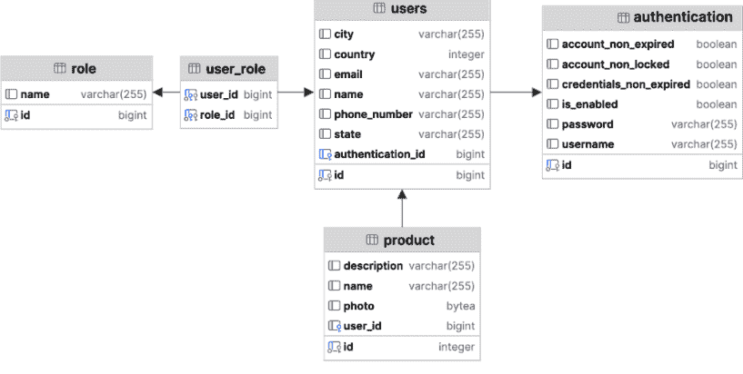

数据库模型包含五个表：authentication、users、user_role、role 和 product。用户可以拥有多个角色，每个用户可以关联多个不同的产品。每个用户在 authentication 表中有一条身份验证记录。该模型支持这样的系统：用户拥有不同的角色，通过各种方式进行身份验证，并与其账户关联多个产品。*图 6.4* 展示了重构后的微服务。

## 将应用程序迁移到微服务

迁移到微服务会扩展数据库模型；每个微服务将拥有自己的数据库。由于我们始终考虑性能、可扩展性和健壮的应用程序，现在是考虑微服务应该使用什么种类型的数据库的时了。

| Authentication | | users | user_role |
| :--- | :--- | :--- | :--- |
| | | city varchar(255) | | |
| | | country integer | user_id bigint |
| | | email varchar(255) | role_id bigint |
| | | name varchar(255) | | |
| | | phone_number varchar(255) | | |
| | | state varchar(255) | | |
| | | authentication_id bigint | | |
| | | id bigint | | |
| | | | | |
| | | description varchar(255) | | |
| | | name varchar(255) | | |
| | | photo bytea | | |
| | | user_id bigint | | |
| | | id integer | | |
| authentication | | Product | | |
| id objectid | | | | |
| accountNonExpired boolean | | | | |
| accountNonLocked boolean | | | | |
| credentialsNonExpired boolean | | | | |
| id string | | | | |
| isEnabled string | | | | |
| password string | | | | |
| username string | | | | |

（图 6.4）

## 选择合适的数据库

为了选择合适的数据库，我们需要分析对它的期望、其业务能力，以及**一致性、可用性和分区容错（CAP）**定理来支持我们的决策。

根据 CAP 理论为每个微服务选择合适的数据库，涉及到根据每个服务的特定需求和特征，在一致性、可用性和分区容错之间取得平衡。让我们分析每个微服务——授权、用户和产品。

### 用户服务

用户服务通常需要一致性来确保用户配置数据的准确性。高可用性对于高效处理用户查询也是理想的。虽然有中等程度的读写流量，但一致性仍然是首要任务。

根据 CAP 理论，用户服务将**一致性和分区容错（CP）**作为其关键目标。关系型数据库是用户微服务的推荐数据库类型，因为它提供了强一致性并支持事务完整性，这两者对于有效管理用户配置至关重要。NewSQL 数据库也是一个可行选择，它结合了 NoSQL 的可扩展性和传统关系型数据库的**原子性、一致性、隔离性和持久性（ACID）**属性。

### 身份验证服务

身份验证服务需要高可用性以确保用户始终能够进行身份验证。一致性是必要的，但在某些方面（如用户注销）可以是最终一致的。它通常涉及低到中等的流量，具有高读流量模式。那么，根据 CAP 理论，身份验证微服务的优先事项是可用性和分区容错（AP）。

NoSQL 数据库是身份验证微服务的推荐数据库类型。这些数据库提供了高可用性和分区容错，对于在分布式系统中处理身份验证和令牌管理至关重要。内存数据库可以帮助存储会话数据和令牌，提供高可用性和低延迟。

### 产品服务

产品微服务需要一致性以确保向用户显示准确的产品信息。虽然高可用性对于处理浏览用户可能产生的高流量是理想的，但一致性必须优先考虑数据完整性。该服务经历中等到高读流量和中等写流量。

根据 CAP 理论，产品微服务将一致性和分区容错（CP）作为其核心原则。关系型数据库是产品微服务的推荐数据库类型，因为它提供了强一致性并支持准确产品信息所需的复杂查询。与用户服务一样，NewSQL 数据库在这种语境下也是一个可行选择。

图 6.5 代表了我们系统中每个微服务的类型。

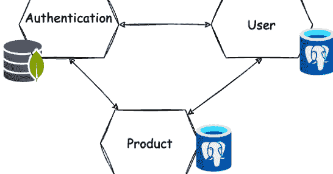

图 6.5：带有其数据库类型的微服务


## 微服务架构中的垂直团队方法

传统组织通常采用水平化团队结构。这种结构按技术层划分职责，由不同的团队分别管理前端、后端和数据库层。图 6.6 阐了这种水平化团队结构。

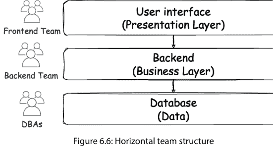

水平化架构的主要缺点是每个功能的规划和实现都需要多个团队的参与。这可能导致团队之间的紧密耦合，可能引起进度安排和截止日期上的摩擦。详细的挑战包括：团队之间复杂的规划与协调、工作流的耦合、由于团队时间线和优先顺序不同导致的调度摩擦、优先级排序不一致以及通信开销增加。这些挑战可能会阻碍开发进度，并导致团队成员之间的误解和冲突，使整个过程变得复杂。

然而，随着组织采用微服务架构，垂直团队结构变得更具优势。这种方法围绕特定的业务能力（如用户管理、支付、订单和物流）来组织团队，每个团队负责其领域内的所有技术层。图 6.7 展示了垂直团队结构。

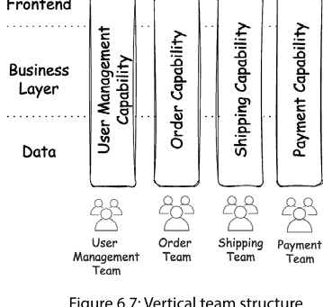

## 微服务架构

在微服务架构中采用垂直团队的主要原因是让团队与业务目标和结果更加对齐。每个团队都成为一个跨职单元，能够独立地开发、部署和维护完整的服务。这种对齐促进了更大的敏捷性、更快的交付速度以及改进的权属和责任制。

垂直团队对于提高敏捷速度至关重要。它们从头到尾监控服务，能够实现更快的决策和变更，同时减少依赖并消除瓶颈。垂直团队在专注于特定业务能力时会获得深刻的见解和专业知识，带来更好的功能开发和创新。通过将团队与业务能力对齐，技术工作直接支持组织目标，增加了开发活动的战略影响。垂直团队负责服务的整个生命周期（从开发到维护），培养了强烈的责任感并鼓励产生更高质量的结果。随着需求的变化，垂直团队提供了扩展性和灵活性，允许组织根据特定的业务能力调整团队组成或数量，而不会破坏整个系统。

微服务架构中的垂直方法提供了显著的敏捷性、专注、对齐、权属和扩展性优势。它也引入了挑战，如资源重复、知识孤岛、集成复杂性、标准的可变性和管理开销。组织必须慎重考虑这些优缺点，并实施策略在减轻挑战的同时最大化收益。通过这样做，他们可以有效利用微服务架构的潜力来推动业务成功。现在我们已经有了使用微服务架构构建的应用，让我们在实现授权服务之前探索另一个主题：整洁架构。

## 整洁架构

在我们的项目中，虽然 N 层架构是模块化的，但其分离并不并不。这可能会增加测试过程的复杂性，并且通常与其使用的框架和工具紧密耦合，使得更改更具挑战。

考虑到这一点，整洁架构是创建高可维护代码的指南，它专注于业务并独立于框架和数据库等技术。

整洁架构结合了各种设计原则和模式，例如 SOLID 原则。其核心思想是根据业务价值将系统组织成层。图 6.8 展示了整洁架构层。

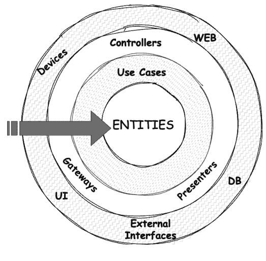

最高层 **(Entities)** 包含业务规则，而后续每一层都接近设备。

在这种分层方法中，内部层对应于更高层次的抽象，涵盖了业务逻辑和规则。相比之下，外部层处理更具体的操作，如用户界面和数据访问。

这种结构允许灵活性和扩展性，因为我们可以根据业务需求定义任意数量的层。遵循依赖规则（dependency rule）至关重要：高层永远不应该依赖于低层。这确保了核心业务逻辑不受外部变化的影响，增强了系统的适应能力和可维护性。

整洁架构体现了以下基本特征：

- **可测试性：** 业务规则可以孤立地进行严格的测试；也就是说，我们可以独立于技术来测试业务规则。
- **独立于外部元素：** 整洁架构确保业务规则和核心逻辑与特定的框架、用户界面、数据库技术和任何外部组件解耦。这确保了灵活性并易于修改，而不会影响核心功能。

整洁架构强调关注点分离，确保确保系统的不同方面是隔离且独立的。

## 微服务架构

虽然整洁架构带来了许多益处，但必须承认采用可能会引入挑战。主要的复杂性之一是设置不同层带来的额外开销，特别是在较小的项目中，这种程度的抽象可能显得过头。此外，对于不熟悉方法的团队来说，通常存在学习曲线，需要对设计原则有更深入的理解，并在遵循架构边界方面保持自律。因素最初可能会减慢开发，但可维护性和灵活性的长期收益通常超过初始投入。

> **依赖规则**
> 记住，高层永远不能依赖于低层。实体层（entity layer）不能知道用例（use cases），用例反过来不能知道控制器（controllers），以此此类推。

让我们通过分析和实现认证服务来研究整洁架构。

## 实现认证服务

让我们实现我们的认证服务，它将使用整洁架构开发。在深入研究代码和每个类的职责之前，图 6.9 展示了使用整洁架构方法的新认证服务结构。

```
com.packpub.authenticationservices
  adapter
    datasources
    transportlayers
  config
    exceptions
    openapi
    security
    usecases
  internal
    entities
    exceptions
    repositories
    usecases
```

图 6.9：项目的结构

在我们的认证服务中，主要文件夹是 internal、adapter 和 config。

### 探索 internal 文件夹

**internal** 文件夹负责业务规则并封装实体（entities）和用例（use case）层。这里不允许框架注解、数据库库和外部对象引用。internal 文件夹有三个文件夹：*entities*、*usecases* 和 *repositories*。

- **entities**：实体是适用于整个企业的的核心业务规则。它们可以通过方法实现，也可以作为数据结构和函数的集合来实现。实体是 `plain old Java objects (POJOs)`。禁止使用 Lombok 或 JPA 注解等框架和库。
- **usecases**：用例是活跃的业务规则，负责管理实体和外部接口之间的数据流，代表用户交互。它们定义了系统对特定输入的响应，确保操作的可控性。作为业务逻辑（实体）和外部层（如接口和框架）之间的中间器，用例确保了业务规则的一致应用，并与实现细节隔离开。
- **repositories**：存储库是访问和管理实体的接口。它们提供了与数据源交互的方法，能够检索单个实体或实体列表。通过抽象数据访问逻辑，存储库确保了一致的 API并将业务逻辑与存储机制分离。

**internal** 文件夹内部可能还有其他文件夹，只要它们不违反整洁架构。

### 探索 adapter 文件夹

**adapter** 文件夹表示接口适配器层。它包含了在用例、实体以及外部系统（如数据库或网络接口）之间转换数据格式的适配器。它有两个主要文件夹：`datasources` 和 `transportlayers`：

- **datasources**：数据源作为各种存储系统的适配器，与 SQL 数据库、REST API 和 Elasticsearch 接口。它们实现了仓库接口以处理数据检索和存储，将业务逻辑与存储细节分离。
- **transportlayers**：传输层是触发用例执行业务逻辑的输入机制。它们是带有处理传入请求、事件、任务等控制器的 RESTful API。使用用例隔离业务逻辑与任何特定的传输层或控制器实现解耦。

### 探索 config 文件夹

config 文件夹包含安全、OpenAPI 和其他的配置。整洁架构的重点是 **usecases** 文件夹，它包含一个 `UsecasesConfiguration` 类，负责根据依赖倒置原则将实现接口的数据源注入到用例中。


现在，让我们通过令牌生成的流程来探索整洁架构的每一层及其对象，以理解整洁架构。

### 实体层 (Entity layer)

以下代码片段显示了 `internal.entities` 文件夹表示的实体层的 `Authentication` 类：

```javapublic class Authentication {
    private Long id;
    private String username;
    private String password;
    ...
```

这是一个简单的 POJO，没有 Lombok 等外部注解

### 用例层 (Use case layer)

以下代码片段展示了 `internal.usecases` 包内用例层中的 `GenerateTokenUseCase` 类：

```javapackage com.packpub.authenticationservices.internal.usecase;
```

```java
public class GenerateTokenUseCase {
    private final AuthenticationManagerRepository authenticationManagerRepository;
    private final UserRepository userRepository;
    private final TokenRepository tokenRepository;
    public GenerateTokenUseCase(
        AuthenticationManagerRepository authenticationManagerRepository,
        UserRepository userRepository,
        TokenRepository tokenRepository) {
```

`AuthenticationManagerRepository`、`UserRepository` 和 `TokenRepository` 接口由数据源类实现。仓库（Repositories）将内部业务规则与外部对象隔离开。

`GenerateTokenUseCase` 类只有一个方法：`execute`。每个类一个方法有优点，例如关注单一职责、简单性和可重用性；也有缺点，例如类数量激增。

以下代码片段展示了 `GenerateTokenUseCase` 类中的 `execute` 方法：

```java
public Optional<String> execute(String username, String
    password) {
...
    if (authentication.isPresent()) {
        authentication.get().setRoles(
            userRepository.getRolesByUsername(username));
```

`userRepository.getRolesByUsername(username)` 过程执行了对用户服务的调用以获取用户。在内部上下文中，它不知道对方是 RESTful API 还是数据库；这对于业务规则并不重要。它只需要知道它将获取用户的规则来生成令牌。

### 不违反依赖规则的流程

考虑一种用例需要与数据源（例如 JPA 仓库或 RESTful API）交互的场景。为了遵守依赖规则，我们必须避免对数据源进行直接调用，该规则规定：任何内层圆（此在本例中为用例层）都不应该知道外层圆（接口适配器）。相反，我们在内层圆中使用接口（仓库）。外层圆的数据源实现仓库接口。这种方法确保了依赖关系向内流动，维护了内部的独立性，使得无论控制流方向如何，都能维护依赖规则。

以下代码片段展示了位于 `config.usecases` 包中的 `UseCaseConfiguration` 类。它有一个 Bean，将 `UserRestApi`、`AuthenticationManager` 和 `TokenJwt` 注入到 `GenerateTokenUseCase` 类中：

```javapackage com.packpub.authenticationservices.config.usecases;
@Configuration
public class UseCaseConfiguration {
@Bean
    public GenerateTokenUseCase generateTokenUseCase(
        UserRestApi userRestApiGateway,
        AuthenticationManager authenticationManager,
        TokenJwt tokenJwt) {
```

以下代码片段展示了实现 `UserRepository` 接口的数据源 `UserRestApi`：

```java@Service
public class UserRestApi implements UserRepository {
```

通过依赖倒置原则，它并没有违反依赖规则。现在，让我们探索接口适配器。

## 接口适配器 (The interface adapters)

这一层的软件包含了适配器，这些适配器用于在用例偏好的格式与外部系统（如数据库、Web 服务或消息队列）所需的格式之间转换数据。它还管理从实体和用例所使用的格式到持久化框架（如数据库）所需格式的数据转换。它处理所有外部交互，将核心应用程序逻辑与外部依赖隔离开。

以下代码片段展示了 `AuthenticationController` 类。它通过调用 `GenerateTokenCase.execute` 启动流程。

```java
public class AuthenticationController {
    private final GenerateTokenCase generateTokenCase;

@PostMapping
public ResponseEntity<AuthenticationResponse>
    createAuthenticationToken(@RequestBody
    AuthenticationRequest authenticationRequest) throws
    Exception {
    final Optional<String> token =
        generateTokenCase.execute(
            (authenticationRequest.getUsername(),
            authenticationRequest.getPassword()));
```

适配器负责隔离框架和库，例如那些转换 API 的请求和响应的框架，以及使用对象关系映射（ORM）将实体从核心应用程序业务映射到数据库（或反之）的工具库。

## 框架与驱动程序层 (Frameworks and Drivers Layer)

我们在这里不编写代码；这一层包含了数据存储的细节，例如数据库驱动程序和其他技术信息。它处于最外层，应该依赖于内层，反之亦然。

既然我们已经学习了整洁架构并使用整洁架构实现了授权服务，让我们深入研究微服务通信。

### 同步通信 (Synchronous communication)

微服务以多种方式进行通信，每种方式都根据系统架构和需求提供不同的功能。在这里，我们将探索同步通信，这是微服务架构的一个基础方面，服务之间直接交互并期望即时响应。

它的特点是请求-响应的性质，适用于需要即时反馈和实时数据交换的场景。

同步通信通常会导致服务之间更紧的耦合。每个服务都需要知道与其通信的服务的端点，从而创建了直接依赖。

同步通信的一个关键优势是能够提供即时反馈。这对于需要实时确认或数据检索的操作至关重要。

RESTful APIs 和 GraphQL 是微服务间同步通信的典型示例。GraphQL 允许客户端请求特定数据，适用于前端开发者需要更灵活的数据检索的场景。

### 同步通信的优势

同步通信的主要优点是简单性、实时交互以及微服务之间可预测的工作流：

- **简单性 (Simplicity)**：同步通信的实现和理解非常容易，特别是对于熟悉基于 Web 的客户端-服务器交互的开发者来说。
- **实时交互 (Real-time interaction)**：即时使得使得通信成为需要实时交互的理想选择，例如用户认证。
- **可预测的工作流 (Predictable workflow)**：请求-响应模型提供了可预测的工作流，更容易处理错误和管理服务依赖。

### 同步通信的挑战

同步通信的主要挑战是延迟、可扩展性和容错性：

- **延迟 (Latency)**：网络延迟会显著影响性能，特别是在高负载环境或服务跨越地理位置分布的等境下。
- **可扩展性 (Scalability)**：随着服务和交互的增长，同步通信可能会成为瓶颈。每个请求都会占用资源直到收到响应，这可能导致更高的资源消耗。
- **容错性 (Fault tolerance)**：如果服务故障或变得不可用，可能会破坏整个请求链，导致级联故障。这需要健壮的错误处理和回退机制。

同步通信实现了实时交互，但也带来了如延迟和可扩展性等挑战。随着微服务架构的演进，平衡其优势与对高效且韧性系统的需求至关重要。


## 微服务之间的耦合

耦合描述了微服务之间的相互依赖程度。在微服务通信中，不同类型的耦合会显著影响系统的灵活性、可维护性和可扩展性。以下是微服务通信中主要的耦合类型：

- 时间耦合（Temporal coupling）：当微服务依赖于其他服务的可用性和时间时，就会发生时间耦合。它通常出现在同步通信场景中，但如果时间至关重要，也可能发生在异步系统中。如果服务 A 必须等待服务 B 的响应才能继续，它们就是时间耦合的。这种依赖关系会导致级联故障或延迟。分布式事务需要多个服务协调完成操作，从而导致了时间耦合。
- 共享数据库耦合（Shared databases coupling）：当多个微服务访问并操作同一个模式时，它们可能是紧密耦合的。数据库结构的更改可能导致所有依赖服务都要发生更改。
- 部署耦合（Deployment coupling）：当微服务由于相互依赖而必须一起部署或扩展时，就会发生这种情况。服务由于紧密集成而被部署在一起，这使得难以独立进行部署或扩展。

作为一名顾问，我理解这三种耦合，如果我们没有在项目开始时解决它们，后期再处理就会非常困难。由于项目已处于生产状态，它涉及许多团队，重构并不简单，因为我们需要协调所有的部分。有些朋友说，这就像“边开车边换轮胎”。现在，让我们学习如何减少微服务之间的耦合。

## 减少微服务的耦合

为了实现松耦合的微服务架构，请考虑以下策略：

- 拥抱领域驱动设计（DDD）：拥抱 DDD 是关重要的，因为它将微服务与边界上下文（bounded contexts）对齐，以最大限度地减少相互依赖并促进自主性。
- 定义清晰的契约：定义良好的 API 规范和版本控制的契约对于减少更改的影响并维护跨服务的一致性至关重要。例如，考虑一个用户服务的 API。版本控制可以通过在 API 端点中包含版本号来实现，例如 `/api/v1/users` 代表版本 1，`/api/v2/users` 代表版本 2。良好的契约可能指定请求和响应格式，包括必填字段、数据类型和潜在的错误代码。如果版本 2 的用户数据中添加了新字段，仍然可以维护旧版本以确保向后兼容。
- 使用异步通信：异步通信在服务的时间解耦方面非常有效。消息队列（如 RabbitMQ 或 Apache Kafka）可以在服务之间缓冲并中继消息，确保每个服务都能独立地按照自己的节奏运行。

## 同步通信 157

- **实现服务发现：** 使用服务注册中心来发现服务，动态避免硬编码依赖。服务发现使用中心化注册表来动态跟踪和定位服务，避免硬编码依赖。这允许服务根据实时注册信息进行连接，从而减少耦合，并灵活性、可扩展性和容错能力，因为服务可以在不影响消费者的情况下进行更新或扩展。我们将在*第 7 章：Spring Cloud 微服务模式*中深入探讨其细节。
- **确保数据独立：** 服务应该设计为拥有自己的数据，防止其他服务的直接访问。数据复制可以在服务之间共享必要数据而不会产生紧密耦合。

微服务的另一种类型是异步通信，我们将在*第 8 章：事件驱动架构*中进行讨论和探讨。现在，让我们使用 RestClient 实现微服务之间的同步通信。

## 使用 RestClient 进行同步通信

在实现同步通信的调用时，我们有一些选择，例如 RestTemplate、SpringCloudFeign 和 RestClient。在编写此书时，Spring Framework 团队在他们的页面建议使用 RestClient，因为它为同步 HTTP 访问提供了更现代的 API。

RestClient 通过其中一个静态方法进行实例化，或者我们可以使用 `builder()` 获取额外的配置选项。一旦 RestClient 被创建或构建，它是线程安全的，可以被多个线程并发利用。以下代码片段展示了如何创建一个 `RestClient` 实例：

```
restClient = RestClient.create();
```

创建实例后，我们使用它进行调用。以下代码片段展示了调用服务获取用户的角色：

```
RoleResponse result = restClient
.get()
.uri(userServiceUrl + "/v1/users/{username}/roles",
                               username)
.retrieve()
.body(RoleResponse.class);
```

`get` 方法设置请求并通过 `uri` 方法指定 URL。`{username}` 表示它将替换的 `username` 参数的数据。`retrieve` 方法获取响应，`body` 将响应转换为 `RoleResponse` 类。

使用 RestClient 执行后 请求非常简单；以下代码片段展示了这一点：

```
ResponseEntity<Void> response = restClient.post()
uri("/v1/users")
.contentType(APPLICATION_JSON)
.body(user)
.retrieve()
.toBodilEntity();
```

`post` 方法设置请求，`contentType` 将 content-type 请求头设置为 application/JSON。用户对象作为体参数传递，`toBodilEntity` 将响应转换为不带体的响应实体。

使用 RestClient 处理异常非常简单，并在下面的代码片段中给出：

```
Boolean result = restClient.get()
.uri(authenticationServiceUrl +
"/v1/api/auth/validate?token={token}", token)
.retrieve()
.onStatus(HttpStatus::is5xxError, (request,
    throw new MyCustomException(
response.getStatusCode().toString(),
response.getStatusText()));
})
.body(Boolean.class);
```

通过 `onStatus`，我们可以根据 HttpStatusCode 定义自定义异常 MyCustomException。

RestClient 提供了许多增强和现代功能，是同步通信的强有力选择。它在 HTTP 库之上提供了一个抽象，能够将 Java 对象无缝转换为 HTTP 请求，并从 HTTP 响应创建 Java 对象。Spring Framework 推荐它优于其他选项。下一次当你需要同步通信库时，RestClient 是正确的选择。现在，让我们探索处理微服务架构工作时的另一个重要主题：监控。

## 监控和管理微服务

向微服务架构迁移带来了新的挑战，使得监控对于系统的可靠性、性能安全至关重要。监控有助于检测问题、优化性能、便于调试、增强安全性、高效扩展资源、改进开发流程并获得业务洞察。投资稳健的监控解决方案对于在微服务环境中实现卓越运营和交付高质量软件是不可少的。幸运的是，我们有 Spring Boot Actuator 来支持监控和管理微服务。

##  Spring Boot Actuator？

Spring Boot Actuator 是 Spring Boot 框架不可或缺的一部分。它提供了监控和管理应用的工具。内置端点（endpoints）提供了应用程序健康、性能指标和环境数据的洞察。对于不同的监控和管理需求，可以通过 HTTP、JMX 或自定义协议访问这些端点。

## 在微服务中添加 Spring Boot Actuator

我们必须向项目中添加以下依赖项以添加 Spring Boot Actuator：

```
<dependency>
  <groupId>org.springframework.boot</groupId>
  <artifactId>spring-boot-starter-actuator</artifactId>
</dependency>
```

由于我们的项目使用了 Spring Security 安全，我们必须在 `SecurityConfiguration` 类中启用对开关端点的访问：

```
.authorize(authorize -> authorize
  .requestMatchers("/api/auth/*", "swagger-ui/**",
  "/v3/apidocs/**").permitAllAll())
```

添加 "/actuator/**" 将启用 Spring Boot Actuator 的端端。图 6.10 显示了执行 Spring Boot Actuator 的端点健康状况。


```
{
  status: "UP"
}
```

图 6.10：Spring Boot Actuator 的健康端点

调用 /actuator/health 端点后，返回了我们应用程序的状态；它是运行状态（is up）。Spring Boot Actuator 提供了几个内置端点用于监控和管理您的应用程序。以下是主要的 Spring Boot Actuator 端点及其用途：

- /actuator/health：这提供了应用程序的健康信息。它通常显示应用程序是否运行，并且如果配置了，还可以包含额外的健康指标（如数据库状态）。
- /actuator/info：显示任意的应用程序信息。它可以配置为包含应用程序名称、描述、版本等详细信息。


## 微服务架构

- /actuator/metrics: 提供了应用程序当前状态的指标，包括内存使用情况、垃圾回收和其他与性能相关的指标。
- /actuator/loggers: 允许在运行时查看和配置应用程序的日志级别。
- /actuator/thredump: 提供 JVM 的线程转储，有助于诊断与线程相关的问题。
- /actuator/httptrace: 此端点显示 HTTP 请求的跟踪信息。有助于调试和监控 HTTP 流量。
- /actuator/env: 显示来自 Spring 环境的属性，包括系统属性、环境变量和配置属性。
- /actuator/beans: 此命令列出应用程序上下所有的 Spring beans，包括它们的依赖关系。
- /actuator/mappings: 提供了所有 @RequestMapping 路径的详细视图。
- /actuator/auditevents: 显示审计事件，例如身份验证和授权事件。
- /actuator/scheduledtasks: 显示应用程序中的调度任务。
- /actuator/caches: 提供可用缓存及其当前状态的信息。
- /actuator/configprops: 显示所有 @ConfigurationProperties 的列表。

建议你使用这些端点来学习和探索每一个一个，以及它们对你的应用程序会有何帮助。

在 application.properties 文件中，你可以使用 `management.endpoints.web.exposure.include` 属性配置暴露哪些端点。下面的代码片段启用了健康检查和指标：

```
management.endpoints.web.exposure.include = health,metrics
```

你可以使用字符 * 而不是端点的名称来暴露所有端点。

## 保护 Spring Boot Actuator 端点

关于安全性，不建议你让所有 Spring Boot Actuator 端点对所有人开放。如下所示代码片段所示，让我们更改 SecurityConfiguration 类，仅允许具有 ADMIN 角色的用户访问端点：

```
.authorizeHttpRequests(authorize) -> authorize
.requestMatchers("/api/auth", "swagger-ui/**", "/v3/api-docs/**").permitAll()
.requestMatchers("/actuator/**").hasRole("ADMIN")
.anyRequest().authenticated()
```

为 "/actuator/**" 路径添加了一个新的 requestMatchers。.hasRole("ADMIN") 指令确保了具有 ADMIN 角色的用户可以访问 Spring Boot Actuator 端点。

Spring Boot Actuator 是一个非常有价值的组件，为高效维护、监控和管理 Spring Boot 应用程序提供了必要的工具。让我们转换一下，涵盖另一个重要主题：将微服务添加到容器中。

## 将微服务添加到容器

容器化是当代软件开发转型之旅中的一项关键创新。让我们探索有效地容器化微服务所需的实际步骤和战略见解。

## 容器简介

容器，特别是由 Docker 管理的容器，在微服务架构中具有许多优势。它们为每个微服务提供了隔离的环境，确保了跨开发和部署阶段的行为一致性。这种隔离增强了安全性并使单个服务的扩展变得简单。

要将你的微服务容器化，你需要在开发机器上安装 Docker。如果没有安装，请按照 Docker 官方上的说明。

## 容器化认证微服务

为了将认证微服务容器化，我们必须在项目中创建一个 Dockerfile。下面的代码片段展示了 Dockerfile 的内容：

```
FROM openjdk:21-jdk-slim
COPY target/authorization-service.jar authorization-service.jar
ENTRYPOINT ["java", "-jar", "authorization-service.jar"]
```

为了让 authentication-service ，我们可以构建项目并按照以下步骤操作：

1. 在根目录下，使用此命令构建项目：
   `docker build -t auth-service:latest`

2. 运行容器：
   `docker run -d -p 8080:8080 auth-service:latest`

对于其他服务，遵循相同的步骤但更改端口号。虽然创建这些步骤很简单，但它们繁琐又费力。好消息是我们可以使用 Docker Compose 同时设置并运行，首先，让我们学习什么是多阶段构建。

## 多阶段构建

多阶段构建是 Docker 的一项功能，允许你在 Dockerfile 中多个 FROM 语句，每个语句代表构建过程的不同阶段。此功能对于通过分离构建和运行时环境创建精简的、生产级的 Docker 镜像非常有用。以下是多阶段构建的主要优势：

- 减小镜像大小：使用多阶段构建，你可以在构建阶段包含所有必要的构建工具和依赖项，但从最终镜像中排除它们。这产生了更小、更高效的 Docker 镜像。
- 提高安全性：工具和依赖项较少的较小镜像减少了攻击面，增强了安全性。
- 优化层缓存：多阶段构建有助于优化 Docker 层缓存，通过重用未更改的层使构建过程更快、更高效。

下面的代码片段展示了一个使用多阶段构建的 Dockerfile：

```
### Stage 1：构建阶段
FROM maven:3.9.7-eclipse-temurin-21-alpine AS builder
WORKDIR /app
COPY pom.xml .
COPY src /src
RUN mvn clean package
### Stage 2：运行时阶段
FROM openjdk:21-jdk-slim
WORKDIR /app
COPY --from=builder /app/target/authentication-services*.jar /authentication-services.jar
EXPOSE 8080
ENTRYPOINT ["java", "-jar", "authentication-services.jar"]
```

在这个多阶段 Dockerfile 中，我们从构建阶段开始。FROM maven:3.9.7-temurin-21-alpine 指定了该阶段的基础镜像是一个带有 java 21 的 Maven 镜像。此阶段将通过 Maven 编译并生成 jar 应用程序。

下一步是运行时。它从 FROM openjdk:21-jdk-slim 开始，指定了一个仅包含 JDK 运行较较镜像，使其更轻量。COPY --from=builder 命令从构建阶段将构建好的 JAR 文件复制到运行时容器的当前工作目录。这种方法确保了最终的 Docker 镜像是最小的，只包含运行应用程序所需的内容。

这种方法提高了效率安全性，使最终镜像更适用于生产部署。

## 管理多容器应用程序

Docker Compose 使用单个 docker-compose.yml 文件简化了多容器应用程序的管理。它自动创建网络以增强安全性，并减少了配置开销。该工具对于开发、测试、CI/CD 流水线和微服务架构有利，特别是对于本地分布式应用程序开发。这是一个 docker-compose.yml 文件的示例：

```
version: "3.8"
services:
  authentication-services:
    build: ../authentication-services
    ports:
    - "8080:8080"
    environment:
      DATABASE_URL: PATH_TO_DATABASE
      USER_SERVICE_URL: http://user-services:8081
  depends_on:
    - postgresql
  user-services:
  product-services:
  postgresql:
```

docker-compose 文件的完整版本位于源代码仓库。services 部分定义了我们的服务，即微服务、数据库和像 Kafka 这样的事件流平台。

authentication-services、user-services 和 product-services 是我们的微服务，而 postgresql 是我们微服务的数据库。

build 是指向项目 Dockerfile 的相对路径，ports 指定了服务和主机的端口；在这种情况下，两者都是 8080。

DATABASE_URL 和 USER_SERVICE_URL 是环境变量。前者决定数据库 URL，后者定义了连接到 http://user-services:8081 用户服务的 URL。

此 Docker Compose 设置确保了定义的服务被正确地构建、配置和链接，实现了无缝通信和可靠的启动顺序管理。

现在，让我们运行并测试我们的微服务项目。假设你已经从 GitHub 克隆了它，然后进入 ch6/docker 文件夹，打开终端并运行此命令：

```
docker-compose up -d
```


## 微服务架构

数据库容器和服务的容器将被创建并运行。图 6.12 显示了容器成功创建的截图。

- 网络 docker-default Created
- 容器 postgres-db Started
- 容器 docker-authentication-services-1 Started
- 容器 docker-user-services-1 Started
- 容器 docker-product-services-1 Started

图 6.11: 已创建的容器

为了确认所有程序已运行，请执行此命令：

```
docker ps
```

结果将显示正在运行的三个服务和一个数据库。

提供的 docker-compose.yml 内部指令包含了一个完整的数据库——所有表均已创建并填充：

> ./postgres/init.sql:docker-entrypoint-initdb.d/.init.sql

现在一切都已运行起来，是时候测试我们的服务以检查一切是否工作正常了。

## 调用服务

让我们调用运行在 8080 端口的认证微服务来生成令牌。调用结果如图 6.13 所示。

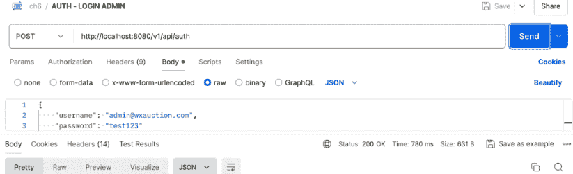

图 6.12: 通过认证微服务生成令牌

## 将微服务加入容器

现在，让我们检查令牌是否有效。图 6.14 显示该令牌是有效的。

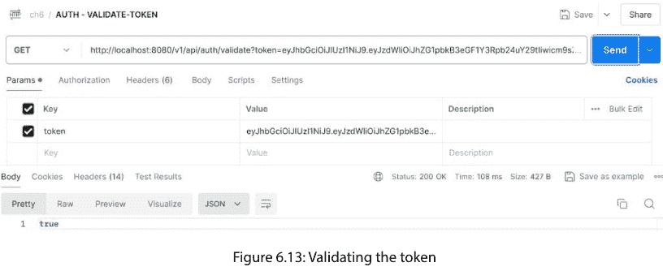

让我们使用该令牌来调用产品列表。图 6.15 展示了成功的调用。

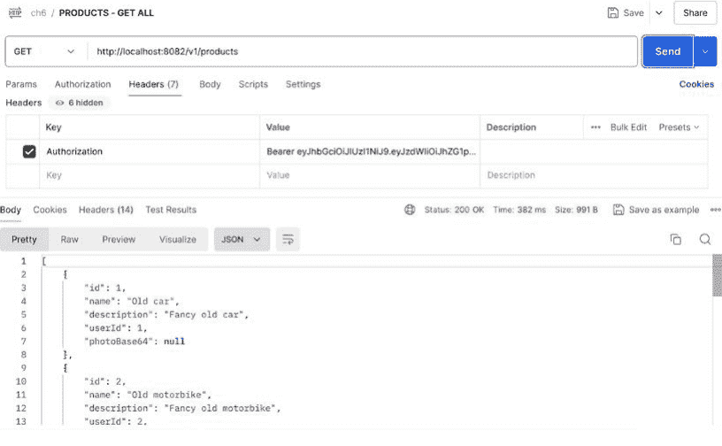

Docker 通过提供隔离性、可扩展性和效率实现了微服务的开发和部署。它允许在开发、测试和生产环境之间进行快速部署和顺滑过渡。按照概述的步骤，你可以有效地对微服务进行容器化，充分利用 Docker 的潜力构建健壮的架构。

## 总结

本章深入探讨了微服务架构、其核心特性（如自主性和专门化）以及它的优缺点。它还介绍了如何使用领域驱动设计原则将之前的客户端/服务器应用转换为微服务架构。它识别了边界上下文，重构了数据库，并根据 CAP 定理选择了合适的数据库。此外，实现微服务强调了整洁架构以维护关注点分离并确保灵活性和可测试的重要性。

本章还涵盖了使用 RestClient 进行同步通信，演示了如何高效地实现服务间通信。它还强调了使用 Spring Boot Actuator 监控和管理微服务的重要性，提供了监控、健康检查和诊断的见解。

最后，本章详细介绍了使用 Docker 和 Docker Compose 将微服务容器化的过程，说明了容器化如何提高开发和部署效率。

本章让你掌握了关于微服务架构的全面知识，包括迁移到微服务架构的实用策略、有效监控和管理微服务的工具，以及对容器化优势的理解。这些信息对于创建健壮、可扩展且可维护的基于微服务的应用具有极价值。

在第 7 章“使用 Spring Cloud 的微服务模式”中，我们将探索由 Spring Cloud 促进的关键微服务模式，例如使用 Resilience4j 实现弹性微服务、使用 Spring Cloud Config 进行集中化配置管理、使用 Eureka 进行服务发现、使用 Spring Cloud Loadbalancer 实现高效的负载均衡策略，以及使用 Spring Cloud Gateway 进行微服务的管理和保护。

## 问题

1. 微服务架构的核心原理是什么，它们为什么重要？
2. 领域驱动设计如何促进从单体架构向微服务的迁移？
3. 整洁架构对微服务开发有什么益处？
4. Spring Actuator 在管理微服务中起着什么角色？
5. 在微服务中使用同步通信的优点和挑战是什么？
6. 使用 Docker 和 Docker Compose 开发微服务的优势是什么？

## # 使用 Spring Cloud 的微服务模式

本章探索使用 Spring Cloud 的微服务模式，从服务发现开始，并强调了 Eureka（Spring Cloud Netflix 的服务注册中心）在实现可扩展性、韧性和灵活性方面的作用。

然后我们涵盖了负载均衡，这对于在服务器之间有效分配网络流量以及增强性能和可靠性至关重要。我们关注使用 Spring Cloud LoadBalancer 实现客户端负载均衡。

之后，我们解释并实现了使用 Spring Cloud Gateway 的网关模式来集中处理路由，并使用 Spring Cloud Config 管理配置，强调了分布式系统的集中化配置管理。

最后，本章涵盖了使用 Resilience4J 的弹性模式以及关键的弹性模式，如断路器、重试、限流、隔离闸和回退策略。

本章将涵盖以下主题：

- 使用 Eureka 发现和注册服务
- 使用 Spring Cloud LoadBalancer 均衡负载
- 使用 Spring Cloud Gateway 进行路由
- 使用 Spring Cloud Config 管理配置
- 使用 Resilience4J 应用弹性

在章末结束时，你将了解如何在微服务架构中实现服务发现、负载均衡、网关、配置管理和弹性模式。这些模式对于开发健壮、有弹性且可扩展的微服务应用至关重要，并将赋予你应用它们的能力。

## 技术要求

本章的所有代码都可以在 GitHub 上找到：https://github.com/PacktPublishing/Software-Architecture-with-Spring/tree/main/ch7。代码块中的省略号表示部分内容已省略。

## 使用 Eureka 发现和注册服务

到为止，我们一直使用固定地址进行通信。虽然这种方法简单，但会导致缺乏灵活性。这就是服务发现发挥用场的地方；它对于可扩展、有弹性且灵活的微服务至关重要。图 7.1 展示了服务发现架构。

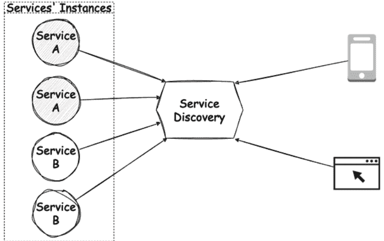

图 7.1: 服务发现架构

当服务启动时，它们通过注册自身启动该过程。它们将详细信息（如 IP 地址、端口和健康状态）发送到服务注册中心。随后由服务发现组件接维护可用实例的注册表。

当客户端应用程序需要与服务 A 或 B 通信时，它们不再调用固定 IP 地址，而是查询服务发现寻找当前的健康实例。如果服务 A 需要与服务 B 通信，它遵循相同的流程。如果某个服务宕机，服务发现将将其从注册表中移除。

现在，让我们检查服务发现的优缺点。

### 优点

让我们学习微服务架构中服务发现的主要优势：

- **动态可扩展性**：服务可以扩展或缩小，新实例可以自动注册自己，使其能够立即被发现。
- **容错性**：服务发现有助于优雅地管理故障。如果某个服务实例失败，它将从注册表中移除，请求将重定向到可用实例。
- **负载均衡**：服务发现可以与负载均衡器集成，在服务实例之间分配请求，增强性能和可靠性。
- **网络韧性**：服务可以通过逻辑名称被发现，因此它们可以适应网络变化（如 IP 地址更改或服务迁移），而无需人工干预。

除了优点之外，服务发现也有一些缺点。

### 缺点

服务发现的主要缺点如下：

- **单点故障**：如果服务注册中心没有正确正确且没有进行复制，它可能会成为单点故障。如果中央注册中心故障，整个服务发现机制可能会被中断，可能导致服务之间的停机或通信失败。为了减少服务注册中心成为单点故障的风险，可以部署带有负载均衡的多个实例，启用数据同步的复制，实现备份、故障转移机制以及带告警的监控。与服务网格集成可以提供额外的韧性和智能流量路由。
- **复杂性和不一致性**：添加服务发现机制需要服务注册中心和发现代理等额外组件，增加了系统的复杂性。服务注册中心可能会出现延迟或不一致，由于网络延迟或注册表节点之间的复制延迟导致过时或不准确的服务信息。在此期间，查询注册表的可能会可能会过旧信息。为了解决一致性，健壮的机制（如重试逻辑和健康检查）对于处理过期数据至关重要。


在微服务架构中，服务发现提供了动态可扩展性、容错性、负载均衡和网络韧性等优势。然而，它也带来了单点故障、复杂性和不一致性等挑战。适当的管理（包括部署多个实例、负载均衡、复制和稳健的监控）对于克服这些缺点并最大化服务发现的优势至关重要。

## 使用 Eureka 实现服务发现

行业中几种广泛使用的服务发现工具，每种工具都有独特的特性和优势，例如 Etcd、Consul、Zookeeper 和 Eureka。

我们将使用 Spring Cloud Netflix 实现服务发现。它包含了 Eureka，这是一个服务注册中心，用于服务之间进行无需固定配置的动态通信。Eureka 与 Spring Cloud 集成，允许在 Spring Boot 应用中通过简单的注解和属性轻松地注册和发现微服务。

我们将创建一个专门的微服务来管理服务发现，提供如集中化管理、可扩展性、容错、简化维护、跨环境的一致发现以及增强安全性等优势。

我们可以使用 Spring Initializr 工具创建新服务 `service-discovery-services`，并添加 Spring Web MVC、Spring Boot Actuator 和 Eureka Server 库。

以下代码段显示了添加到 `pom.xml` 文件中的 Eureka Server 依赖 `spring-cloud-starter-netflix-eureka-server`：

```xml
<dependency>
  <groupId>org.springframework.cloud</groupId>
  <artifactId>spring-cloud-starter-netflix-eureka-server</artifactId>
</dependency>
```

它还向 `pom.xml` 文件的 `dependencyManagement` 部分添加了 Spring Cloud BOM（材料清单），以确保 Spring Cloud 依赖的版本一致且兼容：

```xml
<dependencyManagement>
  <dependencies>
    <dependency>
      <groupId>org.springframework.cloud</groupId>
      <artifactId>spring-cloud-dependencies</artifactId>
      <version>${spring-cloud.version}</version>
      <type>pom</type>
      <scope>import</scope>
    </dependency>
  </dependencies>
</dependencyManagement>
```

以下配置代码段展示了添加到 `application.properties` 中的属性：

```properties
spring.application.name=service-discovery-services
server.port=8761
eureka.client.register-with-eureka=false
eureka.client.fetch-registry=false
```

`spring.application.name` 属性将应用程序名称设置为 `service-discovery-services`。`server.port` 属性将端口设置为 8761，这是 Eureka Server 的默认端口。当设置为 `false` 时，`eureka.client.register-with-eureka` 和 `eureka.client.fetch-registry` 配置了一个独立的 Eureka 服务器。它将不会注册自己，也不会从 Eureka 获取注册表。

要启用 Eureka Server，我们只需要在如下代码段的主 Spring Boot 主类上添加 `@EnableEurekaServer` 注解：

```java
@EnableEurekaServer
@SpringBootApplication
public class ServiceDiscoveryServicesApplication {
```

`@EnableEurekaServer` 注解激活了 Eureka 服务器的功能，确保必要的配置和 Bean 可用，并启用 Eureka 相关组件的组件扫描。

运行应用程序后，Eureka 服务器将通过 http://localhost:8761 可用。

图 7.2 展示了 Eureka 服务器控制台：


| 系统状态 | | | | | | |
| --- | --- | --- | --- | --- |
| 环境 | test | 当前时间 | 2024-07-18T22:07:44 -0300 |
| 数据中心 | default | 运行时间 | 00:03 |
| | | 租约到期启用 | true |
| | | 刷新阈值 | 6 |
| | | 刷新（上一分钟） | 14 |

DS 副本

localhost

已注册到 Eureka 的实例

| 应用 | AMIs | 可用区 | 状态 |
| --- | --- | --- | --- |
| AUTHENTICATION-SERVICES | n/a (1) | (1) | UP (1)- 192.168.100.67-authentication-services:8080 |
| PRODUCT-SERVICES | n/a (1) | (1) | UP (1)- 192.168.100.67-product-services:8082 |
| SERVICE-DISCOVERY-SERVICES | n/a (1) | (1) | UP (1)- 192.168.100.67-service-discovery-services:8761 |
| USER-SERVICES | n/a (1) | (1) | UP (1)- 192.168.100.67-user-services:8081 |

常规信息

| 名称 | 值 |
| --- | --- |
| total-available-memory | 8gb |
| num-of-cpus | 8 |

图 7.2: Eureka 服务器控制台

## 使用 Spring Cloud 的微服务模式

Eureka 服务器控制台概述了服务器的状态和配置，包括系统状态、刷新指标、副本和实例部分。随着我们的服务发现已经启动运行，现在是时候设置服务注册到 Eureka 服务器中了。

## 注册服务

在 Eureka 服务器中注册服务非常简单。只需添加“使用 Eureka 实现服务发现”章节中提到的 `spring-cloud-starter-netflix-eureka-client` 依赖和 Spring Cloud BOM 即可：

```xml
<dependency>
  <groupId>org.springframework.cloud</groupId>
  <artifactId>spring-cloud-starter-netflix-eureka-client</artifactId>
</dependency>
```

需要以下配置代码段来配置 Eureka：

```properties
eureka.client.serviceUrl.defaultZone=http://localhost:8761/eureka
eureka.instance.preferIPAddress=true
```

`eureka.client.serviceUrl.defaultZone` 属性指定了默认服务器 URL，客户端将在此处注册自己并获取注册表。`eureka.instance.preferIPAddress` 属性表示 Eureka 客户端应该注册 IP 地址而不是主机名。这在动态环境（如云和容器化部署）中特别有益，因为 IP 地址直接对应服务实例。

在成功配置并启动所有服务后，您可以通过图 7.3 中的 Eureka 服务器控制台看到已注册的服务：

已注册到 Eureka 的实例

| 应用 | 可用区 | 状态 |
|---|---|---|---|
| AUTHENTICATION-SERVICES | n/a (1) | (1) | UP (1) - 192.168.100.67-authentication-services-8080 |
| PRODUCT-SERVICES | n/a (1) | (1) | UP (1) - 192.168.100.67-product-services-8082 |
| SERVICE-DISCOVERY-SERVICES | n/a (1) | (1) | UP (1) - 192.168.100.67-service-discovery-services-8761 |
| USER-SERVICES | n/a (1) | (1) | UP (1) - 192.168.100.67-user-services-8081 |

图 7.3: 注册在 Eureka 服务器中的服务

## 使用 Spring Cloud LoadBalancer 负载负载

如果你关闭了服务，它的状态将变为 down。现在服务已经注册，服务之间是如何通信的？以下代码段展示了来自身份验证服务的 `UserRestApi` 类的重构：

```java
public class UserRestApi implements UserRepository {
    private final RestClient restClient;
    private final DiscoveryClient discoveryClient;
    @Override
    public List<String> getRolesByUsername(String username) {
        ServiceInstance serviceInstance =
            discoveryClient.getInstances("USER-SERVICES").get(0);
        RoleResponse result = restClient.get()
            .uri(serviceInstance.getUri() +
                "/v1/users/{username}/roles", username)
            .retrieve())
            .body(RoleResponse.class);
```

`UserRestApi` 类重构为使用 `DiscoveryClient`（一个 Spring Cloud 接口）与服务注册中心交互。

`discoveryClient.getInstances` 获取用户服务的实例列表，`USER-SERVICES` 是应用程序的名称。

它随后在 REST 调用中使用 `serviceInstance.getUri()` 通过发现的服务实例动态构建 REST 调用。


# 使用 Spring Cloud 的微服务模式

图 7.4 展示了负载均衡器的工作原理。

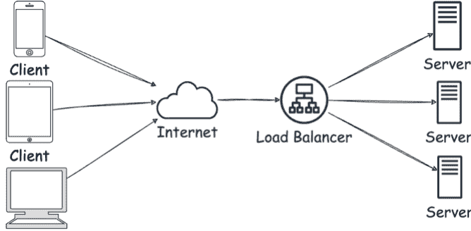

图 7.4: 负载均衡器

当客户端向服务器发送请求时，会产生流量。负载均衡器（无论是硬件还是软件）会拦截这些请求并将它们路由到合适的服务器节点，由该节点处理请求并将响应传递给客户端。负载均衡器会对每个请求重复此过程，使用各种技术来决定由哪个服务器处理每个请求。

## 客户端负载均衡

传统的服务器端负载均衡使用集中式负载均衡器将客户端请求路由到服务器。这可能会由于额外的跳转而引入瓶颈和额外的延迟。另一方面，客户端负载均衡是在客户端层面分负载，而不是使用集中式负载均衡器。客户端维护可用服务器列表，并决定将每个请求发送到哪个服务器。我们的项目将利用 Spring Cloud LoadBalancer 作为客户端负载均衡。它提供了可自定义的负载均衡策略，并与服务发现无缝集成，简化了负载均衡配置，并动态管理服务实例，减少了对自定义实现的需求。图 7.5 展示了带有 Spring Cloud LoadBalancer 的身份验证和用户服务。

## 使用 Spring Cloud LoadBalancer 均衡

« 周期性缓存更新 >>

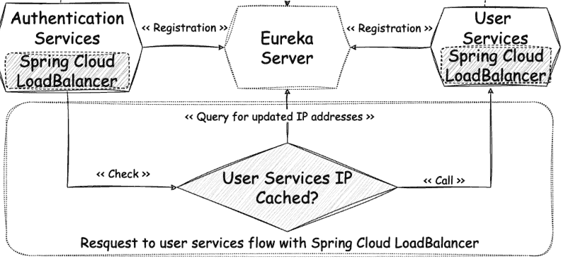

图 7.5: 服务添加了 Spring Cloud LoadBalancer

让我们仔细研究它的工作原理：

- **注册**：身份验证服务和用户服务在启动期间都会向 Eureka 服务器注册它们的实例和 IP 地址。这允许 Eureka 维护一个可用服务及其位置的注册表。
- **周期性缓存更新**：Spring LoadBalancer 通过定期刷新 Eureka 服务器中的 IP 地址来保持缓存为最新。这确保了缓存数据与服务注册表保持一致。
- **带有 Spring Cloud LoadBalancer 请求用户服务的流**：当身份验证服务需要请求用户服务时，将执行以下流程：
    - **检查**：当身份验证服务需要调用用户服务时，它们首先调用 Spring Cloud LoadBalancer，它会检查本地缓存中用户服务的 IP 地址。
    - **缓存用户服务的 IP 地址**：如果缓存包含服务的 IP 地址，身份验证服务将直接调用用户服务。
    - **查询 Eureka 获取更新的 IP 地址**：如果 IP 地址未缓存，Spring Cloud LoadBalancer 将查询 Eureka 服务器以获取用户服务的 IP 地址列表。一旦获取这些地址，身份验证服务将调用用户服务。

当将 Spring Cloud LoadBalancer 添加到服务中时，Eureka 服务器的负载减轻了，因为服务在本地缓存了服务的 IP 地址并定期刷新它们。现在让我们来实现客户端负载均衡。

## 实现客户端负载均衡

为了在使用 Spring CloudBalancer 在我们的服务中实现负载均衡，我们必须添加 `spring-cloud-starter-loadbalancer` 依赖：

```java
<dependency>
  <groupId>org.springframework.cloud</groupId>
  <artifactId>spring-cloud-starter-loadbalancer</artifactId>
</dependency>
```

在 `BeansConfiguration` 类中，让我们设置 RestClient，通过 `@LoadBalancer` 注解在每次调用中使用负载均衡器：

```java
@LoadBalancer
@Bean
public RestClient.Builder restClient() {
  return RestClient.builder();
}
```

现在，我们必须重构进行调的代码。让我们以身份验证服务中 `UserRestApiClient` 获取用户角色的代码为例：

```java
ResponseEntity result = restClient.build()
  .get()
  .uri(URI.create("http://USER-SERVICES/v1/users/" + username + "/roles"))
  .retrieve()
  .body(ResponseEntity.class);
```

该代码替换了之前的指令 `.uri(serviceInstance.getUri() + "/v1/users/{username}/roles", username)`，改为了 `.uri(URI.create("http://USER-SERVICES/v1/users/" + username + "/roles"))`。它替换了之前使用 `DiscoveryClient` 且没有轮切换能力的调用。

在使用负载均衡时，RestClient 使用虚拟主机名 `USER-SERVICES` 处理 URL，以向负载均衡器请求服务实例，而不是从客户端服务获取实际的服务位置和端口。

Spring Cloud LoadBalancer 以轮询方式在可用服务实例之间均匀分布请求。让我们测试负载均衡并检查它是否按预期工作。

## 检查负载均衡

为了检查负载均衡是否正常工作，让我们在身份验证服务中做一些更改，记录负载均衡客户端调用的服务路径。

> > 注意
> 代码中的以下更改仅用于检查负载均衡是否工作。

下面的代码段是一个自定义拦截器，它实现了另一个 `ClientHttpRequestInterceptor` 并重写了 `intercept` 方法，以记录它调用的用户服务的路径和端口号：

```java
@Component
public class CustomLoadBalancerInterceptor implements
    ClientHttpRequestInterceptor {

    private final LoadBalancerClient loadBalancerClient;

    @Override
    public ClientHttpResponse intercept(HttpRequest request,
        byte[] body, ClientHttpRequestExecution
        execution) throws IOException {
        ServiceInstance instance = loadBalancerClient.choose(
            "USER-SERVICES")
        if (instance != null) {
            log.info("Calling service instance: host={},
                port={}", instance.getHost(),
                instance.getPort()), request.getURI().getPath()));
```

它将拦截请求并记录用户服务的详细信息。`ServiceInstance instance = loadBalancerClient.choose("USER-SERVICES")` 指令使用负载均衡器获取实例。然后，在 `BeansConfiguration` 类中，我们重构了 `restClient` 方法：

```java
public RestClient.Builder restClient(
    CustomLoadBalancerInterceptor customBalancerInterceptor) {
        return RestClient.builder()
            .requestInterceptor(customBalancerInterceptor);
```

我们必须将 `CustomLoadBalancerInterceptor` 作为参数传递 `restClient` 方法并添加 `.requestInterceptor(customBalancerInterceptor)`，这将拦截每次调用。

配置完成后，让我们测试它。首先启动 `service-discovery`，然后是 `authentication-services` 和 `user-services`。在根目录按以下命令多次运行 `user-services`：

```bash
mvn spring-boot:run -Dspring-boot.run="--server.port=8086"
```

在此示例中，用户服务使用了端口 8081、8084、8085、8086 和 8087，如例所示。

当前注册到 Eureka 的实例

| 应用 | 可用性区域 | 状态 |
| --- | --- | --- |
| AUTHENTICATION-SERVICES | n/a | (1) | UP (1) - wandsock-mackbook-pro.local.authentication-services:8080 |
| USER-SERVICES | n/a | (5) | UP (0) - wandsock-mackbook-pro.local.user-services:8086, wandsock-mackbook-pro.local.user-services:8087, wandsock-mackbook-pro.local.user-services:8081 |

图 7.6: 用户服务实例

多次运行以下 `curl` 命令，或者使用存储在仓库中提供的 Postman 集合：

```bash
curl --location 'http://localhost:8080/v1/api/auth/ \
--header 'Content-Type: application/json' \
--data-raw '{
  "username": "user@wxauction.com",
  "password": "test123"
}'
```

图 7.7 显示了使用 curl 命令后的可用性状态：

查看用户的端口号；它在可用的用户服务实例之间轮询。第一个实例是 8081，在调用所有实例后，它又从 8081 开始。


# 使用 Spring Cloud Gateway 进行路由

网关是客户端请求的入口，将这些请求路由到网络中适当的服务。在微服务架构中，网关充当反向代理，根据请求的路径、标头或其他标准将客户端请求路由到适当的微服务。它通过提供单一访问点简化了客户端的交互。它可以强制执行安全策略、管理流量并执行其他基本任务，以确保客户端与服务之间高效且安全的通信。

## 使用网关的益处

在微服务架构中实现网关时，我们可以获得以下收益：

- **集中化路由**：通过提供单一端点 http://localhost:8072 来访问各种服务，从而简化客户端的交互。

- **安全性**：网关可以通过集中管理身份验证和授权来增强安全性，确保只有经过验证并许可的用户才能访问系统资源。它还可以监控并记录所有请求，提供全面的审计追踪，帮助您实时识别并响应服务中的可疑活动。此外，网关还可以在请求到达后端服务之前进行过滤和验证，防止诸如 SQL 注入、跨站脚本 (XSS) 和分布式拒绝服务 (DDoS) 攻击等常见的安全威胁。

- **负载均衡**：网关可以通过将传入的请求均匀地分布在服务的多个实例上执行负载均衡功能，从而提高可用性和性能。

- **限流**：网关可以通过控制传入请求的速率来限制给定时间内请求的数量，以防止服务过载。这有助于缓解由于流量激增导致的服务性能下降或中断的风险。

- **监控与分析**：网关通过收集所有入出流量的全面指标和日志来增强监控与分析，提供监控和分析的集中点。这种集中化的方法允许聚合所有服务的详细性能数据，例如请求和响应时间、错误率和吞吐量。这有助于识别性能瓶颈、优化资源利用并调整系统以获得更高的效率。

在使用网关时，关注可能影响您微服务架构的关键问题至关重要。一个问题是，如果网关没有针对高可用性设计，它可能会成为瓶颈或单点故障。必须分析并实施如负载均衡、水平扩展、多区域冗余、监控、自愈机制、限流和 DDoS 保护等策略，以确保高可用性并防止任何单点故障。

另一个问题是延迟，因为每个请求都必须经过额外的跳数，可能会引入延迟。在了解网关是什么以及在微服务架构中使用网关优缺点之后，让我们深入研究 Spring Cloud Gateway。

## 使用 Spring Cloud Gateway 实现网关

Spring Cloud Gateway 是一个 Spring 项目库，用于使用 Spring WebFlux 或 Spring Web MVC 在微服务架构中构建和部署 API 网关。它提供了一些关键特性，如路由、谓词（predicates）和过滤器（filters）。

指向特定服务的路由可以是静态或动态的。静态路由在应用程序配置文件中预定义，而动态路由在运行时使用 Eureka 等机制进行配置。每个路由都可以使用谓词和过滤器进行自定义，以定制路由逻辑。谓词是决定是否应该路由请求的条件，而过滤器可以修改传入和传出的请求及响应。

让我们继续网关实现并深入研究这些功能。图 7.8 展示了带有网关服务的在线拍卖微服务架构。

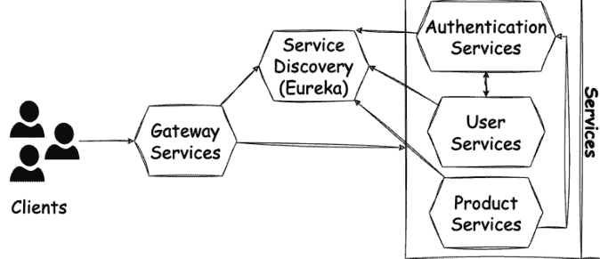

图 7.8：带有网关的在线拍卖微服务架构

网关服务是我们的在线拍卖应用的入口。任何客户端对任何服务的调用都必须通过网关服务。由于网关从服务发现获取服务地址，它会将调用重定向到适当的服务。网关后方服务之间的通信保持直接；也就是说，它们直接相互通信，而不通过网关。

网关将是一个名为 `gateway-services` 的新服务，可以使用 Spring Initializr 创建。图 7.9 展示了需要添加到项目中的依赖：

### 依赖

- Spring Boot Actuator：支持内置（或自定义）端点，允许您监控和管理应用程序——例如应用程序健康状况、指标、会话等。
- Eureka Discovery Client：一种基于 REST 的服务，用于定位服务，以便进行中间层服务器负载均衡和故障转移。
- Reactive Gateway：为响应式应用中路由到 API 提供了一种简单而有效的方法。为这些 API 提供跨切关注点，如安全性、监控/指标和韧性。
- Cloud LoadBalancer：使用 Spring Cloud LoadBalancer 实现客户端负载均衡。

> 图 7.9：网关服务的依赖

reactive gateway 依赖增加了网关功能。`Eureka Discovery Client` 将网关连接到服务发现，以获取服务地址并连接自身。`Spring Boot Actuator` 提供监控网关的功能性端点。因此，让我们配置网关连接到发现服务。

## 将网关连接到发现服务

一旦创建项目，就需要以下配置将网关连接到服务发现：

```
spring:
  cloud:
    gateway:
      discovery.locator:
      enabled: true
      lower-case-service-id: true
```

将 `spring.cloud.gateway.discovery.locator.enable` 配置为 `true` 允许您根据与服务发现注册的服务创建路由，而 `lower-case-service-id` 将允许我们在 URL 中使用小写调用服务。

## Spring Cloud 中的微服务模式

省略了连接到 Eureka 的配置，因为它与服务发现章节讨论的内容相同。现在，让我们调用身份验证服务。

图 7.10 展示了通过网关对身份验证服务的调用。

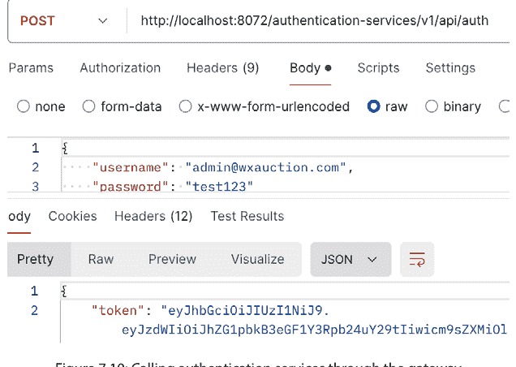

它通过网关调用身份验证服务。Spring Boot Actuator 提供端点来查看网关管理的路由和配置，

```
{
  "token": "eyJhbGciOiJIUz1NiIsInR5cCI6IkXVCJ9",
  "predicate": "Paths: [/authentication-services/**], match slash: true",
  "metadata": {
    "management.port": "8080"
  },
  "route_id": "ReactiveCompositeDiscoveryClient_AUTHENTICATION-SERVICES",
  "filters": [
    "[RewritePath /authentication-services/(?<remaining>.*) = ${remaining}, order = 1]"
  ],
  "uri": "lb://AUTHENTICATION-SERVICES",
  "order": 0
}
```

图 7.11：网关管理的路由和配置

如果我们调用8072/actuator/gateway/routes，可以看到网关管理的路由。现在，让我们学习谓词和过滤器。

## 谓词和过滤器

在 Spring Cloud Gateway 中，谓词和过滤器是管理和处理传入请求及传出响应的重要组件。它们在请求处理管道中扮演着不同但互补的角色，允许复杂的路由和处理逻辑。

## 谓词 (Predicates)

谓词定义了路由到特定后端服务必须满足的条件。它们作为决定特定路由是否处理请求的标准或规则。它评估传入请求的各种属性，例如 URL 路径、标头、查询参数、HTTP 方法等。

### 内置谓词

Spring Cloud Gateway 提供了许多内置谓词，包括：

- After / Before / Between：匹配特定日期时间之后、之前或两个日期之间的请求。
- Header：根据特定名称和值的标头匹配请求。
- Method：根据 HTTP 方法（如 GET 或 POST）匹配请求。
- Path：根据 URL 路径匹配请求。
- Query：根据特定名称和值的查询参数匹配请求。

Spring Cloud Gateway 的内置谓词为根据传入请求的属性定义路由规则提供了强大的方法。

### 过滤器 (Filters)

过滤器是强大的功能，允许您修改传入的 HTTP 请求和传出的响应。过滤器可以全局应用，也可以应用于单个路由，它们在处理管道中起着至关重要的作用，通过启用身份验证、日志记录、指标和限流等跨切关注点来实现功能。


### 内置过滤器

Spring Cloud Gateway 提供了一组丰富的内置过滤器，可以轻松处理常见场景。主要的过滤器如下：

- **RequestHeader**: 在请求中添加标头
- **ResponseHeader**: 在响应中添加标头
- **RequestParam**: 在请求中添加查询参数
- **RewritePath**: 使用正则表达式重写请求路径
- **ModifyRequestBody**: 修改请求体

现在通过一个示例来深入了解谓词（predicates）和过滤器。

## 使用谓词和过滤器修改 URL

让我们使用谓词和过滤器来缩短认证服务的 URL。如下地址中的调用将使用 `authentication` 而不是 `authentication-services`：`http://localhost:8072/authentication/v1/api/auth`。以下配置片段实现了这一功能：

```
routes:
  - id: auth
    uri: lb://authentication-services
    predicates:
      - Path=/authentication/**
    filters:
      - RewritePath=/authentication/(?<path>.*), /${path}
```

此配置创建了一个网关路由，通过负载均衡（特别是通过 URI `lb://authentication-services`）将流量导向 `authentication-services` 服务。

`Path` 谓词规定，任何 URL 路径以 `/authentication/` 开头的传入请求将被重定向到 `authentication-services`。

`RewritePath` 过滤器利用正则表达式在请求转发到目标服务之前修改其 URL 路径。

除了内置谓词和过滤器外，我们还可以创建非常强大的自定义过滤器。

## 自定义过滤器

自定义过滤器允许您在内置功能之外修改和增强请求及响应的处理。它们实现了认证、日志、限流和数据转换等交叉关注点。自定义过滤器对流量流提供了更强的控制，可以全局应用于单个路由，并根据执行阶段分为前置过滤器（pre-filters）和后置过滤器（post-filters）：

- 前置过滤器（Pre-filters）：这些过滤器在请求转发到下游服务之前执行
- 后置过滤器（Post-filters）：这些过滤器在下游服务接收响应并在返回给客户端之前执行

以下代码片段检查请求头中是否存在 `x-correlation-id` 属性。如果不存在，则将其发送到下游服务，并返回给客户端：

```java
@Component
public class CustomGlobalFilter implements GlobalFilter {
  @Override
  public Mono<Void> filter(ServerWebExchange exchange, GatewayFilterChain chain) {
    if (correlationId == null) {
      correlationId = UUID.randomUUID().toString();
      exchange.getRequest().mutate().header(
        "x-correlation-id", correlationId
      ).build();
    }
    String finalCorrelationId = correlationId;
    return chain.filter(exchange).thenRunnable(() -> {
      exchange.getResponse().getHeaders().add(
        "x-correlation-id", finalCorrelationId
      );
    });
  }
}
```

要创建一个过滤器，`CustomGlobalFilter` 实现了 Spring Cloud Gateway 的 `GlobalFilter` 接口。`GlobalFilter` 接口包含一个带有 `ServerWebExchange` 参数的单方法（代表当前的 HTTP 请求和响应）以及 `GatewayFilterChain` 参数（代表将通过的过滤器链）。通过方法签名，该代码是前置过滤器的逻辑实现，示例指令 `getRequest().mutate().header(CORRELATION_ID, correlationId).build()` 为下游服务添加了 `x-correlation-id` 属性，而后置过滤器在函数式编程指令链 `chain.filter(exchange).then(Mono.fromRunnable(() -> { exchange.getResponse().getHeaders().add(CORRELATION_ID, finalCorrelationId) }))` 中执行，为响应头添加了 `x-correlation-id` 属性。

图 7.12 显示了它返回给客户端。

```
POST http://localhost:8072/authentication/v1/api/auth
```

| Params | Auth Headers (9) | Body | Scripts Settings |
| :--- | :--- | :--- | :--- | :--- |
| Headers | 200 OK 6.22 s 639 B Save as example | | | |
| x-correlation-id 4117feeb-1960-493b-9fec-278c7b0bb65 | | | | |

图 7.12：返回给客户端的属性头 x-correlation-id

网关服务向客户端返回了 `x-correlation-id` 属性头。

Spring Cloud Gateway 有效地管理和路由了请求，提供了谓词、过滤器和服务注册集成功能。这些能力增强了灵活性、安全性和性能。虽然它可能会引入一些延迟，但集中化的路由、安全和监控使其成为开发和管理健壮、可扩展且高效的微服务架构的关键。

## 使用 Spring Cloud Config 管理配置

在微服务架构中，随着应用程序的扩展和服务数量的增加，管理配置至关重要。通过应用程序本地管理配置会带来严重问题，特别是在安全性方面（例如数据库密码），以及属性值更改时需要重新部署。虽然对于小型项目简单且适用，但随着应用程序的增长，本地管理配置可能会变得繁琐且容易出错。

配置管理器服务提供了一种跨多个应用程序和环境的集中配置方法。该服务将配置管理外部化，实现了动态更新和集中控制。图 7.13 展示了微服务架构，并增加了配置管理服务。

## 使用 Spring Cloud Config 管理配置

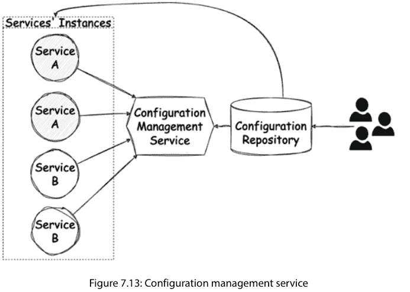

当服务启动时，它们会调用配置管理服务获取配置信息。配置数据存储在仓库中，该仓库可以归类于版本控制下，例如 GitHub、键值数据存储或数据库。团队可以添加或更改值，并且必须通知运行中的服务这些变化。

图 7.13：配置管理服务

## 使用 Spring Cloud Config 实现配置管理

Spring Cloud Config 是一个管理配置的解决方案，实现了分布式系统的集中存储和配置属性管理。它支持多种后端存储选项，包括 Git、SVN、HashiCorp Consul 和 Vault，允许对配置更改进行审计。通过将配置从应用程序代码中外部化，Spring Cloud Config 促进了关注点的清晰分离，并便于了在不重新部署应用程序的情况下管理和更新配置。它由一个作为配置服务器的服务器和一个用于获取配置的客户端库组成，支持动态更新并确保微服务架构中跨环境的一致性。

项目使用公共 GitHub 仓库存储配置文件，地址为：https://github.com/wandersonxs/online-auction-configuration.git。让我们将项目的属性和 YAML 配置文件上传到仓库。图 7.14 显示了已上传文件的仓库。

## 使用 Spring Cloud 的微服务模式

| authentication-services.properties | 认证服务属性 |
| :--- | :--- |
| gateway-services.yaml | 网关 yaml |
| product-services.properties | 产品服务属性 |
| user-services.properties | 用户服务属性 |

图 7.14：上传到 GitHub 仓库的项目文件

你可能注意到文件名并不是 `application.properties` 或 `application.yaml`。Spring Cloud Server 根据项目名称来识别服务的正确配置。文件名格式为 `applicationname.properties` 或 `applicationname-profile.properties`（例如 `authentication-services-dev.properties` 和 `authentication-services-prod.properties`）。在这里我们将使用默认模式 `applicationname.properties`，不指定配置。

一旦创建了仓库并上传了文件，让我们创建配置服务器；我们的服务将命名为 `configuration-services`。

图 7.15 展示了项目的依赖项。

| Dependencies | 添加依赖... |
| :--- | :--- |
| **Config Server SPRING CLOUD CONFIG** | 通过 Git、SVN 或 Hashi Vault 进行集中配置管理。 |
| **Eureka Discovery Client SPRING CLOUD DISCOVERY** | 用于负载均衡和中间层服务器故障的 REST 服务发现。 |
| **Cloud LoadBalancer SPRING CLOUD ROUTING** | 使用 Spring Cloud LoadBalancer 进行客户端负载均衡。 |
| **Spring Boot Actuator OPS** | 支持内置（或自定义）端点，用于监控和管理应用程序——如健康状况、指标、会话等。 |

图 7.15：项目的依赖项


## 使用 Spring Cloud Config 管理配置

Spring Cloud Config 实现了集中管理。Eureka Discovery Clients 将配置服务连接到服务发现和客户端负载均衡。Spring Boot Actuator 提供了常用的端点（endpoints）来管理配置服务器。

以下代码片段展示了带有 @EnableConfigServer 注解的 Spring Boot 主类：

```java
@EnableConfigServer
@SpringBootApplication
public class ConfigurationsServicesApplication {
```

@EnableConfigServer 注解启用了 Spring Cloud Config Server，配置片段则对其配置进行了细化：

- spring.cloud.config.server.git.uri=https://github.com/wandansonx/online-auction-configuration.git
- spring.cloud.config.server.git.default-label=main

spring.cloud.config.server.git.properties 文件设置了配置文件所在的 GitHub 仓库地址，而 spring.cloud.config.server.git.default-label 设置了获取文件的分支，在本情况下为 main 分支。

一旦配置服务器运行，我们就可以通过 http://localhost:8888/authentication-services.yml 访问配置数据，其中 authentication-services 是服务名称。我们可以使用 .yml 获取 yaml 格式的结果，或使用 .properties 获取 properties 格式的结果，如图 7.16 所示。


```yaml
spring.application.name: authentication-services
server.port: 8080
eureka.client.serviceUrl.defaultZone: http://local
eureka.instance.preferIPAddress: true
spring.data.mongodb.uri: mongodb://auction_app:auc
management.endpoints.exposure.include: *
security.jwt.secret-key: db839c04439b5f4361bea3985
security.jwt.expiration-time: 86400000
```

> 图 7.16：authentication-services 配置

显示 authentication-services 的配置数据。如果我们将路径改为 user-services.yml，则用户服务的配置数据将以 YAML 文件输出。让我们调整服务以连接配置服务器并获取数据。

## 调整服务以连接配置服务器

让我们获取认证服务并设置为连接到配置服务。该过程适用于所有其他服务。

在服务中添加以下依赖项：

```xml
<dependency>
  <groupId>org.springframework.cloud</groupId>
  <artifactId>spring-cloud-starter-config</artifactId>
</dependency>
<dependency>
  <groupId>org.springframework.cloud</groupId>
  <artifactId>spring-cloud-starter-bootstrap</artifactId>
</dependency>
```

spring-cloud-starter-config 启用了与配置服务器的连接，spring-cloud-starter-bootstrap 确保在主应用程序上下文初始化之前加载来自 Spring Cloud Config Server 的配置属性。换句话，如果没有它，应用程序将在从配置服务器获取属性之前尝试注入属性，导致应用程序崩溃。

以下配置片段展示了新的属性：

```properties
spring.application.name=authentication-services
server.port=8080
spring.config.import=optional:configserver:${CONFIG_SERVER_URI:http://localhost:8888}
```

应用程序名称和端口配置应该在项目本地指定，因为这些设置对于 Spring Boot 程序的初始启动和引导至关重要。`config.import=optional:configserver:${CONFIG_SERVER_URI:http://localhost:8888}` 属性指示 Spring Boot 从配置服务检索配置。`CONFIG_SERVER_URI` 环境变量指定服务的 URL，如果未设置，则默认为 http://localhost:8888。`optional:` 前缀确保即使配置服务不可用，应用程序也可以启动。

就是这些了！当认证服务启动时，它们将在配置服务器中查找配置。如果在服务运行期间我们更新了属性值，更改将自动被捕获，无需重启。

## 如果属性发生变化会发生什么？

如果我们更新了 GitHub 仓库中应用程序的属性值，配置服务器将提供最新的属性值版本。然而，如果应用程序正在运行，Spring Boot 不会更新正在运行的应用程序属性值。因此，我们可以重启应用程序，或者使用 Spring Boot Actuator 提供的注解 @RefreshScope。以下代码片段显示：

```java
@RefreshScope
@SpringBootApplication
public class AuthenticationServicesApplication {
```

主 Spring Boot 应用程序类已添加了 @RefreshScope 注解。然后，Spring Boot Actuator 为我们提供了 /actuator/refresh 端点，用于从配置服务器获取最新值。以下 curl 命令可以通过刷新来实现：

```bash
curl -X POST http://localhost:8080/actuator/refresh
```

将配置外部化到配置服务器并使用 Git 仓库简化了配置管理，确保了多个环境之间的一性和易于更新。让我们学习如何使用 Resilience4J 为我们的服务应用弹性。

## 使用 Resilience4J 应用弹性

弹性对于在微服务架构中维护系统的稳定性和可靠性至关重要。弹性是指系统优雅处理故障并从故障中恢复的能力。与单体架构不同（一个组件的故障可能导致整个系统不可用），微服务可以设计为隔离故障并继续平稳运行。这就是弹性模式和如 Resilience4j 等工具发挥作用的地方我们将探索五个关键的客户端弹性模式：断路器（circuit breaker）、重试（retry）、限流（rate limiter）、隔离（bulkhead）和降级（fallback）。

客户端弹性模式是应用于客户端的策略和技术，用于在与微服务通信时处理故障。这些模式有助于应对服务不可用、延迟问题和其他故障，从而提高整体可靠性。

## 断路器 (Circuit breaker)

断路器模式防止客户端反复调用故障的服务。它监控故障数量，如果达到阈值，它将断开并停止发送请求，为故障的服务提供恢复时间。断路器有三种状态：开启（open）、半开启（half-open）和关闭（closed）。图 7.17 显示了断路器的状态。

## Spring Cloud 中的微服务模式


断路器流程如下：

1. 请求通过关闭状态，但如果故障超过阈值，断路器进入开启状态。
2. 在开启状态下，请求被阻塞。超时后，它移动到半开启状态。
3. 在半开启状态下，允许有限数量的测试请求。
4. 如果成功，状态返回关闭；否则返回开启。

现在我们知道了断路器是如何工作的，让我们来实现它。认证服务调用用户服务以获取角色，让我们使用 Resilience4j 实现断路器模式。

必须在认证服务中添加以下依赖项以启用断路器弹性模式：

```xml
<dependency>
  <groupId>io.github.resilience4j</groupId>
  <artifactId>resilience4j-spring-boot-3</artifactId>
</dependency>
<dependency>
  <groupId>org.springframework.boot</groupId>
  <artifactId>spring-boot-starter-aop</artifactId>
</dependency>
```

resilience4j-spring-boot-3 通过将 Resilience4j 与 Spring Cloud 集成，使得在 Spring Boot 应用程序中管理断路器更加简单。Spring Boot 应用程序中使用 Resilience4j 注解需要 aOP 依赖，因为这些注解依赖 Spring AOP 来处理断路器逻辑和其他交叉关注点。

现在，在认证服务中，我们在调用用户服务获取用户角色时启用断路器：

```java
public class UserRestApi implements UserRepository {
    @CircuitBreaker(name = "UserServices")
    @Override
    public List<String> getRolesByUsername(String username) {...
```

@CircuitBreaker 注解激活了 getByUsername 方法的断路器。UserServices 作为实例用于断路器配置，如下片段所示：

```yaml
resilience4j.circuitbreaker:
  instances:
    userServices:
      register-health-indicator: true
      wait-duration-in-open-state: 10s
      failure-rate-threshold: 10
      slow-call-rate-threshold: 10
      slow-call-duration-threshold: 1s
      minimum-number-of-calls: 5
      automatic-transition-from-open-to-half-open-enabled: true
```

在 instances 下，我们为不同的服务定义独立的断路器，例如 userServices 或任何需要的服务。


failure-rate-threshold 设置失败率的百分比阈值。如果失败调用的比例超过 10%，断路器将跳转到打开（open）状态。

slow-call-rate-threshold 设置慢调用率的百分比阈值。如果慢调用的百分比超过 10%，断路器在跳转到打开状态时会考虑这一因素。

slow-call-duration-threshold 定义了调用被视为慢调用之前需要的时间。任何耗时最多 1 秒的调用都被视为慢调用。该阈值与 slow-call-rate-threshold 配合使用，用于确定断路器是否应该跳转到打开状态。

minimum-number-of-calls 参数指定了计算失败调用之前所需的最小调用次数。只有在进行至少五次调用后，断路器才会考虑跳转到打开状态。

automatic-transition-from-open-to-half-open-enabled 设置为 true 将自动从打开状态到半打开状态（half-open）。

让我们测试一下我们的断路器实现。

## 测试断路器

设置好断路器后，运行用户服务以外的所有服务。不要运行用户服务。

现在，让我们调用身份认证服务端点 http://localhost:8080/v1/api/auth 几次。图 7.17 显示了结果。

| Body | Cookies | Headers (13) | Test Results |
|---|---|---|---|
| 1 | | | "type": "about:blank", |
| 2 | | | "title": "Internal Server Error", |
| 3 | | | "status": 500, |
| 4 | | | "detail": "CircuitBreaker 'userServices' is OPEN and does not permit further calls", |
| 5 | | | "instance": "/v1/api/auth", |
| 6 | | | "description": "unknown internal server error." |


这表明用户服务处于打开状态，在它再次关闭之前不允许进一步调用，图 7.19 展示了其对应的指标。

## 使用 Resilience4J 应用弹性弹性

```json
{
  circuitBreakers: {
    userServices: {
      failureRate: "80.0",
      slowCallRate: "0.0",
      failureRateThreshold: "10.0%",
      slowCallRateThreshold: "10.0%",
      bufferedCalls: 5,
      failedCalls: 4,
      slowCalls: 0,
      slowFailedCalls: 0,
      notPermittedCalls: 3,
      state: "OPEN"
    }
  }
}
```

图 7.19：userServices 的断路器指标

指标是通过 Spring Boot Actuator 端点 http://localhost:8080/actuator/circuitbreakers 获取的，该端点展示了失败率、慢调用率、不允许的调用、断路器状态等。

有很多参数可以完善我们的配置，值得探索 Spring Cloud Resilience4J 文档。现在，让我们检查回退模式。

## 回退 (Fallback）

回退模式在服务请求失败时提供备用响应或行为。这可以是一个默认值、缓存响应或对另一个服务的调用。

我们只需要在 @CircuitBreaker 注解中指定 fallbackMethod 即可在代码中实现回退：

```java
@CircuitBreaker(name = "userServices",
  fallbackMethod = "getRolesFromCache")
public List<String> getRolesByUsername(String username) {
```

我们需要使用以下代码片段创建 getRolesFromCache 方法：

```java
public List<String> getRolesFromCache(String username, Throwable t) {
  return List.of("ROLE_GUEST");
}
```

fallbackMethod 必须遵循与原始方法相同的返回值和参数，外加上 Throwable 参数，该参数是最后一个参数。

不要运行用户服务来测试回退。返回令牌后，在 https://jwt.io 检查它。它包含了回退返回的 ROLE_GUEST。现在，让我们进入重试模式。

## 重试 (Retry）

重试模式允许客户端在放弃之前自动重试失败的请求一定次数。这适用于瞬态错误，例如网络超时、速率限制和程序不可用，这些错误可以通过后续尝试来解决。

使用 Resilience4J 实现重试非常简单。在用于启用断路器的 getServicesByUsername 函数上方添加以下代码片段：

```java
@Retry (name = "userServicesRetry", fallbackMethod = "getRolesFromCache")
```

@Retry 注解启用了重试模式，下面的配置片段设置了重试机制：

```yaml
resilience4j.retry:
instances:
  userServicesRetry:
    max-attempts: 3
    wait-duration: 1s
metrics:
  enabled: true
```

它为 userServicesRetry 实例定义了重试策略。max-attempts 参数指定了最多三次重试尝试，并通过 wait-duration 参数在每次尝试之间设置一秒的暂停。metrics 块启用了指标的收集，以监控重试行为。这种设置通过重试操作处理了瞬态故障，并通过指标提供了重试过程的可视性。

不要运行用户服务来测试重试。如果你调试代码，你会发现当经过三次重试后，它会调用 getRolesFromCache 回退，返回 ROLE_GUEST 角色。我们探索的下一个模式是限流器。

## 限流器 (Rate limiter）

限流器模式控制发送到服务的请求速率，以防止其过载。它限制了给定时间范围内的请求数。

要实现限流，必须添加以下依赖：

```xml
<dependency>
  <groupId>io.github.resilience4j</groupId>
  <artifactId>resilience4j-ratelimiter</artifactId>
</dependency>
```

在方法上方添加 @RateLimiter 注解以实现限流器，如下代码片段所示：

```java
@RateLimiter(name = "userServicesRateLimiter")
public List<String> getRolesByUsername(String username) {
```

然后，我们需要指定限流器配置，如下配置片段所示：

```yaml
resilience4j:
  ratelimiter:
    metrics:
      enabled: true
  instances:
    userServicesRateLimiter:
      register-health-indicator: true
```

instances 部分为 userServicesRateLimiter 定义了单独的限流设置。register-health-indicator 启用了健康指示器。metrics 块启用了指标的收集以监控限流器行为。这种设置通过重试操作处理了瞬态故障，并通过指标提供了重试过程的可视性。（等等，让我们根据文本流重新对齐）。

*基于文本流的修正：*
instances 部分为 userServicesRateLimiter 定义了单独的限流设置。register-health-indicator 启用了健康指示器。metrics 块启用了指标的收集以监控限流器行为。

等等，查看表格/结果块：
图 7.20 显示了达到限流器的情况。

```json
{
  "type": "about:blank",
  "title": "Internal Server Error",
  "status": 500,
  "detail": "RateLimiter 'userServicesRateLimiter' does not permit further calls",
  "instance": "/v1/api/auth",
  "description": "unknown internal server error."
}
```
图 7.20：限流结果

## 舱（Bulkhead）

舱模式隔离系统的不同部分，防止一个组件的故障级联到其他组件，例如用户服务的高流量影响到产品服务。这可以通过为不同的服务或功能分配资源（如线程池）来实现。Resilience4j 提供了两种舱类型：SEMAPHORE（信号量），限制并发调用，适用于单个 JVM 内的轻量级非阻塞操作；以及 THREADPOOL（线程池），使用边界队列和线程池来处理请求，通过管理并发来实现舱调用和 I/O 操作。

以下代码片段实现了舱模式：

```java
@Bulkhead(name = "userServiceBulkhead", type = Bulkhead.Type.SEMAPHORE)
public List<String> getRolesByUsername(String username) {
```

使用 Resilience4j，我们只需要在方法上方添加 @Bulkhead 注解及其类型，例如 SEMAPHORE。

以下代码片段提供了舱模式的配置：

```yaml
resilience4j:
  bulkhead:
  instances:
    userServiceBulkhead:
      max-concurrent-calls: 3
      max-wait-duration: 1s
  metrics:
    enabled: true
```

在 instances 部分，配置为 userServiceBulkhead 定义了单独的舱设置。max-concurrent-calls 设置允许最多三次并发调用。max-wait-duration 设置将最大等待时间设置为一秒，这意味着如果舱满，线程将等待最多一秒获取权限后失败。

要测试它，请在 UserController 类的 getUserRoles 方法开头添加以下代码：

```java
Thread.sleep(20000);
```


启动所有服务并多次调用身份验证接口 http://localhost:8080/v1/api/auth。图 7.21 展示了舱隔离（bulkhead）机制的返回结果。

```
{
  "type": "about:blank",
  "title": "Internal Server Error",
  "status": 500,
  "detail": "Bulkhead userServicesBulkhead is full and does not permit further calls",
  "instance": "/v1/api/auth",
  "description": "Unknown internal server error."
}
```

图 7.21：舱隔离结果

当达到三个并发调限制时，第四次调用将不再允许，因为舱已满。

速率限制器（rate limiter）和舱隔离（bulkhead）的区别在于，前者限制特定时间内的总调用次数，而后者限制的是并发调用次数。

# 在微服务架构中展示应用程序

现在在线拍卖应用已经在微服务架构中完全实现，其架构如图 7.22 所示。

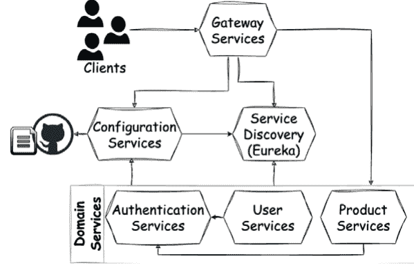

图 7.22：微服务架构中的在线拍卖应用

该图展示了我们使用微服务架构构建的最终在线拍卖架构。在这种设置中，客户端向网关服务发送请求，网关将这些请求路由到相应的领域服务，如认证、用户和产品服务。所有服务都注册在服务发现工具（Eureka）中，允许动态查找和通信。

配置服务处理集中化配置管理。它们从 GitHub 获取设置并将其应用于所有服务。客户端端负载均衡以及断路器（circuit breaker）、降级（fallback）、重试（retry）、速率限制（rate limiter）和舱隔离（bulkhead）等弹性模式的实现进一步增强了架构，确保了在高负载或部分系统故障下的服务的稳定可靠。

该架构展示了几个关键特性：它通过允许微服务独立扩展来支持扩展性，通过 Eureka 实现动态服务发现，通过配置服务维护一致的集中化配置，并通过通过网关交互最小化依赖关系来促进松耦合。

## 总结

在本章中，我们探索了使用 Spring Cloud 的微服务模式。我们关注了服务发现、负载均衡、网关、配置管理和弹性模式。

我们详细讨论了服务发现，强调了实现服务间无缝通信的动态机制。我们使用 Eureka 作为此讨论的案例研究。

接下来，我们涵盖了负载均衡在跨多个服务器分配流量以增强性能和可靠性方面的重要性。我们提供了使用 Spring Cloud LoadBalancer 实现客户端负载均衡的实际步骤，并强调了其在提高系统健壮性方面的作用。

此外，我们深入介绍了使用 Spring Cloud Gateway 的网关实现，解释了网关如何作为代理进行中央路由、增强安全性并有效管理 HTTP 请求。我们还讨论了使用谓词（predicates）和过滤器（filters）来自定义路由逻辑。

本章还探索了使用 Spring Cloud Config 进行配置管理，说明了集中配置管理对于分布式系统的处。我们解释了如何外部化配置属性并使微服务连接到配置服务器。

最后，我们引入了使用 Resilience4j 的弹性模式，例如断路器、重试、速率限制、舱隔离和降级。这些模式对于通过优雅处理故障和确保无缝运行来维持系统的稳定和可靠至关重要。

总体来说，本章让你掌握了微服务架构中服务发现、负载均衡、网关、配置管理和弹性模式的全面知识。这些信息对于创建健壮、可扩展和可维护的基于微服务的应用程序非常有价值。

在第 8 章“事件驱动架构”中，我们将使用 Spring Cloud Stream 探索事件驱动架构的核心原理和实际应用。

## 问题

1. Eureka 如何促进微服务之间的动态通信？
2. 客户端负载均衡是如何提高微服务中系统性能的？
3. Spring Cloud Gateway 提供的用于管理微服务 API 请求的某些关键特性有哪些？
4. Spring Cloud Gateway 中谓词和过滤器的作用是什么？它们是如何协同工作的？
5. 为什么集中化配置管理在微服务中很重要？Spring Cloud Config 是如何实现此点的？
6. Resilience4J 中断路器模式的目的是什么？它如何增强系统韧性？

# 8
事件驱动架构

本章涵盖了事件驱动架构，这对于现代软件开发至关重要，尤其是对于微服务。它解释了这种架构的异步特性及其益处，例如系统可扩展性和实时处理能力。它还讨论了实现事件驱动架构的核心组件、优势和挑战。

本章还涉及基础事件概念，讨论了服务交互和工作流，并涵盖了常见的事件驱动模式，如发布/订阅、事件通知、事件携带状态传输（event-carried state transfer）、消息收件箱和发件箱（inbox and outbox）以及 Saga 模式。

本章最后通过 Spring Apache Kafka 在在线拍卖中探索并实现了事件驱动架构。

本章将涵盖以下主题：

- 介绍事件驱动架构
- 理解事件的基础知识
- 探索事件驱动架构模式
- 使用 Apache Kafka 构建事件驱动服务

在本章结束时，你将对事件驱动架构的原理、模式和实际实现有良好的掌握，使你能够使用 Spring Kafka 和 Kafka 设计并构建可扩展、弹性且高效的事件驱动系统。

## 技术要求

本章的所有代码都可以在 GitHub 上找到：https://github.com/PacktPublish/Software-Architecture-with-Spring/tree/main/ch8。代码块中的省略号表示部分代码已省略，完整代码可以在 GitHub 上获取。

# 介绍事件驱动架构

事件驱动架构是一种依赖事件来启动和促进松耦合系统之间通信的范式。它是使用微服务开发的应用程序中的常用方法。

由于其异步特性，事件驱动架构将事件产生与事件消费解耦，并健壮地处理异步数据流。

事件是状态的显著变化或需要系统其他部分感知并响应的发生事件。

# 异步通信

在事件驱动架构的背景下，异步通信指的是一种交互方法，微服务交换信息时不需要双方同时在线并活跃。异步通信可以解耦服务，允许它们通过发送稍后处理的消息进行通信，而不是像同步请求-响应通信那样等待立即响应。这通常通过使用事件代理、队列或流来实现，它们作为中间件在服务之间存储和转发消息。

# 事件驱动架构的核心组件

事件驱动架构的核心组件是生产者、事件、事件代理（通道）和消费者。让我们详细研究这些组件：

- **生产者 (Producers)**：生产者产生源。它们可以是应用程序、服务、设备或任何检测到状态变化并发布事件以信号变化的系统组件。示例包括用户操作（如点击按钮）、系统警报、数据更新和 IoT 设备信号。
- **事件 (Events)**：事件驱动架构的核心元素，代表系统中显著的变化或触发响应的发生事件。
- **事件代理（通道） (Event broker (channel))**：事件代理或通道是事件从生产者传输到消费者的通信媒介。它可以使用各种消息技术实现，包括如 Apache Kafka 和 RabbitMQ 等消息代理器、服务总线或流平台。
- **消费者 (Consumers)**：消费者是接收和处理事件的组件。它们根据消费的事件执行操作，例如更新数据库、触发其他进程或与其他系统通信。消费者可以是应用程序、微服务，甚至是其他事件生产者。


图 8.1 展示了事件驱动架构及其组件：生产者、事件、事件代理程序和消费者。

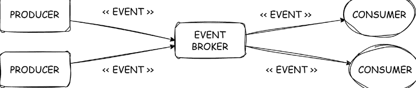

图 8.1：事件驱动架构

该图说明了生产者和消费者之间通过事件代理程序进行的异步通信。生产者生成事件，而事件代理程序充当中间人，从生产者那处接收事件并将其发送给消费者。此图演示了事件代理程序如何实现异步通信、解耦生产者和消费者，并允许他们独立运行。

在设计和实现此类系统时，理解其优势（如可扩展性、增强的系统活性和鲁棒性）并意识到挑战（如确保消息传递的可靠性和管理最终一致性）是非常重要的。意识到这些因素，有助于你在采用这种架构时做出明智的决策。现在，让我们详细探讨事件驱动架构的优势和挑战。

## 事件驱动架构的优势

现代软件开发广泛使用事件驱动架构来构建可扩展且响应迅速的系统。以下是使用它的一些优势和挑战：

- **可扩展性**：事件驱动架构允许系统同时处理许多事件。它对于组件必须独立运行并进行水平扩展的分布式系统来说特别为有效。

- **松耦合**：在事件驱动架构系统中，组件之间是解耦的，允许它们独立地进行开发、部署和扩展。这些组件或服务通过事件进行通信，而不是依赖于直接交互（例如 RESTful API 调用中使用的交互）。这种解耦使得系统更加健壮、适应性更强且易于维护。然而，需要注意的是，服务在逻辑上仍通过事件结构和语义保持耦合。这意味着，对事件格式或含义的任何更改，都需要在生产者和消费者之间进行协调。

- **实时处理和响应能力**：事件驱动架构通过允许组件通过事件进行通信，实现了实时或近实时的数据处理，能够立即捕获并响应变化。事件代理程序将事件从生产者路由到消费者，确保了异步、低延迟的交互。消息队列和事件流技术支持高效的事件处理和可扩展性，使其成为需要即时响应的应用（如金融交易系统、监控服务和物联网应用）的理想选择。

- **鲁棒性**：事件驱动架构可以通过隔离单个组件的故障来增强系统鲁棒性。如果一个组件失败，其他组件可以继续运行，从而降低整个系统故障的风险。

- **简化集成**：事件驱动架构通过事件总线或消息系统促进了异构系统和服务服务之间的集成，使得在不显著更改现有服务的情况下集成新服务变得更容易。

由于任何事物都有权衡，让我们来看看使用事件驱动架构面临的挑战。

## 事件驱动架构的挑战

除了事件驱动架构的优势外，还有我们必须注意的挑战：

- **复杂性**：设计和实现事件驱动系统需要仔细的规划，以管理事件、服务依赖以及潜在的竞态条件（在竞态条件下，多个服务进程并行运行，结果取决于事件处理的顺序）。适当的事件流管理对于确保正确的处理顺序以及防止消息丢失或重复至关重要。

- **调试和监控**：由于异步性质，事件驱动系统可能会带来重大的管理挑战。追踪事件流和识别问题源需要先进的监控和日志工具。为了解决事件驱动架构中的调试和监控挑战，请利用 Prometheus 和 Grafana 等高级监控工具获取实时洞察，并使用 Elasticsearch、Logstash 和 Kibana (ELK) 栈等集中日志解决方案来聚合日志。采用 Zipkin 和 Jaeger 等分布式追踪工具来可视化事件，并设置告警系统进行实时检测。维护详细的文档并使用可视化工具绘制事件流图，有助于理解和调试系统。

- **一致性**：由于事件到达顺序错乱或处理时间差异，在事件驱动架构中维护数据一致性可能是具有挑战性的。通过事件溯源、分布式事务模式（如消息收件箱订单模式和 Saga 模式）以及针对最终一致性进行设计，可以确保数据可能暂时不一致，但最终会收敛到正确状态。此外，幂等事件处理器通过确保多次处理同一个事件的结果与处理一次相同，从而防止意外的副作用。

- **事件过载**：过量的事件生成会压力事件代理程序，增加存储需求和处理延迟。有效的事件过滤和优先级排序有助于确保高效生成和消费有意义的事件。

- **数据重复**：在事件驱动架构中，跨服务的数据会导致会导致挑战。为了解决数据重复，可以使用唯一事件标识符、幂等操作和最终一致性模型。中央事件存储也可以帮助同步数据并减少不一致性。

- **延迟**：在事件驱动架构中，管理延迟至关重要。策略包括优化网络通信、使用高效的事件处理、实现异步处理，以及实施负载均衡和扩展以分配负载。

- **事务管理**：在事件驱动系统中跨多个服务实现事务是复杂的。传统的两阶段提交 (2PC) 协议通过让所有参与者同意提交或回滚来确保原子性。然而，2PC 引入了耦合、阻塞行为和协调开销，使得在服务保持独立且松耦合的分布式高扩展架构中难以实现。相反，更推荐 Saga 模式等替代模式。Saga 模式将事务划分为较小的独立步骤，并在失败时执行补偿措施，以确保最终一致性而非不一致。这使得 Saga 适用于不需要原子性的长运行过程。其他替代方案包括幂等事件处理（重复事件不会引起意外影响）和事务发箱模式（该模式确保事件在与数据库更改的同时可靠地发布，而不需要分布式事务）。

事件驱动架构在可扩展性、实时处理、响应能力、鲁棒性和简化集成方面提供了显著优势。然而，它也引入了复杂性、一致性问题、调试和监控的困难以及事务管理挑战。既然我们已经了解了事件驱动架构，让我们来探讨事件。

## 理解事件的基础知识

事件驱动架构围绕事件展开。理解事件的基础知识对于设计和实现健壮的事件驱动架构系统至关重要。本节将探讨核心方面、特征、类型以及它们如何融入整体架构。

## 什么是事件？

事件是系统中其他组件感兴趣的状态重大变化或发生的情况。它代表了触发其他系统部分进行响应或处理的动作或条件。事件是事件驱动架构中的基础通信单元，允许系统实时对变化做出反应。


## 事件的特征

事件具有定义其本质以及在事件驱动架构系统中如何处理方式的特征：

- **不可变性（Immutable）**：事件必须是不可变的，这意味着它们在发布后不能被更改。这确保了分布式系统的一致性。如果需要修正，应该发布一个新的补偿事件，而不是更新现有的事件。

- **时间性（Temporal）**：事件发生在特定的时间点。它们通常包含时间戳，以指示事件发生的时间。

- **描述性（Descriptive）**：事件携带关于发生了什么的信息，可能包含相关数据或元数据。这有助于消费者理解和处理事件。

- **异步性（Asynchronous）**：事件通常以异步方式处理，允许生产者和消费者之间进行解耦和独立的操作。

事件可以分为几种类型；让我们探索一下。

## 了解事件的类型

事件可以根据其性质和目的进行分类：

- **简单事件（Simple events）**：不涉及复杂逻辑或多个条件的set发生称为简单事件。它们通常涉及直接的操作或状态变化，并且携带的信息最少。这些事件通常用于实时处理至关重要的系统。例如，IoT 系统中的温度传感器可能每次有新读数时生成一个简单事件。

- **复合事件（Composite events）**：复合事件是由简单事件组成的事件，通常代表更高层次的条件或模式。它们涉及多个简单事件的关联，用于检测模式或跨事件聚合信息。例如，在安全监控系统中，检测安全违规可能涉及组合多个事件，例如失败的登录尝试和可疑访问模式。

- **领域事件（Domain events）**：领域事件是业务领域内的重大发生，反映了领域专家关心的状态变化或条件。它们代表了领域内的关键里程碑，例如*订单已提交*（Order Placed）或*客户已注册*（Customer Registered）。领域事件通常带有特定的业务数据，并通知系统其他部分可能影响其行为的变化。例如，在电子商务系统中，当客户下单时，可能会生成一个领域事件来启动支付和库存检查等流程。

- **系统事件（System events）**：系统事件与系统的内部运行或基础设施有关，例如资源可用性、性能指标或系统故障。它们通常由系统生成，用于监控、管理或维护目的。例如，指示服务器 CPU 使用率超过某些阈值的事件就是一个系统事件，可能会触发扩缩操作。

事件独立于事件类型，定义了生产者和消费者之间的模式（schema）和合约。让我们了解什么是事件模式和合约。

## 事件模式和合约

事件使用模式或合约定义，以确保生产者和消费者之间一致的通信。事件模式规定了事件数据的结构和格式，包括必填字段、数据类型和任何可选元数据。定义事件模式的典型格式包括 JSON、Avro 和 Protocol Buffers。

事件合约是生产者和消费者之间对预期结构和行为的协议。它们对如何创建、传输和处理事件提供了共享的理解，减少了沟通误解和错误的风险。

## 获取数据模型

在事件驱动架构中，推模型和拉模型是管理事件发布和处理的两种基本方法。

### 推模型（Push model）

在推模型中，事件由事件源或中间件（如事件代理）主动发送（推）给消费者。图 8.2 展示了推模型。

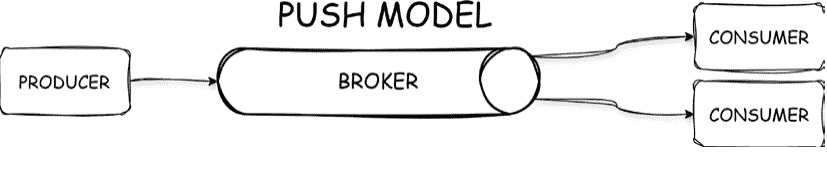

图 8.2：推模型

当事件发生时，它会立即分发给所有订阅的消费者，由他们进行实时处理。这种模型通常用于低延迟至关重要且必须在事件发生后立即处理的场景。例如，推模型确保用户在实时通知系统中立即收到更新。

实现推模型的消息代理和云服务包括 RabbitMQ 和 AWS 简单通知服务（SNS）。

### 拉模型（Pull model）

在拉模型中，消费者按照自己的节奏从事件源或中间件主动请求（拉）事件。图 8.3 展示了拉模型。

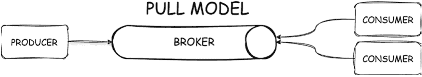

图 8.3：拉模型

事件不是被推送到消费者，而是存储在队列或主题（topic）中，消费者定期轮询这些存储以检索和处理事件。这种模型对于消费者必须控制事件或批处理速率的场景很有帮助。例如，数据分析流水线可能使用拉模型以易管理的分块获取并处理数据。

实现拉模型的消息代理包括 Apache Kafka 和 AWS 简单队列服务（SQS）。

推模型和拉模型之间的选择取决于系统的要求。推模型适用于需要即时处理和低延迟的应用，但如果消费者无法跟上事件速率，可能会导致问题。相反，拉模型对事件速率提供了更大的灵活性和控制，但可能会由于轮询间隔引入延迟。

在事件驱动架构系统中，可能会采用这两种模型的结合来平衡实时处理需求与有效处理变化负载的能力。现在，让我们学习管理服务间交互和流的常用架构样式。

## 管理交互和工作流

事件驱动架构通常采用两种架构样式来管理和控制服务之间的工作流：编排（orchestration）和协同（choreography）。它们是管理分布式系统中交互和工作流的两种不同方法。两种方法都旨在协调多个服务的活动以实现特定的业务目标，但它们的控制机制和设计哲学有显著差异。

## 理解事件的基础

### 编排（Orchestration）

编排是指一种集中方法，由一个中央控制器（通常称为编排器）管理并引导服务之间的交互。编排器协调服务交互的顺序，并确保整体工作流按照定义的计划进行。以下是编排的主要特征：

- 集中控制：单一编排器控制操作流，决定调用哪些服务以及按什么顺序
- 显式工作流定义：工作流逻辑显式定义在编排器内部
- 易于管理：由于编排器协调所有交互，集中式控制更容易管理和监控整体工作流
- 错误处理：编排器可以实现复杂的错误处理和补偿逻辑，确保工作流能够从故障中恢复

图 8.4 展示了使用编排架构样式的电子商务流程。

## 编排

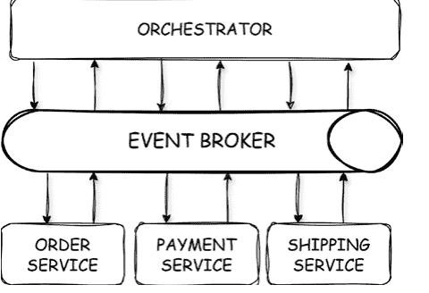

图 8.4：编排架构样式

在编排架构样式中，一个中央编排服务通过消息代理控制服务之间的操作顺序和交互。当客户下单时，订单服务处理该订单并通过事件代理向编排器发送事件。编排器通过事件代理向支付服务发送事件。一旦支付服务完成，它通过事件代理向编排器发回事件，然后编排器向发货服务发送事件。编排器管理服务之间的通信，以确保每个步骤都按正确的顺序执行。


现在，让我们学习另一种用于服务间工作流管理和控制的架构风格：编排（choreography）。

## 编排

编排指的是一种去中心化的方法，每个服务根据事件独立决定何时以及如何与其他服务进行交互。没有中央控制器；相反，服务之间直接通信，对事件做出反应并做出自主决策。编排的主要特征如下：

- 去中心化控制：每个服务都具有自主性，并根据收到的事件做出决策，导致系统更加松耦合。
- 隐式工作流定义：工作流源于服务之间的交互，而不是在中央位置进行显式定义。
- 可扩展性与灵活性：编排的去中心化本质可以带来更好的可扩展性和灵活性，因为可以在不更改中央控制器的情况下添加或修改服务。
- 协调复杂性：管理整个工作流可能会变得复杂，因为没有单一控制点来监督整个过程。

图 8.5 展示了使用编排架构风格的电子商务流程。


图 8.5：编排架构风格

在编排架构中，服务通过对其他服务的事件做出反应进行通信，没有中央协调器。当客户下单时，订单服务处理订单并通知支付服务。支付服务处理付款并通知物流服务。每个服务独立运行，增强了可扩展性并允许独立演进。

另一个根本区别在于每种风格中交换的消息类型。在编排（orchestration）中，消息通常是命令——由编排器发送的显式指令，告诉服务执行什么操作。编排器决定流程并积极指导服务。相比之下，编排依赖于事件，事件代表关于已发生的事实。服务对这些事件做出反应，并独立决定采取什么相应措施。这种区别强化了编排的集中化本质（控制通过命令消息流转）以及编排的去中心化本质（控制源于事件流）。

编排和编排模式各有其优势和适用场景。编排场景适用于中央控制和显式工作流定义有益的场合，更容易管理和监控复杂的工作流。另一方面，编排对于需要高可扩展性和灵活性的系统是理想的，在这些系统中，服务自主运行并动态响应事件。

在编排和编排模式之间选择取决于系统需求，包括工作流的复杂性、灵活性以及对服务交互的预期控制程度。在许多情况下，编排和编排模式的混合使用可以提供最佳平衡，利用每种技术的优势来实现预期的系统行为。

我们现在已经探索并掌握了事件驱动架构。接下来，让我们探索事件驱动架构中重要且常用的事件驱动模式。

## 探索事件驱动架构

事件驱动架构利用各种设计模式来有效处理事件，并确保系统是健壮、可扩展且易于维护的。这些模式有助于管理事件生成、传输、处理和存储的复杂性。我们将介绍一些事件驱动架构中常用的模式。

## 发布/订阅

事件驱动架构中的**发布/订阅模式**涉及生产者将事件发送到代理程序（broker），然后由代理程序将事件分发给多个消费者。消息被推送到消费者，并且可以添加或移除消费者而不影响生产者。持久性订阅允许不活跃的消费者在连接时接收错过的事件。

一个例子是社交媒体平台，用户订阅其他用户的更新。当一个用户发布新更新时，该更新会发布给所有订阅者。

## 事件通知

事件通知是一种简单的模式，生产者发出一个事件以通知消费者发生了某种变化或操作。这些事件携带的信息极少，因此如果需要，消费者可能需要获取额外数据。这种方法减少了事件的大小并易于实现，但它通过要求后续请求可能会增加延迟并创建更紧的耦合。

下面的 JSON 代码段展示了用户在拍卖系统中对物品出价的示例：

```json
{
  "userId": "1",
  "productId": "2",
  "bidAmount": 150.00
}

WITH:
{
  "eventType": "BidAdded",
  "userId": "1",
  "productId": "2",
  "bidAmount": 150.00
}
```

注意，事件通知模式仅包含用户 ID 和产品 ID，因此事件对其他服务包含的信息极少。图 8.6 展示了使用事件通知模式的服务交互。


图 8.6：使用事件通知模式的服务交互

如果消费者需要更多用户或产品数据，则需要额外的服务请求，这会在服务之间产生耦合。这可能导致延迟、降低系统性能，并产生使系统难以管理和维护的依赖关系。减少服务间紧耦合的可能解决方案是实现共享缓存或使用事件携带状态转移（event-carried state transfer）模式。

## 事件携带状态转移

在事件携带状态转移模式中，事件包含了消费者提供所需的所有信息，消除了获取额外数据的需要。

下面的代码段展示了一个带有完整用户和物品数据的持久 JSON 示例：

```json
{
  "user": {
    "id": "112233",
    "name": "Wanderson Xesquevixos"
  },
  "product": {
    "id": "98765",
    "description": "Sport Car 1977"
  },
  "bidAmount": 150.00
}
```

这种方法通过在事件中提供所有必要数据减少了延迟并简化了消费者逻辑。然而，事件可能会变得很大并包含冗余信息。

## 消息输出模式

消息输出模式确保在分布式系统中的可靠发布，同时保持数据一致性。在发送消息之前，服务将其保存到与更新业务数据同一事务的数据库表中。后台进程从该表读取并将事件发布到代理程序。这种方法防止了服务在提交事务后但在发送事件前崩溃导致的消息丢失，确保了每种变化最终都会反映在事件流中。一个示例是电子商务应用程序，它在数据库中保存订单的同时，在输出表中存储 OrderPlaced（订单已放置）。随后发布事件以通知其他服务，维持了内部数据状态与外部消费者之间的一致视图。

## 消息收件箱模式

消息收件箱模式在分布式系统中可靠地消费和处理消息，同时保持数据一致性。当服务接收到事件时，它在执行任何业务逻辑之前首先将消息存储在收件箱表中。这种方法有助于防止重复处理，并即使在崩溃或重试情况下也能实现精确一次或等幂性执行。通过在处理之前之前持久化消息，系统确保操作只应用一次，维护了事件流与服务内部状态之间的一致性。例如，计费服务接收到 PaymentConfirmed（支付已确认）事件，会将消息写入其收件箱表并检查是否已经处理过。只有随后它才会应用支付逻辑，从而避免双倍收费并确保一致的事务结果。


# Saga 模式

Saga 模式通过将事务分解为较小的步骤来管理长事务并确保跨多个服务的数据一致性，每个步骤如果失败，都可以执行补偿操作。它代表了一个单一的业务流程，如图 8.7 所示。


在旅游预订系统中，saga 协调航班、酒店和车辆租赁的预订。如果任何一步失败，saga 就会触发补偿性操作以取消已完成的预订。

Saga 模式确保了数据一致性并处理了长事务。然而，实现和管理补偿事务非常复杂。

我们已经学习了许多新概念：现在，让我们进入下一节，通过在在线拍卖应用程序中实现事件驱动服务来应用这些概念。

# 使用 Apache Kafka 构建事件驱动服务

现在，是时候开始编码并将所学知识付诸实践了。我对事件驱动架构感到非常兴奋，因为它具有扩展性、灵活性且响应迅速，并引入了增强性能和韧性的技术与工具。让我们探索事件驱动架构在在线拍卖案例研究中带来的强大可能。

## 在线拍卖案例研究

自从我们将在线拍卖切换到微服务架构，并整合了网关、负载均衡、分布式配置以及应用韧性等功能后，我们的系统变得更加可靠和高效。用户现在正在享受提升的性能，应用程序的问题也降到了最低。

# 使用 Apache Kafka 构建事件驱动服务 217

利益相关者为系统请求了一个重要的新功能：用户对拍卖中的产品进行竞价的能力。一个基本要求是用户必须拥有足够资金的账户以批准拍卖报价。

### 系统定义与使命

我们的技术团队致力于提供可靠的竞价体验。我们将使用事件驱动架构来连接拍卖服务和托管服务以实现这一目标。这种方法允许拍卖服务发起报价，同时由托管服务验证资金可用性，使两个系统能够独立运行并根据需要进行扩展。

此外，我们将使用 Kafka 作为事件传递的骨干，支持可靠的协调，并允许使用 Saga 等模式维护分布式事务的最终一致性。

让我们从设置事件驱动环境开始，探索并配置 Apache Kafka（也称为 Kafka）。

# Kafka 简介

Apache Kafka 是一个专为事件流设计的分布式平台，每天可以处理数万次事件。Kafka 最初由 LinkedIn 开发，现已成为现代数据架构的重要组成部分，作为实时数据流应用程序的骨干。

Kafka 的主要作用是为应用程序不同组件之间的异步消息交换提供可靠、可扩展且持久的机制。它充当发布-订阅消息系统，其中生产者将事件发布到主题（topics），消费者订阅这些主题以实时消费事件。

Kafka 高吞吐量处理和传输数据的能力使其成为从日志和监控到复杂数据流水线、流处理和微服务架构等用途的流行选择。

# Kafka 的主要特性

Apache Kafka 具有多项特性，使其成为一个健壮且多功能的流平台：

- **分布式架构**：Kafka 的架构包括代理（brokers）、生产者、消费者和主题。得益于其分布式架构，Kafka 可以在节点之间管理海量数据，提供高可用性和容错性。
- **基于主题的组织**：Kafka 中的数据被组织成主题。每个主题可以有多个分区（partitions），这些分区可以被独立消费。这实现了并发处理和负载均衡。

一个具有三个分区的区示例：

- 如果只有一个服务实例，那么它将处理所有三个分区
- 如果有两个实例，一个实例将处理两个分区，另一个将处理剩下的分区
- 如果有三个实例，每个分区将分配给一个服务实例
- 如果有四个实例，三个实例将各处理一个分区，一个将处于空闲状态

- **偏移量 (Offsets)**：在 Kafka 中，消费者在分区中的位置是通过偏移量进行跟踪的。分区中的每条消息都有唯一的偏移量，消费者必须将当前偏移量提交给 Kafka。这确保了消费者在发生故障时可以从停止的地方继续，确保可靠的消息处理。它还允许通过重置偏移量来重放消息的灵活性。
- **消费者组**：Kafka 允许将消费者组织成组。组中的每个消费者处理分区子集的消息，允许并行消费和负载均衡。组内只有一个消费者会处理来自某个分区的每条消息。
- **提交日志存储**：Kafka 的存储模型基于提交日志，消息按产生顺序存储。这种不可变的日志确保了数据的完整性，并为事件提供了可靠的审计轨迹。
- **精确一次语义 (Exactly once semantics)**：Kafka 确保消息精确交付一次，防止丢失或重复。这对于在复杂处理场景中保持数据的准确性和一致性至关重要。

图 8.8 展示了 Apache Kafka 的简化架构。


图 8.8：简化的 Apache Kafka 架构

该图提供了 Apache Kafka 架构的简化概述，突出了生产者、主题和消费者实例之间的交互。该主题有三个分区：分区 0、1 和 2。每个分区维护一个有序的消息序列，偏移量从零开始。

当生产者在不指定分区的情况下发送消息时，Kafka 使用内置策略自动确定分区。如果提供了键（key），Kafka 将具有相同键的消息分配到同一个分区，以保持顺序。如果没有提供键，Kafka 使用轮询算法将消息均匀分布到各个分区。此外，Kafka 允许需要自定义分区逻辑。这种方法确保了需要地方的负载均衡和顺序一致性。

消费者组是共享相同组 ID 的服务实例集。在消费者组内，如果你在同一个消费者组中有服务实例且有三个分区，每个实例将被分配给一个分区，确保分区中的每条消息仅由一个实例消费。如果其中一个实例宕机，Kafka 将自动将分配给该实例的分区重新分配给组内剩余的运行实例，确保持续处理而不重复。

现在我们已经了解了 Kafka 是什么，让我们探索 Spring for Apache Kafka。

# 探索 Spring for Apache Kafka

**Spring for Apache Kafka** 是一个 Spring 项目，它无缝集成了 Spring 应用程序和 Apache Kafka。它构建熟悉的 Spring 编程模型之上，提供了简化 Kafka 生产者和消费者开发的抽象和配置。通过 Spring for Kafka，我们可以轻松地在 Spring Boot 应用程序中创建、配置和管理基于 Kafka 的消息传递，使用 `@KafkaListener` 等注解来消费消息并使用 `KafkaTemplate` 消息。

该框架还与其他 Spring 模块集成，如 Spring Retry、Spring Transaction 和 Spring Boot Actuator，实现了错误处理、重试、消息转换和指标收集等健强大的功能。通过利用依赖注入、声明式配置和一致的 API，Spring for Apache Kafka 帮助我们专注于业务逻辑，同时减少样板代码并确保在驱动架构中关注点的清晰分离。

# 设计新功能

在实现新功能之前，让我们设计在线拍卖应用程序的架构。**图 8.9** 展示了在线拍卖应用程序的架构，包括新添加的拍卖和托管服务。


## 事件驱动架构


图 8.9：在线拍卖架构

让我们概述一下我们在线拍卖应用的的架构：

- 客户端仅与网关服务交互，网关充当单一入口，并将传入的请求路由到适当的下游服务
- 服务在启动时会注册到发现服务（Eureka）中
- 服务从配置服务获取其配置
- 拍卖服务处理竞价，并通过消息代理 Kafka 与托管服务（escrow services）通信

定义好在线拍卖应用的架构后，我们现在可以将注意力转向竞价流程。图 8.10 展示了用户出价时的端到端过程。

## 使用 Apache Kafka 构建事件驱动服务


图 8.10：出价的端到端过程

让我们从端到端回顾出价的过程：

1. 用户通过拍卖服务 API 在拍卖中添加竞价。
2. 拍卖服务 API 将状态为 `PENDING` 的竞价保存到数据库。
3. 拍卖服务 API 向 Kafka 的 `bids-topic` 主题发布事件。该消息包含 `bidId`、`userId`、`auctionID`、`amount` 和 `createdAt`。
4. 拍卖服务 API 返回给用户，通知其报价已提交。
5. 托管服务 API 监听 `bids-topic` Kafka 主题。当新消息到达时，它会检查用户托管账户是否有足够的资金。

## 事件驱动架构

- 6. 托管服务 API 查看用户的资金余额及其收到的竞价总额。如果收到的竞价总额加上当前竞价金额小于等于用户的资金余额，则接受竞价；否则，将其拒绝。
- 7. 托管服务 API 向 `escrows-topic` Kafka 主题发布新事件。该事件包含一个指示竞价是被接受还是被拒绝的状态。
- 8. 拍卖服务 API 监听 `escrows-topic` Kafka 主题。收到消息后，在竞价表中更新竞价状态。
- 9. 拍卖服务 API 通知用户。

有了这些详尽的设计，我们已经准备好从规划过渡到执行。现在是开始编写服务代码了，确保我们遵循架构指南并利用最佳实践来构建可扩展、可靠且高效的解决方案。这一编码阶段将使架构变为现实，实现增强的功能，这些功能将为我们的用户创造价值并支持平台的持续成功。

## 实现拍卖服务

为了创建拍卖服务 API，我们可以使用 Spring Initializr。拍卖服务 API 的依赖项与其他项目（如用户服务 API）相同。唯一的区别是我们必须包含 Spring for Apache Kafka 依赖，如下代码所示：

```
<dependency>
  <groupId>org.springframework.kafka</groupId>
  <artifactId>spring-kafka</artifactId>
</dependency>
```

`spring-kafka` 依赖项实现了 Spring 应用与 Apache Kafka 之间的无缝集成。它提供了生产和消费 Kafka 消息的支持，并具有序列化、反序列化、监听器容器和错误处理等功能，对于实现在线拍卖应用服务之间的事件驱动通信至关重要。

下面的代码映射展示了我们处理绑定支付的控制器：

```
@RequestMapping("/v1/bids")
public class BidController {
  @PostMapping
  public BidResponse create(
    @RequestBody BidRequest bidRequest) {
    Bid bid = BidMapper.INSTANCE.map(bidRequest);
    bidRequest.setCreatedAt(bidRequest.getCreatedAt());
    Bid bid1 = createBidUseCase.execute(bid);
    return BidMapper.INSTANCE.map(bid1);
  }
}
```

为了接收竞价请求，`BidController` 类通过 POST 操作在 `/v1/bids` 下暴露了一个 REST 端点。它是用户出价的入口。该方法将创建竞价委托给 `createBidUseCase.execute`，从而启动了出价过程。

下面的代码片段定义了 `BidDatasource` 类，它实现了 `BidRepository` 接口：

```
public class BidDatasource implements BidRepository {
    private final BidProducer bidProducer;
    @Override
    public Bid bidSave(Bid bid) {
        BidEntity identity = BidMapper.INSTANCE.toEntity(bid);
        identity.setStatus(BidStatus.PENDING());
        Bid bidSaved = BidMapper.INSTANCE.map(
            bidJpaRepository.save(identity));
        bidProducer.placeBid(bidSaved);
        return bidSaved;
    }
}
```

`BidDatasource` 类的 `save` 方法编排了竞价相关的业务逻辑。它以 `PENDING` 状态持久化竞价并通过 `BidProducer` 发布事件，启动了异步竞价流。下面的代码片段展示了 `BidProducer` 类：

```
@Component
public class BidProducer {
    private final KafkaTemplate<String, Bid> kafkaTemplate;
    private static final String BIDS_TOPIC = "bids-topic";
    private static final String KEY_BIDS_TOPIC = "key-bids";

    public void placeBid(Bid bid) {
        log.info("Place bid: {}", bid);
        kafkaTemplate.send(BIDS_TOPIC, KEY_BIDS_TOPIC, bid);
        log.info("Bid {}" sent to bids topic to validate funds!", bid.getId());
    }
} 
```

`BidProducer` 负责向 Kafka 发布与竞价相关的事件，允许其他服务（如托管服务）进行异步处理。它是拍卖服务中的事件生产者，将竞价消息发送到 `bids-topic` Kafka 主题。

`KafkaTemplate<K, V>` 是与 Kafka 交互的高级抽象，其中 K 是消息键类型，V 是消息值——在此情况下，键为 String，有效负载为 Bid。它处理序列化、分区、重试和错误处理，简化了 Kafka 操作。

在 `place` 方法中，使用 `kafkaTemplate.send` 函数通过 `keyids` 键将竞价消息调度到 `bid-topic` Kafka 主题。它是异步的，这意味着消息以非阻塞方式发送到 Kafka 代理。它不会等待任何消费者来处理消息。这种解耦的消息机制允许服务在参与更大的事件驱动工作流的同时，保持孤立性并可独立扩展。

下面的代码片段显示了 `application.properties` 中生产者的 Kafka 生产者属性：

```
spring.kafka.bootstrap-servers = localhost:9092
spring.kafka.producer.key-serializer = org.apache.kafka.common.serialization.StringSerializer
spring.kafka.producer.value-serializer = org.springframework.kafka.support.serializer.JsonSerializer
spring.kafka.producer.properties.spring.json.add.type.headers = false
```

`spring.kafka.bootstrap-servers` 属性指定了生产者连接的 Kafka 。

`spring.kafka.producer.key-serializer` 属性定义了消息键的序列化类。由于 Kafka 消息由键和值组成，此设置确保键被序列化为 UTF-8 编码字符串。这是必要的，因为 Kafka 需要字节，该属性告诉生产者如何将 String 转换为字节格式。

`spring.kafka.producer.value-serializer` 属性指定了消息值的序列化类。在此情况下，Spring Kafka 提供的 JsonSerializer 在将 Java 对象发送到 Kafka 之前将其转换为 JSON 格式。这允许了互操作性并方便其他服务的消费。

`spring.kafka.producer.properties.spring.json.add.type.headers` 属性禁用向 Kafka 消息头中添加类信息 (__TypeId__)。默认情况下，Json 会包含此元数据以帮助消费者反序列化对象。将其设置为 false 可以避免消费者端可能的反序列化问题，使消息格式更整洁且具互操作性。

现在，让我们实现托管服务 API，重点关注处理和处理来自 Kafka 的传入消息（作为消费者）。


# 实现托管服务

为了搭建托管服务项目，我们可以使用 Spring Initializr。它的结构和依赖关系与拍卖服务 API 镜像，包括用于消息消费的 `spring-Kafka` 依赖。

以下代码片段是 `BidConsumer` 类，它用于监听竞价（Bid）：

```java
@Component
public class BidConsumer {
    private final EscrowProducer escrowProducer;
    private final GetEscrowBalanceUseCase getUserEscrowBalanceUseCase;
    private final GetEscrowReservationsUseCase getUserEscrowReservationsUseCase;
    private final CreateEscrowTransactionUseCase createEscrowTransactionUseCase;

    @KafkaListener(topics = "bid-topic", groupId = "escrow-group")
    public void bidConsumer(BidEvent bidEvent) {
        BigDecimal balance = getUserEscrowBalanceUseCase.execute(
            bidEvent.getUserId());
        BigDecimal totalFundReserved =
            getUserEscrowReservationsUseCase.execute(
            bidEvent.getUserId());
        EscrowTransaction escrowTransaction = new
            EscrowTransaction(null, bidEvent.getAuctionId(),
            bidEvent.getUserId(), bidEvent.getUserId(),
            bidEvent.getAmount(), null,
            bidEvent.getCreatedAtAt());
        if(balance.compareTo(totalFundReserved).add(
            bidEvent.getAmount()) >= 0) {
            bidEvent.setStatus(BidStatus.ACCEPTED.name());
            escrowTransaction.setStatus(
            EscrowStatus.RESERVED.name());
        } else {
            bidEvent.setStatus(BidStatus.REJECTED.name());
            escrowTransaction.setStatus(
            EscrowStatus.REJECTED.name());
        }
        createEscrowTransactionUseCase.execute(
          escrowTransactionMapper.INSTANCE.map(escrowEvent));

        escrowProducer.placeEscrow(escrowEvent);
    }
}
```

`BidConsumer` 类负责处理与竞价事件相关的传入 Kafka 消息。它利用 Spring for Kafka 的 `@KafkaListener` 注解来定义消费者方法，实现与 Kafka Topic的无缝集成。

`@KafkaListener` 注解使用 `escrow-group` 消费者组将 `bidConsumer` 订阅到 `bids-topic` Kafka Topic。消费者组允许多个托管服务实例并行消费消息，同时确保每条消息只被一个实例处理一次。Kafka 管理同一组内消费者之间的分布，增强了可扩展性和容错性。如果某个实例宕机，Kafka 将自动将其分区重新分配给组内的其他消费者。每当有消息发布到此 Topic 时，Spring for Kafka 会自动反序列化消息负载并调用该方法。

接收到 `BidEvent` 后，该方法首先通过调用 `GetEscrowBalanceUseCase` 和 `GetEscrowReservationsUseCase` 获取用户的财务数据，以计算已在托管的金额。它通过比较可用余额、当前预留金额和新竞价来执行验证逻辑。如果用户资金充足，则接受竞价；否则，将其拒绝。这种验证结果（ACCEPTEDED 或 REJECTED）被封装在 `EscrowEvent` 中，然后映射到 `EscrowTransaction` 领域模型并使用 `CreateEscrowTransactionUseCase` 持久化。最后，该方法使用 `EscrowProducer` 将 `EscrowEvent` 发布回 `escrow-topic` Kafka Topic，允许拍卖服务相应地处理结果。

现在，让我们来看一下 Kafka 消费者所需的必要配置。以下代码片段概述了 `application.properties` 中的所需设置：

```properties
spring.kafka.consumer.group-id = escrow-group
spring.kafka.consumer.key-deserializer = org.apache.kafka.common.serialization.StringDeserializer
spring.kafka.consumer.value-deserializer = org.springframework.kafka.support.serializer.ErrorHandlingDeserializer
spring.kafka.consumer.properties.spring.deserializer.value.delegate.class = org.springframework.kafka.support.serializer.JsonDeserializer
spring.kafka.consumer.properties.spring.json.value.type = com.packpub.escrowservices.adapter.transportlayers.restapi.dto.BidEvent
spring.kafka.consumer.properties.spring.json.trusted.packages = *
```

该配置块使用 Spring Apache for Kafka 在托管服务 API 中设置 Kafka 消费者。

`spring.kafka.consumer.group-id` 属性定义了消费者组 ID。所有共享此 ID 的实例将协调消息消费，确保每条消息在组内只被处理一次。

`spring.kafka.consumer.key-deserializer` 属性指定 Kafka 消息的键（key）将被反序列化为 String 类型。

`spring.kafka.consumer.value-deserializer` 属性定义了一个包装反序列化器以进行更好的错误处理。它捕获反序列化异常并将它们重定向到可恢复机制，而不是让实体监听消费者崩溃。

`spring.kafka.consumer.properties.spring.deserializer.value.delegate.class` 属性指示实际的反序列化应委托给 `JsonDeserializer`，它会将 JSON 负载转换为 Java 对象。

`spring.kafka.consumer.properties.spring.json.value.type` 属性设置了反序列化 JSON 负载的目标类类型。在此例中，Kafka 将将传入的消息反序列化为 `BidEvent` 类。

`spring.kafka.consumer.properties.spring.json.trusted.packages` 属性允许反序列化任何包中的类。出于安全考虑，这是因为 Spring Apache for Kafka 默认限制反序列化。通配符 `(*)` 表示所有包都是信任的。

这些属性配置了一个健壮的 Kafka 消费者，它可以监听消息、优雅地处理反序列化错误，并确保通过 `BidEvent` 实现类型安全的消息消费。

由于拍卖服务 API 中的 `BidProducer` 和托管服务 API 中的 `BidConsumer` 涵盖了此架构的核心方面——演示了如何使用 Spring Kafka 生产和消费事件——我们不会涉及托管服务 API 中 `EscrowProducer` 或拍卖服务 API 中 `EscrowConsumer` 的实现细节。这些组件遵循已解释的事件驱动消息原则，其结构和配置与我们已经涵盖的内容镜像。

现在新服务已经就绪，是时候测试实现并验证通信和业务逻辑是否按预期工作了。

# 执行竞价投放测试

有了应用程序的新功能，我们可以继续测试步骤的步骤：

- 1. 执行 `ch8/docker-resources/database` 和 `ch8/docker-resources/kafka` 中的 Dockerfile，以设置数据库和 Kafka。
- 2. 按照以下顺序运行服务：service-discovery-services、configuration-services、gateway-services、authentication-services、user-services、auction-services 和 escrow-services。有很多服务，但我们正在不断演进项目。
- 3.  `ch8/postman` 文件夹中的 Postman 集合。执行名为 `AUTH - LOGIN ADMIN` 的请求以获取令牌。
- 4. 在名为 `BID - CREATE` 的请求中，选择 `Authorization` 标签页，选择身份类型为 `Bearer Token` 并添加生成的令牌。然后执行两次请求。以下 JSON 代码段是请求的负载，它告知了拍卖 ID、用户 ID 和竞价金额。注意我们正在使用事件通知模式。它携带的信息极少，仅包含 ID：

```json
{
  "auctionId": "auction1",
  "userId": 1,
  "amount": 600.00
}
```

ID 为 1 的用户在其托管账户中注册了 1,000 的资金，拍卖服务控制台将打印 `Bid accepted!`。第一个请求将执行整个过程，第二个请求将被拒绝，因为预留竞价的总和将达到 1,200，大于用户的 1,000 资金。图 8.11 显示了拍卖服务控制台：


图 8.11：拍卖服务 API 控制台


图 8.12 显示了托管服务在处理竞价期间的控制台输出。

```
* c.p.e.a.d.e.kafka.BidConsumer : Bid 10 processing from bids topic!
* c.p.e.a.d.e.kafka.EscrowProducer : Escrow 10 sent to escrow topic!
* c.p.e.a.d.e.kafka.BidConsumer : Bid 10 processed from bids topic!
* c.p.e.a.d.e.kafka.BidConsumer : Bid 11 processing from bids topic!
  .EscrowProducer : Escrow 11 sent to escrow topic!
  .BidConsumer : Bid 11 processed from bids topic!
```

图 8.12：托管服务 API 控制台

该图展示了托管服务内部的竞价流。在 *BidConsumer* 消费竞价事件后，*Producer* 将带有用户资金分析结果的事件发布到 Kafka 主题，允许拍卖服务消费并对其采取操作。

> 注意
> 如果要可视化 Kafka 主题中的消息，你可以从 https://kafkatool.com/download.html 下载 Offset Explorer 工具。
> Kafka 还提供了原生 CLI 工具，如 kafka-console-consumer.sh 和 kafka-console-producer.sh，以便直接从终端进行快速测试和调试。

随着我们推进拍卖和托管服务的实现，强调引导它们交互的架构模式至关重要。虽然这看起来像是一个简单的生产者-消费者设置，但它实际上结合了发布-订阅和事件通知模式。最重要的是，它遵循了 Saga 编排模式（Saga orchestration pattern）。

在此过程中，每当用户下注竞价时，拍卖服务就会启动一个分布式事务。托管服务验证用户是否有足够的资金并提供响应。根据此响应，拍卖服务接受或拒绝竞价，引导整个事务流程。这使得拍卖服务充当编排者（orchestrator），而托管服务充当参与者（participant）。

与编舞方法（choreography approach）不同——在那种方法中服务独立地对事件做出反应——而这里是拍卖服务协调了这种交互。它在做出关于竞的的之前会等待托管服务的响应。

系统很容易通过消息收件箱（inbox）和发件箱（outbox）模式进行增强，以加强数据一致性。之前讨论过的模式有助于确保可靠的事件发布和处理，使架构更加健壮且具有容错性。

## 总结

本章探讨了事件驱动架构，强调了其异步性质以及对现代软件系统的益处，特别是在微服务环境中。它讨论了事件驱动架构的核心组件，如生产者、事件代理和消费者，以及它们在实现松耦合和可扩展性方面的作用。

它还涵盖了事件的基础知识，包括其不可变性、时效性和描述性等特征。它还讨论了不同的事件——简单事件、复合事件、领域事件和系统事件——这些对于设计有效的事件驱动系统至关重要。它探索了事件驱动系统中的模式，如发布-订阅、事件通知、事件携带的状态传输、消息收件箱和发件箱。它解释了何时使用它们以及涉及的权衡。

此外，本章还提供了一个使用 Spring for Apache Kafka 的在线拍卖系统案例研究。通过实现以 Kafka 作为代理的生产者和消费者，并应用这些模式作为 Saga 编排，我们演示了如何构建可扩展且具韧性的服务。通过将基础概念与实现事件驱动架构的实践指南相结合，本章让你掌握了使用事件驱动架构构建可扩展和韧性系统的知识。

在第 9 章“管道-过滤器与无服务器架构”中，我们将探索无服务器架构，重点关注无服务器函数以及使用 Spring Cloud Function 实现服务告警。我们还将探索使用 Spring Batch 的管道-过滤器架构以实现高效的批处理。

## 问题

1. 什么是事件驱动架构？为什么它在现代应用中被广泛使用？
2. 事件驱动架构中事件的关键特征是什么？
3. 什么是发布-订阅模式？它在事件驱动架构中是如何运作的？
4. 事件携带的状态传输与事件通知模式有何区别？
5. Apache Kafka 在实现事件驱动架构中起什么作用，特别是在章节案例研究的背景下？
6. Spring Kafka 中用于生产和消费消息的主要组件有哪些？

## 9 管道-过滤器与无服务器架构

本章回顾了管道-过滤器架构（pipe and filter architecture），强调了何时应该使用以及何时应该避免使用。它涵盖了 Spring Batch 框架的核心功能和概念，并演示了如何通过在 Spring Batch 应用管道-过滤器架构，创建一个读取 CSV 文件并填充数据库的批处理应用程序。

此外，我们将探索无服务器架构，重点关注**函数即服务（FaaS）**和 **Spring Cloud Function**。最后，我们将实现一个向 Slack 通道发送告警的函数，并在本地以及 **AWS 云**上部署应用程序。本章涵盖了以下主题：

- 回顾管道-过滤器架构
- 使用 Spring Batch 实现应用程序
- 使用 FaaS 探索无服务器架构
- 探索 Spring Cloud Function
- 使用 Spring Cloud Function 实现警

在本章结束时，你将对使用 Spring Batch 的管道-过滤器架构以及使用 Spring Cloud Function 开发 FaaS 的无服务器应用在理论和实践方面都有深入理解，使你能够构建可扩展、可维护的数据处理流水线，以及与云环境无缝集成的高成本效益无服务器函数。

## 技术要求

本章的所有代码都可以在 GitHub 上的 `https://github.com/PacktPublishing/Software-Architecture-with-Spring/tree/main/ch9`。代码块中的省略号表示部分代码已省略，完整代码可以在 GitHub 上获取。

## 回顾管道-过滤器架构

我们在第 1 章《深入理解软件架构》中对管道-过滤器架构进行了全面的介绍。在这里，我们将简要回顾它。图 9.1 展示了管道-过滤器架构的工作流。

图 9.1：管道-过滤器架构工作流

管道-过滤器架构由一系列处理单元（称为过滤器）组成，它们通过管道（pipes）相互连接。一个过滤器的输出作为下一个过滤器的输入。这种结构分阶段处理数据，提供了灵活性、模块化和可扩展性。过滤器负责特定任务，例如转换或聚合数据，而管道促进了它们之间的数据传输。但管道-过滤器架构用在哪里呢？

# 何时使用管道-过滤器架构

管道-过滤器架构通常用于软件工程的各个领域，特别是在需要顺序处理数据的场景。以下是它最常见的用用例：

- 命令行工具：管道-过滤器架构最著名且基础的用途之一是 Unix/Linux 命令行工具。在这里，不同的命令（过滤器）通过管道 (|) 链联。在以下命令中，`cat` 读取文件，`grep` 过滤包含特定术语的行，`sort` 对行排序，`uniq` 去重，每个命令作为一个过滤器通过管道处理数据：
```bash
cat file.txt | grep "searchTerm" | sort | uniq > output.txt
```

- 数据处理流水线：提取、转换和加载（ETL）过程以及流处理系统：
    - ETL 过程：通常用于数据仓库的 ETL 流水线经常采用管道-过滤器架构。数据从各种源提取，通过不同的过滤器进行转换，最后加载到数据仓库。
    - 流式处理系统：如 Apache Flink 和 Apache Beam 等系统使用管道-过滤器架构来实时处理数据流，数据流通过一系列转换和分析。


## 探索 Spring Batch

- 软件构建系统：软件开发中的持续集成/持续部署（CI/CD）流水线经常使用管道和过滤器架构（pipe and filter architecture）。流水线中的每一步（例如代码编译、测试、打包和部署）都充当过滤器，上一个步骤的输出成为下一个步骤的输入。Jenkins 和 GitHub Actions 等工具被广泛用于实现此类流水线。它们为无缝集成和部署工作流提供了灵活性和自动化。

- 批处理：在没有人工干预的情况下执行一组任务。这种方法按照预定的时间间隔收集、处理并输出数据，通常处理海量数据。通常，它是通过预定义的计划触发的，能够高效地处理大量数据，且结果仅在整个批处理完成后才可用。它通常用于不需要即时用户交互的任务，例如数据分析、报告生成和批量数据传输。

批处理通常使用管道和过滤器架构实现。这种组合产生了一个模块化且可维护的系统，每个处理步骤都可以独立地进行修改或扩展。

管道和过滤器架构也用于许多其他场景，例如框架、**机器人流程自动化 (RPA)**、多媒体处理、Web 服务器和编译器。它通常用于数据需要连续处理步骤或对模块化和可扩展设计要求的环境。

# 何何避免管道和过滤器架构

我们必须避免在需要低延迟的实时系统、组件耦合或共享状态的应用、交互式用户应用程序以及涉及复杂工作流或持续长时间运行计算的情况下使用管道和过滤器架构，因为该架构可能会引入效率低下和性能瓶颈。

接下来，我们将学习 Spring Batch 框架，这是一个实现管道和过滤器架构的批处理应用程序的重要工具。

## 探索 Spring Batch

作为 Spring 家族的另一个知名框架，**Spring Batch** 是一个为批处理设计的轻量级、全面的框架。它提供了处理海量数据的工具和实用程序，具有以下核心功能：

- 任务导向型框架：Spring Batch 围绕“作业”（job）的概念设计，作业由多个步骤（step）组成。每个步骤代表批处理过程中的一个阶段，例如读取数据、处理数据和写入输出。

## 管道-过滤器与无服务器架构

- 分块式处理（Chunk-oriented processing）：Spring Batch 的核心模式之一是分块处理，即分块或分段处理大型数据集。例如，数据分块读取、分块处理，然后分块写入，从而允许更高效的内存管理和容错。
- 可扩展性与分区：Spring Batch 提供了扩展批作业以处理大型数据集的机制。这包括对并行处理、分区和多线程步骤的支持，允许批作业被划分并并发执行。
- 事务管理：Spring Batch 与 Spring 的事务管理能力集成，确保作业的每个步骤或分块都在事务上下文中处理。这确保了数据的一致性和完整性，特别是在处理大规模数据处理时。
- 错误处理与可重启性：Spring Batch 提供了健壮的错误处理机制，允许批作业以优雅的方式失败并从失败处重启。这对于长时间运行的批处理过程至关重要，因为可能会由于网络故障或数据不一致等各种原因发生错误。
- 作业监控与管理：Spring Batch 包含了用于监控和管理批作业的工具。这些包括跟踪作业执行、记录进度和管理作业生命周期的能力，提供了对批处理过程的可性和控制。
- 对各种数据源的支持：Spring Batch 可以与多个数据源交互，包括关系型数据库和 CSV、XML 和消息队列等平面文件。它为这些数据源提供了内置的读取器和写入器，并允许自定义实现。
- 与其他 Spring 项目集成：Spring Batch 与 Spring Boot、Spring Data 和 Spring Cloud 等其他 Spring 项目无缝集成。这种集成通过利用更广泛的 Spring 生态系统简化了批处理过程的开发。

现在，让我们熟悉 Spring Batch 的核心概念，深入研究其领域语言：

- JobLauncher：作业启动器是负责启动作业的组件，通常由调度器或手动请求触发。
- Job：作业代表整个批处理任务。它由一个或多个步骤组成，定义了要执行的动作序列。
- JobParameters：作业参数是作业的输入，为特定的执行定义特定的配置和设置。
- Step：步骤是作业中的一个阶段。它可能涉及数据的读取、处理和写入。每个步骤都可以配置特定的读取器、处理器和写入器。
- ItemReader, ItemProcessor 和 ItemWriter：这些是分块式处理步骤的核心组件：
    - ItemReader：它从源读取数据
    - ItemProcessor：它处理这些数据，应用任何必要的业务逻辑或转换
    - ItemWriter：它将处理后的数据写入目标地。
- JobRepository：Spring Batch 利用作业存储库通过在数据库中创建表来管理作业执行元数据，以跟踪作业、步骤、执行状态、参数和历史。此功能允许作业恢复、重试和监控，同时保持批处理过程的完整性和可靠性。建议在生产环境中使用持久化关系型数据库，而在非生产环境中可以使用 H2 等内存数据库。
作业存储库（Job repository）对于跟踪作业和步骤执行至关重要。

下图（图 9.2）展示了 Spring Batch 的核心概念。


图 9.2：Spring Batch 的核心概念

前面的图说明了构成 Spring Batch 领域语言及其工作流的概念。JobLauncher 启动 Job，正在进行的过程的元数据存储在 JobRepository 中。Job 包含一个或多个步骤，每个步骤（Step）与单个 ItemReader、ItemProcessor 和 ItemWriter 关联。现在，让我们看看 Spring Batch 如何与管道和过滤器架构对应。

# Spring Batch 如何与管道和过滤器架构对应？

在 Spring Batch 中，一个作业通常由多个步骤组成，每个步骤执行特定任务，类似于管道和过滤器架构中的过滤器。一个步骤的结果可以作为下一个步骤的输入，类似于数据流过过滤器。Spring Batch 可以被视为管道和过滤器架构的实际实现，特别适用于数据通过一系列转换阶段的批处理。

现在我们已经理解了管道和过滤器架构以及 Spring Batch，让我们把这些知识应用于我们的在线拍卖案例。

# 使用 Spring Batch 实现应用程序

### 在线拍卖案例

开启在线交易后，我们的应用程序用户量和交易量激增。该应用程序已在多个国家发布并取得了巨大成功。

现在利益相关者需要数据报告，这是可以理解的，因为数据分析对任何公司的成功都关重要。他们将使用第三方工具进行报告和分析。然而，他们需要一个包含公司数据的数据库。

由于我们的在线拍卖应用程序是基于微服务构建的，每个服务都有自己的数据库，我们需要创建一个新数据库并在其中收集所有数据。

### 系统定义与任务

从多个数据库收集数据到一个新数据库是复杂的，主要是因为数据库各异——有些是关系型的，有些是 NoSQL。此外，直接在正在运行微服务的数据库上进行查询是不推荐的，因为这可能会导致数据库过载并干扰服务。

其中一位架构师建议最佳方法是让负责每个业务领域的团队处理数据提取。这意味着用户管理团队将用户数据从数据库提取到 CSV 文件，产品团队将提取产品数据，拍卖团队将提取拍卖和出价数据到 CSV 文件。图 9.3 展示了所提的方案设计。


建议的解决方案涉及一个从目录读取 CSV 文件的应用程序。这些 CSV 文件包含从服务数据库中提取的数据。`Users.csv` 文件包含来自 `users` 表的数据，`Products.csv` 文件来自 `products` 表，`Bids.csv` 文件来自 `bids` 表，以及 `Auction.csv` 文件来自 `auction` 表。该应用程序处理这些数据并存储在报告数据库中。

我们可以使用 Spring Batch 框架来构建该应用程序，该框架由管道和过滤器（pipe and filter）架构组成。因此，在实现项目之前，让我们设置环境

### 设置环境

要设置报告数据库，请在 `ch9/docker/postgres` 文件夹下的终端中运行以下命令：

```
docker-compose up -d
```

报告数据库将我们服务的表合并到一个数据库中：users、product、bid 和 auction 表。现在环境已经配置好并运行，让我们来实现应用程序。

### 实现批处理应用程序

让我们使用 Spring Initializer 来创建批处理应用程序，将其命名为 `etl-batch-process`。图 `9.4` 显示了应用程序依赖的截图。

### 依赖项

- **Spring Batch**: 具有事务、重试/跳过和基于块（chunk）处理的批处理应用程序。
- **Spring Data JDBC**: 使用 Spring Data 通过纯 JDBC 在 SQL 存储中持久化数据。
- **PostgreSQL Driver**: JDBC 和 R2DBC 驱动允许 Java 程序使用标准的、与数据库无关 Java 代码连接到 PostgreSQL 数据库。
- **Lombok**: Java 注解库，有助于减少样板代码。

图 9.4：应用程序依赖项

Spring Batch 依赖项提供了创建批处理应用程序所需的所有批处理资源，例如批处理、基于块的处理、重试和跳过以及事务。

在处理批处理应用程序时，使用纯 JDBC 或 Spring Data JDBC 代替 JPA 效果更好。这样，你可以最小化开销、降低复杂性、解决性能挑战、优化内存使用、增强对数据库交互的控制，并实现更高效可靠的批处理作业执行。

另外两个依赖项是 PostgreSQL 驱动（我们需要它来连接到报告数据库）以及 Lombok（它提供了减少样板代码的注解，如构造函数、getter 和 setter）。图 9.5 显示了我们创建组件应用程序所遵循的实现顺序。


图 9.5：组件实现的顺序

实现过程从 ItemReader 开始，随后是 ItemProcessor、ItemWriter、Step、Job，最后是 JobLauncher，它负责启动 Job 的执行。这个序列代表了组件实现的顺序，因此让我们从这里开始。

## 实现 ItemReader

ItemReader 是 Spring Batch 组件，用于读取源数据，源数据可以是 CSV、XML 或数据库。在 `ch9/data-files` 文件夹中，我们找到了四个 CSV 文件：Auctions.csv、Bids.csv、Products.csv 和 Users.csv。这些文件的内容将被读取并保存到数据库中。让我们通过 CSV 文件进行学习；其内容在如下代码段所示：

```
id,city,country,email,name,phone_number,state
1,New York,United States,user@auction.com,User X, 123456789,NY
```

CSV 文件的第一行是表头，它定义了文件中列的名称：id, city, country, email, name, phone_number, 和 state。随后的行包含与表头定义的每个列对应的数据。

## 使用 Spring Batch 实现应用程序

接下来的代码段展示了 User 和 UserDto 类的属性，它们映射了 CSV 列：

```
private Long id;
private String name;
private String email;
...
```

UserDto 类将处理来自文件的数据，并通过一个过程将其传递给 User 类，该类可用于将数据保存到数据库。

在以下代码段所示的 UserFieldMapper 类实现了 `FieldSetMapper` 接口：

```java
public class UserFieldMapper implements
FieldSetMapper<UserDto>{
    public UserDto mapFieldSet(final FieldSet fieldset)
        throws BindException {
        return UserDto.builder()
            .id(fieldset.readLong("id"))
            .name(fieldset.readString("name"))
...
```

UserFieldSetMapper 类是一个映射器；它将从 FieldSet 获取的数据映射到 UserDto 对象。FieldSet 是 Spring Batch 的抽象，允许我们从扁平文件中绑定字段，类似于我们处理来自数据库数据的方式。`fieldset.readLong("id")` 语句读取 Long 数据，而 `fieldset.readString("name")` 语句读取 String 数据。

与映射扁平文件的 FieldSetMapper 类类似，其他类（如 RowMapper）映射数据库的行。

以下代码段展示了扩展 `FlatItemReader` 类的 UserItemReader：

```java
@Component
@StepScope
public class UserItemReader extends FlatItemReader<UserDto> {
```

UserItemReader 类扩展了 FlatItemReader，后者提供了读取和解析扁平文件的核心功能。Spring Batch 提供了各种接口来处理其他源，例如用于关系型数据库的 JdbcCursorReader 和 JpaEventItemReader、用于 NoSQL 文档的 MongoItemReader、用于 XML 文件的 StaxEventItemReader 以及用于 JSON 文件的 JsonItemReader。

@StepScope 注确保为每个步骤执行创建并初始化 bean，允许将最新的作业参数作为特定的步骤配置：

```java
public UserItemReader {
    @Value(\#{jobParameters['usersFile']})") String usersFile;

    this.setLineMapper(lineMapper());

    this.setResource(new FileSystemResource(usersFile));
}
```

UserItemReader 构造函数通过 `@Value("#{jobParameters['usersFile']}")` 获取 Users.csv 文件的路径作为参数。它是 Spring 表达式语言 (SpEL)，用于在作业启动时注入特定的作业参数。

`setResource` 方法指定要处理的资源，在本例中为 Users.csv 文件。`setLineMapper` 通过 `lineMapper()` 方法设置 `LineMapper` 接口，该接口将文件行映射到扁平对象。以下代码段展示了其实现：

```java
private LineMapper<UserDto> lineMapper() {
    var defaultLineMapper<UserDto> = new
    var lineTokenizer = new DelimitedLineTokenizer();
    lineTokenizer.setDelimiter(",");
    lineTokenizer.setNames("id","city","country ...
    lineTokenizer.setStrict(false);
    defaultLineMapper.setLineTokenizer(lineTokenizer);
    defaultLineMapper.setFieldMapper(new
    UserFieldSetMapper());
    return defaultLineMapper;
}
```

`lineMapper` 通过实现 `LineMapper` 的 `DefaultLineMapper` 类定义了每行如何映射到 UserDto 类。

`DelimitedTokenizer` 类负责设置文件的规范，例如告知文件的分隔符（在本例中为逗号）、命名文件的列等。

最后，我们将 `UserFieldSetMapper` 作为参数传递给 `setFieldMapper`，它在例例中将标记后的数据转换为 UserDto 对象。现在，让我们来实现 ItemProcessor。

## 实现 ItemProcessor

ItemProcessor 接口代表批处理作业期间处理单个数据项的业务逻辑。它作为从 ItemReader 读取数据和向 ItemWriter 写入数据的中间媒介。ItemProcessor 允许你在将每个项传递给 User 之前对其应用转换、验证或过滤。在我们的用例中，我们使用它将来自 UserDto 类的数据转换为 User 类，如下代码段所示：

```java
@Component
public class UserProcessor implements
    ItemProcessor<UserDto, User> {
    public User process(UserDto userDto) throws Exception {
        return User.builder()
            .id(userDto.getId())
            .build();
    }
}
```

UserProcessor 类实现了 ItemProcessor，它提供了将由 ItemReader 返回的 UserDto 转换为 ItemWriter 使用的 User 对象的方法。

## 实现 ItemWriter

ItemWriter 的操作与 ItemReader 类似，但执行相反的功能。ItemWriter 不是读取数据，而是将数据写入输出资源。它仍然涉及定位、打开和关闭资源，但主要关注输出操作。这通常意味着向数据库或队列插入、更新或发送消息。

以下代码段展示了实现 `ItemWriter` 接口的 UserWriter 类：

```java
@Component
public class UserWriterTemplate implements ItemWriter<User> {
    private final JdbcTemplate jdbcTemplate;

    public void write(Chunk<? extends User> users) throws Exception {
        jdbcTemplate.batchUpdate(
            "INSERT INTO users (id, city, country, email) VALUES (?, ?, ?)",
            users
        );
    }
}
```

`write` 方法接收处理过的 User 对象块。这些将通过一次数据库调用写入，使用 `JdbcTemplate` 的 `batchUpdate` 方法批量执行插入操作。


# 实现步骤 (Step)

在 Spring Batch 中，Step 代表批处理作业的单一、独立阶段。它是 Spring Batch 框架中的基础构建块，封装了必须作为整个作业一部分执行的特定任务或一组任务的逻辑。每个 Step 通常包括读取、处理和写入数据，作为 Job 的一部分按顺序或条件执行。以下代码片段展示了 `BatchConfig` 类，这是一个定义了批处理设置的 Spring 配置类：

```
@Configuration
public class BatchConfig {
    private final ItemReader userItemReader;
    private final ItemProcessor<UserDto, UserDto> userItemProcessor;
    private final ItemWriter<UserDto> userItemWriter;
    @Bean
    public Step importUsersStep(final JobRepository repository, final PlatformTransactionManager transactionManager) {
        return new StepBuilder("importUsersStep", repository)
            .chunk<UserDto, UserDto>(100, transactionManager)
            .reader(userItemReader)
            .processor(userItemProcessor)
            .writer(userItemWriter)
            .build();
    }
}
```

`UserReader` 实现了 `ItemReader` 接口用于读取用户数据，`ItemProcessor` 用于处理数据，`ItemWriter` 用于写入处理后的数据。

`importUsersStep` 方法使用 `StepBuilder` 辅助类创建一个 `Step`。`StepBuilder` 设置了同时处理 100 个项目的流程，链联了读取、处理器和处理器，它们分别负责读取、处理和写入用户数据。

`Job` 负责持久化作业、步骤和执行的状态，而 `PlatformTransactionManager` 是 Spring 中的一个接口，定义了事务管理所需的操作。接下来，它管理 `Job` 组件。

# 实现 Job

在 Spring Batch 中，`Job` 代表整个批处理工作流。它是顶层容器，负责协调一个或多个 Step 的执行，并定义了这些步骤执行的顺序。`Job` 负责管理批处理过程的生命周期，包括启动、停止和重启作业以及跟踪其执行状态。

以下代码片段定义在 `BatchConfig` 类中，用于定义 `Job`：

```java
public Job importFiles(final JobRepository jobRepository, final PlatformTransactionManager transactionManager) {
    return new JobBuilder("importFiles", jobRepository)
        .start(importUsersStep(jobRepository, transactionManager))
        .next(importBidsStep(jobRepository, transactionManager))
        .next(importProductsStep(jobRepository, transactionManager))
}
```

`importFiles` 方法是一个定义 `Job` 的 Spring Bean。该 `Job` 由一系列 `Step`（步骤）组成，起始于是作为参数传递给 `start` 方法的 `importUsersStep`，然后是 `importBidsStep` 和 `importProductsStore` 作为参数传递给 `next` 方法。`JobBuilder` 用于构建并返回 `Job`，按指定的顺序协调步骤的执行。

# 实现 JobLauncher

`JobLauncher` 是 Spring Batch 中的一个接口，负责启动批处理作业。它是启动 `Job` 并管理其执行的主要机制，包括提供必要的作业参数和处理作业生命周期。

以下代码片段定义在 `EtBatchProcessApplication` 类中：

```java
@Scheduled(fixedRate = 60000)
public void importFiles() throws Exception {
    JobParameters jobParameters = new JobParametersBuilder()
        .addDate("timestamp", Calendar.getInstance().getTime())
        .addString("usersFile", USERS_FILE)
        .toJobParameters();
    
    JobExecution jobExecution = jobLauncher.run(job, jobParameters);
}
```

前面的代码片段代表一个定时方法 `importFiles`，它每 60 秒运行一次，触发 `Job`。`JobParameters` 负责将当前时间戳和文件名 `USERS_FILE` 作为参数。

然后使用 `jobLauncher.run()` 方法配合定义的参数启动作业。

# 管道过滤器架构（Pipe-and-Filter）与 Serverless架构

开发批处理应用程序的所有步骤都已完成。执行后，可以在 9.6 所示的截图中查看结果。

report_db.public.users

| | | | | |
|---|---|---|---|---|
| city | | email | | name |
| 1 New York | United States | user@vxauction.com | | User X |
| 2 New York | United States | admin@vxauction.com | | Admin X |

图 9.6：由应用程序填充的 users 表

users 表是通过 `Users.csv` 文件填充的。如果你查看数据库客户端，你会注意到创建了带有 `batch_UserRepository` 前缀的表，这些表用于管理作业执行。现在，让我们学习另一个重要的架构：带有 SaaS 的 serverless 架构。

# 结合 FaaS 探索 serverless 架构

Serverless 架构是一种云计算模型，其中我们专注于编写和部署代码，而不管理底层基础设施。在这种模型中，云提供商会自动配置、伸缩运行应用程序所需的资源。在这里，我们将重点介绍 FaaS，并使用 Spring Cloud Function 实现一个应用程序，在我们的计算机上本地运行它，然后在云提供商 AWS 中进行部署和运行。现在，让我们继续讨论并了解更多关于 FaaS 的信息。

### 什么是 FaaS？

FaaS 是一种 serverless 模型，代码响应事件运行而无需基础设施管理。应用程序被拆分为由 HTTP 请求或文件上传等事件触发的小型独立函数。

这些函数是无状态的、短生命周期的，并且设计为快速执行，因此非常适合可以孤立处理的任务。

### FaaS 的优势

FaaS 的优势包括成本效益、自动伸缩、降低复杂性、专注于业务价值以及更快的上市时间。

- 成本效益：通过 FaaS，我们只为函数运行的实际时间付费，避免了空闲服务器资源的成本。
- 自动伸缩：FaaS 根据需求自动伸缩，确保应用程序能够在无需人工干预的情况下处理波波动的负载。
- 降低复杂性：由云提供商处理基础设施，开发者从服务器维护、伸缩和部署中解放出来，使过程更加简单。
- 专注于业务价值：开发者可以集中于构建功能和解决业务问题，而不是处理运营问题。
- 更快的上市时间：FaaS 允许开发者通过消除管理基础设施的开销来更快地构建和发布功能。

除了这些优势外，FaaS 也有我们在选择它来实现某些功能之前需要注意的挑战。

### FaaS 的挑战

使用 FaaS 时存在挑战；让我们重点介绍主要的挑战：

- 冷启动（Cold starts）：当函数一段时间未被调用时，它在第一次运行时可能需要更长时间，因为云提供商需要初始化环境。这种延迟会影响性能，特别是对于时间敏感的应用程序。有一些策略可以缓解冷启动，例如保持函数热启动或使用像 AWS Lambda 等某些平台提供的并发功能，但这会增加复杂性和成本。
- 供应商锁定（Vendor lock-in）：每个云提供商实现 FaaS 的方式都不同，这使得在平台之间迁移函数或维护多云部署变得具有挑战性。

我们可以依靠 Spring Cloud 框架来应对供应商锁定。让我们发现 Spring Cloud Function 是什么以及它如何能支持我们。

### 探索 Spring Cloud Function

Spring Cloud Function 是 Spring 生态中的一个项目，它提供了一个使用 Java 构建和部署 serverless 应用程序的框架。我们可以创建可以轻松部署到各种 serverless 平台（如 AWS Lambda、Azure Functions、Google Cloud Functions）或在本地或传统的基于服务器的环境中运行的函数。

Spring Cloud Function 的目标是促进代码复用、实现可移植性并简化跨环境的业务逻辑部署。


- **自动类型转换：** Spring Cloud Function 提供了对各种数据格式（如 JSON、XML 和 Java 对象）之间自动转换的内置支持，简化了函数中输入和输出数据的处理。

- **事件驱动架构支持：** 该框架支持事件驱动编程，允许函数由 HTTP 请求、消息或数据库更改等事件触发。这对于构建响应式和高响应的应用程序特别有用。

- **自定义函数组合：** Spring Cloud Function 允许你通过组合多个函数来构建函数，从而用极少的样板代码实现复杂的处理管道。

Spring Cloud Function 是一个构建无服务器（serverless）应用程序的健壮框架，允许开发者创建可迁移、可重用且易部署的函数。它抽象了不同无服务器平台的复杂性，让我们专注于编写业务逻辑，这些逻辑可以运行从基于云的无服务器环境到传统的基于服务器的应用程序等任何地方。通过与 Spring 生态系统的深度集成，Spring Cloud 为构建现代事件驱动应用程序提供了无缝的开发体验。现在我们已经了解了无服务器架构和 Spring Cloud Function，让我们继续实现应用程序。

## 使用 Spring Cloud Function 实现告警

继续我们的在线拍卖应用程序，利益相关者要求负责生成报告和进行数据分析的用户在批处理应用程序完成报告数据库填充时收到告警。

虚构公司 WX-Auction 使用 Slack，这是一种协作和通信工具。一位软件工程师建议使用 FaaS 应用程序，向 Slack 频道（组）发送告警，通知批处理过程已完成。

FaaS 是一个合适的方法，因为批处理每天运行一次，构建一个一直运行的告警应用程序是没有必要的，而且浪费资源和资金。

在本次实践中，我们将实现该应用程序并在本地运行它，然后对其进行修改以部署在 AWS 云提供商上。

让我们从使用 Spring Initializr 创建应用程序开始。图 9.7 显示了项目所需的库截图。

### 依赖

| 依赖 | 说明 |
| :--- | :--- |
| Function SPRING CLOUD | 通过函数促进业务逻辑的实现，并支持跨无服务器提供商的统一编程模型，以及能够独立运行（本地或在 PaaS 中）。 |
| Spring Web WEB | 使用 Spring MVC 构建 Web 应用（包括 RESTful 应用程序）。使用 Apache Tomcat 作为默认嵌入容器。 |

我们只需要向项目添加 Spring Cloud Function 和 Spring Web MVC 依赖，我们将其命名为 alert-faas。

> 提示
> 本书的范围不包括创建如何在 Slack 上创建账户或频道的分步指南。你可以访问 https://slack.com/get-started#create-new 创建 Slack 账户，访问 https://slack.com/help/articles/201402297-Create-a-channel 创建频道，并访问 https://api.slack.com/messaging/webhooks 创建应用并获取用于发布消息的 webhook。
> 如果你没有设置 Slack，也可以使用仅在控制台打印消息的应用程序版本。

以下代码段通过 `SlackAlertFunction` 配置类展示了一个 FaaS 应用程序：

```java
@Configuration
public class SlackAlertFunction {
    @Bean
    public Consumer<Message> alertSlackChannelConsumer() {
        return message -> {
            try {
                restClient.post()
                    .uri(slackWebhookUrl)
                    .header("Content-Type", "application/json")
                    .body(message)
                    .retrieve();
                System.out.println("Message sent!");
            } catch (Exception e) {
                System.out.println("Error: " + e.getMessage());
            }
        };
    }
}
```

该 FaaS 是一个名为 `SlackAlertFunction` 的配置类。`alertSlackChannelConsumer` 方法使用了 `Consumer` 接口，这是一个接受单个输入且不返回任何值的函数式接口。它将接收一条消息并使用 `restClient.post()` 通过在 `slackWebhookVariable` 中定义的 webhook 将其发送到 Slack 频道。

如果我们希望在不提供任何输入的情况下启动调用并仅接收告警已发送的确认，可以使用 `Supplier` 函数式接口。该接口只产生输出，以下代码段演示了它的用法：

```java
@Bean
public Supplier<String> alertSlackChannelSupplier() {
    return () -> {
        try {
            String messageContent = "The ETL process is completed! (Supplier Function)";
            String payload = String.format("{\"text\":\"%s\"}", messageContent);

            restClient.post()
                uri(slackWebhookUrl)
            ...
```

更新后的函数 `alertSlackChannelSupplier` 位于 `SlackAlertFunction` 类内部。更改是为了是将 `Consumer` 接口替换为 `Supplier` 接口。由于我们不再有输入，我们创建了一个硬编码的消息 `messageContent` 并将其添加到 `payload` 中。函数执行后，将返回一个 `String` 消息。

在调用函数时传递输入并接收输出如何？在这种情况下，我们可以使用 `Function` 接口；它接受一个参数并产生结果。

以下代码段展示了利用 `Function` 接口的方法：

```java
@Bean
public Function<Message, String> alertSlackChannelFunction() {
    return message -> {
        try {
            restClient.post()
                .uri(slackWebhookUrl)
```

## 使用 Spring Cloud 实现告警

使用 `Function<Message, String>` 时，我们可以传递输入（Message 对象）并接收输出（String 对象）。我们已经在类中实现了这些函数。就是这样！现在，让我们在本地运行应用程序。

### 测试应用程序

要开始测试，请导入 Postman。图 9.8 显示了调用 SpringCloudFunction 的截图。

### 在 AWS 上部署应用程序

在向 AWS 部署应用程序之前，我们需要进行一些更改。如下配置所示，我们必须在 `pom.xml` 中为应用程序添加新依赖，以便其在 AWS 上运行：

```xml
<dependency>
  <groupId>com.amazonaws</groupId>
  <artifactId>aws-lambda-core</artifactId>
</dependency>
<dependency>
  <groupId>org.springframework.cloud</groupId>
  <artifactId>spring-cloud-function-adapter-aws</artifactId>
</dependency>
<dependency>
  <groupId>com.amazonaws</groupId>
  <artifactId>aws-lambda-events</artifactId>
</dependency>
```

我们还需要在 `<build><plugins>` 部分修改 `pom.xml` 文件，添加 `maven-shade-plugin` 和 `spring-boot-thin-layout` 依赖，以创建一个可以部署在 Lambda 中的包：

```xml
<build>
  <plugins>
    <plugin>
      <groupId>org.springframework.boot</groupId>
      <artifactId>spring-boot-maven-plugin</artifactId>
      <dependencies>
        <groupId>org.springframework.boot.experimental</groupId>
        <artifactId>spring-boot-thin-layout</artifactId>
        <version>1.0.31.RELEASE</version>
      </dependencies>
    </plugin>
    <plugin>
      <groupId>org.apache.maven.plugins</groupId>
      <artifactId>maven-shade-plugin</artifactId>
    </plugin>
  </plugins>
</build>
```

最后，我们需要在 `application.properties` 文件中添加以下配置：

```properties
spring.cloud.function.definition=alertSlackChannelFunction
```

`spring.cloud.function.definition` 属性确保当调用 Lambda 函数时，它将调用 `alertSlackChannelFunction`。当应用程序包含多个函数时，设置 AWS 部署是关重要的。然而，即使只有一个函数，显式设置此属性也被认为是一种良好的做法。


### 在 AWS 上部署应用程序

假设你已经拥有 AWS 账户，或者已经创建了一个账户来部署此应用程序。让我们开始部署过程：

- 1. 登录 AWS 控制台，搜索 Lambda 并按回车。然后，点击 Lambda 结果。
- 2. 在新加载的屏幕上，点击 Create Function（创建函数）按钮。
- 3. 如图图 9.10 所示设置配置，然后点击 Create Function（创建函数）按钮：

- 选择从头开始创建（Author from scratch）
- 对于 Function name（函数名称），输入 `alertSlackChannelFunction`
- 对于 Runtime（运行时），选择 Java 21


4. 进入下一页的 **Code**（代码）标签页，点击 **Upload from**（上传自）按钮。然后上传名为 *alerting-faas-0.0.1-SNAPSHOT.jar* 的应用程序 jar 包。

Lambda > Functions > alertSlackChannelFunction

## # alertSlackChannelFunction


图 9.11: 应用程序上传

5. 上传后，在同一个 **Code** 标签页向下滚动到 **Runtime settings**（运行时设置）部分，如*图 9.12*所示，并点击 **Edit**（编辑）按钮。


图 9.12: 运行时设置部分

## 管道-过滤器与无服务器架构

在弹出的新屏幕上，将 **Handler** 输入框的内容替换为 `org.springframework.cloud.adapter.aws.FunctionInvoker::handleRequest`，如图 9.13 所示，并点击 **Save**（保存）按钮。此设置用于将 Spring Cloud Function 与 AWS Lambda 集成，抽象 AWS Lambda 的特定细节，简化配置，并确保根据你的应用程序配置调用正确的 Spring 函数。

## 运行时设置信息

Runtime（运行时）选择编写函数所需的语言。注意，控制台代码编辑器仅支持 Node


Handler Info org.springframework.cloud.function.adapter.aws.FunctionInvoker::handleRequest

图 9.13: 运行时设置配置屏幕

- 设置已完成。现在是时候测试它了。点击 **Test**（测试）标签页，输入**图 9.14**截图所示的 JSON，并点击 **Test**（测试）按钮。

| Code（代码） | Test（测试） | Monitor（监控） | Configuration（配置） | Aliases（别名） | Versions（版本） |
|---|---|---|---|---|---|
| Test event Info（测试事件信息） | Save（保存） | Test（测试） | | | |
| Template - optional（模板 - 可选） | | | | | | |
| hello-world | | | | | |
| Event JSON（事件 JSON） | Form（表单） | | | | | |
| { "text": "The ETL process is completed! Message sent from Lambda AWS" } | | | | | |

图 9.14: 测试屏幕

函数执行后将提示结果，如图 9.15 所示。


如果你设置了 Slack 的 webhook，你也可以在通道中看到消息，如**图 9.16**的截图所示。


我们利用 Spring Cloud Function 利用了 FaaS 的力量，通过允许开发者在云中部署和执行单个函数而无需管理底层基础设施来赋能开发者。这种组合提供了无与伦比的灵活性、成本效益和自动扩展，简化了开发并实现了跨云环境的无缝集成，用于构建现代、可扩展的应用程序。

## 总结

本章介绍了管道和过滤器架构以及 Spring Batch 框架，强调了其优势、挑战以及使用管道和过滤器架构的典型应用。它还引导你开发了一个用于在线拍卖场景的基于 Spring Batch 的应用程序，强调了从 CSV 文件提取数据、处理并存储在数据库中。

最后，本章还使用 Spring Cloud Function 探索了无服务器架构（即 FaaS）。我们学习了 FaaS 的益处，例如成本效益、自动扩展和降低复杂性，同时应对了冷启动和供应商锁定等挑战。此外，我们还讨论了 Spring Cloud Function 如何允许我们创建可以部署在 AWS Lambda 等多个云提供商上的重用、平台无关的函数。最后，我们演示了如何使用 FaaS 构建 Slack 告警，以及如何在 AWS 上运行和部署该函数。

本章让你掌握了关于管道和过滤器架构以及无服务器架构的全面知识，以及如何在真实场景中结合 Spring Batch 和 Spring Cloud 框架使用它们来构建健壮的应用程序。

在第 10 章“安全”中，我们将探索软件架构的关键安全方面。这包括深入研究 OAuth2 和 OpenID 以实现无缝身份验证和授权，这将增强我们保护安全和构建韧性软件系统的能力。此外，我们将使用所学的安全知识实现一个应用程序。

## 问题

- 1. 管道和过滤器架构是如何运行的？它的核心组件是什么？
- 2. Spring Batch 如何与管道和过滤器架构相结合？
- 3. Spring Batch 在批处理方面有哪些优势？
- 4. 什么是 FaaS？它是如何工作的？
- 5. 使用 FaaS 的益处和挑战是什么？
- 6. Spring Cloud Function 支持哪些函数编程范式？

## 第三部分：现代软件开发中的高级主题

此部分专注于对于构建企业级应用程序至关重要的高级主题。它涵盖了构建企业级应用程序的关键领域，如安全、可观测性、测试、性能优化、编排和自动化。该部分包含章节：

- 第 10 章：安全
- 第 11 章：可观测性
- 第 12 章：测试
- 第 13 章：性能优化
- 第 14 章：使用 Kubernetes 进行编排
- 第 15 章：持续集成与持续部署


# 防御 DoS 攻击

当恶意者通过过量请求淹没系统、网络或 Web 应用程序，导致其缓慢或合法用户无法访问时，就会发生 DoS 攻击。在分布式拒绝服务（DDoS）攻击中，多个机器发送大量请求，这使得防御更具挑战性。这些攻击可以通过利用其弱性来针对网络带宽、服务器资源甚至特定的应用程序。

为了在 Spring Web 应用程序或 API 中防止 DoS 攻击，你可以实施以下策略：

- *速率限制 (Rate limiting)*：一种确定用户或 IP 在给定时间内可以向你的应用程序发送请求数量的技术。这对于防止 DoS 攻击至关重要，因为它限制了恶意者通过大量请求淹没你的系统。
- *断路器模式 (Circuit breaker pattern)*：断路器通过停止向运行困难或失败的服务发送请求，防止你的系统被过载。该模式可以在超过阈值时拦截请求，并在系统稳定后自动恢复。
- *请求节流 (Request throttling)*：这限制了处理请求的速率，随着接近限制会减慢响应时间。这降低了高流量场景下资源耗尽的风险。你可以在特定的端点应用此以防止滥用。
- *验证码 (CAPTCHA)*：防止自动化系统在 DoS 攻击中提交请求。将 Google 的 reCAPTCHA 集成到登录、注册或重置密码表单可以缓解自动 Do 尝试。
- *IP 黑名单和白名单 (IP blacklisting and allowlisting)*：你可以仅允许信任的 IP（白名单）或阻止显示恶意行为的 IP 地址（黑名单）。这对于保护管理端等敏感区域特别有用。在 Spring Security 中，你可以根据你的 IP 地址限制访问：

```java
http.authorizeRequests()
    .antMatchers(/admin/**).hasIpAddress("192.1.1.1")
    .anyRequest().authenticated();
```

`.antMatchers(/admin/**).hasIpAddress("192.1.1.1")` 表达式是 Spring Security 配置的一部分，它将对 /admin/ 下所有 URL 的访问限制仅限于来自 IP 地址 192.1.1.1 的客户端。

在 Spring Web 应用程序或 API 中通过编程手段防止 DoS 攻击需要分层的方法，结合速率限制、请求验证、断路器和 IP 过滤等安全最佳实践。利用 Spring Cloud Gateway、Resilience4j 和 CAPTCHA 集成等工具可以针对此类攻击提供强力保护。此外，主动监控、负载均衡和 Web 防火墙 (WAF) 对于在威胁造成重大损害之前检测并缓解它们至关重要。

# 通过输入验证和输出编码确保安全

通过输入验证清理输入和对输出编码是防止注入攻击（如 SQL 注入和 XSS）的关键技术，这些攻击发生在恶意用户操纵输入以执行有害代码时。让我们探索如何清理输入和编码输出。

# 清理输入

输入验证确保进入的数据符合预期的格式和值。这一步至关重要，因为攻击者通过注入恶意数据来利用未验证的输入字段。适当的验证涉及通过正则表达式（regex）检查数据的类型、长度和模式，对电子邮件和电话号码等输入执行严格的模式。

关于输入验证的典型攻击是 SQL 注入，它发生在攻击者通过向输入字段注入恶意 SQL 代码来操纵应用程序的 SQL 查询，允许攻击者检索、修改和执行数据库操作。如果应用程序未对输入进行清理，攻击者可以在用户名字段中注入类似 `'OR '1'` 的内容，结果查询将如下：

```sql
SELECT * FROM users WHERE username = '' OR '1' = '1' AND password = 'password123';
```

此查询将始终返回真（'1' = '1' 始终为真），可能让攻击者无需有效的用户名和密码即可访问应用程序。

我们可以使用适当的输入验证和预编译语句（参数化查询，用 `?` 表示）来防止此类攻击，避免 SQL注入：

```java
String sql = "SELECT * FROM users WHERE id = ?";
jdbcTemplate.query(sql, new Object[]{userId}, rowMapper);
```

userId 然后作为参数传递，而不是直接将其连接到 SQL 字符串中。

现在，让我们探索另一个安全关键：输出编码。

# 编码输出

输出编码确保在 Web 页面上渲染的数据格式正确，并解释为内容而非可执行代码。这对于防止 XSS 攻击至关重要，XSS 攻击者向 Web 应用程序注入恶意的 JavaScript 脚本，导致在用户的浏览器中执行非预期的脚本。

例如，如果用户输入在不经过编码的情况下直接渲染，攻击者可以在评论字段中插入 `<script>` 标签，该标签在显示时可能会被浏览器执行。为了防止代码执行，用户输入在 HTML、CSS 或 JavaScript 上下文中渲染之前应进行编码。

在 Spring 中，我们使用像 Thymeleaf 库，它默认会转义危险字符（如 `<`、`>`），确保任何输入都被视为纯文本而非可执行代码。以下代码片段使用了 Thymeleaf 组件：

```html
<p th:text="${userComment}"></p>
```

使用 Thymeleaf 组件 `th:text` 会自动转义 userComment 中的任何特殊字符，防止 XSS 漏洞。

结合用于过滤恶意输入的输入验证和用于中和潜在可执行代码的输出编码，可以降低 SQL 注入和 XSS 攻击的风险。这些技术是 Web 安全的基础，应该一致地应用于 Web 应用程序中所有的输入输出处理。现在，让我们学习什么是 CSRF。

# 防止 CSRF

CSRF 攻击发生在恶意站点欺骗用户在已验证身份的另一个网站上执行非意愿操作时。攻击者利用用户的已验证会话在未经其同意的情况下执行操作。对于使用基于令牌身份验证的无状态微服务，不需要 CSRF 保护，但对于依赖 Cookie 的无状态 Web 接口，建议使用。

Spring Security 默认启用 CSRF 保护。然而，如下代码片段所示，如有需要我们可以禁用：

```java
@Bean
public SecurityFilterChain filterChain(HttpSecurity http) throws Exception {
    http.csrf(csrf -> csrf.disable())
    ...
}
```

`http.csrf(csrf -> csrf.disable())` 语句将禁用应用程序的 CSRF。

当在 Spring 中启用 CSRF 保护时，每个会话都会生成 CSRF 令牌并作为隐藏字段包含在表单中。服务器检查请求中的此令牌以确保请求是合法的。

以下代码片段展示了 Spring Security 的内置标签 `<input type="hidden" name="${csrf.parameterName}" value="${csrf.token}">`，自动向表单添加 CSRF 令牌，确保防止 CSRF 攻击：

```html
<form action="@{submit}" method="post">
  <input type="hidden" name="${csrf.parameterName}" value="${csrf.token}" />
  ...
```

通过这些实践，Spring Security 确保你的应用程序受到 CSRF 攻击的保护，保护任何未经授权请求的状态更改操作。

# 展示重要的安全措施

在这里，我们将介绍提供关键安全措施以保护应用程序的重要安全框架和组织。我们将不断监控它们以保证安全。我们将介绍 ZTA、基于 STRIDE（欺骗 Spoofing、破坏 Tampering、否认 Repudiation、信息披露 Information disclosure 和权限提升 Elevation）的威胁建模、OWASP 组织及其 Top 10 最关键 Web 安全风险列表，以及漏洞管理和补丁的重要性。

# 介绍 ZTA

**零信任架构 (Zero Trust Architecture, ZTA)** 是基于“从不信任，始终验证”原则的安全框架。它假设威胁存在于网络内部和外部；因此，默认不信任任何用户、设备或系统。访问请求必须根据最小权限原则 (PoLP) 持续通过验证、授权和检查。ZTA 包括持续验证、最小权限访问、微隔离、强身份验证、加密和安全访问。它对于云安全、远程工作和防止数据泄露非常有益，对于在当今数字环境中维持稳健的安全至关重要。

你可以在美国国家标准技术研究院 (NIST) 网站访问官方出版物和详细信息：https://www.nist.gov/publications/zero-trust-architecture。

现在，让我们理解威胁建模。

# 承认威胁建模

威胁建模是一种主动的安全方法，涉及在漏洞被利用之前识别系统架构中的潜在风险。它有助于视觉化攻击者如何利用漏洞。该过程包括识别关键资产（如敏感数据）、评估攻击向量、分析潜在的威胁者，并为每个风险定义缓解策略。


一种流行的威胁建模框架是 STRIDE，由微软开发，它定义了以下内容：

- **身份伪造 (Spoofing)**：攻击者冒充另一个用户或系统以获取未经授权的访问，通常通过窃取凭据或伪造身份令牌来实现。
- **Tam改**：对数据进行未经授权的修改，可能涉及传输中的数据或修改存储的数据。
- **否认 (Repudiation)**：当用户否认某项操作时发生，如果没有适当的日志记录和责任追溯，很难证明其参与性。
- **信息泄露 (Information disclosure)**：指向未经授权的用户暴露敏感数据。这通过无意泄露、数据泄露或访问控制配置不当来实现。
- **DoS 攻击 (DoS attacks)**：旨在通过过量请求或消耗资源，使合法用户无法访问系统或服务，从而降低服务或导致系统崩溃。
- **权限提升 (Elevation of privilege)**：当攻击者获得比应有的更高的权限时发生，使其能够以权限用户或管理员的身份执行操作。

STRIDE 框架允许架构师系统地分析跨越各种攻击面的威胁。欲了解更多信息，您可以在微软官方文档中找到：https://learn.microsoft.com/en-us/azure/security/develop/threat-modeling-tool-threats。

# OWASP

OWASP 是一个非营利组织，专注于通过为开发者和安全专业人员提供免费工具、文档和指南来增强 Web 应用的安全。它最著名的贡献是 OWASP Top 10，这是一个定期更新的列表，列出了最重要的安全风险，通常每 3 到 4 年修订一次。以下是 2021 年发布的最新版本 10 位风险概述：

1. **访问控制失效 (Broken access control)**：由于访问控制执行不当，导致用户访问超出权限范围的资源或执行操作，例如未经授权访问敏感数据或功能。
2. **加密失败 (Cryptographic failures)**：与加密和密码过程相关的问题，可能导致敏感数据暴露。这包括弱化或不当的加密实践，例如使用过时的算法或误管理加密密钥。
3. **注入 (Injection)**：涉及恶意数据（如 SQL 注入和 XSS）注入 Web 应用程序，通常通过输入字段实现。
4. **不安全的设计 (Insecure design)**：应用程序中的设计缺陷，例如缺乏安全设计模式、架构薄弱或在设计阶段未能纳入安全措施，导致可被利用的漏洞。
5. **安全配置错误 (Security misconfiguration)**：安全设置未正确配置，例如默认凭据、权限过大的设置或缺少安全补丁。
6. **存在漏洞和过时的组件 (Vulnerable and outdated components)**：具有已知漏洞的过时软件、库或组件通常难以追踪，未能及时更新它们可能会导致易于被利用的安全风险。
7. **身份识别和认证失效 (Identification and authentication failures)**：以前称为身份认证失效，涉及用户识别和认证机制中的缺陷。常见问题包括弱密码、不当会话管理或缺少**多因素身份认证 (MFA)**，这会导致未经授权的访问。
8. **软件和数据完整性失效 (Software and data integrity failures)**：涉及软件更新、关键数据或持续集成 (CI/CD) 流水线未验证完整性。不安全的反序列化以及对第三方软件或更新的信任问题也属于此类。
9. **安全日志和监控失效 (Security logging and monitoring failures)**：日志记录和监控不足，导致难以检测泄露和安全事件。此类类别强调了全面的日志记录和监控对确保适当**事件响应 (IR)** 的重要性。
10. **服务端请求伪造 (SSRF)**：当应用程序被欺骗向非预期的内部或外部服务器发送请求时，发生 SSRF。

这些风险凸显了 Web应用程序中的关键漏洞，开发者和安全专业人员应该优先考虑这些以防御现代威胁。

软件开发中的漏洞管理是一个持续的过程，涉及识别、评估和报告软件及硬件中的安全漏洞。这包括定期进行漏洞评估和渗透测试以识别并解决漏洞。它还需要在发现新漏洞时及时对库、依赖项和平台进行补丁。

Dependabot、WhiteSource 和 Clair 等工具可以自动化漏洞的跟踪和修复。定期更新框架和库（如 Spring）对于确保应用最新的安全补丁、最大限度减少已知漏洞风险至关重要。

既然我们已经理解了安全的重要性并识别了主要威胁，让我们探索 OAuth2 和 OIDC，它们对应用安全至关重要。

# 理解 OAuth2 和 OIDC

OAuth2 和 OIDC 是两个重要的框架——前者用于授权，后者用于认证。然而，在解释它们之前，我们必须理解实体（entity）与身份（identity）之间的概念和区别，以及认证（authentication）与授权（authorization）之间的区别。让我们从揭秘实体和身份开始。

## 澄清实体和身份

让我们澄清实体和身份这两个经常被误解和误用的术语。

实体 (Entity) 是任何对象，例如用户、设备或应用程序，在安全上下文中可以被表示和引用。本质上，它指的是一个存在并与系统交互的事物。

身份 (Identity) 是在特定上下文中唯一标识实体的属性。这些属性可以是凭据（如用户名和密码），也可以是在系统中代表实体的令牌。

下表对这两个术语进行了对比：

| 实体 (Entity) | 身份 (Identity) |
| :--- | :--- |
| 代表物理或虚拟对象，如用户、系统、应用程序等。 | 代表标识实体的信息。 |
| 可以是用户、应用程序或系统。 | 由描述实体的属性或凭据定义，如用户名或电子邮件。 |
| 本身不携带任何关于认证的信息。 | 直接参与认证和识别过程。 |

表 10.1：实体与身份的对比

[/content] 既然我们已经区分并理解了实体和身份，我们将分析认证和授权的概念及其区别。

## 理解认证和授权

认证和授权通常需要澄清，尽管它们是应用安全的核心。让我们逐一阐明。

认证 (Authentication) 是验证用户身份的过程。例如，当你在认证中心参加考试时，你必须通过出示身份证明来证明你就是你所称的那个个人。工作人员将检查你的照片和数据以确认你的身份。在系统中，我们使用用户名和密码等凭据进行认证。

API 和 Web 应用程序使用了许多认证方法；常见类型如下：

- **基于凭据的认证 (Credential-based authentication)**：此类别包括基础认证和摘要认证。用户在每次请求中都提供他们的凭据（如用户名和密码）。基础认证发送 Base64 编码的凭据，而摘要认证通过使用随机数（nonce）对密码进行哈希处理来增加额外的安全性，防止重放攻击。两种方法都很简单，但需要 HTTPS 来确保传输过程的安全。
- **基于令牌的认证 (Token-based authentication)**：这包括持者令牌认证、JSON Web Token (JWT) 和 OAuth2。在基于令牌的系统中，令牌在初始认证后发放，并在后续请求中使用。持者令牌（Bearer tokens）是作为访问密钥的简单字符串，JWT 令牌以签名的自包含格式携带用户信息和声明，允许无状态认证。OAuth2 是一个更广泛的框架，我们将在接下来的*探索 OAuth2 框架*章节中介绍它。

另一方面，授权 (Authorization) 是验证用户允许做什么的过程。它只关心用户的权限，而不是他们的身份。例如，在进入音乐会现场后，你可以移动 VIP 区域。工作人员将通过门票检查你的授权，看它是否允许进入 VIP 区域，无论你是谁。系统将检查你是否被允许执行特定命令，例如进行财务交易或访问交易记录。

现在我们已经理解了身份、实体、认证和授权的概念，让我们探索 OAuth2。

# 探索 OAuth2 框架

OAuth2 是一个在 RFC 6749 中概述的授权框架，可以在 `https://datatracker.iet.org/doc/html/rfc6749` 获取。它允许第三方应用程序在不暴露用户凭据的情况下访问用户在其他平台的资源。它通常用于委托访问，使用户授予客户端有限的权限来代表其操作。这有点困惑，让我们用另一个例子换种解释。

想象你想使用一个第三方应用程序而无需创建新账户。你想从你的 Google 账户获取数据。在这种场景下，在 OAuth2 语文中，第三方应用程序（客户端）代表你（资源所有者）通过 Google API（资源服务器）请求用户数据。Google 也作为授权服务器。让我们仔细研究 OAuth2 框架中的每个角色：

- 资源所有者 (Resource owner)：拥有资源的人或实体。
- 客户端 (Client)：代表资源所有者请求访问资源的应用程序。
- 授权服务器 (Authorization server)：认证资源所有者并向客户端发放访问令牌。它可以是第三方提供商（如 Google 或 GitHub），提供基于 OAuth2 的认证；也可以由团队开发的自定义授权服务器，对安全策略和令牌管理提供完全控制权。
- 资源服务器 (Resource server)：持有受保护资源的服务器（如 Web 服务或 API），并验证访问令牌。


图 10.1 展示了参与基础 OAuth2 流程的各个参与者。


图 10.1：OAuth2 流程

**资源所有者**(resource owner）通过触发应用程序上的某些操作启动进程，例如点击应用程序按钮通过授权提供程序进行身份验证。随后，**客户端**(client）向资源所有者请求授权或同意。一旦**资源所有者**授予**客户端**权限，它就会将此**授权许可**(authorization grant）转发给**授权服务器**，后者返回一个访问令牌（access token），**客户端**可以使用该令牌请求**受保护的资源**。

**访问令牌**（access token）是一种允许客户端代表用户从资源服务器访问受保护资源的凭据。出于安全考虑，它通常具有较短的寿命，以确保在令牌泄露时影响降至最低。对于长期访问，授权服务器可能还会提供刷新令牌（refresh token），并可以在无需进一步用户交互的情况下请求新的访问令牌。

OAuth2 严重依赖访问令牌的加密传输和存储。使用 HTTPS 加密传输中的数据并确保令牌安全地存储在客户端中至关重要。OAuth2 还通过设置令牌过期时间并限制泄露令牌的损害来降低风险。

现在，让我们学习一下范围（scopes）。

## 什么是范围？

OAuth2 中的**范围**Scopes）定义了客户端代表用户访问的特定操作或资源。例如，某个范围可以限制客户端对用户个人资料的访问权限为只读，或者允许对数据进行修改。妥善设置范围可以确保客户端只能访问所需的最小权限。

## 认可授权类型（Grant types）

授权类型（Grant types）指的是客户端从授权服务器获取访问令牌的不同方法或流程。这些授权类型定义了应用程序如何根据用例和安全需求请求访问资源所有者的受保护资源。每种授权类型都根据客户端、资源所有者、授权服务器和资源服务器之间的特定交互以不同的方式处理授权数据的交换。让我们介绍最常见的 OAuth2 授权类型：

- 授权码模式（Authorization code）：这种授权方法最适用于服务端应用程序。在此过程中，客户端用用户登录后获取的授权码来交换访问令牌。这种方法通过确保令牌保持机密且不存储在浏览器中，提供了高安全性。
- 隐式模式（Implicit）：隐式授权主要用于单页应用程序（SPA）或移动应用。在此流程中，客户端直接从授权服务器获取令牌，而无需服务器到服务器的交换。这种方法的安全性较低，已被弃用，改为使用带有代码交换证明（PKCE）的授权许可。
- 客户端凭据模式（Client credentials）：这种方法用于机器之间的交互。为了获取令牌，客户端使用唯一凭据（如 client ID 和 secret）直接与授权服务器身份验证。此身份验证过程不涉及任何用户交互。
- 资源所有者密码凭据（ROPC）：ROPC 允许直接使用用户凭据获取令牌。尽管由于安全漏洞通常不建议这样做，但可以考虑用于信任的客户端，特别是内部应用程序。
- 带有 PKCE 的授权码模式（Authorization code with PKCE）：这是授权码模式的增强且更安全的版本。它专门为公共客户端（如移动端和 SPA）设计。PKCE 通过动态生成的代码挑战和验证器增加了一层安全性，以防止授权码被拦截。它降低了未经授权访问的风险并增强了授权过程的安全性。
- 设备授权模式（Device grant）：这专门为输入能力有限的设备设计，如物联网（IoT）或智能电视。在此过程中，设备向用户展示一个唯一代码，用户随后在具有更多输入能力的设备（如手机或电脑）上对其进行授权。这种方法允许对不同输入能力的设备进行安全且方便的授权。

OAuth2 中的授权类型定义了客户端如何从授权服务器获取访问令牌以访问受保护资源。根据应用程序以及是否涉及用户使用不同的授权类型。每种授权类型都有其特定的流程和安全考虑，授权类型的选择取决于系统的安全性和用户交互需求。

OAuth 2.0 持续被用于保护 API，它是基于令牌的身份验证不可或缺的一部分。正如我们将要探索的，它与其他协议（如 OIDC）一起工作用于身份管理（IDM）。

## 探索 OIDC

OpenID Connect (OIDC) 是构建在 OAuth 2.0 框架之上的身份标识层。它允许客户端应用程序（如 Web 或移动应用）从身份提供者（IdP，如 Google、Facebook 或 OIDC 提供者）验证用户身份并获取基本个人资料信息。OIDC 提供了一种执行用户身份验证的标准方式，允许应用程序以统一且安全的方式进行身份验证并检索配置数据。此过程依赖于一个包含 JSON 格式的身份相关声明（如用户的姓名、电子邮箱和其他属性）的 ID 令牌（ID token）。

OIDC 通过利用授权服务器的身份验证并允许以互操作且类 REST 的方式检索个人资料信息，简化了用户身份的验证。此外，开发者可以使用特定的范围请求默认声明，例如电子邮件或个人资料，根据应用程序需求包括用于身份验证的 `openid`、`profile` 或 `email`。

## OIDC 如何与 OAuth2 关联？

OAuth 2.0 主要为授权设计，允许应用程序在获得许可的情况下访问用户数据。相比之下，OIDC 扩展了 OAuth 2.0 以包含用户身份验证。一个关键区别是增加了 `openid` 范围和 ID 令牌，ID 令牌携带了 JSON 格式的身份相关信息，允许客户端确认用户身份。


OIDC 引入了“流程”（flows）的概念来支持用户交互，而 OAuth 2.0 使用“授权许可”（grant）一词来表示授权过程。例如，OIDC 的授权码流程（Authorization Code Flow）经常用于需要身份验证和资源访问的场景。这些额外功能使得 OIDC 成为 OAuth 2.0 的自然扩展，能够安全验证用户身份并提供对资源的受控访问。

两种协议在许多情况下共同工作，例如在单登录（SSO）实现中，用户使用 Google 或 Facebook 等提供者登录第三方服务。这允许应用程序安全地获取用户配置数据并访问其他资源，而无需将凭据暴露给客户端应用程序。现在，让我们在应用程序中实现这两个协议。

## 使用 Spring Authorization Server 实现 OAuth2

是时候将所学付实践了。我们将使用 Spring Authorization Server，这是一个为基于 Spring 的应用程序提供 OAuth2 和 OIDC 身份验证与授权能力的框架。它按照 OAuth2 流程向客户端发放访问令牌、刷新令牌和 ID 令牌。

## 安全

### 在线拍卖案例

随着我们的在线拍卖应用程序的增长，我们现在面临着新挑战：第三方客户端和外部应用程序请求通过 API 访问我们的产品目录。暴露产品 API 需要仔细考虑安全措施。仅依赖传统的 API 密钥或基础身份验证已不再足够。

### 系统定义与任务

我们将实现一种健壮的身份验证和授权机制，安全地向外部客户端开放我们的产品 API。我们将引入一个新组件来执行访问控制：授权服务器。

授权服务器确保任何代表用户请求数据的外部客户端都经过了适当的注册并授权访问 API。图 10.2 概述了我们实现 OAuth2 流程将关注的核心组件。


图 10.2：实现 OAuth2 流程的组件

让我们解释组件的流程：

1. 客户端请求授权服务器验证用户身份并获取访问令牌。
2. 授权服务器在身份验证成功后生成访问令牌，允许客户端应用程序访问受保护资源。
3. 客户端应用程序将访问令牌传输到资源服务器（产品服务）以访问请求的资源。资源服务器在授予访问之前向授权服务器验证令牌。


我们将开发两个新组件：授权服务器和客户端应用程序，并调整产品服务以作为资源服务器运行。让我们从实现授权服务器开始。

## 实现授权服务器

我们将利用 Spring Authorization Server 框架，结合 OAuth2 和 OIDC 来简化授权服务器的实现。然而，在创建授权服务器时，理解安全且有效地进行设置的底层过程至关重要。我们将遵循以下步骤：

- 1. 创建授权服务器项目并包含所需的依赖项。
- 2. 实现安全过滤器以处理身份验证、授权和 OIDC 端点。
- 3. 设置用户管理，为用户及其凭据定义身份验证机制。
- 4. 注册 OAuth2 客户端，以确保只有经过授权的应用程序才能请求令牌。
- 5. 通过实现访问令牌的编码、解码和验证来管理令牌。
- 6. 配置授权服务器设置，以确保安全性并符合 OAuth2 2.0 规范。

根据概述的步骤，让我们开始实现授权服务器。

## 创建授权服务器

让我们设置授权服务器，将其命名为 `authorization-server`。

以下代码片段展示了使用 Spring Authorization Server 实现授权服务器所需的依赖项：

```xml
<dependency>
  <groupId>org.springframework.boot</groupId>
  <artifactId>spring-boot-starter-oauth2-authorization-server</artifactId>
</dependency>
<dependency>
  <groupId>org.springframework.boot</groupId>
  <artifactId>spring-boot-starter-security</artifactId>
</dependency>
<dependency>
  <groupId>org.springframework.boot</groupId>
  <artifactId>spring-boot-starter-web</artifactId>
</dependency>
```

## 274 Security

`spring-boot-starter-oauth2-authorization-server` 依赖是一个 Spring Boot starter，它简化了在 Spring 应用中实现 OAuth2 授权服务器的过程。它允许应用程序充当授权服务器，发放访问令牌、刷新令牌和 ID 令牌，同时支持 OAuth2 和 OIDC 流。它与 Spring Security（即 `spring-boot-starter-security` 依赖项）无缝集成，为身份验证、令牌管理和客户端注册提供了内置支持。

`spring-boot-starter-web` 依赖项允许创建 RESTful 端点，用于处理 OAuth2 授权流和令牌管理。

现在，让我们实现安全过滤器。

## 实现安全过滤器链以启用 OAuth2 和 OIDC

我们必须创建一个 `SecurityFilterConfig` 类来为授权服务器配置安全过滤器链。以下代码片段展示了 `SecurityFilterConfig` 类和第一个安全过滤器链。它为 Spring Authorization Server 框架配置了安全设置，并应用了默认的 OAuth2 授权服务器配置：

```java
@Configuration
public class SecurityFilterConfig {
    @Order(1)
    SecurityFilterChain authorizationServerSecurityFilterChain(
        HttpSecurity http) throws Exception {

        OAuth2AuthorizationServerConfiguration
            .applyDefaultConfigurer(http);
        http.getConfigurer(OAuth2AuthorizationServerConfigurer.class)
            .oidc(withDefaults());

        http.exceptionHandling((exceptions) -> exceptions
            .authenticationEntryPoint(
                new LoginUrlAuthenticationEntryPoint("/login")));
            .oauth2ResourceServer(conf ->
            conf.jwt(withDefaults()));

        return http.build();
    }
}
```

`OAuth2AuthorizationServerConfiguration.applyDefaultSecurity(http)` 启用了处理授权服务器 HTTP 请求的默认安全设置，强制执行身份验证和令牌安全策略。

`http.getConfigurer(OAuth2AuthorizationConfigurer.class).oidCustomizer.withDefaults()` 允许通过自定义器启用默认值的 OIDC 支持，允许通过符合 OIDC 标准的 IdP 进行验证，并启用用户端点和 ID 令牌等功能。

`http.exceptionHandling((exceptions) -> exceptions.authenticationEntryPoint(new LoginUrlEntryPoint("/login")))` 指令通过在未身份验证的用户尝试访问受保护资源时重定向到 `/login` 屏幕来配置异常处理。

`oauth2ResourceServer(conf -> conf.jwt(Customizer.withDefaults()))` 指令启用 OAuth2 资源服务器能力，允许授权服务器验证 JWT 令牌。

以下代码片段定义了 `SecurityFilterConfig` 中默认的 `SecurityFilterChain` 配置，强制所有请求进行身份验证并将访问限制在已身份验证的用户。它还基于身份验证机制创建了表单登录：

```java
@Order(2)
@Bean
SecurityFilterChain defaultSecurityFilterChain(
    HttpSecurity http) throws Exception {
    http.authorizeHttpRequests((authorize) -> authorize
        .anyRequest().authenticated())
    .formLogin(Customizer.withDefaults());
    return http.build();
}
```

`SecurityFilterChain` 配置确保所有请求都需要身份验证。如果未身份验证的用户尝试访问受保护资源，将抛出异常，触发在第一个 `SecurityFilterChain` 配置（`authorizationServerSecurityFilterChain`）中定义的身份验证入口。这将按照之前配置的那样将用户重定向到 `/login` 屏幕。

我们的 `SecurityFilterChain` 配置已到位，用于执行 OAuth2 和 OIDC 安全，通过将未身份验证的用户重定向到 `/login` 屏幕来处理身份验证异常，并启用基于 JWT 的资源服务器支持。此外，它们确保所有请求都需要身份验证。现在，让我们实现管理用户认证的代码。

## 实现用户管理配置

现在，让我们处理用户认证管理。以下代码片段定义了 `UserManagementConfig` 配置类，通过提供 `UserDetailsService` Bean 来配置用户身份验证和安全性。它从 MongoDB 数据源中检索用户详情：

```java
@Configuration
public class UserManagementConfig {

    private final AuthenticationMongoDataSource
        authenticationRepository;

    @Bean
    public UserDetailsService userDetailsService() {
        return this::loadByUsername;
    }
    private UserDetails loadByUsername(String username)
        throws UserNotFoundException {
            AuthenticationEntity authentication =
                authenticationRepository.findByUsername(username)
                .orElseThrow(() -> new
                    UserNotFoundException("User not found with
                    username: " + username));
        }

    @Bean
    public BCryptPasswordEncoder passwordEncoder() {
        return new BCryptPasswordEncoder();
    }
}
```

`UserManagementConfig` 类负责用户身份验证。`userDetailsService` 提供了一个在身份验证期间检索用户详情的 `UserDetailsService` Bean。它将查找委托给 `loadByUsername` 方法，该方法从 MongoDB 数据库获取用户信息、分配角色并返回用于身份验证和授权的 `UserDetails` 对象。此外，`BCryptPasswordEncoder passwordEncoder()` 提供了使用 BCrypt 的密码加密机制。现在，让我们实现注册和管理 OAuth2 客户端的代码。

## 实现注册客户端配置

让我们实现注册和管理 OAuth2 客户端的代码，确保它们能够安全地从授权服务器身份验证并获取访问令牌。

以下代码片段展示了用于管理已注册 OAuth2 客户端的 `RegisteredClientConfig` 配置类：

```java
@Configuration
public class RegisteredClientConfig {

  @Bean
  RegisteredClientRepository registeredClientRepository() {
    RegisteredClient registeredClient =
      RegisteredClient.withId(UUID.randomUUID().toString())
      .clientId("client-application")
      .clientSecret("$2a$10...")
      .clientAuthenticationMethod(ClientAuthenticationMethod.CLIENT_SECRET_BASIC)
      .authorizationGrantType(AuthorizationGrantType.AUTHORIZATION_CODE)
      .authorizationGrantType(AuthorizationGrantType.REFRESH_TOKEN)
      .redirectUri("http://127.0.0.1:8080/login/oauth2/code/client-server-oidc")
      .scope(OidcScopes.OPENID)
      .scope(OidcScopes.PROFILE)
      .clientSettings(ClientSettings.builder()
        .requireAuthorizationConsent(true).build())
      .build();

    return new InMemoryRegisteredClientRepository(registeredClient);
  }
}
```

`ClientConfig` 类在授权服务器中注册并管理 OAuth2 客户端。它定义了一个 `RegisteredClientRepository` Bean，存储客户端详情和配置。

`registeredClientRepository` 方法注册了一个具有以下属性的 OAuth2 客户端：

- withId: 为 OAuth2 客户端定义唯一标识符 (UID)
- clientId: 指定用于与授权服务器进行身份验证的 OAuth2 客户端的 UID
- clientSecret: 为客户端身份验证设置密钥
- clientAuthenticationMethod: 定义客户端如何进行验证。使用 `CLIENT_SECRET_BASIC`，将验证客户端 ID 和密钥。


authorizationGrantType: 指定 OAuth2 授权流。

- 授权码流（AUTHORIZATION_CODE）遵循以下步骤：
    - **用户请求登录**：客户端重定向到授权服务器的登录页面。
    - **用户身份验证并授予同意**：用户登录并批准请求的权限（范围）。
    - **颁发授权码**：授权服务器携带授权码重定向用户客户端。
    - **客户端用码换令牌**：客户端将授权码和凭据发送到授权服务器的令牌端点。
    - **颁发访问令牌**：授权服务器验证授权码并返回访问令牌，以及可选的刷新令牌（refresh token）。

- 刷新流（REFRESH_TOKEN）遵循以下步骤：
    - **颁发访问令牌**：当用户通过授权码流进行身份验证时，授权服务器会同时颁发访问令牌和刷新令牌。
    - **访问令牌过期**：访问令牌的寿命有限，最终会过期。
    - **客户端请求新令牌**：客户端不再要求用户重新登录，而是将刷新令牌发送到授权服务器的令牌端点。
    - **授权服务器验证刷新令牌**：它验证刷新令牌是否有效、未过期并与正确的客户端关联。
    - **颁发新访问令牌**：如果有效，授权服务器将返回新的访问令牌，以及可选的新刷新令牌。

redirectUri: 定义授权服务器应该发送代码和令牌的 URI。拆解重定向 URI，我们有：

- http://127.0.0.1:8080：OAuth2 客户端运行的应用 URL。
- `/login/oauth2/`：Spring Security 期望接收授权码的默认端点。

- client-server-oid：客户端注册 ID 必须与 Spring OAuth2 客户端配置定义的 registrationID 匹配。注意 client-server 是客户端名称。

- scope: 指定授予客户端的权限。

- requireAuthorizationConsent: 授权前是否需要用户同意。

目前，客户端详情存储在内存存储库中（类似于用户管理），它们也可以持久化到数据库中。现在，让我们实现 JWT 令牌的管理。

# 实现 JWT 令牌的管理

以下代码片段展示了 `JwtConfig` 类。它配置了 Spring 授权服务器中的令牌签名和验证。它定义了 JWT 令牌如何签名、存储和解码，以确保安全的令牌认证和验证：

```
@Configuration
public class JwtTokenConfig {

    @Bean
    JWKSource<SecurityContext> jwkSource() {
        KeyPair keyPair = generateRsaKey();
    }

    @Bean
    JwtDecoder jwtDecoder(JWKSource<SecurityContext> jwkSource) {
        return OAuth2AuthorizationServerConfiguration
                .jwtDecoder(jwkSource);
    }
}
```

`JWKSource<SecurityContext> jwkSource()` 方法生成并存储加密密钥，用于签名和验证授权服务器颁发的 JWT 令牌。当用户登录并接收令牌时，该方法确保令牌使用 RSA 密钥对（公钥和私钥）安全安全。私钥用于对令牌签名，而公钥允许服务验证其真实性。

`JwtDecoder jwtDecoder(JWKSource<SecurityContext> jwkSource)` 方法验证并解码授权服务器颁发的 JWT 令牌。当用户使用 JWT 令牌发起请求时，该方法通过使用从 JWKSource 获取的公钥验证其数字签名，以确保令牌是真实且未被篡改的。

完成授权服务器实现的最后一步是为授权服务器定义的配置编写代码。

# 实现授权服务器的设置

让我们实现代码以将定义的配置应用到授权服务器。以下代码片段显示了 `AuthorizationServerConfig` 类：

```
@Configuration
public class AuthorizationServerConfig {
  @Bean
  AuthorizationServerSettings
  authorizationServerSettings() {
    return AuthorizationServerSettings.builder().build();
  }
}
```

`AuthorizationServerConfig` 类在我们的 Spring 授权应用程序中配置 OAuth2 授权服务器设置。`authorizationServerSettings` 方法提供的 `AuthorizationServerSettings` Bean 定义了授权服务器的默认配置。该类管理 OAuth2 端点、安全策略和协议合性。

授权服务器实现完成后，让我们进入客户端的实现。

# 实现客户端应用程序

现在，我们将实现客户端应用程序，它将代表用户请求授权以访问资源服务器。客户端应用程序的名称为 client-application，以下代码片段显示了实现它所需的依赖：

```xml
<dependency>
  <groupId>org.springframework.boot</groupId>
  <artifactId>spring-boot-starter-oauth2-client</artifactId>
</dependency>
```

`spring-boot-starter-oauth2-client` 依赖启用了 OAuth2 客户端功能。它允许应用程序通过外部 IdP（如 Google、GitHub 或自定义授权服务器）对用户进行身份验证。

以下配置片段在 `application.yaml` 文件中定义了 OAuth2 客户端注册，允许应用程序通过符合 OIDC 标准的授权服务器进行身份验证：

```yaml
spring:
  security:
    oauth2:
      registration:
        client-server-oidc:
          provider: spring
```

# 使用 Spring Authorization 实现 OAuth2

```yaml
client-id: client-application
client-secret: secret
authorization-grant-type: authorization
redirect-uri: "http://127.0.0.1:8080/login/oauth2/code/{registrationId}"
scope: openid, profile
client-name: client-application-oidc
provider:
  spring:
    issuer-uri: http://localhost:9000
```

此客户端配置必须与之前在授权的注册客户端配置中定义的详情匹配，如下：

- client-server-oidc：这是标识 Spring Security 中 OAuth2 客户端配置的注册信息。
- provider：为 IdP 指定自定义名称。
- clientId：指定用于与授权服务器进行身份验证的 OAuth2 客户端的 UID。
- clientSecret：为客户端认证设置密钥。
- authorization-grant-type：指定 OAuth2 授权流。
- redirectUri：定义授权服务器应该发送代码和令牌的 URI。拆解重定向 URI，我们有：
  - http://127.0.0.1:8080：OAuth2 客户端运行的应用 URL。
  - /login/oauth2/code：Spring Security 期望接收授权码的默认端点。
  - {registrationId}客户端 ID 的占位符，在 OAuth2 认证流中将被替换为 client-server-oidc。
- scope：指定从授权服务器请求的权限。
- client-name：为此客户端配置提供用户友好的名称。
- issuer-uri：指定授权服务器的发行者 URL，用于发现身份验证和令牌管理的端点。

在 `client-application` 项目中，我们还定义了 `ProductController` 类，这是一个控制器，如下代码所示：

```java
@RestController
public class ProductController {
    public RestClient webClient;

    @GetMapping("products")
    public ProductResponse getProducts(
        @RegisteredOAuth2Client
            "client-server-oidc") OAuth2AuthorizedClient client) {
        return webClient
            .get()
            .uri("http://127.0.0.1:8082/v1/products")
            .header("Authorization", "Bearer %s")
            .formatted(client.getAccessToken())
            .retrieve()
            .body(ProductResponse.class);
    }
}
```

`get` 方法请求资源服务器（产品服务）获取产品数据。它在请求头中包含了从授权服务器获取的令牌令牌以对请求进行认证。

现在，让我们实现资源服务器，确保它执行 OAuth2 安全并在提供受保护资源之前验证访问令牌。

# 实现资源服务器

我们将通过调整产品服务以使用 OAuth2 安全来实现资源服务器。这将只有具有有效访问令牌的已验证客户端才能访问受保护的产品数据。

以下代码片段显示了将产品服务配置为 OAuth2 资源服务器所需的依赖：

```xml
<dependency>
    <groupId>org.springframework.boot</groupId>
    <artifactId>spring-boot-starter-oauth2-resource-server</artifactId>
</dependency>
```


```xml
<groupId>org.springframework.security</groupId>
<artifactId>spring-security-oauth2-jose</artifactId>
</dependency>
```

`spring-boot-starter-oauth2-resource-server` 依赖允许应用程序验证和处理 OAuth2 访问令牌。

`spring-security-oauth2-jose` 依赖提供了对 JWT 令牌的支持，包括签名验证和解码，允许资源服务器安全地进行身份验证。

在 `properties.yaml` 文件中添加了以下配置片段，用于配置 OAuth2 身份验证的资源服务器：

```yaml
spring:
  security:
    oauth2:
      resourceserver:
        jwt:
          issuer-uri: http://localhost:9000
```

该配置指定了授权服务器详情，它负责发布令牌并暴露用于令牌验证的公钥。资源服务器必须通过验证数字签名来验证和解码 JWT 令牌。它不是直接使用私钥，而是根据 `issuer` 属性定义的从授权服务器获取公钥。这确保了只有由受信任的授权服务器颁发的令牌会被接受，从而使资源服务器能够安全地验证请求。

我们的实现已经完成。授权服务器、客户端应用程序和资源服务器都已完全配置。让我们继续测试，以确保它们能够协同工作。

# 测试身份验证和授权流程

现在授权服务器、客户端应用程序和资源服务器已经完全实现，我们必须验证它们是否按预期工作。测试过程将确保令牌被正确颁发、验证并用于保护受保护资源的访问：

- 1. 使用 `chill/docker-resources` 目录下的 Docker Compose 文件设置数据库。
- 2. 启动位于 `chill` 目录下的授权服务器、客户端应用程序和资源服务器。
- 3. 打开浏览器并访问以下 URL：http://localhost:8080/products。它将带你重定向到默认授权服务器的登录页 http://localhost:9000/login，如图 10.3 所示。


- 4. 使用 `admin@wxauction.com` 作为用户名，`test123` 作为密码登录。然后点击 Sign In（登录）按钮。

- 5. 由于我们的配置需要授权，将出现授权界面，如图 10.4 所示。请勾选个人资料框，然后点击 Submit Consent（提交同意）按钮。

# 需要授权

client-server 想要访问您的账户 admin@wxauction.com
上述应用请求了以下权限。
请检查这些权限并在批准后点击同意。


6. 同意授权后，数据将从资源服务器返回并如图 10.5 所示。

```json
Pretty-print
{
  "id": 1,
  "name": "Old car",
  "description": "Fancy old car",
  "userId": 1,
  "photoBase64": null
}
```

图 10.5：从资源服务器返回的产品列表

我们成功实现并测试了授权服务器、客户端应用程序和资源服务器，通过 OAuth2 和 OIDC 确保了安全性。身份流按预期工作，颁发访问令牌、刷新令牌和 ID 令牌以实现安全的服务通信。此实现为扩展安全策略和增强访问控制机制奠定了坚实基础。

## 总结

本章对软件开发中的安全性进行了全面探讨，强调了从项目开始就集成安全性的重要性。读者学习了核心安全概念，包括保护静态存储和传输中数据的加密。本章还解释了防御技术，并结合输入验证和端点保护来防止 SQL 注入和 XSS，以及防止 CSRF 和 DoS 攻击的策略。

此外，本章还介绍了 ZTA 和 OWASP 等高级框架，重点关注最关键的安全漏洞。它进一步演示了如何使用 Spring Authorization Server 实现 OAuth2 和 OIDC 的身份验证和授权。

本章涵盖了保护数据和应用程序的安全概念和实践实现策略，以及防御常见安全威胁的方法。

在第 11 章“可观测性”中，我们将研究可观测性及其支柱，并强调它与传统监控的区别。我们将使用 Elasticsearch、Logstash、Kibana (ELK)、Micrometer、OpenTelemetry、Zipkin 以及应用性能监控 (APM) 等工具在应用程序中实现可观测性。

## 问题

- 1. 从项目开始集成安全性的重要性是什么？
- 2. 什么是加密？它是如何保护静态存储和传输中数据的？
- 3. 什么是输出编码？它是如何防止 XSS 攻击的？
- 4. 什么是 OWASP Top 10？它为什么重要？
- 5. 什么是 OAuth2 和 OIDC？它们是如何增强身份验证和授权的？
- 6. 哪个框架简化了我们 Spring Boot 应用中 OAuth2 和 OIDC 的实现？

# 11

## 可观测性

本章探讨了现代软件系统中可观测性的基本组件，特别是在微服务和分布式架构中。它讨论了可观测性的三个支柱：**日志（logs）、指标（metrics）和追踪（traces）**。本章强调了这些支柱在深入了解系统可靠性和性能方面的重要性，超越了传统的监控方法。

本章将我们的在线拍卖应用程序与 **Elasticsearch、Logstash、Micrometer、OpenTelemetry 和 Zipkin** 等可观测性工具集成。

此外，它深入研究了**应用性能监控 (APM)** 并探索了如何将在线拍卖应用程序与 **New Relic** 集成。它还将将初始的可观测性方法与 New Relic 等 APM 工具进行了对比。

本章涵盖了以下内容：

- 解析可观测性
- 实现可观测性的三个支柱
- 介绍应用性能监控

在章末结束时，你将能够在监控中实现全面的可观测性；使用日志、指标和追踪监控系统性能；并使用 ELK、OpenTelemetry、Zipkin 等工具以及 New Relic 等 APM 工具有效地排排除故障。这些知识将使你能够确保系统可靠性，检测并排排除问题，以及优化分布式架构中的性能。

## 技术要求

本章的所有代码都可以在 GitHub 上找到：`https://github.com/PacktPublishing/Software-Architecture-with-Spring/tree/main/ch11`。代码块中的省略号表示部分代码已省略，完整代码可在 GitHub 上获取。

## 揭析可观测性

微服务、分布式架构和云原生技术的兴起使得系统变得复杂。服务在多个节点和多样化的基础设施上运行，使得传统的管理方法力不从心，且分布式环境中的故障排除变得更具挑战性。

在这一瞬息万变的环境中，维护系统的可靠性和性能不仅仅是监控一组设定的指标。当问题跨服务故障或发生意外的延迟高峰时，你需要更深层的视图，此时可观测性变得至关重要。让我们了解什么是可观测性。

## 什么是可观测性？

可观测性是指通过分析外部输出（如日志、指标和追踪）来评估系统内部状态的能力。系统的观测性越高，我们就能越快越精确地将性能问题追溯到根源，而无需进行进一步测试或编写额外的代码。

可观测性涉及全面收集和分析数据以深入理解系统性能。它超越了传统的监控能力（后者专注于跟踪 CPU 使用率、内存和运行时间等预定义指标，根据设定的阈值评估系统状况并检测问题）。

如前所述，可观测性依赖于三个支柱：日志、指标和追踪。这三个支柱提供了完整的系统视图，并支持高效的故障排除和性能优化。让我们深入研究以获得全面理解：

- **日志**是系统或网络内事件的记录。它们提供了应用程序如何运行的见解，可诊断问题、定位性能瓶颈并识别潜在的安全风险。
- **指标**是通过衡量事件（如性能和行为）创建的数值数据集。通常，指标通过监控特定的系统参数（如 CPU 使用率、内存利用率、错误率、延迟和响应时间）来收集。指标为评估和优化网络或系统性能提供了定量见解。
- **追踪**按因果顺序记录事件，展示一个事件如何触发或导致另一个事件。通过观察事件的序列及其关系，追踪系统有助于理解请求在系统中的流向，从而识别延迟、失败或瓶颈。追踪在分布式系统中至关重要，因为必须分析跨多个服务的事件序列来确定任何问题的根源。


日志（Logs）、指标（Metrics）和追踪（Traces）提供了系统性能的全视图。图 11.1 展示了观测性三支柱的作用。


图 11.1：观测性的三支柱

日志、指标和追踪是围绕事件相互关联的观测性支柱。日志记录单个事件；指标通过衡量系统行为得出，随时间推移通常与事件相关；追踪则代表跨越系统的事件流及其因果关系。

让我们以响应时间为例，说明日志、指标和追踪如何提供对系统内部状态的完整可视化。

当事件发生时，日志会记录事件详情，例如请求何时发出以及采取了哪些操作。例如，如果一个请求耗时 50 毫秒完成，日志条目将记录该事件的发生、开始和结束时间。

与此事件相关的指标（在此例中为响应时间）将对 50 毫秒进行量化，并与系统的正常性能相比评估该值是典型的、快速的还是缓慢的。它能够实现跨越时间的追踪，以识别模式，例如 50 毫秒的响应时间是离群值还是与其他事件一致。

最后，追踪提供了请求穿过系统的可视化地图或树形结构，突出了它与哪些服务或组件进了交互。如果请求耗时 50 毫秒，追踪将帮助识别系统哪些部分导致了这段时长——是数据库调用、外部 API 还是另一个服务。这允许你精确定位时间消耗所在，并理解延迟的根源，从而更容易优化系统或排除系统故障。

日志、指标和追踪对发生了什么以及为什么提供了全面的理解。现在，让我们在我们的在线拍卖应用中实现它们。

### 实现观测性的三支柱

现在，我们将在在线拍卖应用中实现观测性的三支柱。让我们从应用第一根观测支柱开始：日志。

我们将利用著名的 Elasticsearch、Logstash 和 Kibana (ELK) 栈来管理应用程序的日志。

### 使用 ELK 管理日志

ELK 是一个强大的开源堆栈，广泛用于集中式日志记录、日志分析和数据可视化。每个组件都扮演着不同的角色，让我们探索一下它们：

- **Search (Elasticsearch)**：这是一个高度可扩展的分布式搜索和分析引擎，旨在近实时存储、索引和查询海量数据。它构建在 Apache Lucene 之上，提供了高级的全文搜索功能，并支持复杂的查询和聚合。它的主要目的是提供一种快速、高效的方法来搜索、分析和可视化大型数据集，使企业能够提取可操作的见解。它在日志分析、监控和搜索驱动的应用中非常流行。其主要特性如下：
- **分布式架构**：通过将数据分布在多个节点上确保高可用性和可扩展性，使系统对故障具有韧性。
- **实时数据处理**：几乎立即索引数据，允许对最新数据执行查询。
- **全文搜索**：支持分词、词干提取、相关性评分和其他高级搜索功能，以确保精确且有意义的搜索结果
- **聚合与分析**：允许强大的聚合功能来总结数据并进行统计分析，这对仪表板和报告很有帮助。
- **RESTful API**：提供简单的、基于 HTTP 的 API，以便与各种应用程序无缝集成。
- **速度与性能**：针对快速搜索和检索进行了优化，即使对于大型数据集也是如此。
- **Logstash**：这是一个健壮的数据处理流水线。它从各种源收集、过滤、转换和丰富数据，然后将其发送到 Elasticsearch 进行索引。日志支持多种输入类型，可以从文件、消息代理、API 和 syslog 中摄取信息。它实时处理数据，确保低延迟流，并可以将处理后的数据转发到其他系统。Logstash 处理结构化和非结构化数据格式，提供容错性，并具有带有自定义插件的模块化设计。它通常用于日志聚合、指标收集以及处理应用程序和安全事件以便实时威胁检测。
- **Kibana**：Kibana 是一个基于 Web 的工具，与 Elasticsearch 配合使用，允许用户可视化并探索数据。它能够创建交互式仪表板，对于实时监控、日志分析和系统性能追踪非常有价值。通过灵活的查询，用户可以探索数据、设置警报并共享报告，辅助趋势监控和异常检测。

ELK 提供了管理和分析日志的工具，使用户能够有效监控应用程序的健康状况和性能。图 11.2 显示了 ELK 如何配合服务工作。


图 11.2：ELK 与服务一起的工作

图 11.2 展示了日志数据通过 ELK 栈的流程，从生成日志的服务开始。这些日志被发送到 Logstash，在那里数据被转换和丰富，确保准备好进行索引和存储。接下来，丰富后的数据传递给 Elasticsearch，允许快速查询和聚合，实现跨海量数据集的实时搜索。最后，数据通过 Kibana 进行可视化和分析，Kibana 连接到 Elasticsearch，完成了用于有效观测和分析的流水线。

Kibana 提供了一个可视化界面，用于创建仪表板、图表和图形，帮助用户监控应用程序健康、检测异常并高效排除故障。此流水线确保了从日志生成到数据可视化的无缝过程，实现了对系统性能的全面观测和实时见解。让我们从设置 ELK 栈开始，使我们的日志集中并在 Kibana 中将其可视化。

### 设置 ELK 栈

运行 ELK 的 docker-compose 文件位于 GitHub 上的 docker/observability 文件夹中。由于这是一个普通的 Docker 设置，我们不会讨论文件本身的细节。相反，我们将讨论设置这些工具的配置文件。

让我们从 logstash.conf 文件开始，它指示 Logstash 处理来自 Spring Boot 应用的输入日志并将其发送到 Elasticsearch。下面的配置片段显示了它的样子：

```
input {
  tcp {
    port => 5000
    codec => json_lines
  }
}
```

```
filter {
  json {
    source => "message"
  }
}
  output {
    elasticsearch {
      hosts => ["elasticsearch:9200"]
      index => "online-auction-logs-%{YYYY.MM.dd}"
    }
    stdout { codec => rubyebug }
  }
}
```

Logstash 配置定义了日志如何接收、处理和输出。以下部分概述了其及其的功能：

- **Input block (输入块)**：输入块指定了 Logstash 如何从应用程序接收数据。在前面的配置中，它将监听 TCP 端口 5000 上的 JSON 格式的传入连接。
- **Filter block (过滤块)**：过滤块处理传入的日志。在这里使用 json 过滤器来解析每条日志 message 字段中的 JSON 内容。该过滤器提取单个 JSON 元素并将它们转换为结构化字段，以便在 Elasticsearch 中进行更易查询和分析。
- **Output block (输出块)**：输出块将处理后的日志和标准输出发送到端口 9200 上的 Elasticsearch。日志存储在 online-auction-logs-YYYY.MM.dd 中，为日志留存和查询性能创建新的每日索引。此外，日志还使用 rubydebug codec 发送到标准输出，以便于 debug。rubydebug codec 将日志输出为 Ruby 风格的哈希（hash），本质上是结构化日志数据的键值对表示。每个事件都会带有其字段打印（包括元数据），使得检查和验证日志内容变得简单。

> 注意
若你使用 macOS，则必须禁用 AirPlay 接收器以便在端口 5000 上运行 Logstash。要执行此操作，请在 Spotlight 搜索中输入 AirPlay Receiver 并将其禁用。

一旦设置好 Logstash，我们就可以重构应用程序将日志发送到 Logstash，以便在 Kibana 中进行可视化。


### 重构应用以支持日志

Logstash 是我们唯一需要配置的内容，因此现在我们将配置服务将日志发送到 Logstash。我们将使用 Logback 将日志记录与 Logstash 集成。Spring Boot 默认的日志框架是 Logback，它简化了与 Spring 应用的配置和集成。它提供了高性能日志记录，启动速度更快且内存占用更低。Logback 为不同需求提供了多种适配器（appenders），包括与 Logstash 等日志聚合工具的兼容性。

需要在项目的 `pom.xml` 文件中添加以下依赖：

```xml
<dependency>
  <groupId>net.logstash.logback</groupId>
  <artifactId>logstash-logback-encoder</artifactId>
  <version>8.0</version>
</dependency>
```

`logstash-logback-encoder` 依赖允许使用 Logback 的应用程序生成 JSON 格式的日志，便于与 Logstash 无缝集成，并在 Elasticsearch 中进行高效索引，以便通过 Kibana 等工具进行可视化。

下面的配置片段显示了 `src/main/resources` 应用程序文件夹下的 `logback-spring.xml` 文件。它配置了 Logback 将日志发送到 Logstash：

```xml
<configuration>
  <appender name="LOGSTASH"
    class="net.logstash.logback.app.LogstashTcpSocketAppender">
    <destination>localhost:5000</destination>
    <encoder class="net.logstash.logback.encoder.LoggingEventCompositeJsonEncoder">
      <providers>
        ...
      </providers>
      <root level="info">
        <appender-ref ref="LOGSTASH" />
      </root>
    </encoder>
  </appender>
</configuration>
```

此 Logback 配置旨在通过本地 5000 端口的 TCP 连接将日志发送到 Logstash。它使用 `LogstashTcpSocketAppender` 来确保日志以与 Logstash 兼容的格式传输。

指定的编码器是 `LoggingEventCompositeJsonEncoder`，它将日志事件格式化为 JSON。这种结构化的 JSON 格式使得 Logstash 能够更容易处理日志并将其转发到 Elasticsearch 进行索引和分析。

根元素将默认日志级别设置为 INFO，确保所有 INFO 级及以上的日志都发送到 LOGSTASH 适配器进行处理。

在最后一步，我们将增强控制器以发送日志。下面的代码片段展示了重构后的 `AuthenticationController` 类，其中发送日志的 `createAuthenticationToken` 方法。

```java
@Slf4j
public class AuthenticationController {

  @PostMapping
  public ResponseEntity<AuthenticationResponse>
  createAuthenticationToken(@RequestBody AuthenticationRequest authenticationRequest,
                            @RequestHeader HttpHeaders headers)
  throws Exception {
    log.info("START PROCESS OF AUTHENTICATION");
    final Optional<String> token = generateTokenUseCase
    .execute(
      authenticationRequest.getUsername(),
      authenticationRequest.getPassword());
    log.info("END PROCESS OF AUTHENTICATION");
    return ResponseEntity.ok(
      new AuthenticationResponse(token.get()));
  }
}
```

@Slf4j 是一个 Lombok 注解，通过消除手动声明日志实例的需求来简化 Java 应用中的日志记录。`log.info` 是 SLF4J API 的方法，由 @Slf4j 启用，用于记录消息。由于 Logback 配置了 Logstash 适配器，这些消息会被发送到 Logstash。

这就是通过 Spring Boot 使用 ELK 的魔力所在：简单。无需编写一行代码，我们就让应用程序将日志发送到 Logstash。现在，让我们运行应用程序、进行测试，并在 Kibana 中可视化日志吧。

### 在 Kibana 中可视化日志

一旦 ELK 栈和在线拍卖应用运行，首先通过发送请求生成令牌。服务已经将日志发送到 Logstash，Logstash 将其转发到 Elasticsearch。现在，让我们访问 Kibana 控制台来可视化日志：

- 1. 通过此 URL 访问 Kibana：http://localhost:5601。
- 2. 在左侧菜单中，点击 Stack Management（栈管理）链接或通过 URL http://localhost:5601/app/management 访问。

点击 Index Management（索引管理），查看我们在 `logstash.conf` 文件块输出中设置的 `online-auction-logs-%{YYYY.MM.dd}` 索引。

在左侧菜单中，点击 Data Views（数据视图），然后点击 Create data view（创建数据视图）并如图 11.3 所示填充字段。最后，点击 Save data view Kibana 按钮。

### Name（名称）
```
online-auction-logs
```

### Index pattern（索引模式）
```
online-auction-logs*
```

### Timestamp field（时间戳字段）
```
@timestamp
```

图 11.3：数据视图信息

要查看日志，点击汉堡菜单然后点击 Discover（发现）链接，如图 11.4 所示。


图 11.4：Kibana Discover 屏幕

让我们仔细观察 Kibana Discover 屏幕，以了解如何利用它：

- 框 1 允许我们选择日志发送到的索引。
- 框 2 包含我们可以用于过滤的字段。
- 框 3 允许我们使用 Kibana 查询语言 (KQL) 语法输入过滤器。在这种情况下，我们使用了 `"message": "* PROCESS OF AUTHENTICATION"` KQL 语法来查找身份验证服务记录的消息。
- 框 4 显示我们的过滤结果。
- 框 5 提供了数据随时间的可视化。

应用程序现在实现了集中日志记录，将来自各个组件的日志事件聚合到单一平台。这提高了可见性，能够实现更快的故障排除，并允许关联、分析、异常检测和实时监控。结构化的 JSON 日志还增强了 Elasticsearch 中的过滤和查询，以便在 Kibana 中进行主动监控和告警。现在让我们开始实现可观测性的第二个支柱——指标：

## 使用 Micrometer 和 OpenTelemetry 管理指标

我们之前作为可观测性策略的一部分使用 ELK 实现了日志。现在，我们将关注可观测性的另一个关键支柱：指标。为了实现这一点，我们将利用两个核心工具：用于收集应用程序指标的 Micrometer 和用于将这些指标导出到集中可观测性平台的 OpenTelemetry。让我们从理解这些工具开始。

### 介绍 Micrometer

Micrometer 是一个收集应用程序指标的框架，可以与 Prometheus 和 Elasticsearch 等多种监控系统配合。它提供了一个统一的实例化接口，允许计数器（counters）、仪表表（gauges）、计时器（timers）和分布摘要（distribution summaries），并发送到多个平台。Micrometer 对 Spring Boot 应用特别有效，因为它由 Spring Boot Actuator 集成，便于 JVM 指标的收集。

### 介绍 OpenTelemetry

OpenTelemetry 是一个开源框架，旨在从应用程序和基础设施中收集、处理和导出遥测数据。它为可观测性提供了统一的标准，支持日志、指标和追踪（traces）。


在清晰理解 Micrometer 和 OpenTelemetry 的优势后，下一步是设置 OpenTelemetry Collector。

### 设置 OpenTelemetry Collector

OpenTelemetry Collector 可以通过 ch1/docker/observability 文件夹下的 docker-compose 文件可用。在这里，我们将分析它的配置。

以下配置片段是配置 OpenTelemetry Collector 的 otel-collector-config.yml 文件：

```
receivers:
  otlp:
    protocols:
      endpoint: "0.0.0.0:4318"
processors:
  cumulativetelta: {}
  filter:
    metrics:
      exclude:
        match_type: regexp
        metric_names:
          - "jvm.gc.pause"
exporters:
  elasticsearch:
    endpoints: ["http://elasticsearch:9200"]
service:
  pipelines:
    metrics:
      receivers: [otlp]
      processors: [cumulativetelta, filter]
      exporters: [elasticsearch]
```

Open Collector 充当中心流水线，用于收集、处理并将遥测数据导出到选定的观测性平台。以下章节概述了它的组件及其功能：

- receivers 块：接收器从源收集传入的遥测数据。OTLP 接收器使用 HTTP 协议在端口 4318 上监听传入的遥测数据，并接受来自任何网络接口的请求。

### 实现观测性的三支柱

- processors 块：处理器块在导出之前修改或过滤遥测数据。cumulativetelta 处理器将累积指标（如不断增加的计数器）转换为增量指标（仅跟踪导出之间的变化）。当后端导出的是增量值（即针对特定指标的值，如特定时间窗口内的内存使用量，而不是累积值）时，这种方法非常有用。filter 处理器使用正则表达式匹配排除特定指标。在这里，名为 jvm.gc.pause 的指标被排除在导出之外。这通常是为了减少噪声或无关数据。
- exporters 块：导出器块将遥测数据发送到外部后端。elasticsearch 导出器将指标发送到运行在 http://elasticsearch:9200 的 Elasticsearch 实例。这允许指标通过 Kibana 等工具进行存储、搜索和可视化。
- pipelines 块：service 块内的流水线定义了数据如何从接收器流向导出器。此指标流水线通过 OTLP 接收器接收遥测数据，使用 cumulativetelta 和 filter 处理器进行处理，并将结果导出到 Elasticsearch。

OpenTelemetry Collector 配置完成并准备好导出遥测数据，下一步是重构应用程序以支持指标收集，实现与观测性流水线的无缝集成。

### 重构应用程序以支持指标

一旦 OpenTelemetry Collector 配置并运行，我们必须对应用程序进行一些重构以支持指标。项目需要添加以下依赖项，micrometer-registry-otlp：

```
<dependency>
  <groupId>io.micrometer</groupId>
  <artifactId>micrometer-registry-otlp</artifactId>
  <scope>runtime</scope>
</dependency>
```

micrometer-registry-otlp 库允许 Micrometer 使用 OLP 导出指标，将 Micrometer 的指标收集与 OpenTelemetry 生态系统集成。它允许将 Spring Boot 应用的指标发送到 OpenTelemetry Collector，Collector 可以将数据传输到 Elasticsearch、Prometheus 或 Grafana 等监控平台。

以下是 application.properties 文件中与指标导出相关的属性配置片段：

```
management.endpoints.web.exposure.include=
management.otlp.metrics.enabled=true
management.otlp.metrics.export.url=http://localhost:4318/v1/metrics
management.otlp.metrics.export.step=10s
```

## 观测性

让我们分析每个属性的：

- management.endpoints.web.exposure.include 属性确保暴露了 actuator 端点
- management.otlp.metrics.export.enabled 属性通过 OTLP 启用指标。它确保应用程序配置为将指标数据发送到兼容 OTLP 的后端
- management.otlp.metrics.export.url 属性指定了指标发送到的 OpenTelemetry Collector 的 URL
- management.otlp.metrics.export.step 属性定义了收集指标并发送到 OTLP 端点的间隔。

现在，让我们设置配置以便在 Kibana 中可视化指标。

### 在 Kibana 中配置和可视化指标

OpenTelemetry Collector 和在线拍卖应用已运行，开始发送请求以生成令牌。现在访问 Kibana 控制台来调整并可视化指标。

- 通过 URL http://localhost:5601 访问 Kibana。
- 在左侧菜单中，点击 Stack Management 链接或通过 URL http://localhost:5601/app/management 访问。
- 在左侧菜单中，点击 Data Views，然后点击 Create data view 并如图 11.5 所示填充字段。完成后，点击 Save data view to Kibana 按钮。

| Name |
| :--- |
| metrics-generic-default |
| Index pattern |
| metrics-generic-default* |
| Timestamp field |
| @timestamp |

选择一个时间戳用于全局时间过滤器。

显示高级设置

> 图 11.5：数据视图信息

要查看指标，点击汉堡菜单并选择 **Discover** 链接。**图 11.6** 中的 Discover 屏幕显示过滤后的日志，显示 HTTP 状态码为 500 的网关服务日志。


图 11.6：Kibana 显示过滤后的日志

让我们使用 Kibana **Discover** 选择指标配置发送到的索引：

- 框 1 允许你选择指标发送到的索引
- 框 2 包含用于过滤指标数据的可用字段。
- 框 3 是你可以使用 KQL 语法输入过滤器的地方。在此例中，我们使用 `resource.attributes.service.name` : "gateway-services" 和 `attributes.httpStatusCode` : 503 KQL 语法，用于在系统 CPU 使用率超过 0.3 时过滤与认证服务相关的指标。
- 框 4 显示我们的过滤结果。
- 框 5 提供了数据随时间的可视化。

应用程序现在具有集中式日志和指标功能，这为系统事件和性能趋势提供了宝贵的见解。使用 Kibana，我们可以创建交互式仪表板，提供指标数据的实时洞察，使可视化趋势、监控系统健康和检测异常变得更容易。它强大的查询功能和可自定义的可视化（如图表、图表和仪表盘）允许我们有效地跟踪**关键性能指标 (KPIs)**。此外，Kibana 支持告警，确保团队在指标超过预定义的阈值时收到通知，这有助于主动解决问题。接下来，我们将关注实现观测性的第三支柱：追踪（traces）。

### 使用 OpenTelemetry 和 Zipkin 管理追踪

在单体应用中，所有组件紧密连接并通常运行在同一个内存空间中。这使得使用日志和指标更容易理解、诊断故障和跟踪操作序列。识别性能问题、错误或失败可以通过检查同一系统内的日志或分析指标来实现。因此，追踪是有益的，但由于组件之间的连接更加直接，它并不像那么本质。

追踪对于微服务中的监控和诊断问题至关重要。由于其分布式特性，单个请求通常与多个组件交互。追踪有助于识别性能瓶颈、跟踪错误并有助于系统观测性。它允许团队在服务扩展或演进时获得见解并确保可靠性。

### 理解分布式追踪

分布式追踪是一种监控特定请求如何通过各种分布式系统组件的方法。它允许我们跟踪请求在系统之间的旅程，帮助确保用户请求得到完全履行。

分布式追踪基于两个核心概念：

- **Span ID**：跟踪单个请求。每个服务都有唯一的 span ID。随着它们移动过各种组件，会生成更多的 span ID。
- **Trace ID**：关联 spans 并跟踪传入的请求，遍历完成该请求涉及的各种服务。

图 11.7 展示了一个请求，突出了 trace ID 及其相关的 spans。


如**图 11.7** 所示，当请求在分布式系统中启动时，会生成一个 trace ID 来跟踪跨服务的整个请求生命周期。在此 trace 中，为每个服务交互创建单独的 span，例如从服务 A 到服务 B 的转换，每个 span 代表一个工作单元。这些 spans 唯一标识为 span ID = 1 和 span ID = 2 在相同的 trace ID 下关联，提供了请求跨越系统的流向和时机的全面视图。现在，让我们学习 Zipkin，这是一个帮助我们进行分布式追踪的系统。


# 实现可观测性的三个支柱 303

### 什么是 Zipkin？

Zipkin 是一个收集和显示追踪数据的分布式追踪系统。它捕获计时信息以排查延迟问题、监控请求流并理解服务之间的交互。Zipkin 提供了请求如何在服务之间移动的全面视图，帮助识别瓶颈或错误。它通过显示时间定位延迟，并通过追踪 ID（trace ID）和跨 ID（span ID）实现无缝上下文传播。

它还包含一个可视化跨应用程序追踪流的依赖图。此功能对于识别模式、错误路径或与过旧服务的交互非常有用。

应用程序必须使用追踪器（tracer）或插桩库（如 OpenTelemetry）向 Zipkin 发送数据。数据可以通过 HTTP 或消息发送，并存储在内存或持久化后端中（例如 Elasticsearch）。

现在，让我们运用学习的新知识，为我们的 openline 拍卖集合添加追踪功能。

### 设置 Zipkin

我们现在添加可观测性的第三个也是最后一个支柱：追踪。让我们开始配置 OpenTelemetry Collector。以下配置片段展示了 `otel-collector-config.yml` 文件：

```
receivers:
  otlp:
    protocols:
      http:
        endpoint: "0.0.0.0:4318"
exporters:
  zipkin:
    endpoint: "http://zipkin:9411/api/v2/spans"
service:
  pipelines:
    traces:
      receivers: [otlp]
      exporters: [otlp, zipkin]
```

zipkin 导出器配置为向 Zipkin 服务器发送追踪数据。当分布式追踪系统收集追踪数据时，它通过 `/api/v2/spans` 端点将其发送到 Zipkin。

traces 流水线定义了如何处理追踪。它指定流水线应从 otlp 接收器接收追踪数据，并将其导出到 otlp 和 zipkin 导出器。这意味着追踪数据将通过 OTLP 协议发送另一个服务，并发送到 Zipkin 服务器进行进一步可视化。

此配置允许 OpenTelemetry Collector 通过 HTTP 接收追踪数据并导出到 OTLP 端点和 Zipkin。关键在于 Zipkin 作为一个导出器，允许追踪数据通过其用户界面进行可视化，从而辅助分布式追踪。

现在 Zipkin 已添加到 docker-compose 文件中以启用分布式追踪。鉴于其设置简单，我们不会深入探讨配置细节，因为它们非常简单且几乎不需要解释。现在，让我们重构我们的服务以启用分布式追踪并捕获它们的交互。

### 重构应用程序以支持追踪

我们已经配置了 OpenTelemetry Collector 与 Zipkin 工作；在 Zipkin 运行后，让我们添加必要的依赖项 Micrometer 和 OpenTelemetry，以便在设置中启用分布式追踪：

```
<dependency>
  <groupId>io.micrometer</groupId>
  <artifactId>micrometer-tracing-bridge-otel</artifactId>
</dependency>
<dependency>
  <groupId>io.opentelemetry</groupId>
  <artifactId>opentelemetry-exporter-otlp</artifactId>
</dependency>
```

- `micrometer-tracing-bridge-otel` 依赖充当 Micrometer 追踪 API 与 OpenTelemetry 后端之间的连接器。它在将追踪数据传输到 OpenTelemetry 时，启用 Micrometer 的追踪功能（如 spans）。这种集成将 Micrometer 用于指标（metrics）和追踪（traces）的中立 API 与 OpenTelemetry 的标准化追踪系统相结合。因此，由 Micrometer 收集的 Spring Boot 应用程序追踪将通过 OpenTelemetry collector 平滑导出。

- `opentelemetry-exporter-otlp` 依赖允许您的应用程序将追踪和指标数据发送到 OTLP 端点。它允许将可观测数据（包括追踪、指标和日志）无缝传输到 OpenTelemetry Collector 或其他兼容 OTLP的服务。OTLP 协议确保了通信的一致性，通过从各种服务收集数据、将其集中进行进一步处理，并将其转发到 Zipkin、Prometheus 或 Elasticsearch 等后端，来实现全面的可观测性。

## 实现可观测性的三个支柱

以下配置片段显示了 `application.properties` 文件中在应用程序中设置追踪所需的属性：

```
management.tracing.enabled=true
management.tracing.sampling.probability=1.0
management.otlp.tracing.endpoint=
http://localhost:4318/v1/traces
```

该配置通过 `management.tracing` 属性启用应用程序中的追踪功能。`tracing.sampling.probability` 属性确保 100% 的请求都被采样并追踪。`management.otlp.tracing.endpoint` 属性指定了发送追踪数据的端点，即本地端口 4318 上的 OpenTelemetry Collector。此设置确保所有追踪都被捕获并发送到指定的追踪端点进行分析。

配置以及用于追踪服务间交互的重构已完成。现在，让我们在 Zipkin 中可视化追踪。

### 在 Zipkin 中可视化追踪

一旦应用程序运行，它将发送追踪，我们可以在 Zipkin 中对其可视化。请遵循以下步骤：

- 执行 `http://localhost:8072/authentication/api/v1/auth` 请求以获取令牌。完整的请求在 GitHub 上提供。访问 `http://localhost:9411/zipkin` 进入 Zipkin。然后，点击 RUN QUERY 查看请求，如图 11.8 所示。


3. 点击 Show 按钮显示请求的追踪。图 11.9 展示了显示请求详情的追踪。它始于网关服务通过认证服务获取令牌。它突亮了请求持续时间以及服务之间每个请求的持续时间。我们还可以看到请求的 trace ID 由 13 个 spans 组成。

## gateway-services: http post

| Duration 212.405ms | Services 3 | Total Spans 13 | Trace ID 35b0c720c717e77b44b4e46dd267a |
| :--- | :--- | :--- | :--- |
| 0ms | 70.802ms | 141.603ms | 212.405ms |
| | | | Service name / Spans name |
| | | | gateway-services / http post |
| | | | Span ID / Parent ID |
| | | | ca20312e9de00fc56 / none |
| | | | Annotation |
| 0ms | 70.802ms | 141.603ms | 212.405ms |
| gateway-services: http post | | | 190.605ms |
| authentication-services: http post /v1/auth | | | 173.605ms |
| authentication-services: security filterchain before | | | 1.757ms |
| | | | Start Time / 10/16 15:11:55.087 |

图 11.9: 追踪屏幕

4. 点击顶部的 Dependencies 访问依赖屏幕。图 11.10 显示了 Zipkin 依赖图，它可视化了系统中不同微服务之间的交互。此图帮助你理解整体架构和数据流，允许你识别服务是如何连接的，并追踪它们交互中的潜在瓶颈或错误。


图 11.10: 服务依赖屏幕

现在，我们的在线拍卖应用了可观测性的三个支柱：日志、指标和追踪。我们可以通过 ELK 可视化日志和指标，通过 Zipkin 可视化追踪。现在，让我们考虑另一个重要的观测工具：APM。

## 引入应用程序性能监控

虽然 ELK、Micrometer、OpenTelemetry 和 Zipkin 是日志、指标和追踪的优秀工具，但 APM 作为一种替代方案，提供了一个全面的、一体化的解决方案来监控应用程序性能。APM 包含了日志、指标、追踪和基础设施洞察的能力，需要的手工更少，并提供更深的功能。但 APM 到底是什么？

### 什么是 APM？

APM 是一套监控和管理软件应用程序性能及可用性的工具和实践。它提供了对应用程序行为的实时洞察，追踪响应时间、资源使用（CPU、内存和吞吐量）、错误率和用户体验等指标。通过监控应用程序组件（包括服务器、数据库和前端），APM 帮助识别性能瓶颈、诊断问题并确保最佳用户体验。

APM 工具通常捕获指标、追踪和日志，以提供应用程序健康的完整视图。这允许开发和运营团队主动识别问题（例如响应延迟或系统错误），避免影响最终用户。APM 工具示例包括 New Relic、Dynatrace 和 Datadog，它们集成到各种环境中以提供应用程序性能的详细分析。我们将通过 New Relic 工具实现可观测性。

## 使用 New Relic 实现和可视化可观测性

需要 New Relic 才能遵循这些步骤。如果你还没有，请创建一个账户并按照步骤设置：

- 1. 访问 URL https://one.newrelic.com。
2. 在主页，点击左侧的 All Entities，并按照步骤在环境中设置全栈可观测性。
3. 现在，让我们设置 New Relic Java 代理。要下载它，执行以下 curl 命令。更多信息可以在文档 https://docs.newrelic.com/install/java 查看。
4. 解压下载的 newrelic-java.zip 文件。

```
curl -O https://download.newrelic.com/newrelic/java-agent/
newrelic-agent/current/newrelic-java.zip
```


5. 在 newrelic 文件夹中，有一个名为 newrelic.yml 的配置文件。创建六个具有以下名称的 newrelic.yml 副本：

- newrelic-authentication-services.yml
- newrelic-user-services.yml
- newrelic-discovery-services.yml
- newrelic-product-services.yml
- newrelic-gateway-services.yml
- newrelic-configuration-services.yml

在这些配置文件中，更改以下键值：`license_key` 和 `app_name`。许可证可以 New Relic 网站获取，将 `license_key` 设置为您的许可证密钥，`app_name` 应与文件中指定的应用程序名称对应。例如，在 `newrelic-authentication-services.yml` 文件中，`app_name` 必须设置为 authentication-services。

6. 要运行应用程序，您必须向 JVM 传递以下参数：`javaagent` 指向 New Relic 代理的路径，以及 `newrelic.config.file` 指定 New Relic 代理的配置文件。以下是运行认证服务的命令行示例：

```
java -javaagent:/path/to/newrelic/newrelic.jar -Dnewrelic.config.file=/path/to/newrelic/newrelic-authentication-services.yml -jar authentication-services.jar
```

7. 执行几次 `http://localhost:8072/authentication/v1/api/request`；这将会将数据发送到 New Relic。

8. 当应用程序启动时，它会在控制台中向 New Relic 显示以下日志，如图 11.1 所示。这意味着 New Relic 代理已已应用程序激活。


图 11.1：关于 New Relic 的日志

## 介绍应用程序性能监控

9. 访问 New Relic 网站，点击 APM & Services，然后选择服务名称查看其指标，如图 11.12 所示。


## 310 可观测性

10. 点击 Distributed tracing（分布式追踪），然后请求以查看追踪，如图 11.13 所示。


图 11.13：分布式追踪界面

11. 要可视化日志，请点击 Logs（日志），如图 11.14 所示。


图 11.14：日志界面

## 总结

作为一个基于 SaaS 的 APM 工具，New Relic 提供了日志、指标、追踪和体验监控等功能，使其成为在分布式环境中实现最佳性能和可靠性的有力选择。

总之，两种方法对于实现我们应用程序的可观测性来说都是有效的。我们利用强大的开源工具（如 ELK、Micrometer、OpenTelemetry 和 Zipkin）增强了可观测性能力。然而，这些工具需要更多的配置和管理。它们提供了更大的灵活性和控制，但可能使实施和管理更具挑战性。

另一方面，New Relic 是一种开箱即用的 APM 解决方案，集成了日志、指标和追踪。它更容易设置和使用，只需极少的配置。它通过高级功能提供了无缝的可观测性，并且维护工作较少，但因为它是一个 SaaS 解决方案。

同时使用这两种方法（APM 工具结合开源可观测性解决方案）是全球范围内的普遍做法，特别是对于优先考虑稳健可观测性的公司。然而，采用趋势可能会有所不同：开源工具在关注成本效益和灵活性的组织中变得越来越流行，而 APM 工具往往更受重视集成易用性和供应商支持的人青睐。

## 总结

本章全面探讨了现代软件系统中的可观测性，强调了跨分布式架构的深度可见性的的重要性。你学习了可观测性的三个支柱——日志、指标和追踪，以及它们如何贡献于系统性能监控和故障排除。本章还解释了如何使用如 ELK 进行集中式日志记录，使用 Micrometer、OpenTelemetry 和 Zipkin 分布式追踪来实现可观测性。

此外，本章介绍了诸如 New Relic 的 APM 等高级主题。它演示了如何集成它以提供分布式环境中应用程序性能的完整视图，从日志到追踪。

本章的理论概念和实践实施策略为增强分布式系统中的可观测性提供了见解，以提高应用程序的可靠性和性能。

在接下来的第 12 章“测试”中，我们将介绍并强调软件测试的重要性。我们将探索测试金字塔、各种类型的测试、测试驱动开发 (TDD) 的原则，以及自动化测试的工具和框架。

## 思考

1. 现代软件系统中的可观测性是什么？
2. 可观测性的三个支柱是什么？
3. 日志如何贡献于可观测性？
4. 指标在可观测性中起什么作用？
5. 为什么追踪在分布式系统中至关重要？
6. 传统监控和可观测性之间有什么区别？

## 12

### 测试

本章探索了现代软件开发中的自动化测试，强调了其在确保质量、实现快速发布以及支持敏捷和 DevOps 驱动的环境持续交付方面的作用。它还提供了对测试金字塔的实践探索——这是一个将测试分为三个级别：单元、集成和端到端（E2E）测试的基础模型——并提供了使用 JUnit 5、Mockito、Testcontainers、MockMvc、RestAssured 以及 Spring Boot 对加载完整应用程序上下文的支持等工具进行单元测试和集成测试的实操示例。

此外，它还涵盖了使用 Jmeter 进行性能测试、测试驱动开发 (TDD) 和行为驱动开发 (BDD) 方法，展示了它们如何提高代码质量并使测试与业务需求保持一致。

本章涵盖以下内容：

- 通过自动化测试提升软件质量
- 理解并实现测试金字塔
- 通过性能测试增强应用程序
- 探索测试驱动开发
- 引入行为驱动开发

在本章结束时，你将获得关于如何实施自动化测试策略的理论和实践知识，以增强软件质量并加快反馈循环。

## 技术栈要求

本章的所有代码都可以在 GitHub 上找到：https://github.com/PacktPublishing/Software-Architecture-with-Spring/tree/ch12。

## 通过自动化测试提升软件质量

在当今世界，软件触及生活的方方面面。我们使用应用程序完成无数任务，因此当软件失败或缓慢时，我们可能会迅速寻找替代方案。随着创新的加速，在更快交付软件的同时保持高质量变得至关重要。让我们进一步探索测试。

## 有效应用自动化测试

自动化测试对于支持快速开发、持续集成 (CI) 和持续交付 (CD) 工作流至关重要。它的优势——如更快的反馈、重构和减少手动工作——为人所知，但其有效性取决于如何策略化和实地地应用。在仔细考虑的情况下实施，自动化测试可以产生巨大的益处；然而，如果没有定义的策略，它可能会迅速变成负担，导致测试被忽视或不可靠。

工程师必须意识到测试对于软件质量至关重要。团队需要验证测试，而不仅仅是为了完成任务而创建它们。通过减少自动化测试开发来节省时间并不罕见。结果是生产环境中的代码经常因为 NullPointerException 等简单错误而崩溃。因此，测试需要成为公司文化的一部分，每个人都应该理解其益处。

为了自动化测试的利益，我们可以遵循以下步骤：

- **定义测试目标和覆盖范围**：通过识别代码库中需要测试的关键区域。优先考虑核心函数、业务逻辑涉及复杂交互的特性。对于 API，创建单元测试来验证代码状态、错误是否被正确处理，并确认提供了正确的响应。此外，检查请求中的必需字段是否被妥善管理。
- **选择正确的测试工具**：选择与项目技术栈对齐且与 Jenkins 或 GitHub Actions 等 CI 工具兼容的工具，例如如下：
  * 使用 JUnit, Mockito, AssertJ 和 Hamcrest 进行单元测试
  * 使用 Testcontainers 在集成测试中隔离数据库和消息代理等组件
  * 使用 Selenium 进行 Web 应用程序的 UI 和 E2E 测试


# 理解与实现测试金字塔

- 使用 Postman 或 RestAssured 进行 API 测试
- 使用 JMeter 进行性能测试
- 使用 JaCoCo 或 SonarQube 进行覆盖率测试

**使用测试金字塔组织测试：** 测试金字塔是一种强调单元测试、少量集成测试以及更少 E2E（端到端）测试的模型。这种结构确保了快速、可靠的反馈，了过多复杂测试带来的开销。

**定期审查和维护测试：** 自动化测试需要维护才能保持有效。团队应该随着应用程序的演进定期更新和重构测试，移除过时的测试并适应新功能。

**利用 TDD（测试驱动开发）：** TDD 是一种确保在代码实现之前编写测试的方法论。该过程从创建一个初始失败的测试开始。然后编写代码使测试通过。一旦通过，就会对代码进行精炼和优化，以获得更好的组织结构和清晰度。这种技术确保了新功能的全面测试，并更清晰地定义了需求。

**通过 CI 实现自动化：** 将测试集成到 CI 流水线中，使其在每次代码更改时自动运行。这确保了测试的一致性并让团队获得有关更改影响的快速反馈。

通过遵循这些步骤并仔细选择适合我们项目的选项，我们可以采用自动化测试实践，提高软件质量并简化开发流程。既然我们已经认识到自动化测试在交付高质量软件中的重要性，让我们深入研究测试金字塔。

# 理解与实现测试金字塔

Mike Cohn 在他的书籍《敏捷成功》（*Succeeding with Agile*）中引入了测试金字塔，该书作为定义测试层级的视觉指南，并为每个层级的测试比例提供了基本结构。图 12.1 展示了带有分层的测试金字塔。


测试金字塔从下到上包含三层：单元测试、服务（或集成）测试和 E2E 测试。金字塔底部的测试比顶部的测试更隔离且速度更快，而顶部的测试集成程度更高且速度慢。

在构建有效的测试套时，测试金字塔的核心思想非常有用。两个主要原则应指导我们的方法：

- 实现范围和关注点不同的测试
- 随着向金字塔上层移动，测试的数量应该减少

为了创建一个平衡、高效且可维护的测试套件，应重点开发许多快速且有针对性的单元测试，并仅保留适中规模的服务或集成测试。将 E2E 测试限制在少数测试上。这样你就可以避免创建图 12.2 所示的测试冰淇淋蛋锥形结构。


图 12.2：测试冰淇淋反模式

测试冰淇淋是软件测试中的一种反模式，它优先考虑金字塔顶部的测试。这通常会导致测试套件运行缓慢且难以维护。

Cohn 的测试金字塔为测试分布提供了一个有用的起点，但在现代开发实践中，这些术语可能会显得局限且模糊。随着系统变得越来越复杂，许多团队受益于调整金字塔以适应其特定上下文，添加或重新定义层级，并明确单元、集成和 E2E 测试的测试目标。现在，让我们探索测试金字塔的每一层，从单元测试开始。

# 探索单元测试

单元测试侧重于隔离地验证单个组件或代码单元，以确认它们按预期运行。通常，这涉及测试方法或类，以验证它们在特定条件下的行为正确。通过隔离单元，我们可以快速识别 bug、验证功能，并确保应用程序的主要部分在与其他组件集成之前按预期方式运行。

# 理解与实现测试金字塔

单元测试在开发周期早期检测错误方面起着至关重要的作用，降低了修复 bug 的成本。单元测试的特征如下：

- **快速**：单元测试应该运行迅速，为开发者提供即时反馈
- **隔离**：单元测试不依赖于数据库、API 和消息队列等外部组件
- **可重复**：无论在何种环境中执行，每个测试都应该一致地产生相同的结果

单元测试的编写和维护成本最低，但它们非常有价值，因为它们在开发过程中提供了快速反馈，帮助在生命周期早期发现问题。

单元测试通常用测试替体（test doubles）替换数据库和 API 等外部组件。**测试替体**（test double）是 mock 的通用术语，指为了测试目的而替换生产对象的任何情况。

# 我们应该使用独立测试还是社交测试？

在实现单元测试时，我们可以在**独立测试（solitary testing）**和**社交测试（sociable testing）**方法之间选择。独立测试通过完全用测试替体替换依赖项来隔离单元，仅关注单元的功能以识别问题。社交测试允许单元与相关组件之间进行交互，验证它们是否按预期协同工作，而不重度使用测试替体。因此，它们适用于集成或组件测试。

两者之间的选择取决于上下文：社交测试对于稳定的交互有用，而独立测试是隔离特定行为的理想选择。混合使用方法没有问题。

> 注意
单元测试应该测试什么？单元测试应该关注类的公共接口和可观察的行为，例如验证 X 是否产生结果 Y，而不是内部细节。这种方法使测试对重构具有韧性，确保它们验证的是结果而非实现过程。避免测试私有方法或 getter 和 setter 等琐碎代码。通过优先考虑有意义的测试，单元测试成为增强代码质量和支持重构的强大工具，而不会增加不必要的开销。

### 实现单元测试

让我们使用拍卖场景中的特定示例来编写单元测试。我们将使用一个名为 `AuctionBid` 的类，它模拟了用户的投标行为。如下代码片段所示：

```
public class AuctionBid {
    private final String bidder;
    private BigDecimal highestBid;
```

```
public class AuctionBid(String bidder) {
    this.bidder = bidder;
    this.highestBid = BigDecimal.ZERO;
}
public void placeBid(BigDecimal amount) {
    if (amount.compareTo(getHighestBid()) <= 0) {
        throw new IllegalArgumentException("Bid must be higher than current highest bid");
    }
    this.highestBid = amount;
}
public BigDecimal getHighestBid() {
    return highestBid;
}
public String getBidder() {
    return bidder;
}
```

AuctionBid 类跟踪竞标者的最高出价，并通过 `placeBid` 方法强制任何新出价必须高于当前最高出价的业务规则。它是单元测试的理想选择，因为它不依赖于数据库或 API 等外部系统，我们将专注于验证业务逻辑的正确性。

以下代码片段是测试类 `AuctionBidTest`，它包含了通过 `givenHigherBid_whenPlaceBid_thenUpdatesHighestBid` 和 `givenLowerEqualBid_whenPlaceBid_thenThrowsException` 验证有效和无效出价的单元测试：

```
public class AuctionBidTest {

@Test
void givenHigherBid_whenPlaceBid_thenUpdatesHighestBid() {
    AuctionBid bid = new AuctionBid("Alice");
    bid.placeBid(new BigDecimal("100.00"));

    assertThat(bid.getHighestBid()).isEqualTo(new BigDecimal("100.00"));
}
@Test
void givenLowerOrEqualBid_whenPlaceBid_thenThrowsException() {
    AuctionBid bid = new AuctionBid("Bob");
    bid.placeBid(new BigDecimal("150.00"));
}
```


```java
assertThatThrownBy(() -> bid.placeBid(new BigDecimal("100.00")))
    .isInstanceOf(IllegalArgumentException.class)
    .hasMessage("Bid must be higher than current highest bid");
```

让我们探索 `AuctionTest` 类的技术元素，以了解如何使用 JUnit 5（现代 Java 应用中最常用的测试框架）来构建和执行单元测试。

`@Test` 注解由 JUnit 5 提供，用于将一个方法指定为测试用例。当测试套件执行时，测试框架会自动发现并运行标记了 @Test 的方法。每个方法都应该验证特定的行为或场景。

`assertThat` 和 `assertThrownBy` 方法属于 AssertJ，这是一个断言库，它随 `spring-boot-starter-test` 依赖一同提供，而该依赖在 Spring Boot 项目默认包含。Assert 提供了一个流式且富有表达力的 API 来编写断言，使测试更具可读性，失败信息更有帮助。

`assertThat` 用于验证值或条件，允许编写可读且富有表达力的测试代码。它可以用于检查对象属性、集合内容或数值比较。

`assertThatThrownBy` 方法设计用于断言特定代码块抛出了预期的异常。它允许链式额外的验证，例如异常类型及其消息。

这些方法增强了测试的清晰度，并比传统的断言方法提供了更具体的失败信息。现在，让我们了解什么是 mocks（模拟）和 spies（间谍器），以及如何在单元测试中使用它们。

# 理解单元测试中的 mocks 和 spies

在编写单元测试时，通过用测试双胞（test doubles）替换依赖项来隔离单元类是常见操作。两种常用的双胞类型是 mocks 和 spies，它们乍看起来可能相似，但行为不同。

mock 是一个完全打桩的对象，除非显式指示，否则它不会执行任何真实逻辑。当你想要模拟行为并验证交互，而不依赖任何内部实现时，它是很有用的。

相反，spy 包装了一个真实对象并允许部分打桩。默认情况下，除非方法被特定地打桩，否则 spy 会调用真实对象的实际方法。当你想要测试真实行为，同时仍需要在需要覆盖特定部分时，这非常有帮助。

下面的代码片段是一个使用 mock 的单元测试方法：

```java
@Test
void mock_shouldReturnStubbedValueAndNotCallRealLogic() {
    AuctionBid mockBid = mock();
    when(mockBid.getHighestBid()).thenReturn(new BigDecimal("999.00"));
    BigDecimal result = mockBid.getHighestBid();
    assertThat(result).isEqualTo(new BigDecimal("999.00"));
}
```

该测试没有使用真实的 `AuctionBid`，而是使用 Mockito 的 `mock()` 创建了类的 mock，对其行为拥有完全控制。

`when` 方法定义了 mock 如何如何响应方法调用。在这种情况下，调用了 `mockBid.getHighestBid()`，它返回了一个预定义的 `999.00` 的 `BigDecimal` 值。最后，`assertThat(result).isEqualTo(new BigDecimal("999.00"))` 验证返回值与预期值匹配。

下面的代码片段展示了一个使用 spy mock 的单元测试：

```java
@Test
void givenStubbedHighestBid_whenPlaceBidLowerException() {
    AuctionBid realBid = new AuctionBid("Charlie");
    AuctionBid spyBid = spy(realBid);

    doReturn(new BigDecimal("200.00"))
        .when(spyBid)
        .getHighestBid();

    assertThatThrownBy(spyBid.placeBid(new BigDecimal("150.00")))
        .isInstanceOf(IllegalArgumentException.class)
        .hasMessage("Bid must be higher than current highest bid");
}
```

在此测试中，真实的 `AuctionBid` 实例通过 `spy(realBid)` 被包装了一个 spy。`getHighestBid()` 方法使用 `doReturn(...)` 被打桩，以模拟最高出价已设置为 200.00 的场景。当调用 `placeBid(150.00)` 时，实际的 `placeBid` 方法被调用，因为它没有被打桩。在 `placeBid` 内部，验证正确调用了 `getHighestBid()` 方法，这意味着使用了打桩的值。结果，`placeBid` 内部的比较针对打桩值 200.00 进行的，而不是真实的字段值。这导致了

# 理解测试金字塔实现

验证失败时的预期行为，抛出 `IllegalArgumentException`。这个示例展示了 spies 如何结合真实行为和受控打桩，允许测试在不更改原始类实现的情况下模拟内部状态。

当你想在不依赖对象内部逻辑的情况下完全控制行为时，mocks 是理想的。。同时，当你想要验证交互或覆盖特定行为的同时仍保留对实际实现的访问时，spies 非常有用。在 mock 和 spy 之间进行选择取决于测试的意图：何时隔离测试行为，以及何时需要拦截或验证特定调用的灵活性。

# 为业务逻辑实现单元测试

让我们使用一个验证用户服务 API 中 `GetUserRoleUseCase` 类逻辑的测试。我们将为 `execute` 方法创建单元测试，该方法返回现有用户的角色，或者如果用户不存在则返回 `ANONYMOUS` 角色。下面的代码片段展示了 `GetUserRoleUseCase` 类的代码：

```java
public class GetUserRoleUseCase {

    private final UserRepository userRepository;

    public GetUserRoleUseCase(UserRepository userRepository) {
      this.userRepository = userRepository;
    }
    public List<String> execute(String username) {

    List<String> roles = new ArrayList<>();
    Optional<User> user =
        userRepository.findByUsername(username);
    user.ifPresentOrElse(user ->
        user.getRoles().forEach(role ->
            roles.add(role.getName())), () ->
        roles.add("ANONYMOUS"));
    return roles;
}
}
```

下面的代码片段是 `GetUserRoleUseCaseTest` 类，即为测试 `GetUserRoleUseCase` 类中的 `execute` 方法而创建的单元测试类：

```java
public class GetUserRoleUseCaseTest {
@Test
void givenUserExists_whenExecute_thenReturnsRoles() {

    UserRepository mockRepository = mock();
    GetUserRoleUseCase useCase = new
    GetUserRolesUseCase(mockRepository);

    Set<Role> roles = Set.of(new Role(1L, "ROLE_USER"), new
    Role(2L, "ROLE_ADMIN"));

    User user = new User(1L, "Alexander", ...

    when(mockRepository.findByUsername(
    "alexander@example.com")
    .thenReturn(Optional.of(user));

    List<String> result =
    useCase.execute("alexander@example.com");

    assertThat(result).containsExactlyInAnyOrder(
    "ROLE_USER", "ROLE_ADMIN");
}

@Test
void givenNoUser_whenExecute_thenReturnsAnonymousRole() {

    UserRepository mockRepository = mock();
    GetUserRolesUseCase useCase = new
    GetUserRolesUseCase(mockRepository);

    when(mockRepository.findByUsername(
    "not_exist@example.com")
    .thenReturn(Optional.empty());
    List<String> result =
    useCase.execute("not_exist@example.com");

    assertThat(result).containsExactly("ANONYMOUS");
}
}
```

`GetUserRolesUseCaseTest` 包含两个测试方法：`givenUserExists_whenExecute_thenReturnsRoles` 和 `givenNoUser_whenExecute_thenReturnsAnonymousRole`。

`givenExists_whenExecute_thenReturnsRoles` 验证用例是否根据用户名正确检索找到的用户的角色。它没有依赖于真实的数据库，而是使用 `UserRepository` 的 Mockito mock 来隔离逻辑，对其行为拥有完全控制，并确保测试独立于外部系统。mock 被注入到 `GetUserRolesUseCase` 的新实例中，并使用 `when(...).thenReturn(...)` 定义其行为以返回预定义的角色。`assertThat(result).containsExactlyInOrder(...)` 断言确认该方法返回了预期的角色，无论顺序如何。

`givenNoUser_whenExecute_thenReturnsAnonymousRole` 测试遵循相同的方法，但通过返回 `Optional.empty()` 模拟了用户不存在。它验证了当未找到用户时用例返回默认角色 `ANONYMOUS`。断言检查结果是否包含该角色。

这些测试共同验证了整个业务逻辑，涵盖了成功和回退场景，并在不依赖外部基础设施（如数据库）的情况下确保正确性。现在，让我们为 RESTful 控制器实现单元测试。

# 为 RESTful 控制器实现单元测试

单元测试 RESTful 控制器对于确保端点正确处理输入、适当委托任务并返回预期的 HTTP 状态关重要。为了实现这一点，我们可以利用 Spring 提供的强大工具 MockMvc。MockMvc 允许我们向控制器模拟 HTTP 请求并验证结果，而无需启动整个 Web 服务器。

下面的代码片段定义了 `UserControllerTest` 类，负责验证 `UserControllerComponent`：

```java
@MockMvcTest(UserController.class)
@ConfigureMockMvc(addFilters = false)
class UserControllerTest {
    @Autowired
    private MockMvc mockMvc;
    @MockBean
    private GetUsersUseCase getUsersUseCase;
    @Test
    void getUsers_shouldReturnListOfUsers_whenUsersExist()(
        throws Exception {
            List<User> users = List.of(new User(1L, ...
            when(getUsersUseCase.execute())).thenReturn(users);
            mockMvc.perform(get("/v1/users")
                .accept(MediaType.APPLICATION_JSON)
                .andExpect(status().isOk())
                .andExpect(jsonPath("$").hasSize(2))
                .andExpect(jsonPath("$[0].name").value("Alice")
                .value("bob@example.com"));
        }
    )
}
```


代码使用 `@WebMvcTest(UserController.class)` 注解仅加载 Spring Boot 应用的 Web 层，这简化了控制器及相关组件的测试，而无需初始化整个应用程序。`@AutoConfigureMockMvc(addFilters = false)` 注解禁用了安全过滤器，确保可以在无需身份验证的情况下测试端点。

通过 `@Autowired` 注入 MockMvc 对象，使得测试能够在不启动服务器的情况下模拟向控制器端点发送 HTTP 请求。为了隔离控制器逻辑，使用 `@MockBean` 对 `GetUseCase` 进行了 Mock 处理，它在内部创建一个 Mockito mock 对象并替换现有的 Spring Bean；或者，如果该 Bean 不存在，则会在应用程序上下文中注册一个新的 mock bean，并使用标准的 Mockito 存桩（stubbing）和验证。

`mockMvc.perform(get("/v1/users"))` 这一行模拟了向 `/v1/users` 端点的 HTTP GET 请求，允许测试像处理真实请求一样与控制器交互。调用 `.accept(MediaType.APPLICATION_JSON)` 指定测试期望返回 JSON 格式的响应。随后，通过 `.andExpect(...)` 方法链来验证返回的 JSON 负载中的特定元素，确保数据结构和内容符合预期输出。

通过 MockMvc，我们可以为控制器端点编写简洁且有效的单元测试，确保它们在各种输入和输出场景下表现正常。现在，让我们探索测试金字塔的下一层：

## 探索集成测试

**集成测试**是软件测试的一个阶段，其中单个单元或组件被组合并整体进行测试。它验证应用程序是否与外部组件（如数据库、API、事件系统、文件存储、身份验证、通知服务、缓存和配置管理）正确交互。这些测试确认了应用程序能够按预期处理数据、响应、权限、消息和密钥，确保在类生产环境下所有组件之间的平滑集成和数据一致性。

与关注单个 mock 内部隔离功能的单元测试不同，集成测试评估的是应用程序中相互连接部分的行为。

在集成测试中，我们使用测试数据库，这与单元测试类似。例如，假设我们想要验证代码是否将数据保存到数据库，但该函数调用了一个 API 而我们不需要测试它。在这种情况下，如果我们的主要关注是确保代码正确保存到数据库，我们可以对其进行 Mock 处理。

但在集成测试中使用数据库和 API 等真实组件是一个好主意吗？

## 在集成测试中避免真实组件

使用数据库和 API 等真实组件创建集成测试可能是有益的，但使用模拟环境通常更具实用性。真实组件指的是开发环境甚至是生产环境中的真实数据库或 API。虽然真实组件提供了最真实的类生产条件，但它们也会带来挑战。

真实组件可能不可用或不稳定，导致测试不可靠和出现假阴性（false negatives），从而中断 CI/CD 流水线。设置、拆毁以及与真实组件交互会显著增加测试执行时间，减慢 CI/CD 进程。在真实数据库中管理数据一致性、状态清理和环境隔离可能会导致测试波动（flaky tests）或环境冲突。此外，在 CI/CD 中使用真实组件可能会产生额外的基础设施成本，特别是在依赖托管服务或云托管数据库及 API 时。

集成测试的目的是测试和验证与组件的交互。如果不建议使用真实组件，我们应该如何测试这些组件以获得可靠的测试结果呢？

## 在集成测试中模拟真实组件

为了在不依赖真实组件的情况下实现可靠的集成测试，你可以使用工具为数据库、API 和其他服务提供真实的、隔离的环境来完成模拟：

- *外部 API 的 Mock 服务器：使用 WireMock 或 MockServer 等工具允许你模拟 API 响应，模仿第三方服务的行为。这些 Mock 服务器允许你为不同的端点和场景定义响应，确保在不依赖外部可用性的情况下行为保持一致。*

- *用于基础设施测试的 Testcontainers：Testcontainers 是一个库，允许你作为 Docker 容器启动任何基础设施组件的隔离、可丢的实例。虽然它通常用于 PostgreSQL、MySQL 或 MongoDB 等数据库，以及 Kafka 和 RabbitMQ 等消息队列，但它也可以运行 LocalStack 和 MinIO 等服务。LocalStack 模拟 AWS 服务（如 S3、DynamoDB 和 SQS），使其成为在不访问 AWS 端点的情况下测试云交互的理想选择。MinIO 提供了兼容 S3 的 API，可以在控制环境中模拟对象存储行为。使用 Testcontainers 编排这些组件可以确保为测试提供一致的、类生产的环境，而无需依赖基础设施或外部可用性。*

通过这些技术，集成测试可以紧密模拟真实交互，在避免依赖线上生产系统的同时确保可靠性和一致性。这种方法降低了假阴性的风险，并保持 CI/CD 流水线的快速和稳定。现在，让我们使用 Testcontainers 实现一个集成测试。

## 使用 Testcontainers 代替实现集成测试

我们现在为 `GetUserRolesUseCase` 类的 `execute` 方法实现集成测试，这就是我们之前实现单元测试的同一个方法。在单元测试中，我们使用测试来模拟仓库的行为。现在，我们使用 Testcontainers 提供一个 PostgreSQL 数据库，因为我们已经学习了在集成测试中使用实际数据库的缺点。

为什么使用 Testcontainers 而不是 H2 内存数据库？Testcontainers 可以提供与服务在生产环境中相同的数据库，使我们的集群接近真实情况。例如，通过 Testcontainers，我们可以创建并使用过程、函数以及 H2 数据库不提供的某些特性。

以下配置片段包含了需要添加到 `user-services` API 的依赖：

```
<dependency>
  <groupId>org.springframework.boot</groupId>
  <artifactId>spring-boot-testcontainers</artifactId>
  <scope>test</scope>
</dependency>

<dependency>
  <groupId>org.testcontainers</groupId>
  <artifactId>junit-jupiter</artifactId>
  <scope>test</scope>
</dependency>

<dependency>
  <groupId>org.postgresql</groupId>
  <artifactId>postgresql</artifactId>
  <scope>test</scope>
</dependency>
```

`spring-boot-testcontainers` 模块添加了 Spring Boot 3.1+ 与 Testcontainers 的原生集成，允许我们使用 `@ServiceConnection` 等注解，Spring 会根据运行的容器自动配置源 URL、用户名和密码等属性。

`junit-jupiter` 模块将 Testcontainers 与 JUnit 5 集成，支持 `@Testcontainers` 和 `@Container` 等注解，这些注解可以在测试执行期间管理容器周期。

Testcontainers 的 `postgresql` 模块提供了 `PostgreSQLContainer` 类，用于在 Docker 容器内启动隔离的 PostgreSQL 实例用于数据库集成测试。

## 理解并实现测试金字塔 327

关于配置，在现实场景中，集成测试通常需要比生产环境不同的配置设置——例如禁用安全过滤器、启用测试特定的 Bean 或连接到测试容器。

以下配置片段是 `src/test/resources` 文件夹下的 `application-test.properties` 文件：

```
eureka.client.enabled=false
management.otlp.metrics.export=false
management.tracing.enabled=false
```

`eureka.client.enabled` 属性禁用了 Eureka 客户端，防止应用程序向 Eureka 服务器注册或尝试服务发现。

`management.otlp.metrics.export` 属性禁用了 OpenTelemetry (OTLP) 收集器的导出。

`management.tracing.enabled` 属性关闭分布式追踪。

我们将使用 Testcontainers 加载数据库，因此为测试填充数据库。然后我们必须在 `src/test/resources` 文件夹中创建 `init.sql` 文件。它包含了向表插入数据的指令，例如以下代码片段中的 SQL：

```
INSERT INTO users (city, country, email, phone_number, state)
VALUES ('New York', 'United States', 'user@wxauction.com', 'User X', '123456789', 'NY');
```

现在，让我们检查代码片段中的集成测试类 `GetUserRolesUseCaseIntegrationTest`：

```
@SpringBootTest
@TestProfiles("test")
@Sql("init.sql")
public class GetUserRolesUseCaseIntegrationTest {
    @Container
    @ServiceConnection
    static PostgreSQLContainer<?> postgres =
        new PostgreSQLContainer<>("postgres:16-alpine");
    @Autowired
    private UserJpaDataSource userJpaDataSource;
    private GetUserRolesUseCase getUserRolesUseCase;

    @Test
    void givenUserExists_whenExecute_thenReturnsRoles() {
        String username = "admin@wxauction.com";
```


```java
List<String> roles = 
getUserRolesUseCase.execute(username);
assertThat(roles).contains("ROLE_ADMIN");
```

虽然 @SpringBootTest 通常会加载整个应用程序上下文，并且通常与端到端（E2E）测试相关，但在这种，它是为了通过 GetUserRolesUseCase 实现真实的数据库交互。不同的应用程序可能需要不同的测试策略：使用 @JpaTest 测试仓库类，使用 @WebMvcTest 测试控制器类，以及使用 @SpringBootTest 进行完整工作流的 E2E 场景。

当使用 @ActiveProfiles("test") 时，Spring 首先加载默认应用程序属性，然后用 application-test.properties 中的值覆盖其属性值。基础配置不会被忽略，而是会被测试配置设置所扩展或替换。

@Containers 注解启用了与 Testcontainers 库的集成，允许通过 @Container 定义的容器在测试生命周期内自动启动和停止。

@Sql("init.sql") 注解在测试执行之前运行指定的 SQL 脚本，用所需的架构和数据初始化数据库，以确保一致且可重复的测试条件。@Container 注解将 PostgreSQLContainer 标记为受管理的 Testcontainers 资源，确保它在测试之前自动启动，并在测试后停止。

@ServiceConnection 注解由 Spring Boot 3.1 引入，它告诉 Spring 使用运行中的容器自动配置应用程序属性（如 `spring.datasource.url`、用户名和密码），消除了手动设置属性的需要。

PostgreSQLContainer 指定了 postgres:16-alpine Docker 镜像，当使用 @Container 时，它由 Testcontainers 框架在测试前自动启动并在测试后停止——消除了手动调用 start() 和 stop() 的需要。

givenUserExists_whenExecute_thenReturnsIntegration 测试方法镜像照了主要的单元测试，但在执行方式上有所不同。它没有使用测试双（test double），而是与真实的应用程序上下文和数据库交互，验证 GetUserRolesUseCase 在集成环境中的真实行为。

要执行集成测试，请进入项目文件夹并运行以下命令：

```
mvn clean test -Dtest=GetUserRolesUseCaseIntegrationTest
```

观察控制台可以发现表已创建，数据已插入，且 GetUserRolesUseCase execute 方法中的 userRepository.findByUsername 指令正在与数据库交互，使用 Testcontainers 执行指定的查询。

# 理解并实现测试金字塔

Testcontainers 是一个强大的集成测试工具，它利用 Docker 提供真实的、隔离的环境。通过启动数据库、消息代理和其他组件的实际实例，Testcontainers 确保测试具有高度准确性并紧密反映生产环境。现在，让我们为持久层实现一个集成测试。

# 为持久层实现集成测试

为持久层实现集成测试至关重要，这可以验证自定义查询、实体映射和数据访问函数在底层数据库上运行正常。尽管 Spring Data JPA 抽象了大部分数据访问逻辑，但测试自定义查询并确保它们返回结果、结果准确、尊重实体关系并遵守架构约束仍然至关重要。这些测试有助于识别潜在问题，例如错误的 JPQL 或原生 SQL、实体属性与数据库列之间的不匹配，或者连接（join）和抓取策略导致的意外行为。

以下代码片段定义了 UserRepository 接口，这是一个用于管理用户实体的 Spring Data JPA 仓库：

```java
public interface UserRepository extends
    JpaRepository<UserEntity, Long> {
    @Query("SELECT u FROM UserEntity WHERE u.email = :username")
    Optional<UserEntity> findByUsername(String username);
}
```

扩展后的 UserRepository 提供了标准的 CRUD 操作，并声明了一个自定义方法 findByUsername，用于通过邮箱地址检索用户。以下代码片段是 UserJpaIntegrationTest，它是测试 UserJpaRepository 接口的测试类：

```java
@DataJpaTest
@Testcontainers
@AutoConfigureTestDatabase(replace = AutoConfigureTestDatabase.Replace.NONE)
@Sql("/init.sql")
public class UserRepositoryIntegrationTest{
    @Container
    @ServiceConnection
    static PostgreSQLContainer<?> postgres = new PostgreSQLContainer<>("postgres:16-alpine");
    @Autowired
    private UserRepository userRepository;

    @Test
    void findByUsername_shouldReturnUser_whenEmailExists()
```

```java
String email = "admin@wxauction.com";
Optional<UserEntity> result =
userRepository.findByUsername(email);
assertThat(result.isPresent()).get()
    extracting(UserEntity::getEmail).isEqualTo(email);
```

UserJpaIntegrationTest 类与之前讨论过的 UserDatasourceIntegrationTest 非常相似，关键区别在于它使用了 @DataJpaTest 注解而不是 @SpringBootTest。对于 Spring Boot 而言，@DataJpaTest 专为孤立测试 JPA 组件而定制。它是一个轻量级集成测试，因为它只加载与持久化相关的应用程序上下文部分（如仓库、实体映射和 EntityManager），而不初始化整个 Spring 应用程序上下文。因此，标记了 @DataJpaTest 的测试往往比使用 @SpringBootTest 的测试更快且更聚焦，因为后者会启动整个应用程序上下文，包括 Web、安全和其他非持久化相关的组件。现在，让我们来实现一个全栈集成测试。

# 实现全栈集成测试

现在，我们将使用 RestAssured 和 Testcontainers 实现一个全栈集成测试。该测试涵盖了多个应用层——从 RestAssured 端点通过业务逻辑再到持久层——确保了系统跨层的端到端正确性和集成性。

此测试确保应用程序在所有层上都表现正确——从在 API 层处理 HTTP 请求，到执行业务逻辑并在数据库中持久化数据。RestAssured 是这种场景的理想选择，因为它发出真实的 HTTP 请求，能够对路由、过滤器、序列化和并发交互进行完全验证。与在 Spring 上文中运行并模拟 HTTP 请求的 MockMvc 不同，RestAssured 作为一个真实的客户端与应用程序进行交互。

以下配置片段包含了 rest-assured 依赖，使用 RestAssured 编写和执行基于 HTTP 的集成测试需要该依赖：

```xml
<dependency>
  <groupId>io.rest-assured</groupId>
  <artifactId>rest-assured</artifactId>
  <version>5.3.1</version>
  <scope>test</scope>
</dependency>
```

以下代码片段定义了 UserControllerIntegrationTest 类，它使用 RestAssured 向 /v1/users/{username}/roles 端点发送请求。它验证了应用程序是否正确返回了指定用户的关联角色：

```java
@SpringBootTest(
classes = UserServicesApplication.class,
webEnvironment= SpringBootTest.WebEnvironment.RANDOM_PORT
)
@Testcontainers
@Sql("init.sql")
public class UserControllerIntegrationTest {
    @LocalServerPort
    private int port;
    @Container
    @ServiceConnection
    static PostgreSQLContainer<?> postgres =
        new PostgreSQLContainer<>("postgres:16-alpine");
    @Test
    void getUserRolesReturnsRoles_whenExists() {
        RestAssured.baseURI = "http://localhost";
        RestAssured.port = port;
        given()
            .accept(ContentType.JSON)
            .header("traceparent", "00-abcdef1234567890abc")
        .when()
            .get("/v1/users/admin/wxauction.com/roles")
        .then()
            .log().all()
            .status(200)
            .body("roles", not (empty()))
            .body("roles", hasItem("ROLE_USER"));
    }
}
```

@SpringBootTest 注解配置了 classes并将 webEnvironment 设置为 SpringBootTest.WebEnvironment.RANDOM_PORT。它们告诉 Spring 在随机端口上启动完整的应用程序上下文，使其适用于全栈集成测试。

@LocalServerPort 注解注入运行时使用的端口，然后该端口被赋值给 RestAssured.port。此外，RestAssured.baseURI 被 设置为 http://localhost，确保 RestAssured 将 HTTP 请求发送到本地运行的 Spring Boot 测试服务器的正确地址。


在 `getUsershReturnRoles_whenUserExists` 测试方法中，使用了 RestAssured 向 `/v1/users/admin/wxauction.com/roles` 端点发送 GET 请求。`.accept(ContentType.JSON)` 设置了 Accept 头部。还添加了 `traceparent` 头部以模拟分布式追踪。

使用 `.then().get()` 发送请求后，通过链式断言对响应进行验证，例如 `.status(200)`，它断言 HTTP 响应状态应为 200 (OK)。`then().body("roles", not(empty()))` 检查 E2E 响应中的 `roles` 字段是否为空。`then().body("roles", hasItem("ROLE_USER"))` 确认列表包含 `ROLE USER`。

`.log().all()` 在测试或调试期间非常有用，因为它会将完整的请求和响应打印到控制台。

这是在 Spring Boot 应用中使用 RestAssured 进行集成测试的完整设置。它涵盖了应用启动、容器化数据库的使用、真实的 HTTP 请求以及响应验证。现在，让我们探索测试金字塔的顶层：E2E 测试。

# 探索 E2E 测试

E2E 测试（端到端测试）通过从头到检查整个系统来评估应用程序完整工作流。在测试金字塔顶端，E2E 测试通过确保所有组件（如 UI、后端和数据库）按预期协同工作，来验证关键的用户交互。通过模拟实际用户操作，E2E 测试有助于检查跨应用程序的集成问题，并验证核心工作流（如用户注册、结账或数据处理）从用户角度来看是否运行正常。

由于执行时间较长且维护需求较高，E2E 测试应该只关注任务关键型路径，而不是覆盖所有可能的交互。Selenium、Cypress 和 Playwright 等工具常用于自动化 E2E 测试，并提供并行执行选项以缩短测试时长。为了使这些测试具有可管理性，最佳实践包括限制对特定测试数据的依赖，并将最重要的测试作为 CI/CD 流水线的一部分运行，以便在开发早期发现集成问题。

E2E 提供了关于终端用户体验的宝贵见解，但资源消耗巨大。为了在不牺牲测试效率的情况下确保稳健覆盖，应该将更快速、低级的测试（如单元测试和集成测试）与 E2E 测试结合平衡。

虽然测试金字塔强调通过单元、集成和 E2E 测试为正确性建立坚实基础，但性能测试则超越了这一框架，评估非功能性方面，如速度、响应能力和负载下的系统稳定性；让我们探索性能测试以及如何提升应用程序。

# 通过性能测试提升应用程序

想象现在是黑色星期五，这一年中最繁忙的购物日之一。客户正涌入你的在线商店，渴望抢购优惠，并在购物车中填满他们等待了一整年的折扣商品。但当他们点击页面并将商品加入购物车时，情况开始发生——页面变慢，某些用户遇到加载错误，甚至还有人超时。本该是销售额创纪录的一天，却变成了一场手忙脚乱的恢复工作，让客户感到沮丧，并可能转向其他店处。

这种场景揭示了性能测试的重要性。功能性测试确保我们的应用程序运行正常，而性能测试则确保它在压力下也能良好运行。我们验证系统在不同负载下是否满足响应性、稳定性和扩展性的要求。性能测试允许我们识别瓶颈，例如响应时间缓慢、资源消耗过度以及应用程序在重负载下可能潜在的系统故障。通过尽早发现这些问题，我们可以优化资源，并在最关键的时刻微调应用程序的韧性和响应能力，让我们有信心系统能够处理流量峰值和意外负载。

性能测试的主要类型包括：

- 负载测试：模拟从正常到高用户负载，确保应用程序能够处理相应的流量水平。
- 压力测试：将系统推向崩溃点，观察其在极端条件下的行为。
- 可扩展性测试：评估应用程序根据负载增加或减少而进行伸缩的能力。
- 耐力测试：在典型负载下长时间运行系统，检查内存泄漏或随时间推移的稳定性。

对于需要处理大量用户或高交易频率的应用程序（如电子商务网站、社交媒体平台或金融应用），性能测试至关重要。团队通常会在预计应用程序使用量激增的日子（如黑色星期五）进行性能测试。

性能测试通过尽早识别和解决性能问题，增强了用户满意度，减少了停机时间，并确保了峰值负载下的流畅体验。让我们使用 JMeter 实现负载测试。

# 使用 JMeter 实现负载测试

我们将使用 Apache JMeter 进行负载测试，并模拟多个用户访问端点 `http://localhost:8072/authentication/v1/api/auth` 以获取令牌。让我们开始实现：

1. 从 https://jmeter.apache.org/download_jmeter.cgi 下载 Apache JMeter 并解压到目录中。
2. 运行 bin 文件夹下的 jmeter 可执行文件启动 JMeter。
3. 创建一个新的测试计划。右键点击测试计划，选择“添加”，选择“线程 (用户)”，最后选择“线程组 (Thread Group)”。该线程组定义了用户数量和测试持续时间。确保如下列表所示的配置如图 12.3。


- **线程数（用户）/Number of Threads (users)**：设置为 100 以模拟 100 个并发用户。
- **启动时间（秒）/Ramp-up period (seconds)**：设置为 10 秒，以便 JMeter 在该时间范围内启动所有线程。
- **循环次数/Loop Count**：设置为 10；每个用户将发送 10 次请求。

图 12.3：线程组配置

4. 创建一个新的 HTTP 请求。右键点击线程组，选择“添加”，选择“采样器”，最后选择“HTTP 请求”。输入如下配置，如图 12.4所示所示


图 12.4：HTTP 请求配置

- **协议/Protocol**：输入 http
- **服务器名称或 IP/Server Name or IP**：输入 localhost
- **端口/Port Number**：指定 8072
- **方法/Method**：设置为 POST
- **路径/Path**：/authentication/v1/api/auth

5. 创建一个新的 HTTP 信息管理器。右键点击 HTTP 请求，选择“添加”，选择“配置元素”，最后选择“HTTP 信息管理器”。输入如下配置，如图 12.5。


图 12.5：HTTP 信息管理器配置

以下是键值对：

- **名称/Name**：Content-Type
- **值/Value**：application/json

6. 现在，让我们验证响应；我们将检查响应码是否为 200。创建一个响应断言。右键点击 **HTTP 请求**，选择“添加”，选择“断言”，最后选择“响应断言”。输入如下配置，如图 12.6 所示：


图 12.6：断言配置

使用以下**响应断言**值：

- **测试字段/Field to Test**：选择响应码
- **测试模式/Patterns to Test**：输入 200

7. 现在，让我们添加一个监听器来捕获并查看结果。右键点击线程组，选择“添加”，选择“监听器”，最后选择“聚合报告”。这将为应用程序提供见解，如响应时间、吞吐量和成功结果。

8. 验证在线拍卖正在运行，然后点击 JMeter 中的**启动**按钮开始负载测试。


# 通过性能测试提升应用 337

在负载下。通过彻底检查这些指标，我们可以确定位瓶颈，评估性能是否达到预期阈值，并识别可能需要优化的领域，以确保在重用户需求下的稳定性和响应速度。

# 总结报告

名称：总结报告
注释：
将结果写入文件 / 从文件读取

| 标签 | 样本数 | 平均值 | 最小值 | 最大值 | 标准差 | 错误 % | 吞吐量 | 接收 KB/sec | 发送 KB/sec | 平均字节 |
|---|---|---|---|---|---|---|---|---|---|
| HTTP Request | 1000 | 1244 | 112 | 4571 | 654.45 | 0.00% | 44.6/sec | 31.36 | 11.54 | 720.1 |
| HTTP | 1000 | 1244 | 112 | 4571 | 654.45 | 0.00% | 44.6/sec | 31.36 | 11.54 | 720.1 |


让我们根据结果分析总结报告中的每一列：

- **Samples（样本数）**：向服务器发送了 1,000 个 HTTP 请求，对于理解平均性能的良好样本量。
- **Average（平均值）**：HTTP 请求的平均响应时间为 1,244 毫秒，这表示处理请求所需的典型时间。取决于系统的预期，如果目标是亚秒级响应，这可能被认为是缓慢的。
- **Min（最小值）**：记录的最快响应时间为 112 毫秒。这可能代表服务器负载较小或由于优化的处理路径而快速响应的情况。
- **Max（最大值）**：最慢的响应时间为 4,571 毫秒，表明偶尔会出现延迟峰值。这些可能是由于临时资源限制或服务器峰值负载导致的。
- **Std. Dev.（标准差）**：标准差为 654.45 毫秒。这种高偏差表明响应时间不一致，可能由于服务器负载波动、网络问题或后端处理延迟引起。
- **Error %（错误率）**：未记录到错误。这表明所有请求都成功处理了，对于可靠性是一个良好的结果。
- **Throughput（吞吐量）**：吞吐量为每秒 44.6 次请求。该指标反映了服务器在当前配置下处理请求的能力。高负载通常需要更高的吞吐量。
- **Received KB/sec（接收 KB/sec）**：从服务器接收数据的平均速率为每秒 31.36 KB。此信息帮助我们理解来自服务器的数据流，并为带宽考虑提供参考。
- **Sent KB/sec（发送 KB/sec）**：数据率为每秒 11.54 KB，反映了从 JMeter 发送到服务器数据。此指标有助于评估负载生成是否需要大量的带宽。
- **Avg. Bytes（平均字节）**：每个请求的平均响应数据大小为 720.1 字节，这提供了响应负载大小的直观概念。

服务器可靠地处理请求且没有错误，在平均负载下表现出稳定的性能。然而，响应时间存在差异，偶尔达到 4.5 秒的峰值。高标准差表明性能不一致。44.6 次/秒的吞吐量对于中等负载足够，但对于更高需求可能需要测试。优化、缓存和负载均衡有助于实现更一致、更快的响应时间。

像这样的性能测试有助于确保应用程序可靠地处理真实世界的流量，提供更流畅的体验。现在，我们可以关注从源头驱动质量的开发实践，例如 TDD 和 BDD。这些方法强调早期编写测试，并通过测试场景定义功能，从而培养更精确、更健壮的代码。

# 探索测试驱动开发 (TDD)

TDD 是一种在编写代码本身之前刻意编写测试的方法，但它不仅仅是先写测试——TDD 是一种引导整个开发过程的严谨方法论。在 TDD 中，开发遵循结构化的循环：过程从为所需的功能创建测试开始。然后编写代码以确保测试通过。一旦测试通过，就会对代码进行重构以增强其组织性和清晰度。图 12.8 展示了这种 TDD 工作流。


图 12.8：TDD 过程

使用 TDD 工作时的流程如下：

1. **Red（红色）**：从编写一个定义小功能单元的测试开始。由于功能尚不存在，测试最初将失败，标志着需要代码来通过它。
2. **Green（绿色）**：编写通过测试所需的最少代码。目标是保持代码简单，并专注于满足测试要求。
3. **Refactor（重构）**：一旦测试通过，在不改变行为的情况下改进代码结构和效率。重构在 TDD 中至关重要，因为它增强了可读性，维护了整洁代码并减少了重复。

TDD 促进了持续反馈循环。我们通过在代码之前编写测试来定义精确，从而获得更高质量的代码和测试覆盖。它还促进了增量开发，确保每个功能在继续之前都得到了充分验证。TDD 常用于敏捷开发和现代软件开发实践，以确保软件以更少的缺陷满足功能需求。

在探索了 TDD 及其对测试优先的设计关注后，我们现在转向 BDD，它在 TDD 之上构建。

# 行为驱动开发 (BDD)

BDD 强调测试系统的行为而非单个函数。BDD 的目标是确保软件符合用户预期。

BDD 在 TDD 的基础上构建，通过协作强调行为。BDD 结合了 TDD 原则，通过以叙述风格编写测试来建立通用语言。这种方法对开发者、测试人员和利益相关者都易于理解。

结构化这些测试的常见方式是通过 given-when-then (GWT) 格式。让我们看看这种格式：

- **Given（假设）**：设置初始上下文
- **When（当）**：描述所采取的操作
- **Then（那么）**：概述预期结果

在 BDD 中使用 GWT 允许团队以易读的方式编写测试。这有助于确保开发符合技术需求和业务预期。GWT 模式完全适用于任何类型的测试，从单元测试到复杂的集成。尽管 GWT 通常与 BDD 相关，但其格式使其非常通用。

# 在测试中应用 GWT 模式

为了演示 GWT 模式，让我们获取之前的单元测试示例 `findByUsername_shouldReturnUser_whenUserExists()`。以下代码片段是重构为 GWT 模式的测试方法：

```java
@Test
void givenAnExistingUsername_whenFindByUsername_thenReturnsUser() {
  // Given
  String name = "testUser"
  UserEntity userEntity = new UserEntity();
  userEntity.setName(name);
  when(userJpaRepository.findByUsername(name)).thenReturn(Optional.of(userEntity));
  // When
  Optional<User> result = userJpaDatasource.findByUsername(name);
  // Then
  assertTrue(result.isPresent());
  assertEquals(name, result.get().getName());
}
```

第一个变化是方法名；在 GWT 中，我们使用 given..._when..._then... 语法；在这种情况下，方法名改为 `givenAnExistingUsername`。它清晰地概述了场景：*Given* 描述了设置，*when finding* 指定了正在测试的操作，而 *then returns* 指出了预期结果。这种命名规范使得该方法自明易懂且易于理解：


GWT 模式使测试更加清晰且具有结构化，使其易于阅读和理解。通过清晰地分离设置（setup）、执行（execution）和验证（verification），GWT 确保了测试的可维护性并有效地向所有团队成员（包括可能不熟悉技术的成员）传达意图。这种方法改进了协作，并为描述系统行为提供了共享语言。

## 总结

本章探讨了现代软件开发中的自动化测试，强调了在快速交付周期中的质量。你学习了测试金字塔及其层级——单元测试、集成测试和 E2E 测试——以及它们在软件可靠性方面的作用。实际示例演示了如何使用 JUnit 5 和 Mockito 进行单元测试、使用 Spring Boot 工具加载完整应用程序内容、使用 Testcontainers 进行稳定且隔离的集成测试，以及使用 MockMvc 和 RestAssured 验证不同层级的 API 行为来实现有效测试。

本章还涵盖了使用 JMeter 进行性能测试以评估稳定性和扩展性，并引入了 TDD（测试驱动开发）和 BDD（行为驱动开发），通过测试优先的设计和使用 GWT 模式对齐业务需求来提高代码质量。

本章的理论概念和实际应用策略为开发增强敏捷开发软件质量的自动化测试策略奠定了坚实基础。

在第 13 章“性能与优化”中，我们将探索 Java 虚拟机（JVM）和垃圾回收（GC）的复杂机制。我们还将使用工具识别瓶颈并进行深度的性能分析。此外，我们将讨论如何应用缓存来提高响应时间和性能，并通过响应式编程引入异步和非阻塞通信。

## 问题

- 1. 软件开发中自动化测试的主要益处是什么？
- 2. 什么是测试金字塔？它为什么重要？
- 3. 为什么在集成测试中应该避免使用真实的数据库或 API？
- 4. 与内存数据库相比，Testcontainers 是如何改进集成测试的？
- 5. 什么是测试双（test double）？什么时候使用？
- 6. 负载测试与压力测试有什么区别？

## 性能与优化

本章涵盖了 Java 虚拟机（JVM）和垃圾收集器（GC）优化技术，以提高应用程序的效率和扩展性。首先回顾了 JVM 架构，以对其组件及其如何管理内存和资源建立基础理解。本章还介绍了调优 GC 的策略，并探索了实际的堆大小配置和方法，以确保最小的延迟并提高吞吐量。

本章还探索了缓存策略以提高应用程序性能、最小化响应时间并减轻服务器负载。我们通过 Spring WebFlux 处理虚拟线程和响应式编程，提供了一种开发高扩展性和响应式应用的非阻塞、事件驱动方法。

本章涵盖了以下主题：

- 优化 JVM 和 GC
- 使用缓存提高性能
- 使用 WebFlux 引入响应式编程

通过本章的学习，你将获得优化 JVM 性能、实现有效缓存策略以及为现代 Java 应用采用响应式编程的实践和理论知识。

## 技术要求

本章的所有代码都可以在 GitHub 上找到：https://github.com/PacktPublishing/Software-Architecture-with-Spring/tree/main/ch13。代码块中的省略号表示部分代码已省略，全量代码可在 GitHub 上获取。

## 优化 JVM

JVM 是执行 Java 应用程序的核心运行时环境，其性能直接影响应用程序的效率和扩展性。我们将探索优化 JVM 和配置 GC 的策略，以最小化延迟、提高吞吐量并减少内存开销。首先，让我们退后一步，回顾 JVM 和 GC。

## 回顾 JVM

JVM 在 Java 生态系统中至关重要，它为不同的硬件和操作系统（OS）提供了跨的一致执行环境。理解 JVM 如何管理内存和 CPU 资源对于性能敏感型应用程序至关重要。JVM 架构如图 13.1 所示。


该图显示了 JVM 的架构。类文件包含编译后的字节码，类加载器子系统负责将其加载到内存。运行时数据区域管理不同的内存区域，包括方法区、堆、栈、程序计数器寄存器（PC 寄存器）和原生方法栈。每个区域在程序执行期间都有不同的用途。

图 13.1：JVM 架构

执行引擎包括解释器、即时编译（JIT 编译器）和 GC，它们负责字节码的执行和内存管理。

原生方法接口促进了原生库的集成，实现了 Java 代码与平台特定功能之间的交互。这一基础为仔细检查 JVM 的核心组件之一 GC 铺平了道路，GC 在高效管理内存和确保优化应用程序性能方面起着关键作用。

## 解析 GC

GC 自动管理 Java 应用程序中的内存，回收未使用对象的空间。虽然这简化了开发，但 GC 可能会因为收集期间的暂停而影响性能。图 13.2 显示了 Java 内存堆及其分代。


该图说明了由 GC 管理的 Java 堆内存结构。堆分为新生代（Young Generation）、老年代（Old Generation）和元空间（Metaspace）。

对象首先分配到新生代，特别是 Eden 空间。如果它们在 Eden 空间的 Minor GC 垃圾回收过程中存活，则会被移动到存活空间（S0 或 S1）。这些存活空间作为仍使用的对象的临时存储。在随后的 Minor GC 中，对象会在 S0 和 S1 之间来回。如果一个对象在存活空间中持续通过多次 GC，它就会被提升到老年代，那里是长寿对象的所在地。

Minor GC 在新生代中频繁发生，通过移除短命对象来回收空间，因此速度较快。Major GC 是垃圾回收过程在老年代中运行以清理长寿对象，但速度较慢并可能导致应用程序暂停。

Java 8 引入的元空间在本地内存中存储类元数据，不直接由 GC 管理。GC 通过自动回收这些区域中的未使用空间来确保高效使用内存并防止内存泄漏，分代模型为短命和长寿对象优化了这一过程。

在对 Java 堆及其 GC 管理理解的基础上，下一步是探索调优 GC 的策略，以减少暂停、增强效率并定制其行为以满足应用程序特定需求。

## 探索 JVM GC

GC 管理内存，但可能会因为“停停世界”（stop-the-world）导致性能问题，特别是在老年代的 Major GC 期间。停停世界是 JVM 事件，在此期间，所有应用程序线程都会暂停，以允许 GC 执行特定任务（如内存清理）。

现代 JVM 提供了高级收集器以最小化暂停并增强效率。让我们重点介绍一些 GC：

- G1 GC：为大型应用程序设计，它能最小化暂停并根据系统状况动态调整。我们可以通过 JVM 参数 -XX:+UseG1GC 启用它。
- Shenandoah GC：它执行带内存压缩的并发垃圾回收，减少暂停。我们可以通过 JVM 参数 -XX:+UseShenandoahGC 启用它。
- Z GC (ZGC)：ZGC 专注于实现极低的暂停时间，使其成为需要高响应能力的应用程序的理想选择。它可以从从小堆到大堆高效扩展，并可以通过 JVM 参数 -XX:+UseZGC 启用。
- C4 GC (Azul Platform Prime)：C4 代表连续并发压缩收集器，是一种为超低延迟和极高扩展性设计的无暂停 GC。它消除了停停世界暂停，是大型堆和实时系统的理想选择。它需要 Azul JVM。

选择合适的 GC 需要了解你的应用程序对吞吐量、延迟和扩展性的需求。我们可以通过评估每个 GC 的权衡取舍来配置 JVM 以优化性能。让我们学习如何确定堆大小的合适值。

## 确定合适的堆大小值

虽然 JVM 提供了默认的堆设置，但对于特定的工作负载，这些设置通常是不够或低效的。确定合适的堆大小需要结合应用程序分析、工作负载分析和系统限制。以下是我们为应用程序设置正确值可以采取的方法和建议：

- **分析行为**：使用 VisualVM 等工具分析你的应用程序以了解其内存使用模式。分析内存分配趋势、对象寿命和潜在的内存泄漏。确定你的应用程序是内存密集型还是 CPU 密集型，因为直接影响最佳堆分配。

- **监控 GC 性能**：分析 GC 事件以找出问题。频繁 GC 可能表明新生代大小不足，而长时间的 Major GC 通常由于对象过度提升到老年代导致。通过 -XX:NewRatio=<value> 调整新生代与老年代的比例，并使用 -XX:SurvivorRatio=<value> 调优新生代内的存活空间，来优化堆区域。


# 优化 JVM 和 GC

- **负载测试与精调：** 进行负载测试以模拟生产环境场景，并监控延迟、吞吐量和 GC 停顿等性能指标。根据这些指标，逐渐调整堆大小。评估稳定状态和峰值负载期间的内存率，以确保为不可预见的内存激增留足够的余量（headroom）。

- **设置初始和最大堆大小：** 使用 -Xms<size> 设置初始堆大小，使用 -Xmx<size> 设置最大堆大小。对于内存需求稳定的应用程序，将 -Xms 设置为与 -Xmx 相等，以最大限地减少运行时调整堆大小的开销。

- **利用随机访问内存 (RAM) 比例：** 对于容器等内存受限的环境，可以使用总可用 RAM 的百分比来配置堆大小，即使用 -XX:InitialRAMPercentage=<value> 设置初始堆，使用 -XX:MaxRAMPercentage=<value> 设置最大堆。一个常见的指南是将内存的 50-70% 分配给堆，留出其余部分给操作系统和非堆内存需求（如 Metaspace 或本地线程栈）。

- **考虑非堆内存：** 记住，堆只是 JVM 消耗的总内存的一部分。非堆内存（如 Metaspace、线程栈和直接缓冲区）需要仔细考虑，特别是在 Docker 或 Kubernetes 等内存受限的环境中。如有，使用 -XX:MetaspaceSize=<size> 和 -XX:MaxMetaspaceSize=<size> 调整 Metaspace 大，以防止应用程序在使用大量类或动态代理时出现不受控制的增长。

持续进行分析（profiling）和调整堆参数有助于实现平衡配置，减少 GC 开销并增强性能。一旦熟悉了堆大小调整方法，让我们分析一些案例，这些案例可以为 JVM 调优如何解决挑战提供实践见解。

# 分析 JVM 调优案例

为了充分理解 JVM 调优的影响，查看特定配置和优化如何应用于特定场景将很有帮助。让我们通过 JVM 调优案例来解决性能挑战。

# 提高高流量 Web 应用的延迟（案例 1）

一个大型电子商务应用程序在流量高峰期间经历了严重的延迟问题。用户报告响应速度缓慢，特别是在应用程序处理大量并发请求的秒杀活动期间。

根原因被确定为老年代（Old Generation）在 Major GC期间出现长 GC 停顿。该应用程序使用了默认的 Parallel GC，它关注吞吐量，但会导致阻塞请求处理的停顿世界（stop-the-world）事件。

解决该问题的一种方法如下：

- **GC 选择：** 使用 -XX:+UseG1GC 切换到 Use G1 GC

- **目标停顿时间：** 设置 -XX:MaxGCPauseMillis 选项以设定最大 GC 停顿时长。

- **堆大小：** 使用 -Xms<Value> 和 -Xmx<Value> 调整初始和最大堆设置，以确保堆大小一致并避免与调整大小相关的开销。

- **区域大小：** 在 G1 GC 中，堆被划分为等大的区域（regions），每个区域作为内存分配和垃圾回收的单元。这些区域的大小会显著影响性能，较小的区域可以提高内存分配的粒度。尽管如此，它可能会增加管理开销，而较大的区域虽然减少了开销，但可能导致内存效率降低。我们可以使用 JVM 参数 -XX:G1HeapRegionSize=<value> 配置区域大小。选择最优区域大小取决于应用的特征和行为。

在解决了高流量 Web 应用的延迟问题后，让我们转向另一个背景：为数据密集型分析平台优化性能。

# 扩展数据密集型分析平台（案例 2）

一个大型分析平台在处理海量数据集时面临严重的性能瓶颈。应用程序频繁内存溢出（OM）并经历长时间垃圾回收停顿，中断了工作流并延迟了分析任务。

根原因被确定为由于大量长生命对象的堆积导致老年代过载。该平台的内存密集型操作需要一种能够处理大堆且对执行影响最小的 GC。

解决该问题的一种方法如下：

- **GC 选择：** 采用 ZGC，利用其低停顿特性和可扩展性

- **堆大小：** 使用 -XX:InitialRAMPercentage=<value> 和 -XX:MaxRAMPercentage=<value> 动态设置堆大小，以便根据系统资源分配内存

- **GC 日志：** 使用 -Xlog:gc* 启用详细 GC 日志，以便进行实时监控和精调

- **最大停顿时间：** 使用 -XX:MaxGCPauseMillis 配置最小停顿时长

在扩展了数据密集型平台后，让我们探索 JVM 调优如何解决容器化微服务架构中的内存限制。

# 在微服务架构中优化 JVM（案例 3）

部署在 Kubernetes 集群中的微服务支付系统经常超过容器内存限制，导致 pod 重启和服务中断。此问题影响了交易高峰负载期间支付处理的可靠性。

问题被追溯到在容器受限内存环境中堆大小配置不当以及垃圾回收欠佳。

解决该问题的一种方法可能是：

- **GC 选择：** 切换到 Shenandoah GC -XX:+UseShenandoahGC 以并发垃圾回收和内存压缩
- **堆大小管理：** 使用 -XX:InitialRAMPercentage=<value> 和 -XX:MaxRAMPercentage=<value> 将堆大小配置为容器内存的百分比
- **Metaspace 调优：** 通过设置 -XX:MetaspaceSize=<value> 和 -XX:MaxMetaspaceSize=<value> 防止增长

这些案例演示了 JVM 调优如何解决性能瓶颈并提高应用程序可靠性。通过仔细选择 GC、优化堆配置并探索内存选项，系统可以实现更好的稳定性。

# 探索分析工具

为了有效优化 JVM 性能，彻底理解内存使用至关重要。有几种强大的工具可用于 GC 分析：

- **VisualVM：** 一个轻量级免费工具，用于监控 CPU、内存和线程。
- **Java Flight Recorder (JFR) 和 Java Mission Control (JMC)：** 用于持续分析的低开销工具。JFR 捕捉运行时数据而 JMC 分析记录。
- **Eclipse Memory Analyzer Tool (MAT)：** 用于识别内存泄漏和优化内存使用的开源工具。它提供对象引用、依赖图和详细报告。

# 缓存提高性能

让我们想象这样一个场景：图书馆有一本几乎成员都想读的书。每当读者请求时，管理员都要去远远的储藏室取书。一天，管理员决定把书放在前台。现在，当读者请求时，他们可以直接递过去，节省了时间和精力。缓存的工作原理类似，通过将频繁访问的数据存储在快速易访问的位置，提高系统性能并减少重复耗时操作的需求。

# 什么是缓存？

缓存是将数据存储在临时存储位置（通常称为缓存）以便更快速访问的过程。与其从数据库或外部 API 重复获取数据，缓存提供了快速访问频繁请求的信息。图 13.3 展示了应用于我们产品服务的缓存流程。

| 步骤 | 说明 |
| :--- | :--- |
| 1 | 客户端请求产品服务获取请求列表。 |
| 2 | 在查询数据库之前，产品服务检查缓存查看请求的数据是否已缓存。此步骤旨在避免不必要的数据库访问。 |


3. 此步骤仅在数据不在缓存时发生，会向数据库发出请求以检索数据。

4. 产品服务向用户响应请求的数据。同时，它可能会将检索到的数据存储在缓存中，以便更高效地处理对相同数据的后续请求，减少数据库查询。

让我们探索在系统中应用缓存的优势，从加速响应时间到减少服务器负载以及增强整体可扩展性。

## 缓存的优势

缓存通过减少数据库负载、最小化延迟和为客户端提供更快的响应时间来增强系统性能。它对于高读操作或需要低延迟响应的应用程序特别具有优势。主要优势包括：：

- **提高性能：** 缓存通过减少在数据库查询或网络调用等昂贵操作上花费的时间，可以大幅提高应用程序的速度。
- **减轻负载：** 将频繁的请求卸载到缓存中，可以减少数据库和 API 的负载，使其能够处理更多请求或专注于关键任务。
- **成本效益：** 对于云托管应用程序，缓存可以减少资源消耗，并降低与处理或数据库扩容相关的成本。
- **增强可扩展性：** 良好的缓存策略允许应用程序有效扩展，在处理更多并发用户时不会出现明显的性能下降。

缓存提供了许多益处，但也引入了挑战，例如为了保持数据一致性而进行的缓存失效，以及为了管理空间限制和数据新鲜度而进行的缓存淘汰。缓存失效机制等策略可以有效解决这些问题。让我们进一步探索这些策略。

## 深入了解缓存失效策略

缓存系统必须保持新鲜和准确。缓存失效是从缓存中清除过时数据的过程。常见策略包括：

- **缓存淘汰策略：** 这些是通过在缓存满时决定移除哪些数据来管理有限缓存空间的策略。某些策略包括：
- ** **最近最少使用 (LRU)：** LRU 移除最最久未被访问的数据。
- ** **先进先出 (FIFO)：** FIFO 逐出添加到缓存的最旧数据，无论其访问频率如何。
- ** **最少频率使用 (LFU)：** LFU 移除访问次数最少的数据。
- **基于时间的过期：** 基于时间的过期是一种缓存策略，数据在指定的持续时间（称为生存时间或 TTL）后会自动失效。这种方法确保了缓存数据保持新鲜和相关。
- **直写回缓存 (Write-through cache)：** 直写回缓存是一种每当后端发生更改时立即更新缓存的策略，确保数据一致性并消除过时数据。虽然这种方法益于读写操作需要强一致性的场景，但额外的更新步骤可能会导致写操作的延迟略微增加。

现在，让我们检查在系统中应用缓存的实践实践。

## 应用缓存的最佳实践

缓存的最佳实践对于确保获得有效的性能改进同时避免常见陷阱至关重要。以下是一些建议的方法：

- **选择正确的数据进行缓存：** 选择正确的数据进行缓存至关重要。重点缓存被频繁访问但并不经常更改的信息，例如产品详情或用户配置文件。这种方法确保了缓存保持用处，而不会成为更新的瓶颈。
- **设置合适的过期时间：** 根据缓存数据的变动性，定义真实的 TTL 值以设置合适的过期时间。这防止了向用户提供过时数据，并保持缓存的更新。
- **避免过度缓存：** 过度缓存会导致内存过度使用、增加维护复杂性和过时数据问题。在缓存和系统资源之间取得平衡至关重要。
- **确保容错性 (FT)：** 设计系统以有效处理缓存未。这包括实现可靠的备用机制，以便在缓存不可用或过时时从源处检索数据。

遵循这些实践，我们可以实施增强性能、维护数据准确性并提供无缝用户体验的缓存解决方案。现在，让我们看看我们可以应用于系统的缓存类型。

## 识别缓存类型

根据系统的特定需求和架构，存在多种类型的缓存，每种类型都适用于不同的用例。让我们检查一些最常见的缓存类型及其应用：

- **内存缓存：** 这种做法是在 RAM 中存储数据以实现快速访问。Redis 和 Memcached 等工具通常被用于内存缓存。典型用例包括会话管理和存储频繁访问的数据库行。

## 缓存以提高性能

- **API 缓存：** 这指的是存储频繁访问的 API 端点的响应，以最小化减少冗余计算和数据库查询。它可以在不同层实现，包括客户端、服务器，或通过 API 网关或反向代理（如 NGINX 或 AWS API Gateway）中间件。
- **数据库缓存：** 数据库缓存是指存储查询结果或对象以减少数据库查找的频率。有效的实现可以利用缓存等功能。
- **内容分发网络 (CDN)：** CDN 指将 HTML、图像、CSS 和 JavaScript 文件等静态资源存储在分布于地理位置的服务器上。CDN 缓存提供商的 Cloudflare、Akamai 和 AWS CloudFront。
- **浏览器缓存：** 浏览器缓存允许浏览器在用户的设备上本地存储资源，减少服务器负载并提高页面加载时间。通过配置缓存策略的 Cache-Control HTTP 头和用于资源新鲜度的 ETag，浏览器缓存通过使应用程序更高效、更迅速，提高了整体用户体验。

缓存对于增强软件性能至关重要。根据用例选择正确的方法可以确保系统高效、可扩展，并在优化资源利用率的同时增强用户体验。现在，让我们在我们的在线拍卖应用程序中实现一个缓存。

## 在应用程序级实现缓存

应用程序级或本地缓存使用专门的库或框架在应用程序内部存储频繁访问或计算密集型数据。在本次练习中，我们将探索将 Spring Cache（一种用于管理缓存的方便抽象）与 Caffeine（一种高性能内存缓存库）集成。

这种组合利用了 Spring Cache 的简单性和 Caffeine 的高级功能，例如基于时间的淘汰、基于大小的淘汰和异步缓存加载。我们将使用产品服务在获取产品列表时应用缓存。让我们开始吧！

1. 在产品服务的 API 的 pom.xml 文件中添加 Caffeine 依赖。Spring Cache 是 Spring 框架的一部分，与 Spring Boot 开箱可用：

```
<dependency>
  <groupId>com.github.ben-manes.caffeine</groupId>
  <artifactId>caffeine</artifactId>
</dependency>
```

2. 在 ProductServicesApplication 类中添加 @EnableCaching 注解以在应用程序中启用缓存，如下代码段所示：

```java
@EnableCaching
public class ProductServicesApplication { }
```

3. 下面的代码片段展示了设置 CaffeineCacheManager 的配置类：

```java
@Configuration
public class CacheConfig {

@Bean
public CacheManager cacheManager() {
    CaffeineCacheManager cacheManager =
    new CaffeineCacheManager("products");
    cacheManager.setAfterWrite(10, TimeUnit.MINUTES)
    .expireAfter(Caffeine.newBuilder()
    .maximumSize(100));
    return cacheManager;
}
```

CacheConfig 类使用 Caffeine 作为缓存提供程序为应用程序配置缓存。cacheManager bean 创建了一个缓存名为 products 的 CaffeineCacheManager 实例。然后，它在写入缓存条目后设置 10 分钟的过期时间，并将缓存限制为最多 100 条目。这些设置确保了高效的内存使用和自动移除过时或最少使用的数据。

4. 下面的代码片段代表我们必须在 datasources 包中添加的服务层。此添加是必要的，以避免通过在高层添加 Spring 注解来违反项目的整洁架构；事实上，是在用例中。之前，我们直接从控制器调用用例；现在，控制器将调用服务层，服务层将与用例交互：

```java
@Service
public class ProductServiceImpl implements ProductService {
@Cacheable("products")
public List<Product> getAllProducts() {
    List<Product> products = getProductsUseCase.execute();
    return products.stream().map ...
}

@CacheEvict(value = "products", allEntries = true)
public ProductResponse addProduct(
    ProductRequest productRequest) {
```


# 通过缓存提高性能

@Cacheable("products") 注解将 `getAllProducts` 方法的结果缓存到名为 `products` 的缓存中。如果缓存中已包含数据，则将跳过该方法并返回缓存数据，通过避免重复计算来提高性能。当调用 `addProduct` 方法时，@CacheEvict(value = "products", allEntries = true) 注解会清除 `products` 缓存中的条目，确保在添加新产品时缓存保持一致性，且不会提供过时的数据。这些注解实现了应用程序内部无缝的一致性管理。

当你运行项目并请求获取产品列表时，你会发现每次执行时控制台中都会出现一条 SQL Hibernate 日志。随后的请求将将不再显示该日志，因为数据是从缓存中检索的，而不是查询数据库。如果你添加了一个新产品，缓存将被清除。结果是，下一次请求产品列表时，它将查询数据库。

在微服务架构中，应用级缓存存在重大的局限性。当一个服务（例如产品服务）多个实例运行时，对其中一个实例的缓存所做的更改（例如添加或删除产品）不会传播到其他实例。缺乏同步会导致跨服务实例的缓存数据不一致，损害系统的可靠性。为了解决这个问题并确保分布式环境下的一致性，我们可以使用如 Redis 等解决方案实现分布式缓存，它提供了跨所有实例的中心化缓存和同步。

# 使用 Redis 实现分布式缓存

使用 Redis 实现分布式缓存可以确保微服务架构中的一致性和可扩展性。与应用级缓存不同，Redis 是所有服务实例均可访问的中心化缓存解决方案，允许它们高效地共享和同步数据。为了以简单且规范的方式将 Redis 与 Spring Boot 集成，我们将使用 `spring-boot-starter-data-redis` 依赖提供的原生支持。该启动利用默认默认 Redis 客户端 Lettuce，并与 Spring Cache 抽象无缝集成。让我们看看如何基于 Spring Data Redis 在我们的产品服务 API 中实现分布式缓存：

- 1. 利用之前的产品服务 API 代码，移除 Caffeine 依赖和 `CacheConfig` 类，然后在 `pom.xml` 文件中添加以下 Spring Redis 依赖：

```
<dependency>
  <groupId>org.springframework.boot</groupId>
  <artifactId>spring-boot-starter-data-redis</artifactId>
</dependency>
```

- 2. 在 resources 文件夹中，在 `application.properties` 文件中配置 Redis：

```
spring.cache.type=redis
spring.redis.host=localhost
spring.redis.port=6379
spring.redis.timeout=60000
spring.redis.lettuce.pool.min-active=10
spring.redis.lettuce.pool.min-idle=2
```

此配置连接到运行在 localhost:6379 的 Redis 服务器，并设置 60 秒的连接超时。连接池配置允许多达 10 个活动连接，并至少保留 2 个空闲连接，以确保高负载场景下的响应能力。

- 3. 以下代码段展示了用于设置基于 Redis 的 `CacheManager` 类的 `CacheConfig` 配置类：

```
@Configuration
public class CacheConfig {

  @Bean
  public CacheManager cacheManager(
    RedisConnectionFactory redisConnectionFactory) {
    RedisCacheConfiguration config =
    RedisCacheConfiguration.defaultCacheConfig()
    .entryTTL(Duration.ofMinutes(10))
    .serializeValuesWith(
        RedisSerializationContext.SerializationPair
        .fromSerializer(
            new GenericJackson2JsonRedisSerializer()))
    )
    return
    RedisCacheManager.builder(redisConnectionFactory)
    .cacheDefaults(config).build();
  }
}
```

`CacheConfig` 类使用 Spring Data Redis 在应用程序中设置缓存，通过 `@Caching` 注解与 Spring Cache 无缝集成。`cacheManager` bean 创建了一个由 `RedisConnectionFactory` 类支持的 `RedisCacheManager`，该类作为方法参数提供以建立到 Redis 服务器的连接。配置通过 `.entryTTL(Duration.ofMinutes(10))` 定义了默认的 TTL（生存时间），并通过 `.serializeValuesWith(SerializationPair.fromSerializer(new GenericJackson2JsonRedisSerializer()))` 指定了缓存值的 JSON 序列化，确保存储在 Redis 中的数据保持结构化且可读。此设置使应用程序能够使用 Redis 作为中心化的分布式缓存后端，允许跨多个服务实例进行一致且高效的缓存管理。

# 使用 WebFlux 引入响应式编程

从应用级缓存到分布式缓存的迁移已完成。由于我们使用 Spring Cache，因此不需要进一步更改。

- 1. 当你请求产品列表时，它会被保存到 Redis 中，如图 13.4 所示。


图 13.4：缓存在 Redis 中的产品

图中显示了 Redis Insight 连接到 Redis 服务器。可以在 https://redis.io/ 下载。我们可以看到创建了键 `products::SimpleKey []`。此键代表由 Spring Cache 管理的缓存结果，对于没有参数的方法使用默认的 SimpleKey 类。值以 JSON 格式存储为序列化的 Product 对象列表。该条目还有一个 TTL，即缓存数据在过期前在 Redis 中保留将多多久。现在，让我们转向另一种编程范式：响应式编程。

# 使用 WebFlux 引入响应式编程

响应式编程是一种旨在处理异步数据流的范式，专注于非阻塞、事件驱动系统。与传统的命令式编程模型不同，响应式编程允许系统对数据或事件做出反应，特别适用于对性能和可扩展性要求高的应用程序。

# 为什么选择响应式编程？

传统的 Web 服务器使用线程池处理请求，每个线程专门负责一个请求。例如，如果服务器有三个线程，它可以同时处理三个请求，而第四个请求必须等待其中一个线程可用。这种模型会导致效率低下，因为线程在等待外部操作（如数据库操作）时会保持空闲。这种空闲消耗了内存和资源却没有完成有效工作，随着线程数量的增加会产生资源限制。响应式编程通过以下方式解决这些问题：

- 非阻塞 I/O：操作在等待外部资源时不阻塞线程，允许更好地利用资源
- 异步处理：任务独立执行，增强系统响应能力
- 背压处理：确保生产者和消费者以兼容的速度工作，避免系统过载

响应式编程实现了异步、非阻塞的任务处理。线程可以在等待操作完成时切换到其他任务，从而优化资源利用。这种方法在不不断增加线程或资源的情况下提高了可扩展性和性能。

# 遵循 Reactive Streams 规范

响应式编程基于 **Reactive Streams 规范**，该规范定义了异步组件之间的交互。你可以在 https://www.reactive-streams.org/ 获取更多信息。其接口包括：

- Publisher（发布者）：异步产生数据的组件，并在请求向订阅者发送项，确保数据流是非阻塞的。
- Subscription（订阅）：管理发布者和订阅者之间的约。它允许订阅者按照自己的节奏请求数据，并提供背压机制以防止数据过载系统。
- Subscriber（订阅者）：消费由发布者发布的数据。通过 onSubscribe、onNext、onError 和 onComplete 来处理接收数据、错误或完成信号等事件。
- Processor（处理器）：一种既是订阅者又是发布者的混合组件。它从一个源消费数据，对其进行处理或转换，并为另一个订阅者产生数据，为响应式转换提供了模块化的流水线。


图 13.5 提供了 Reactive Streams 规范核心组件之间交互的视觉表示。

| Client | Publisher | Subscription | Subscriber |
| --- | --- | --- | --- |
| subscribe(Subscriber) | create | onSubscribe(Subscription) | |

图 13.5：Reactive Streams 规范的组件

客户端通过订阅发布者来请求其开始发送数据。它连接了发布者和接收数据的订阅者。订阅被发送给订阅者，允许其控制想要接收多少数据以及何时接收。这种设置确保了数据流流畅，而不会让系统过载。现在，让我们学习 Spring WebFlux。

## 什么是 Spring WebFlux？

Spring WebFlux 在 Spring 5 中引入，它实现了 Reactive Streams API，为构建响应式应用提供了一个强大的框架。它是传统 Spring MVC 框架的响应式对应物，基于符合 Reactive Streams 规范的库 Project Reactor。Spring WebFlux 两种编程模型：

- **基于注解的编程**：Spring WebFlux 也支持类似于 Spring MVC 的基于注解请求处理，使用了 @Controller、@RequestMapping 和 @GetMapping 等注解。这种结构化方法简化了从 Spring MVC 的迁移，使开发者能够以极低的学习曲线采用响应式编程。

- **函数式编程**：Spring WebFlux 通过利用路由和处理函数引入了函数式、声明式的编程风格。开发者不再使用注解，而是使用 RouterFunction 和 HandlerFunction API 以编程方式定义路由。这种方法促进了更简洁、模块化且可测试的设计，允许在处理 HTTP 请求时具有更大的灵活性，特别是在响应式、事件驱动的应用中。函数式风格对于构建轻量且可扩展的微服务特别有益。

## 性能与优化

Spring WebFlux 的核心概念包括使用 Mono 和 Flux 处理数据流。Mono 代表单个值或事件异步流，适用于预期产生一个或零结果的操作。Flux 则处理从 0 到 N 个异步元素的序列，适用于流式多个项目。这些由 Project Reactor 提供的响应式类型构成了 WebFlux 响应式编程模型的基础。现在，让我们使用 WebFlux 将认证服务转换为响应式模型。

## 将认证服务转换为响应式

将认证服务转换为响应式模型可以通过利用非阻塞 I/O 和异步处理显著提高可扩展性和响应速度。这种转换允许系统用更少的资源处理更多的并发请求，使其成为高流量环境的理想选择，并能抵御沉重负载。在下面的步骤中，我们将使用 Spring WebFlux 将认证服务转换为响应式模型：

- 移除 spring-boot-starter-web MVC 依赖和 spring-boot-starter-webflux 依赖，如下配置片段所示：
```xml
<dependency>
  <groupId>org.springframework.boot</groupId>
  <artifactId>spring-boot-starter-webflux</artifactId>
</dependency>
```

- 移除 spring-boot-starter-data-mongodb 依赖和 spring-boot-starter-data-mongodb reactive 依赖，如下配置片段所示。需要进行这种替换是因为前者使用了与响应式模型不兼容的阻塞操作，而后者采用了非阻塞 I/O：
```xml
<dependency>
  <groupId>org.springframework.boot</groupId>
  <artifactId>spring-boot-starter-data-mongodb-reactive</artifactId>
</dependency>
```

- 下面的代码片段显示了对 ViewController 类中 createAuthenticationToken 方法的修改，以便在响应式模型中处理令牌的创建：
```java
@PostMapping
public Mono<AuthenticationResponse>
  createAuthenticationToken(@RequestBody Mono<AuthenticationRequest> authenticationRequestMono) {
  return authenticationRequestMono.flatMap(authenticationRequest ->
    generateTokenUseCase.execute(
```

## 使用 WebFlux 引入响应式编程

```
authenticationRequest.getUsername()
authenticationRequest.getPassword()
.map(AuthenticationResponse::new)
);
```

方法的返回类型封装在 MonoBody 中，确保在响应式流水线完成完成后异步发送响应。这使得服务器可以在令牌生成和响应创建完成的同时，并发处理其他任务。

@RequestBody Mono<AuthenticationRequest> 注解被接收为一个 Mono，Mono 是一个代表单次计算或值的响应式发布者。与传统的阻塞方法不同，请求体并不会预先完全实例化；而是在它可用时才被处理的。

`flatMap` 算子处理了异步性质。一旦 Mono 发射出传入的 AuthenticationRequest，它就会对其进行处理。

`.map(AuthenticationResponse::new)` 步骤将发射的令牌转换为 AuthenticationResponse 对象。整个操作链保持非阻塞和响应式的状态，这意味着在任何一点都没有线程在等待结果。

此外，Mono 流水线是惰性的（lazy），意味着它只在被订阅时执行，确保在保持非阻塞响应式流的同时实现高效的资源利用。

- 4. 下面的代码片段显示了 GenerateTokenUseCase 类中 execute 方法的变化：

```
public Mono<String> execute(String username, String password) {
  return authenticationManager.authenticate(
    username, password)
    .flatMap(authentication ->
       userRepository.getRolesByUsername(username)
      .collectList()
      .doOnNext(authentication::setRoles)
    ).thenReturn(authentication))
  }

  flatMap(authentication ->
    Mono.just(tokenRepository.generate(authentication))
  );
}
```

封装在 Mono 对象中的方法返回类型确保响应被异步发送。

方法通过调用 authenticationManager.authenticate 开始，它返回一个代表异步认证过程结果的 Mono 对象。一旦认证成功，`flatMap` 算子就会链接下一个异步步骤。此步骤涉及从 userRepository.getRolesByUsername 获取用户角色，该方法会发射一个代表角色的 Flux<String>。`.collect()` 算子将发射的角色转换为 Mono<List<String>>。

一旦收集了角色，`doOnNext` 将它们设置到认证对象上而不改变流。`thenReturn(authentication)` 步骤确保修改后的认证对象被传递到响应式流水线的下一个阶段。

最后，另一个 `flatMap` 算子为已认证的用户生成令牌。调用 userRepository.generate(authentication) 方法，并将结果封装在 Mono<String> 中作为方法的最终输出。整个流水线是惰性的，仅在被订阅时执行，维持了从认证到令牌生成的完全响应式、非阻塞的流。

- 下面的代码片段显示了 AuthenticationJpaDatasource 的变化：

```
@Repository
public interface AuthenticationJpaDatasource
extends ReactiveCrudRepository<AuthenticationEntity, Long> {
Mono<AuthenticationEntity> findByUsername(String username);
}
```

我们将 Mono 切换到 MongoRepository，是因为后者支持响应式应用至关重要的非阻塞异步交互。ReactiveCrudRepository 接口与响应式栈配合良好，能够与 MongoDB 进行非阻塞 I/O，从而提高了可扩展性和资源效率。

- 下面的代码片段显示了 UserRestApi 类中 getRolesByUsername 方法的变化：

```
public class UserRestApi implements UserRepository {
    private final WebClient webClient;

    Flux<String> getRolesByUsername(String username) {
        return webClient.get()
            .uri(":///v1/users/{username}/roles", username)
            .retrieve()
            .onStatus(status -> status != HttpStatus.OK,
            clientResponse ->
```


```java
clientResponse.bodyToMono(String.class)
.flatMap(errorBody -> Mono.error(
    RuntimeException("Error: " + errorBody)))
.bodyToFlux(String.class);
}
```

为了符合响应式模型，我们将 `RestClient` 替换为 `WebClient`。`WebClient` 类是非阻塞的，可以提高高并发应用的效率和扩展性。

该方法返回一个 `Flux<String>`，这是一个非阻塞的角色流。`WebClient .get()` 方法向服务器端点发起非阻塞异步请求，以获取用户的角色。`retrieve()` 方法用于提取响应，而 `onStatus` 通过检查状态响应是否不同于 200 来处理错误场景。如果发生错误，响应将映射为包含错误信息的 `Mono` 对象，并重新抛出为 `RuntimeException` 异常。

`bodyToFlux(String.class)` 从响应体中以流（Flux）的形式提取角色，确保该过程是异步且非阻塞的。

- 7. 下面的代码片段展示了 `SecurityConfiguration` 类中的更改：

```java
@EnableWebFluxSecurity
public class SecurityConfiguration {

    private final ReactiveUserDetailsService reactiveUserDetailsService;

    @Bean
    public SecurityWebFilterChain securityWebFilterChain(ServerHttpSecurity http) {
        // ...
    }

    @Bean
    public ReactiveOAuth2UserDetailsService reactiveAuthenticationManager() { ... }

    @Bean
    public ReactiveOAuth2UserService<OAuth2UserRequest, OAuth2User> reactiveOAuth2UserService() {
        return new CustomOAuth2UserService();
    }
}
```

`@EnableWebFluxSecurity` 注解用于启用并配置响应式 Spring WebFlux 应用中的安全功能。

`securityWebFilterChain` 方法用于 Spring WebFlux，通过 `ServerHttpSecurity` 提供了一种响应式的、无状态的安全配置。此前，应用程序依赖于 Spring MVC 以及 `UserDetailsService`、`OAuth2UserService` 和 `AuthenticationManager`。现在我们已切换到使用 `ReactiveUserDetailsService`、`DefaultReactiveOAuth2UserService` 和 `ReactiveAuthenticationManager` 的响应式版本。

使用 Spring WebFlux 向响应式范式的转换已经完成。现在，让我们对比 Spring MVC 和 Spring WebFlux。

#对比 Spring MVC 和 Spring WebFlux

为了比较使用 Spring MVC 和 Spring WebFlux 进行身份验证服务的性能，让我们分析它们在密集令牌请求下的行为。图 13.6 显示了两种实现的 VisualVM 线程情况。


图 13.6：使用 Spring MVC 和 Spring WebFlux 的身份验证服务

# 使用 WebFlux 引入响应式编程

接下来的 VisualVM 线程标签页显示了 Spring MVC 和 Spring WebFlux 身份验证服务的结果。让我们分析一下结果：

- 线程计数：Spring MVC 使用每个请求一个线程的模型（`http-nio-* 线程`），创建了许多线程来处理请求。这可能导致高资源消耗（即使对于等待线程也是如此），并在负载下面临扩展性挑战。相比之下，Spring WebFlux 采用了事件驱动的非阻塞模型（`reactor-http-* 线程`），需要更少的线程且扩展更高效。
- 线程活动和资源利用：在 Spring MVC 中，由于阻塞架构，许多线程处于等待或阻塞状态，导致大量的空闲时间且资源利用率低下。相比之下，Spring WebFlux 的非阻塞方法确保线程积极处理异步任务，最大限度地减少空闲时间并增强了资源效率。

Spring MVC 的阻塞每个请求一个线程模型由于效率低下可能会限制高并发场景下的扩展性。Spring WebFlux 的响应式编程模型提供了更好的资源利用率和扩展性，使其更适合重负载任务。考虑到这些差异，我们应该使用 Spring MVC 还是 Spring WebFlux 呢？

> Spring MVC 还是 Spring WebFlux？
选择取决于你的用例和工作负载。Spring MVC 最适合并发量低到中等的小型应用程序。适当的线程池调优、监控以及在请求处理程序中避免阻塞操作对于防止过载至关重要。相比之下，Spring WebFlux 是高并发应用的理想选择，特别是处理实时、流式和响应式 API。为了充分利用其优势，请确保应用程序是端到端非阻塞的，并使用 R2DBC 或 MongoDB 等响应式数据库驱动。

# 与虚拟线程对比响应式编程

虚拟线程（Virtual threads）是 Java 的 Project Loom 引入的轻量级线程模型，旨在解决传统平台线程的局限性。与依赖操作系统资源的平台线程不同，虚拟线程由 JVM 处理，资源密集程度低得多。这允许创建海量线程，而不会产生通常与平台线程相关的开销。虚拟线程的主要特征包括：

- 每个任务一个线程模型：开发者可以采用传统的阻塞编程风格，而无需担心资源限制，因为每个任务都有自己的线程。
- 无缝集成：虚拟线程与现有的 Java 代码、库和框架透明地工作，只需要极少的代码更改。
- 支持阻塞调用：它们通过挂起和恢复线程来高效处理阻塞 I/O，而无需消耗操作系统级的资源。

响应式编程和虚拟线程旨在提高可扩展性和资源利用率，但它们实现这些目标的方式不同，且适用于不同的用例，如表 13.1 所示。

| 维度 | 响应式编程 | 虚拟线程 |
| :--- | :--- | :--- |
| 编程模型 | 非阻塞、事件驱动；依赖回调和流。 | 阻塞、命令式；遵循传统的每个任务一个线程模型。 |
| 学习曲线 | 需要理解 Mono 和 Flux 等异步概念，学习曲线较陡。 | 对于熟悉阻塞代码的 Java 开发者来说几乎没有学习成本。 |
| 资源利用率 | 通过使用更少的线程进行异步任务切换来优化。 | 轻量级线程减少了即使是阻塞时的资源消耗。 |
| 代码复杂度 | 较高，因为需要链式调用和组合异步调用。 | 较低，代码类似于传统的同步编程。 |
| 生态支持 | 需要 React 和 WebFlux 等响应式库和框架。 | 与现有的库（甚至是传统的阻塞的库）无缝工作。 |
| 用例 | 最适用于具有流式或事件驱动工作负载的高并发应用。 | 适用于需要高并发但偏于简单代码的应用程序。 |

表 13.1：响应式编程与虚拟线程的对比

响应式编程对于需要端到端非阻塞行为的系统是理想的，例如实时数据流或高度可扩展的 API。然而，它引入了复杂性并可能需要重构。

虚拟线程非常适合需要高并发但不想引入响应式编程复杂性的应用程序，或者当集成阻塞库是要求时。最终的选择取决于应用程序的需求、团队专业知识以及性能与简单性之间所需的平衡。

# 在 Spring Boot 应用中启用虚拟线程

从 Spring Boot 3.2 和 Spring Framework 6.1 开始，可以在 MVC 中使用虚拟线程，在保持熟悉的阻塞编程模型的同时增强并发性和可扩展性。让我们在用户服务 API 中启用虚拟线程。

我们必须在 `application.properties` 文件中添加以下属性：

```
spring.threads.virtual.enabled=true
```

## 总结

`spring.threads.virtual.enabled=true` 属性为嵌入式 Tomcat 服务器启用虚拟线程。它允许 Spring MVC 的请求处理在虚拟线程上运行，从而显著提升了扩展性。

要检查用户服务 API 是否启用了虚拟线程，可以使用 Spring Actuator。打开浏览器并输入以下 URL：http://localhost:8081/actuator/thredump 图 13.7 显示了用户服务的 JSON 线程储：


图 13.7：用户服务的 JSON 线程储

如图所示，出现 `filename: VirtualThread.java` 和 `className: java.lang.VirtualThread` 条目确认了正在使用虚拟线程。

## 总结

本章探讨了通过优化 JVM 和 GC 增强 Java 应用性能的策略，从减少延迟、提高吞吐量到根据特定需求定制配置。读者深入了 JVM 架构、内存管理以及高级调优技术（如堆大小和 GC 选择）。

本章还引入了缓存作为提高响应和扩展性的关键工具，并使用 Spring Cache 和 Redis 实际实现。探讨了使用 Spring WebFlux 的响应式编程，展示了非阻塞、事件驱动范式如何实现可扩展、高性能的应用。最后，讨论了虚拟线程以及 Spring Boot 项目中启用它们。

通过将理论知识与实践技术相结合，本章为优化 JVM 性能、实现高效缓存策略以及在现代 Java 系统中使用响应式编程奠定了全面的基础。

在第 14 章使用 Kubernetes 进行编排中，我们将探索 Kubernetes 的强大之处，检查其核心概念，并获得使用 MiniKube 安装和部署应用程序的实战经验。


## 问题

1. GC（垃圾回收）在 JVM 中起什么作用？为什么调优它很重要？
2. 调优 JVM 内存有哪些关键参数？
3. 缓存是如何提高应用性能的？
4. 应用级缓存和分布式缓存之间有什么区别？
5. 响应式编程相比于传统编程模型有哪些核心优势？
6. Spring WebFlux 与 Spring MVC 有何不同？

## 14 使用 Kubernetes 进行编排

本章介绍了 Kubernetes，这是一个强大的开源容器编排平台。本章首先探讨了 Kubernetes 集群的架构及其组件。本章还强调了 Kubernetes 的优势，如自动化、可扩展性和可靠性，同时讨论了它的缺点，并评估了其最有效的场景。

本章深入探讨了如何使用注册表（registry）管理容器镜像、创建 Kubernetes 清单（manifests）以及将其部署到 Kubernetes 集群中。通过涵盖这些关键方面，它建立了一套利用 Kubernetes 进行现代应用部署和管理的全面方法。

本章涵盖以下内容：

- 理解 Kubernetes
- 使用注册表管理容器镜像
- 什么是 Kubernetes 清单？
- 将应用部署到 Kubernetes

在章章结束时，你将对 Kubernetes 的能力有深入理解，了解如何使用清单部署容器化应用，以及如何在 Kubernetes 环境中有效地管理这些部署。

技术要求

本章的所有代码可以在 GitHub 上找到：https://github.com/PacktPublishing/Architecture-with-Spring/tree/main/14。代码块中的部分已省略，完整代码可用 GitHub。

### 理解 Kubernetes

**Kubernetes**（通常称为 K8s 或 **kube**）是一个用于容器编排的开源平台。它简化并自动化了部署、管理和扩展容器化应用的任务，减少了人工干预的需求。在希腊语中，Kubernetes 一词意思是“舵手”。它由 Google 开发，于 2014 年作为开源项目发布，将 Google 在大规模工作负载方面的知识与开源社区的贡献相结合。让我们深入研究 Kubernetes 以理解该集群。

### 什么是 Kubernetes 集群？

Kubernetes 集群由多个节点组成，这些节点共同工作运行容器化应用。它形成了 Kubernetes 架构的基础，便于应用的管理、部署和扩展。集群有两个主要组件：控制平面和工作节点。图 14.1 展示了 Kubernetes 集群。让我们探索组成 Kubernetes 集群的组件：

- **控制平面（Control plane）**：控制平面作为集群的大脑，通过调度工作负载、管理节点和监控健康状况管理系统的期望状态。它还负责确保指定数量的副本按预期运行。控制平面包括以下关键组件：
    - **云控制器管理器（Cloud controller manager）**：`cloud-controller-manager` 将集群与云商的 API 集成，并管理节点删除、负载均衡等特定任务。它将多个控制循环合并到单个进程中，为了性能和可靠性进行水平扩展。
    - **API 服务器（Api server）**：`kube-api-server` 暴露 Kubernetes API，处理用户与集群之间的通信。
    - **控制器管理器（Controller manager）**：`controller-manager` 作为单个二进制文件运行各种控制器进程以简化操作。控制器通过 Job 对象管理一次性任务，维护 Service 与 Pod 之间的 EndpointSlice，并为新命名空间创建默认账户，确保集群处于期望状态。
    - **调度器（Scheduler）**：`kube-scheduler` 为新创建的 Pod 分配合适的节点。它的决策考虑了资源需求、硬件和软件约束、亲性和反亲性规则、数据本地性和调度。
    - **etcd**：这是一个键值存储，存储 Kubernetes 集集的配置和状态信息，包括节点、Pod、服务和其他资源的详情。
    - **工作节点（Worker nodes）**：这些是运行应用的虚拟或物理机器。每个工作节点包含：
        - **kubelet**：kubelet 是一个与控制平面通信以接收指令的服务。它通过持续监控状态并在需要时重启来确保容器按指定运行。
        - **kube-proxy**：kube-proxy 管理网络规则以实现 Pod 之间的通信。它通过处理路由、负载均衡并将转发到适当的服务来维护集群内部的网络连接。
        - **容器运行时（Container runtime）**：这是 Kubernetes 的核心组件，管理容器的执行和生命周期。Kubernetes 支持 containerd、CRI-O 以及其他与**容器运行时接口 (CRI)**兼容的实现。

### “期望状态”意味着什么？

在 Kubernetes 中，期望状态是用户对应用基础设施定义的配置，包括副本数量、资源分配和网络规则。Kubernetes 监控系统并修正实际状态与期望状态之间的任何差异，以维持集群正常。

理解 Kubernetes 集群的组件对于掌握控制平面和工作节点如何协作维护容器化应用的期望状态至关重要。现在，让我们探索 Kubernetes 的模块化架构，它将各种功能和组件组织成不同的类别。

### Kubernetes 组件分类

Kubernetes 是一个强大的容器编排平台，旨在简化容器化应用的部署、扩展和管理。它的模块化架构将组件组织成不同的类别，使其更容易理解和管理。每个组件都针对应用管理的特定方面进行了定制，使 Kubernetes 能够处理部署和复杂的分布式系统。

关键类别——核心组件、网络、工作负载、存储和配置——共同提供了一个全面的解决方案。这种组织允许我们在关注特定任务的同时最大化利用 Kubernetes 的能力。以下是构成 Kubernetes 骨干的分类组件概述：

- **核心组件（Core components）**：
    - Pod：Kubernetes 中最小且最基础的部署单元，一个 Pod 代表集群中运行进程的单个实例。Pod 封装了一个或多个紧密耦合的容器、共享存储卷以及用于内部通信的唯一 IP 地址。它们是扩展和编排应用的基础，并为管理容器工作负载提供了逻辑层。
    - 命名空间（Namespaces）：这些是集群内的逻辑分区，实现了 Pod、Service 和部署等资源的隔离和组织。它们对于管理开发、测试和生产等环境、限制资源消耗以及通过基于角色的访问控制（RBAC）策略确保安全性非常有用。
    - 部署（Deployments）：这些是控制器，通过定义其期望状态（如副本数量和配置）来管理应用。部署允许开发者执行滚动更新，确保应用升级期间零停机，并在故障时支持回滚到之前的版本。它们还通过自动替换失败 Pod 提供自愈能力。
    - 副本集（ReplicaSets）：这些资源负责维护指定数量的 Pod 副本以确保高可用性和容错性。副本集监控集群状态，并自动创建或终止 Pod 以匹配期望数量。虽然通常由 Deployment 管理，但也可以独立使用用于简单的情况或遗留应用。

- **网络组件（Networking components）**：
    - Service：Kubernetes Service 抽象了一组 Pod，将其呈现为单一、稳定的端点。这种设置有助于 Kubernetes 集群组件之间的无缝通信。Service 解耦了工作负载与单个 Pod 实例，即使在 Pod 创建或销毁也能确保流量正确路由。各种 Service 提供了内部和外部通信的灵活性，如 ClusterIP、NodePort、LoadBalancer 和 ExternalName。


### 理解 Kubernetes

- Ingress：此组件是一种专门的 API 资源，用于管理对 Kubernetes 服务的外部 HTTP 和 HTTPS 访问。它允许高级路由，功能包括基于路径和基于主机的规则、TLS/SSL 终止以及负载均衡。Ingress 简化了应用程序发布到互联网的过程，同时通过注解（annotations）支持自定义配置，提供了对行为的细粒度控制。

- 网络策略（Network Policies）：这些在 Pod 级别建立并执行防火墙规则，以调节 Pod 与外部端点之间的网络流量。网络策略根据标签、命名空间和 IP 范围等标准定义允许的流量。这种方法增强了安全性，并减少了集群内部横向移动和非法访问的机会。

- 服务网格（Service meshes）：这些是高级网络框架（如 Istio 和 Linkerd），运行在应用层以提供流量路由、观测性和安全性等功能。服务网格简化了复杂功能的实现，包括重试、分布式追踪、服务发现和双向 TLS 认证。这些功能增强了微服务架构的可靠性和可管理性。

工作负载组件：

- StatefulSets：这些是 Kubernetes 工作负载 API 对象，用于管理需要唯一网络标识、持久化存储和一致部署顺序的稳定应用程序。StatefulSets 确保 Set 中的每个 Pod 都保持唯一的标识符和主机名，使其成为数据库、分布式系统和其他依赖状态的工作负载的理想选择。

- DaemonSets：这些确保在集群的每个节点或节点节点上运行一个 Pod，通常用于集群级任务，如日志收集、监控或网络策略执行。DaemonSets 会随着节点的添加或移除自动添加或删除 Pod，确保整个集群的服务一致性。

- Jobs/CronJobs：

  - Jobs：这些处理预期在完成后终止的一次性任务，例如数据处理或数据库迁移。它们确保任务运行完成，并在必要时重试失败的任务。

  - CronJobs：它们按指定的间隔调度任务，类似于 Unix 系统中传统的 cron 任务。它们适用于周期性工作负载，如备份、报告生成和维护任务。

自动扩缩器（Autoscalers）：

- 水平 Pod 自动扩缩器 (HPA)：它根据 CPU 和内存等资源使用指标或自定义指标动态调整 Pod 副本的数量，确保应用程序能够高效处理变化的工作负载。

# 使用 Kubernetes 进行编排

- **垂直 Pod 自动扩缩器 (VPA)**：通过监控使用情况并自动调整 CPU 和内存分配，优化 Pod 的资源请求和限制，以防止过度配置或利用不足。
- **自定义资源定义 (CRDs)**：你可以通过定义为用例定制的自定义资源类型来允许用户扩展 Kubernetes。CRDs 允许开发者利用其原生 API 服务器和控制器模式创建并管理 API 资源，将自定义功能集成到 Kubernetes 中。
- 存储组件：
  - **持久化卷 (PVs)**：这些代表由 Kubernetes 集群提供的存储。PV 抽象了底层的存储实现，并支持多种后端，如本地存储、**网络文件系统 (NFS)**、云存储或网络存储系统。
  - **持久化卷声明 (PVCs)**：作为应用程序对存储的请求。PVC 指定了所需的存储大小和访问模式（例如读写或其他参数）。Kubernetes 将 PVC 绑定到合适的 PV，为 Pod 提供无缝的存储访问，同时将其与底层存储基础设施解耦。
  - 存储类 (Storage classes)：这些定义了 Kubernetes 集群提供的不同存储选项，例如 SSD、HDD 或用于云和网络存储。存储类允许根据特定标准（如性能、复制策略或可用区）对 PV 进行动态置备。使用存储类，管理员可以在简化存储管理的同时，确保应用程序获得与其需求匹配类型。
- 配置与密钥（Secrets）：
  - ConfigMaps：这些允许以键值对的形式存储和管理非敏感数据，并可以将这些数据注入到 Pod 中。它们将配置与应用程序代码分离，允许开发者更改设置（如环境变量、命令行参数和配置文件），而无需重新构建容器镜像。这种方法提高了包括开发、测试和生产环境在内的跨环境灵活性和一致性。
  - Secrets：这些是创建用于安全存储敏感信息的 Kubernetes 资源，例如 API 密钥、密码、令牌和证书。Secrets 对静态数据进行加密，并通过 RBAC 策略控制访问。它们可以作为环境变量注入 Pod，或作为文件挂载，这确保了能够安全且高效地访问敏感信息，而不会在应用程序代码或容器镜像中暴露这些信息。

通过将 Kubernetes 组件分类为核心、网络、存储和配置组，我们可以更好地理解它作为一个多功能容器编排平台的模块化架构。现在，让我们来讨论一下为什么 Kubernetes 是至关重要的。

# 为什么 Kubernetes 至关重要？

我们在线拍卖应用程序的微服务目前使用 Docker Compose 来运行各种组件（包括数据库）。虽然 Docker Compose 是开发或小规模环境中管理微服务的优秀工具，但在可靠性、可扩展性和自动化至关重要的生产环境中，它具有局限性。这正是 Kubernetes 至关重要之处，因为它有效地解决了这些需求。

Kubernetes 是一个用于运行韧性分布式系统的强大框架。它处理扩缩、故障转移和金丝雀发布等部署策略，让你能够专注于构建应用程序，而不是管理基础设施。此外，Kubernetes 为维护生产环境中的系统稳定性提供了必要的自动化。例如，如果容器崩溃，Kubernetes 会检测到该问题并及时替换容器，以确保持续运行。这种自动化消除了手动干预的负担，并保证了应用程序在发生故障时也能保持运行。

通过简化和自动化容器管理，Kubernetes 使我们能够高效地部署应用程序、维护高可用性并无缝扩展，使其成为生产级系统的理想选择。Kubernetes 提供了以下功能：

 ** **服务交付和负载均衡**：Kubernetes 通过使用 DNS 名称或唯一的 IP 地址访问容器，并高效地分配网络流量以保持稳定性，即使在需求高峰期间也是如此。

- **存储编排**：它会自动管理你选择的存储系统，无论是本地还是云端的。

- **自动滚动更新和回滚**：此功能通过自动化部署过程确保你的应用程序处于所需状态。如果出现问题，它还会逐步更新或回滚到之前的版本。

- **自动资源优化**：它通过将容器的 CPU 和内存需求与可用节点匹配来高效分配资源，优化整个集群的资源利用率。

- **自愈能力**：它重启失败的容器，删除不健康的容器并移除无响应的容器。它还确保容器在提供客户端之前已就绪。

- **密钥和配置管理**：此功能安全地存储和管理密码、API 密钥和令牌等敏感数据。它在不需要重新构建容器镜像或暴露敏感信息的情况下更新配置和密钥。

- **批处理**：它管理批处理作业和**持续集成 (CI)** 工作负载，无缝地处理容器故障。


# 使用 Kubernetes 进行编排

- **水平扩展：** 它可以通过命令、用户界面或自动触发器（如 CPU 利用率）轻松地扩大或缩小规模。
- **IPv4/IPv6 双栈支持：** 它为 Pod 和服务分配 IPv4 和 IPv6 地址，以实现灵活的网络。
- **扩展性：** 它允许在不修改 Kubernetes 源码的情况下添加自定义功能。

Kubernetes 改变了应用的部署和管理。它提供了一个强大、可扩展且具有韧性的平台，能够满足生产级系统的需求。其全面的功能，如自动化发布、自愈能力、密钥管理和水平扩展，使其成为运行容器化应用程序的不可或缺的工具。通过抽象基础设施管理的复杂性，Kubernetes 让我们能够专注于创新和效率。

虽然 Kubernetes 提供了巨大的优势，但它也带来了挑战。

# Kubernetes 的缺点有哪些？

Kubernetes 提供了许多优势，但也有某些缺点，在决定它是否是你项目的合适工具时，必须考虑这些因素：

- **学习曲线陡峭：** 它要求对概念和配置有深入的理解。
- **复杂性：** 管理和调试大规模集群可能具有挑战性。
- **开销：** 对于较小的应用程序，它会有资源和成本开销。

虽然 Kubernetes 为管理容器化应用程序提供了稳健的平台，但这些缺点使其在所有场景下并不理想。这些挑战强调了仔细评估 Kubernetes 是否符合你的项目需求的重要性。

# 分析何时使用以及何时不使用 Kubernetes

当你的应用程序需要高可用性和可扩展性以有效处理变化的工作负载时，请使用 Kubernetes。它特别适用于管理微服务架构，特别是那些具有复杂网络需求的架构。此外，在自动化部署和回滚是开发运维工作流关键环节的环境中，Kubernetes 是非常有益的。

另一方面，对于扩展需求极简单的应用程序，应避免使用 Kubernetes，因为其复杂性可能会超过其优势。对于缺乏有效管理和维护 Kubernetes 知识的小团队来说，它可能不是理想选择。

在此基础上，Kubernetes 工作流的下一步是使用注册仓库管理容器镜像，这对于确保无缝且高效的部署至关重要。让我们讨论如何管理容器镜像。

# 使用注册仓库管理容器镜像

镜像注册仓库（Image registry）是一个存储、管理和分发容器镜像的集中服务。它充当一个仓库，开发者可以在构建容器镜像后将其推送到（push），并在不同环境中部署时拉取（pull）这些镜像。镜像仓库对于容器化工作流至关重要，因为简化了容器镜像的共享、版本控制和部署。镜像仓库有三种类型：公共、私有自托管：

- **公共仓库：** 这些仓库可以广泛访问，并托管容器镜像。它们是共享常用镜像或访问社区贡献的资源的理想选择。提供公共仓库的仓库包括 Docker Hub（它拥有丰富的官方和社区镜像集合）、Quay.io（它支持具有高级安全和分析功能的公共和私有仓库）以及 GitHub Container Registry（它与 GitHub 集成，用于管理和共享项目相关的镜像）。
- **私有仓库：** 为组织内部或特定项目设计，这些仓库提供了增强安全性、受限制的访问以及对容器镜像更好的控制。提供私有仓库的仓库包括 Docker Hub（它支持对协作者进行限制访问的私有仓库）、Amazon Elastic Container Registry (ECR，一个与 AWS 服务集成的云端选项）以及 Harbor（一个提供高级漏洞扫描和镜像签名功能的开源仓库）。
- **自托管仓库：** 这些仓库允许我们托管和管理自己的仓库，对基础设施和策略提供完全控制。Docker Registry 是一个用于私有镜像存储的开源轻量级选项，而 Harbor 提供了访问控制和漏洞扫描等高级功能的自托管部署。

镜像仓库通过集中存储和分发镜像简化了容器工作流，使其成为 CI/CD 管道、生产部署和安全镜像管理的关键。选择合适的仓库取决于可扩展性、集成要求和安全需求。

现在我们了解了镜像仓库的作用和类型，并将探索如何创建容器镜像并将其推送到 Docker Hub 仓库。

# 创建并推送镜像到 Docker Hub

让我们创建并将镜像推送到 Docker Hub 仓库。我们将使用身份验证服务概述这一过程。一旦构建构建，它将被标记并推送到 Docker Hub，以便在任何环境中进行部署。要继续操作，你需要创建一个账户，可以在 `https://hub.docker.com` 完成。

# 警告

当你执行命令时，请将 Docker Hub 用户名 `wxesquevixvos` 替换为你的用户名。

# 使用 Kubernetes 进行编排

遵循以下步骤创建并推送镜像：

- 创建镜像需要一个 Dockerfile。Dockerfile 位于应用程序的根目录下。此处不会详细介绍 Dockerfile 的创建，因为在第 6 章“微服务架构”中已经过深入讨论。

- 打开终端控制台并导航到 `ch14/authentication` 下的身份验证项目文件夹。然后执行以下命令并输入你的 Docker Hub 凭据登录：

`docker login`

- 一旦登录，让我们继续构建身份验证服务。执行以下命令：

`docker build --platform linux/amd64,linux/arm64 -t wxesquevixos/authentication-services:latest`

- 现在，我们需要将应用程序镜像推送到 Docker Hub。执行以下命令：

`docker push wxesquevixos/authentication-services:latest`

上传应用程序镜像后，你可以访问你的 Docker Hub 账户 https://hub.docker.com/u/wxesquevixos?gl=1*h3722x*_g... 来查看，如图 14.2 所示。


图 14.2：带有应用程序镜像的 Docker Hub 仓库

# 什么是 Kubernetes 清单（manifests）？

应用程序镜像已成功上传到 Docker Hub，使其可以在任何 Kubernetes 环境中被拉取和部署。

现在，我们将创建必要的 Kubernetes 清单来部署应用程序，包括 Deployment、Service 和 Ingress 资源的配置。

# 什么是 Kubernetes 清单（manifests）？

Kubernetes 清单是用 YAML 或 JSON 格式编写的配置文件，定义了 Kubernetes 资源的期望状态。它们是配置和运行应用程序、服务和其他组件的蓝图。通过启用声明式配置，清单允许我们指定系统的期望状态，而 Kubernetes 会自动管理并纠正任何偏差以维持该状态。与需要直接命令修改资源的命令式方法不同，声明式清单确保了部署更具预测性和重复性，提供了跨环境的一致性。Kubernetes 促进了自动化，与 CI/CD 管道和其他工具无缝集成以简化工作流。

Kubernetes 清单可以根据应用程序或集群特定的需求定义各种资源类型。常见的资源类型包括 Pods、Deploy、Services、Ingress、ConfigMaps、Secrets、PVCs、Jobs、CronJobs 和 CRDs。

Kubernetes 清单是 Kubernetes 集群中管理和部署应用程序的基础。

一旦我们理解了 Kubernetes 清单的作用和重要性，我们就准备好为我们的应用程序部署创建所需的清单。

# 编写应用程序清单

现在，我们将编写 Kubernetes 清单来部署身份验证服务及其相关组件。这些清单对于定义应用程序如何部署、暴露以及与外部资源交互至关重要。具体来说，我们将涵盖以下清单：Deployment、Service 和 Ingress，它们可以在 `ch14/kubernetes` 目录下找到。让我们从 Deployment 清单开始。

# Deployment 清单

Deployment 定义了身份验证服务的期望状态，包括容器规范、副本和资源配置。

以下 `authentication-services-deployment.yml` 文件的配置片段是身份验证服务的 Deployment 清单：

```
apiVersion: apps/v1
kind: Deployment
metadata:
```


```yaml
name: authentication-services
labels:
  app: authentication-services
spec:
  replicas: 2
  selector:
    matchLabels:
      app: authentication-services
  template:
    metadata:
      labels:
        app: authentication-services
    spec:
      containers:
        - name: authentication-services
          image: wxesquevixos/authentication-services:latest
          ports:
            - containerPort: 8080
          env:
            - name: MONGODB_URL
              value: "mongodb:///auction_app:auction123@192.168.100.89:27017/authentication_db?authSource=admin"
            - name: USER-SERVICES
              value: "http://user-services.default.svc.cluster.local"
```

`kind` 字段指定这是一个 Deployment 资源，`metadata.name` 字段将其标识为 authentication-services。`metadata.labels` 字段使用标签 `app:authentication-services` 对其进行分类。

`spec.replicas` 定义了 Pod 的数量——在这种情况下，将创建两个副本。

`spec.selector.matchLabels` 确保 Deployment 管理带有标签 `app:authentication-services` 的 Pod。

`template.metadata.labels` 将标签 `app:authentication-services` 分配给 Pod。

`template.spec.containers` 定义了容器配置，其中容器名称为 authentication-services，`image` 指定了 Docker 镜像。在这种情况下，它将拉取我们推送到 Docker Hub 的镜像 `wxesquevixos/authentication-services:latest`。

`ports.containerPort` 暴露了容器中的 8080 端口。

# 什么是 Kubernetes？

`env` 定义了环境变量，其中 `MONGODB_URL` 指定了外部 MongoDB 数据库的连接字符串，而 `USER-SERVICES` 指定了集群内 user-services 端点的 URL。

URL `http://user-services.default.svc.cluster.local` 是集群内 Kubernetes Service 的全限定名称。以下是每个部分代表的含义：

- user-services: Service 的名称
- default: 部署 Service 的命名空间，在此情况下是默认命名空间
- svc: 表示这是一个 Service 资源
- cluster.local: Kubernetes 集群的默认 DNS

此 URL 允许集群内的 Pod 与默认命名空间中的 user-services Service 通信。

> 警告
> 敏感环境变量必须存储在 Secret清单文件中以增强安全性并防止暴露。在我们的示例中，我们将将其留在 Deployment清单文件中。

在创建并理解 Deployment 清单文件之后，让我们创建 Service 清单文件

# Service 清单文件

Service 为 Deployment 提供稳定的网络支持，并允许集群内的其他组件通过名称与其通信，从而抽象了底层 Pod IP。

下面的配置片段是 Service 清单 `authentication-services-deployment.yml` 文件：

```yaml
apiVersion: v1
kind: Service
metadata:
  name: authentication-services
spec:
  selector:
    app: authentication-services
  ports:
    - protocol: TCP
      port: 80
      targetPort: 8080
  type: ClusterIP
```

`kind` 字段指定清单文件中定义的资源是 Service。

`spec.selector` 将流量路由到带有标签 `app: authentication-services` 的 Pod。
`spec.ports` 管理 Service 端口。`protocol` 指定使用 TCP 进行通信。它为 Service 暴露了 80 端口，`targetPort` 将流量转发到容器中的 8080 端口。

`type` 将 Service 类型设置为 ClusterIP，使其仅可以通过其 DNS 名称 `authentication-services.default.svc.cluster.local` 在集群内部访问。

现在，让我们创建 Ingress 清单文件来路由外部的 HTTP 和 HTTPS 流量。

# Ingress 清单文件

Ingress 管理集群内服务的外部 HTTP 和 HTTPS 访问，允许基于 URL、主机名和 SSL 终止进行路由。

下面的配置片段是 Ingress 清单 `authentication-services-ingress.yml` 文件：

```yaml
apiVersion: networking.k8s.io/v1
kind: Ingress
metadata:
  name: authentication-services-ingress
  annotations:
    nginx.ingress.kubernetes.io/enable-cors: "true"
    nginx.ingress.kubernetes.io/cors-allow-origin: ""
    nginx.ingress.kubernetes.io/cors-allow-methods: "GET,POST,PUT,OPTIONS"
    nginx.ingress.kubernetes.io/cors-allow-headers: "Authorization,Content-Type"
spec:
  ingressClassName: nginx
  rules:
  - host: authentication-services.com
    http:
      paths:
      - path: /v1/api/auth
        pathType: Prefix
        backend:
          service:
            name: authentication-services
            port:
              number: 80
```

`kind` 字段指定这是一个 Ingress 资源`metadata.name` 为其命名。

`annotations` 字段配置了带有 CORS 的 NGINX Ingress，允许跨源请求并指定允许的源、方法和头。

`spec.ingressClassName` 指定了 Ingress 控制器即 NGINX。`rules` 字段定义了路由规则，其中 `host` 字段用于路由针对 authentication-services.com 的流量。此外，`paths` 字段将匹配 /v1/api/auth 的请求重定向到端口 80 的 authentication-services Service。

由于我们将 MongoDB 作为 Kubernetes 外部的资源使用，我们将创建一个 Service 清单文件以允许认证服务访问它。

# MongoDB 外部 Service 清单文件

在 Kubernetes 外部运行数据库可以优化资源，利用 Amazon RDS 或 MongoDB Atlas 等工具简化备份和恢复，并避免在 Kubernetes 中处理 StatefulSets 和扩展。它还通过私有网络和防火墙增强安全性，通过经过的配置提高可靠性，并支持大规模生产环境。

我们将 MongoDB 和 PostgreSQL 保持在 Kubernetes 外部以利用这些优势。

下面的配置片段是提供外部资源访问的 Service：

```yaml
apiVersion: v1
kind: Service
metadata:
  name: mongodb-service
spec:
  type: ExternalName
  externalName: 192.168.100.89
  ports:
    port: 27017
    targetPort: 27017
```

`kind` 字段指定这是一个 Service 资源，`metadata.name` 将命名为 mongodb-service。

`spec.type` 将 Service 类型设置为 ExternalName，允许它连接到外部资源。

`externalName` 指定外部 MongoDB 数据库的 IP 地址。

`ports` 字段映射了用于 MongoDB 通信的 27017 端口。

由于 MongoDB 将作为 Kubernetes 外部的资源使用，此 Service 清单文件允许认证服务访问它。

通过构建 Deployment、Service、Ingress 和外部 Service 清单文件，我们定义了在 Kubernetes 中部署和管理认证服务及其依赖项的关键组件。这些清单文件建立了无缝集成和扩展所需的所需的配置、网络和外部连接。

清单文件准备就绪，下一步是将这些资源部署到 Kubernetes 集群中，使认证服务及其相关组件运行起来。让我们在 Kubernetes 中部署这些资源。

### 将应用程序部署到 Kubernetes

现在我们已经完成了使用 Dockerfile 将应用程序容器化，并将其镜像推送到容器注册表 Docker Hub，同时创建了 Kubernetes Deployment、Service 和 Ingress 清单文件，我们准备好进入下一阶段。

在这一阶段，我们将重构应用程序，移除 Spring Cloud minikube 以创建一个本地 Kubernetes 集群，部署准备好的清单文件，并测试应用程序以确保其按预期运行。让我们重构应用程序并理解为什么这一步是必要的。

### 重构应用程序

为了简单起见，我们将关注认证服务的 API，用来说说明在 Kubernetes 中部署应用程序的过程，并移除 Spring Cloud 依赖，转而使用 Kubernetes 原生功能（如服务发现和流量路由）。

现在让我们重构认证服务：

## Spring Cloud 模式与 Kubernetes
为了在与 Kubernetes 资源集成的同时保留 Spring Cloud 模式，我们可以使用 Spring Cloud Kubernetes。它允许 Spring Boot 应用通过将服务发现和外部化配置等概念映射到原生 Kubernetes 资源（如 Services、ConfigMaps 和 Secrets），从而与 Kubernetes 生态系统无缝集成。要了解更多信息，请访问 https://spring.io/projects/spring-cloud-kubernetes。

- 1. 从 pom.xml 文件中移除依赖：spring-cloud-starter-netflix-eureka-client、spring-cloud-starter-loadbalancer 和 spring-cloud-starter-config。


- 2. 由于我们已经移除了配置服务，我们必须将认证服务的属性加回 `application.properties` 文件。添加了 `user-services.url` 属性以定义 `USER-SERVICES` 标识符，Kubernetes 将通过环境变量将地址注入用户服务：

user-services.url=${USER-SERVICES}

- 3. 在 `BeansConfiguration` 类中，重构 `restClient` 方法，如下代码段所示。它移除了 `@LoadBalanced` 注解和 `CustomLoadBalancerInterceptor` 类：

```
@Bean
public RestClient restClient() {
    return RestClient.create();
}
```

- 4. 在 `UserRestApi` 类中，添加 `userServiceUrl` 变量以从 `user-services.url` 属性定义的环境变量获取其值：

```java
@Service
public class UserRestApi implements UserRepository {

    @Value("${user-services.url}")
    private String userServiceUrl;

    private final RestClient restClient;

    public List<String> getRolesByUsername(String username) {
        RoleResponse result = restClient.get()
            .uri(userServiceUrl + "/v1/users/" + username + "/roles")
            .retrieve()
    }

...
```

这些更改通过 Kubernetes 原生功能简化了应用程序。现在，让我们设置 minikube。

# 设置 minikube

minikube 是一个专门为本地开发和测试设计的轻量级 Kubernetes 实现。它在本地机器上创建一个单节点 Kubernetes 集群，允许开发者在受控的环境中实验 Kubernetes 特性、部署应用程序并测试配置。minikube 对开发者来说是理想的工具，因为它支持 Ingress、DNS 和存储功能。它在紧密模拟完整 Kubernetes 集群的同时，既资源高效又设置简单。

### 安装 minikube

请遵循 https://minikube.sigs.k8s.io/docs/start 上的说明安装 minikube。你还可以在那里找到关于 minikube 的详细文档。

- 1. 安装 minikube 后，我们可以启动它。打开终端控制台并执行以下命令。图 14.3 显示了运行 minikube 的终端截图：

```
minikube start
$ minikube start
minikube v1.34.0 on Darwin 15.1.1 (x86_64)
Using the docker driver based on existing profile
Creating control plane in "minikube" cluster
Pulling base image v18.0.45
Starting docker container for "minikube" ...
Verifying Kubernetes components...
Preparing Kubernetes v1.31.0 on Docker ...
Using image docker.io/kubernetes/storage-provisioner:v1.0
Using image docker.io/kubernetes/dashboard:v2.7.0-beta
Using image docker.io/kubernetes/metrics-server-scrapprover:v0.8.0-alpha
ndashboard requires the metrics-server addon. To enable all features run:
minikube addons enable metrics-server
Enabled addons: storage-provisioner, dashboard, default-storageclass
done kubectl is now configured to use "minikube" cluster and "default" namespace by default
```


minikube 提供了一个仪表板，我们可以在其中看到之前讨论过的所有 Kubernetes 组件。要访问仪表板，请执行以下命令。图 14.4 显示了：

```
minikube dashboard
```

### 将应用程序部署到 Kubernetes


图 14.4：minikube 的仪表板

- 3. 在另一个终端中运行以下命令以启动 minikube tunnel。这对于暴露 LoadBalancer 服务至关重要，因为它通过创建一个从主机到客户端的网络隧道来路由流量。它还让服务可以从外部访问并模拟生产环境行为：

```
minikube tunnel
```

设置好 minikube 后，让我们探索基本的 Kubernetes 命令以增强应用程序的部署和管理。

### 常用的 kubectl 命令

常用的 kubectl 命令对于高效管理 Kubernetes 资源至关重要。它们能够实现如应用清单、管理 Pod 和扩展、扩展部署以及排故障等任务。下表列出了最实用的命令，作为在 Kubernetes 集群中部署和维护应用程序的基础工具包。

| 命令 | 说明 |
| --- | --- |
| kubectl get <resource> | 列出集群中指定类型的资源，如 Pod、服务或部署 |
| kubectl apply -f <file|directory> | 部署或更新清单文件或目录中定义的资源 |
| kubectl delete -f <file|directory> | 删除清单文件或目录中定义的资源 |

# 使用 Kubernetes 进行编排

| 命令 | 说明 |
| --- | --- |
| kubectl describe <resource> <name> | 显示特定资源的详细信息 |
| kubectl logs <pod-name> | 获取特定 Pod 的日志用于调试 |
| kubectl exec -it <pod-name> <command> | 在运行的 Pod 内部执行命令，例如打开 shell |

表 14.1：基础 Kubernetes 命令 |

有了 minikube 和基础 Kubernetes 命令，我们现在拥有了操作 Kubernetes 集群的基础工具。让我们将应用程序部署到 Kubernetes 中。

### 在 Kubernetes 中部署应用程序

在 Kubernetes 中安装认证服务涉及使用清单文件部署其资源，这些文件定义了应用程序在集群中的运行方式。


13. 应用已部署到 Kubernetes，我们需要配置本地系统，通过向 /etc/hosts 文件添加条目来解析 DNS。在在该文件中添加以下行：

```
127.0.0.1 authentication-services.com
```

应用程序及其依赖项已成功部署到 Kubernetes，身份验证服务现在集群内已完全运行。通过利用 Kubernetes 的强大功能（例如用于外部访问的 Ingress 控制器和用于内部通信的 Service），我们确保了部署的可扩展可靠性。

现在，让我们测试应用程序，以验证所有组件均按预期运行，并且身份验证服务在内部和外部均可访问。

### 测试应用程序

我们将向部署在 Kubernetes 中的测试应用程序请求身份验证服务的令牌。这将确认服务已正确部署并按预期运行：

- 1. 导航到 ch14/postman 文件夹并将 ch14.postman_collection.json 文件导入 Postman。
- 2. 要要获取令牌，请向 http://authentication-services.com/v1/api/auth 提交请求。图 14 展示了向身份验证服务发起的令牌请求。


> 图 14.6：获取令牌的身份验证请求

身份验证服务在 Kubernetes 中的部署和测试已成功完成。通过利用 Kubernetes 原生功能并遵循最佳实践，我们确保了可扩展、可靠且适用于生产环境的设置。测试确认身份验证服务运行符合预期，为进一步开发以及与集群与其他服务的集成奠定了坚实基础。

## 总结

本章深入探讨了 Kubernetes 作为容器编排平台的特性，强调了它在简化应用程序部署、管理和扩展方面的能力。你学习了 Kubernetes 架构，包括控制平面和平工作节点，并清晰地理解了它在管理分布式系统和维护应用程序所需状态方面的作用。

本章还涵盖了 Kubernetes 的核心功能，如服务发现、负载均衡、自动化滚动更新、自愈和水平扩展，展示了它们对生产级系统的益处。此外，还涉及了使用注册表管理托管容器镜像、编写 Kubernetes 清单（manifest）并将身份验证服务部署到 minikube 以进行本地 Kubernetes 设置。

本章将基础概念与实际应用相结合，使你具备使用 Kubernetes 部署可扩展、可靠且高效的容器化应用程序的知识。

在*第15章，持续集成与持续部署*中，我们将探索 CI/CD 的基础，研究其关键概念和原理，并获得使用 Jenkins 设置和自动化 CI/CD 流水线的实践经验。

## 问题

- 1. 什么是 Kubernetes？它为什么重要？
- 2. Kubernetes 集群的主要组件有哪些？
- 3. 什么是 Kubernetes 清单？它们有什么用？
- 4. Kubernetes 中 Deployment 清单的目的是什么？
- 5. Kubernetes 中 Service 清单是如何工作的？
- 6. Kubernetes 中 Ingress 清单的功能是什么？

## 持续集成与持续部署

本章介绍了持续集成和持续部署（CI/CD）作为现代软件开发的本质实践，即使是设计得最好的软件架构，也需要有效的交付机制来确保更改能够平滑集成、一致测试并可靠部署。本章首先强调了传统开发模型的挑战，并解释了 CI/CD 如何通过自动化发布过程的关键阶段来解决这些问题，从而提高效率、协作和质量。本章介绍了 CI/CD 的原则，如版本控制、自动化构建和测试，同时解释了持续交付与持续部署之间的区别。

此外，本章详细介绍了使用 Jenkins 实现 CI/CD 流水线的步骤，涵盖了环境配置设置、GitHub 集成和 Docker 容器化。通过探索这些组件，本章建立了一种构建稳健 CI/CD 工作流的全面方法，最终提升了软件交付的可靠性和速度。

本章涵盖以下内容：

- 理解 CI/CD
- 设置环境和 GitHub
- 使用 Jenkins 构建 CI/CD 流水线
- 设置 Jenkins 和 CI/CD 流水线

在本章结束时，你将对 CI/CD 实践有扎实的理解，了解如何使用 Jenkins 构建和自动化软件交付流水线，以及如何有效地管理这些流水线，以便在现代开发环境中精简且可靠的部署。

## 技术要求

本章的所有代码都可以在 GitHub 上找到：https://github.com/PacktPublishing/Software-Architecture-with-Spring/tree/main/ch15。代码块中的省略号表示部分部分代码，完整代码可以在 GitHub 上获取。

## 理解 CI/CD

在传统的软件开发中，团队通常遵循被称为“瀑布模型”的线性方法。开发者在很长时间内处理大部分代码，然后才集成他们的更改。这一过程经常导致“集成地狱”，即合并不同团队成员的更改会导致冲突和延迟。此外，测试通常在开发周期的末尾手动进行，使得难以早期检测并解决问题。

在 21 世纪初，敏捷（Agile）和 DevOps 方法论的兴起通过促进迭代式开发和更快的反馈循环解决了这些挑战。这导致了 CI（持续集成）的出现，它通过频繁和自动化的代码合并与测试尽尽地减少集成问题。随后，CD 和持续部署继继出现，以简化阶段、发布和生产过程。让我们探索 CI/CD 的概念和实践，以更好地理解它们对软件开发工作流的意义影响。

## 探索 CI/CD

CI/CD 专注于自动化软件发布过程的关键阶段，以优化和加速开发。在某些背景下，CI/CD 中的字母 D 也可以代表交付（delivery）。持续交付与持续部署的主要区别在于更改如何发布到生产环境。在持续交付中，更改在提升到生产环境之前需要手动批准。相反，持续部署允许更改在没有任何人工干预的情况下通过流水线并进入生产环境。图 15.1 展示了 CI/CD 流水线流程。


让我们通过一个使用 Jenkins 构建 CI/CD 流水线的微服务应用公司案例来澄清图 15.1 所示的流程（Jenkins 是一个开源自动化工具，通过自动化软件项目的构建、测试和部署来支持 CI/CD 过程）：

## 持续集成：

- 开发者将他们的更改提交到 GitHub 仓库。
- GitHub 通过 webhook 设置触发 Jenkins 流水线。
- 流水线执行单元测试，使用 SonarQube 等工具检测代码质量检查，并为该服务构建 Docker 镜像。

## 持续交付：

- 构建通过后，流水线自动将 Docker 镜像部署到测试环境。
- 在此阶段，在验证环境符合预期后，必须手动触发向生产环境的部署。这意味着生产环境的更新在没有任何人工干预的情况下发生。

## 持续部署：

- 在持续部署设置中，移除了持续交付中的手动批准。相反，一旦通过测试环境，构建将自动部署到 Kubernetes 用于生产环境。这意味着生产环境的更新在没有任何人工干预的情况下发生。

在这种场景下，Jenkins 优化了整个 CI/CD 流水线，促进了高效的代码集成、测试和部署。让我们检查 CI/CD 的核心原则，以更好地理解它如何增强软件开发生命周期。

## 检查 CI/CD 的核心原则

理解 CI/CD 的核心原则对于提高我们软件开发生命周期的效率至关重要这些基础知识改进了开发和部署工作流，使我们能够更快、更高质量交付软件：

- 版本化源码仓库：集中源码仓库在源码管理（SCM）中起着至关重要的作用。它包含了创建构建的所有必需文件和脚本，包括应用程序源代码、数据库架构、库、配置文件和版本信息。此外，它还应该存放测试脚本和构建自动化脚本，以简化开发过程。


- **频繁、小规模的代码合并与迭代：** 对仓库进行频繁、定期的更改并将其合并到主分支，有助于防止隐藏冲突并简化调试。避免大规模、低频率的提交，这会导致延迟和风险。

- **自动化构建与自测试：** 构建过程应该是自动化的，并可以通过单个命令运行，负责打包应用程序和编译代码依赖项。CI/CD 流水线必须使用自动化测试，如果任何测试失败，将导致构建失败。静态分析工具有助于维护代码质量和安全合规性。

- **稳定且一致的测试环境：** 代码应该在模拟生产环境的环境进行测试。不能在生产环境中测试代码；而必须在克隆环境中进行测试，以识别问题并确保真实条件下的结果。

- **透明的协作与可见性：** 所有团队成员都应该能够访问最新的构建、仓库更新和日志。清晰的版本历史和实时的 CI/CD 状态有助于开发者监控进度并保持更新的同步。

- **可靠且低风险的部署：** 部署应该是可靠且例行的，让团队有信心随时发布更新。有效的测试应该在生产之前捕获问题。小规模、增量的部署可以降低大规模故障的风险，并简化回滚。

遵循这些 CI/CD 原则可以提高软件质量、最大限地减少错误并优化交付流程。现在，让我们来看看 CI/CD 的优势与挑战。

## 识别 CI/CD 的优势与挑战

通过自动化从代码集成到部署的工作流，CI/CD 允许我们更频繁、高效地交付更新和新功能。这种方法有助于早期检测并解决问题，减少停机时间并提高整体软件质量。以下是 CI/CD 的一些优势：

- **更高的代码质量：** 自动化测试框架（如 JUnit 或 Selenium）可以尽早发现错误，确保代码库更稳定、更可靠。

- **改进协作：** CI/CD 鼓励频繁的代码集成，促进开发者之间的协作和持续改进。

- **减少人工投入：** 自动化减少了耗时的过程，让开发者能够专注于创建新功能，而无需执行重复性任务。

- **降低风险：** 小规模、增量的部署降低了大规模故障的概率，使得出现问题时回滚更加简单且易管理。

- **增加透明度：** CI/CD 流水线提供了软件健康状况的实时可见性，使团队更容易监控进度并识别瓶颈。

- **更快的上市时间：** 自动化集成、测试和部署加速了发布周期。例如，使用 Jenkins 或 GitHub Actions 等工具，可以在每次提交时自动构建并测试代码，显著加快反馈循环。

## 理解 CI/CD

采用 CI/CD 带来了显著的收益，但也面临着挑战，例如复杂的流水线配置和耗时的构建失败。强大的基础设施和监控工具对于实现有效的自动化至关重要。尽管存在这些挑战，CI/CD 对于敏捷团队至关重要，它增强了反馈循环和协作，确保与用户预期一致。

## 流行的 CI/CD 自动化工具

在现代软件开发中，CI/CD 工具对于自动化构建、测试和部署至关重要，使团队能够快速高效地交付可靠软件。以下是一些常用的 CI/CD 工具，每种工具都提供了满足不同需求的功能：

- Jenkins 是一个流行的开源服务器，以其在 CI 和持续部署中的作用而闻名。丰富的插件生态系统支持跨编程语言的项目构建、部署和自动化。Jenkins 通过流水线简化了复杂的工作流，并与 GitHub、GitLab 和 Bitbucket 等版本控制系统无缝集成，增强了源代码管理和 CI。
- GitHub Actions 是适用于 GitHub 仓库的内置 CI 工具，可自动处理由 CI 事件（如 push 和 pull requests）触发的工作流。它允许开发者使用 YAML 文件创建自定义工作流以实现定制化自动化。该工具还具有可重用任务的市场，使得通过用于常见任务的预构建组件更容易设置和加速流水线的创建。
- GitLab CI/CD 是 GitLab 平台的一个集成功能，提供了全面的 DevOps 解决方案，涵盖了版本控制、CI/CD 自动化、容器镜像仓库管理和监控。它与 GitLab 仓库无缝集成，实现高效的代码协作和部署。流水线使用 YAML 文件配置以实现灵活自动化，该工具对于寻求版本控制、CI/CD 和项目管理一体化解决方案的团队理想。
- CircleCI 是一款多功能的 CI/CD 工具，提供云端和本地部署版本。它以易于使用和高性能而闻名。它可以在包括 Docker、Linux、Windows 和 macOS 在内的各种环境中运行工作流，允许灵活的开发设置。CircleCI 支持并行测试执行以获得更快反馈，并与 Docker 和 Kubernetes 集成，是容器化应用的理想选择。流水线配置通过直观的 YAML 文件管理，简化了流程自动化。

现在我们已经意识到了 CI/CD 的重要性并了解了一些 CI/CD 工具，让我们使用 Jenkins（最广泛使用的自动化工具之一）来实现一个 CI/CD 流水线。我们将通过关注在线拍卖项目的身份验证服务来演示这一过程。让我们从设置环境和创建 GitHub 项目开始。

## 设置环境和 GitHub

为了确保我们的流水线在执行期间可以从项目的 GitHub 仓库拉取代码，我们必须设置必要的环境和 GitHub 项目。此过程将涉及配置公共 URL、创建 GitHub 仓库以及设置 webhooks 来自动触发流水线运行。让我们从为本地开发创建一个公共 URL 开始。

 为本地开发创建公共 URL

为本地开发环境创建公共 URL 允许外部服务与我们的应用程序交互。该 URL 确保推送到 GitHub 的代码可以触发我们的 CI/CD 流水线。这一过程通过 webhooks 实现，它向特定端点发送请求。

我们将使用 ngrok 工具创建一个安全的、临时的公共 URL，将请求转发到我们的本地服务器。它支持 HTTPS，并包含一个用于检查和调试传入请求的 Web 界面。

> 设置 ngrok
> 在 https://dashboard.ngrok.com/signup 创建账户，并按照 https://dashboard.ngrok.com/get-started/setup 中的说明设置 ngrok 并获取令牌。

在设置并运行 ngrok 后，它将提供会话详情，如图 15.2 所示。


图 15.2：ngrok 会话详情

转发（Forwarding）是我们最重要的细节，因为它创建一个公开访问的 URL 暴露了 localhost:8080。复制并保存此 URL。我们将用它在“设置 GitHub”部分配置 GitHub webhook。现在，让我们设置 GitHub。

## 设置 GitHub

为了实现部署过程自动化，我们需要为项目创建一个名为 authentication-services 的新 GitHub 仓库。我们将代码推送到该仓库，该代码位于 ch15/authentication-services 文件夹中。图 15.3 显示了推送到 GitHub 的身份服务的截图。


图 15.3：身份服务的 GitHub 仓库

该图展示了推送到 wandersonxs 账户下 authentication-services 仓库的项目。现在，让我们创建一个 webhook，每当主分支发生合并时，都会触发 Jenkins 中的 CI/CD 流水线。

## 创建触发流水线的 webhook

Webhooks 允许外部服务接收有关特定事件的通知。在此语境下，我们希望在项目主分支发生 push 或合并时，触发 Jenkins 中的 CI/CD 流水线。因此，请按照以下步骤操作：

- 进入 Settings（设置），从左菜单选择 Webhooks，并点击 Add Webhook 按钮。
- 在下一个屏幕上，按照说明完成屏幕上的表单，并点击 Add webhook 按钮。图 15.4 显示了带有必要信息的完成屏幕，如下列表所示：


# 持续集成与持续部署


图 15.4: 用于触发 Jenkins CI/CD 流水线的 Webhook

-3. **Payload URL:** 输入 ngrok 提供的转发 URL，并在末尾添加 /github-webhook。
4. **SSL verification:** 选择 **Enable SSL verification**（启用 SSL 验证）选项。
5. **触发哪些事件：** 选择 **Just the push event**（仅 push 事件）选项。
6. **Active:** 保持勾选。

在设置 GitHub 仓库和 Webhook 后，我们可以编写 Jenkinsfile 来构建我们的 CI/CD 流水线。

# 使用 Jenkinsfile 构建 CI/CD 流水线

创建 CI/CD 流水线涉及建立一个结构化的自动化流程，简化软件交付的关键阶段，包括构建、测试和部署应用程序。通过利用 Jenkins，我们可以创建一个 Jenkinsfile，作为管理此工作流的蓝图。这种方法确保了跨开发环境的一致性、可靠性和可扩展性。我们将实现 Jenkinsfile，这是使用 Jenkins 构建 CI/CD 流水线的核心组件。

# 定义 Jenkinsfile

Jenkinsfile 配置文件定义了流水线的完整工作流，并促进 CI/CD 过程的自动化。它指定了构建、测试和部署应用程序所需的阶段和步骤，作为 Jenkins 编排整个过程的蓝图。它使用基于 Groovy 的脚本编写，通常遵循声明式流水线（declarative pipeline）格式，为定义复杂的工作流提供了清晰且结构化的方法。

Jenkinsfile 的一个关键优势是它可以提交到与应用程序代码相同的版本控制仓库中，确保流水线随源代码同步演进。将流水线配置视为代码增强了可维护性、可追踪性和协作性，使工作流更容易审查和管理。现在，我们深入研究 Jenkinsfile 的结构，并探索它的组件如何工作创建一个高效的 CI/CD 流水线。

# 理解 Jenkinsfile

Jenkinsfile 的结构由多个块组成，每个块在定义 CI/CD 流水线时都有不同的用途。这些块指定了流水线的不同方面，例如它在哪里运行、执行的关键、每个阶段内执行的步骤，以及用户输入和通知的额外配置。表 15.1 列出了 Jenkinsfile 的主要块，强调了它们的作用并指示了是必选还是可选。

| 块 | 用途 | 必选/可选 |
|---|---|---|
| pipeline | 定义整个流水线的根块 | 必选 |
| agent | 定义流水线运行的环境，指定节点、Docker 容器或其他执行平台等选项 | 必选 |
| environment | 声明流水线使用的环境变量 | 可选 |
| stages | 定义流水线的主要阶段（如构建、测试和部署），概述 CI/CD 过程的顺序步骤 | 必选 |
| stage | 定义流水线的单个阶段（如构建阶段），指定在该阶段期间要执行的任务 | 必选 |
| steps | 在阶段执行期间执行的命令 | 必选 |
| post | 指定在流水线完成后执行的操作，例如发送通知或执行清理任务 | 可选 |

# 持续集成与持续部署

| 块 | 用途 | 必选/可选 | 
| --- | --- | --- |
| input | 在流水线中添加手动审批步骤 | 可选 |
| parameters | 允许在流水线执行期间进行用户输入 | 可选 |
| options | 为流水线添加额外配置，例如指定超时、启用重试和设置资源限制 | 可选 |

表 15.1: Jenkinsfile 的主要块

该表展示了 Jenkinsfile 的主要块，简要解释了每个块以及它是必选还是可选的。现在，让我们为我们的身份服务创建 Jenkinsfile，并深入研究这些块以更好地说明它们。

# 编写 Jenkinsfile

现在，我们将为身份服务创建 Jenkinsfile 并探索它的块以更好地理解它们。

完整的 Jenkinsfile 位于 `ch15/authentication-services` 目录。在这里，我们将按块对其拆分，对每个组件提供详细说明，帮助您理解不同部分如何协同工作定义一个功能完整的 CI/CD 流水线：

- * `pipeline` 块定义了 Jenkins 流水线的整体结构，作为包含所有其他块的根块。它是必选组件，概述了整个 CI/CD 过程：

```
pipeline {
```

- * `agent` 块指定流水线或单个阶段运行的位置，例如在特定节点、Docker 容器或其他环境中运行。它是决定流水线执行环境的必选块。agent 有三种选项：

- * `any`: 使用任何可用的 agent
- * `none`: 无 agent - 如果每个阶段中都指定了 agent，则有用
- * `Custom`: 指定特定的节点或标签

为了简单和灵活性，我们将使用 `agent any`。这将允许流水线在任何符合 Docker 和 Maven 基础要求的节点上运行：

```
pipeline {
  agent any
```

3. `environment` 块定义了整个流水线可访问的全局环境变量。这些变量可以根据需要特定特定阶段进行自定义或覆盖。该块对于维护多个步骤之间的一性非常有帮助。以下环境块定义了三个变量：用于 Docker 镜像名的 `DOCKER_IMAGE`、用于版本标签的 `DOCKER_TAG`（设置为 latest）以及用于 GitHub URL 的 `GITHUB_REPOSITORY_URL`：

```
environment {
  DOCKER_IMAGE = 'wesquevixos/authentication-services'
  DOCKER_TAG = 'latest'
  GITHUB_REPOSITORY_URL = 'https://github.com/...'
}
```

4. `stages` 块包含多个 `stage` 块，每个块代表一个不同的流水线阶段，如构建、测试或部署。该块是必选的，因为它定义了 CI/CD 过程的主要阶段，每个 `stage` 块作为流水线中的独立步骤运行。我们的 Jenkinsfile 包含了 `Checkout` 阶段用于从 GitHub 仓库获取代码，随后是 `Build` 阶段用于编译应用程序并运行单元测试。`Build Docker Image` 阶段创建 Docker 镜像，而 `Push Docker Image` 阶段将其上传到 Docker Hub。最后，`Deploy to Minikube` 阶段将应用程序部署到 Minikube：

```
stages {
  stage('Checkout') {
    steps {
      echo 'Checking out code...'
      git branch: 'main',
      url: "${GITHUB_REPOSITORY_URL"
    }
  }
  stage('Build') {
    steps {
      echo 'Building the application...'
      sh mvn clean package -DSkipTests'
    }
  }
  stage('Test') {
    steps {
      echo 'Running tests...'
      sh mvn test'
    }
  }
  stage('Build Docker Image') {
    steps {
```

# 持续集成与持续部署

```
echo 'Building Docker image...'
sh ""
  docker build -t ${DOCKER_IMAGE}:
    ${DOCKER_TAG}
  """
}
stage('Push Docker Image') {
  steps {
    echo 'Pushing Docker image to Docker Hub...'
    withCredentials([usernamePasswordCredentialsId:
      'dockerhub-credentials', usernameVariable:
      'DOCKER_USERNAME', passwordVariable:
      'DOCKER_PASSWORD']]) {
      sh """
        echo $DOCKER_PASSWORD | docker login -u
        $DOCKER_USERNAME --password-stdin
        docker push ${DOCKER_IMAGE}:${DOCKER_TAG}
      """
    }
  }
}
stage('Deploy to Minikube') {
  steps {
    echo 'Deploying to Minikube...'
    sh """
      kubectl apply -f kubernetes/authentication-services-
        deployment.yaml
      kubectl apply -f kubernetes/authentication-services-
        service.yaml
      kubectl apply -f kubernetes/authentication-services-
        ingress.yaml
    """
  }
}
```

`steps` 块在阶段内是必选的，包含了在该阶段执行的特定命令或操作。`Deploy to Minikube` 阶段定义了应用程序到 Minikube 的部署过程。它的 `steps` 块使用 `echo` 命令打印消息，并使用 `kubectl` 运行 shell 命令来应用部署、和服务入口资源：

```
stage('Deploy to Minikube') {
  steps {
    echo 'Deploying to Minikube...'
    sh """
  }
```


```
kubectl apply -f kubernetes/authentication-services-deployment.yaml
kubectl apply -f kubernetes/authentication-services-service.yaml
kubectl apply -f kubernetes/authentication-services-ingress.yaml
```

- 6. `post` 块是一个可选部分，用于定义在流水线或单个阶段完成后执行的操作。它包含多个子块，例如：`always`（无论结果如何都会运行）、`success`（仅在流水线或阶段成功执行时运行）、`failure`（仅在失败时运行）以及 `unstable`（当流水线或阶段变为不稳定状态时运行，例如测试失败时）。

```bash
post {
  success {
    echo 'Pipeline completed successfully!'
  }
  failure {
    echo 'Pipeline failed. Please check the logs.'
  }
}
```

我们已经创建了 Jenkinsfile 的结构和组件，强调了每个块在定义高效 CI/CD 流水线方面所起的关键作用。在准备好这些基础和我们的 Jenkinsfile 之后，我们将设置并逐步演示 Jenkins 中实现 CI/CD 流水线的步骤。

## 设置 Jenkins 和 CI/CD 流水线

在第 15 章《Kub 编排》中，我们手动执行了部署认证服务的整个过程。该过程涉及从 GitHub 拉代码、创建 Docker 镜像、将镜像推送到 Docker Hub 以及将服务部署到 Minikube。这个过程耗时、容易出现人为错误，并且对于频繁更新或较大的团队来说缺乏扩展性。为了解决这些问题，我们将实现自动化，通过 Jenkins CI/CD 流水线简化此工作流，提供以下能力：

- 1. 代码集成自动化：每当更改合并到主分支时，自动从 GitHub 拉最新代码
- 2. 构建与测试：使用 Maven 编译应用程序并运行测试以维护代码质量
- 3. 容器化并推送：为更新的服务构建 Docker 镜像并将其推送到 Docker Hub
- 4. 部署：将更新的认证服务无缝部署到 Minikube

在本章结束时，你将拥有一个完全自动化的 CI/CD 流水线，确保认证服务得到高效的构建、测试和部署，减少手动操作并实现更快的迭代。

> 注意
> 在开始之前，请确保你的环境已正确设置。Minikube 应该正常运行，并配置为允许外部访问 MongoDB（如第 15 章《Kub 编排》中概述）。此外，确保系统中已安装并配置了 Docker、Maven 和 Java，因为这些工具对于流水线执行期间项目的构建和测试至关重要。

现在，让我们设置 Jenkins。

## 设置 Jenkins

到目前我们已经完成了几个步骤：使用 ngrok 创建了公共 URL、设置了 GitHub 仓库、配置了触发事件的 webhooks 并创建了 Jenkinsfile。现在，是时候设置 Jenkins 了，这是一个强大的自动化工具，将作为我们 CI/CD 流水线的引擎。

> Jenkins 安装
> 访问 https://www.jenkins.io/download/ 下载并安装适用于你平台的 Jenkins。

一旦安装并初始化 Jenkins，让我们继续进行配置：

- 1. 要启动 Jenkins，请遵循安装程序提供的说明进行操作。对于 macOS 用户，请按照以下指令在本地端口 8080 上运行 Jenkins：

```bash
/opt/homebrew/opt/jenkins/bin/jenkins
--httpListenAddress=127.0.0.1 --httpPort=8080
```

- 2. 复制控制台中生成并打印的密码，如图 15.5 所示。

> 需要进行 Jenkins 初始设置。已创建一个管理员用户并生成了一个密码。
> 请使用以下密码继续安装：

```
ae80f18928724acfed24ea75a29f34
```

该密码也可以在此处找到：/users/wanderson/.jenkins/secrets/initialAdminPassword

- 3. 图 15.6 显示了解锁 Jenkins 的屏幕。粘贴从控制台中复制生成的管理员密码并点击 Continue（继续）按钮。你也可以在 /USER_HOME/.jenkins/secrets 目录下的 `initialAdminPassword` 文件中找到管理员密码。

## 开始使用

### 解锁 Jenkins

为了确保管理员安全地设置了 Jenkins，密码已写入日志（不确定在哪里找到它？）以及服务器上的此文件中：

```
/Users/wanderon/.jenkins/secrets/initialAdminPassword
```

请从任一位置复制密码并将其粘贴到下方。


图 15.6：解锁 Jenkins 屏幕

- 4. 在 Customize Jenkins（自定义 Jenkins）屏幕上，如图 15.7 所示，点击 Install suggested plugins（安装建议插件）选项。

### 自定义 Jenkins

插件通过附加功能扩展 Jenkins 以支持许多不同的需求。


图 15.7：自定义 Jenkins

插件安装完成后，你可以在 **Create First Admin User（创建第一个管理员用户）**屏幕上创建或跳过管理员用户，如**图 15.8**所示。我强烈建议创建一个。填写表单并点击 **Save and Continue（保存并继续）**按钮。

### 创建第一个管理员用户


图 15.8：创建第一个管理员用户

**图 15.9** 显示了 **Instance Configuration（实例配置）**屏幕。在输入字段中输入 Jenkins URL：`http://localhost:8080/`。点击 **Save and Finish（保存并完成）**按钮继续。

### 实例配置


Jenkins URL 用于提供指向各种 Jenkins 资源的绝对链接根 URL。这意味着此值是必须的

图 15.9：实例配置

在下一个屏幕上，点击 **Start using Jenkins（开始使用 Jenkins）**按钮。你将被重定向到 Jenkins Dashboard板屏幕，如**图 15.10**所示。

## 设置 Jenkins 和 CI/CD 流水线


图 15.10：Jenkins 设置完成

一旦安装并配置 Jenkins，下一步是设置流水线以自动化你的构建、测试和部署过程。

## 设置流水线

在安装并配置 Jenkins 后，下一步是设置流水线，这是构建、测试和部署项目的核心自动化工作流。Jenkins 流水线概述了每当有新提交推送到关联 GitHub 仓库的主分支时，项目将遵循的步骤。让我们按照以下步骤进行：

- 1. 在 Jenkins 初始化后，在浏览器中输入以下 URL：`http://localhost:8080`。
- 2. 在 Jenkins 主界面，点击 **Create job（创建任务）**选项。
- 3. 在下一个屏幕上输入项目名称 `authentication-services`，选择 **Pipeline（流水线）**选项，并点击 **OK**。图 15.11 展示了创建任务的屏幕。

### 新项目

输入项目名称


选择项目类型

- Freestyle project（自由风格项目）：经典的通用任务类型，可从一个 SCM 检出代码，串行执行构建步骤，并带有构建后步骤（如归档制品和发送电子邮件通知）。
- Pipeline（流水线）：编排可以跨越多个构建代理的长时间活动（以前称为 workflows）和/或组织不易放入自由风格任务类型的复杂活动。

图 15.11：创建流水线

- 4. 在下一个屏幕上，点击 **Build Triggers（构建触发器）**并选择 **GitHub hook trigger for GITScm polling**，如图 15.12 所示。

当 Jenkins 接收到 GitHub push 事件时，GitHub 轮询会验证仓库是否与任务 SCM 配置中定义的匹配。如果是，插件将触发 Git 插件进行一次轮询。Git 插件随后检测到更改并启动构建。

### 构建触发器

- Build after other projects are built %（其他项目构建后构建）
- Build periodically %（定期构建）
- GitHub hook trigger for GITScm polling ?

图 15.12：构建触发器部分

- 5. 点击 **Pipeline** 菜单并根据说明完成表单。图 15.13 显示了填充好的 Pipeline 脚本，如下述列表的描述：

Pipeline（流水线）

Definition（定义）


图 15.13：Pipeline 部分

- 6. Definition：选择 **Pipeline script from SCM（从 SCM 获取流水线脚本）** 选项。此时，Jenkins 将使用源代码仓库中的 Jenkinsfile 来定义流水线步骤。


7. SCM: 选择 Git 选项。Git 插件允许 Jenkins 项目中启用基本的 Git 操作。它支持从 Git 仓库进行轮询、获取、检出和合并内容。

8. 仓库 URL: 输入 Git 仓库的 URL 或路径，格式类似于 Git clone 命令中使用的格式。对于我们的示例，它将是 https://github.com/wandersonxs/authentication-services.git。

9. 凭据: 由于仓库是公共的，应保持为 - none -。

10. 如图 15.14 所示，向下滚动到 Pipeline 部分，并按照后续列表中的描述完成表单：

要构建的分支？


图 15.14: Pipeline 部分

- 11. 分支指定符（留空表示“任意”）：我们必须在代码推送时指定启动流水线的分支。填写 `*/main`。
- 12. 脚本路径: 这指定了 Jenkinsfile 在仓库中的位置。默认情况下，如果你将其设置为 Jenkinsfile，它将获取项目根目录下的 Jenkinsfile。保持为 Jenkinsfile 即可。
- 13. 点击 Save 。
- 14. 点击左上角的 Dashboard 菜单或访问 http://localhost:8080。图 15.15 显示了已创建 authentication-services 任务的 Dashboard 屏幕。

## 持续集成与持续部署

| S | W | 上次成功 | 上次失败 | 上次时长 |
|---|---|---|---|---|---|
| 🔵 | ☀️ | authentication-services | N/A | N/A | N/A |

图 15.15: 已创建任务的 Dashboard 屏幕

我们的流水线已经创建，但还需要一个额外的步骤。回想一下，我们有一个用于创建并将镜像推送到 Docker Hub 的阶段，因此我们必须提供必要的凭据。让我们在 Jenkins 中设置它。

## 设置 Docker Hub 凭据

我们将在 Jenkins 中设置凭据，以便流水线能够将项目镜像推送到 Docker Hub。请按照以下步骤操作：

- 1. 在 **Dashboard** 屏幕上，点击 **Manage Jenkins** 菜单并选择 **Credentials, System, and Global credentials (unrestricted)**。最后，点击 **+ Add Credentials** 按钮。
- 2. 根据说明填写表单。*图 15.16* 显示了填写后的凭据，如下述列表所示：


图 15.16: 全局凭据表单

- Scope（范围）：选择 **Global** 选项。**Global** 意味着凭据对 Jenkins 中的所有任务和用户可用。相比之下，**System** 意味着凭据仅对 Jenkins 系统进程（如流水线脚本）可用，无法通过任务 UI 访问。

## 设置 Jenkins 和 CI/CD 流水线

- ii. **Username:** 提供你的 Docker Hub 用户名。
- iii. **Password:** 提供你的 Docker Hub 密码。
- iv. **ID:** 填写 `dockerhub-credentials`。此字段是一个唯一 ID，用于在任务和其他配置中识别这些凭据。
- 3. 点击 **Save** 按钮。Docker Hub 凭据已如*图 15.17* 所示创建。

## 全局凭据 (unrestricted)

无论领域规范如何，只要匹配需求即可可用的凭据。

| ID | 名称 | 类型 |
|---|---|---|
| | dockerhub-credentials | 带密码的用户名 |

图 15.17: Docker Hub 凭据

完全配置 Jenkins 后，我们现在准备好触发第一次构建了。我们必须验证每个阶段——从获取代码到构建、测试和部署——都能运行顺畅。

## 手动启动流水线

Jenkins 设置好且流水线配置完成后，你现在准备好触发第一次构建了。我们将引导你手动启动流水线，以确保一切都按预期运行。这将有助于验证 Jenkins 可以获取最新代码、执行定义的阶段并成功完成流水线过程。通过手动运行流水线，我们还可以依赖 GitHub 的自动触发尽早发现任何问题。让我们从运行流水线并观察其执行情况开始！

- 1. 访问 Jenkins **Dashboard** 屏幕，点击 `authentication-services` 项目，然后点击 **Build Now** 菜单。*图 15.18* 展示了启动的流水线。


图 15.18: 流水线启动

## 持续集成与持续部署

2. 点击 Stages 菜单以监控流水线的进度。图 15.19 展示了 Jenkins 表示执行进度的阶段视图。每个区块对应流水线中的一个阶段，包括步骤：Checkout Checkout SCM、Checkout、Build、Test、Build Docker Image、Push Docker Image、Deploy to Minikube 和 Post Actions。绿色勾钩表示这些阶段已成功完成。

## 构建 authentication-services


图 15.19: authentication services Jenkins 流水线阶段概述

- 3. 我们也可以检查 Kubernetes dashboard。你可以通过 `minikube dashboard` 命令启动它。
- 4. 图 15.20 显示了在 Minikube 中部署并运行的 authentication services。


图 15.20: 在 Minikube 中部署并运行的 authentication services

通过手动启动流水线，我们验证了每个阶段——从检出到部署都执行成功，确认了我们的设置按预期运行。现在手动运行完成，是时候过渡到自动化流程了。每当 GitHub 上的 authentication-services 项目的主分支进行推送时，流水线就会自动启动。

## 在推送更改到 GitHub 后自动启动流水线

自动化在创建高效的 CI/CD 过程中起着至关重要的作用，它可以无需人工干预持续测试和部署代码更改。现在，我们将测试在推送到 GitHub 项目主分支后流水线是否会自动触发。

> 注意
> 确保 ngrok 正在运行并将 GitHub 的 webhook 配置为相同的 URL。

让我们通过验证流水线是否会自动触发来开始过程：

- 访问我们在“设置环境和 GitHub”部分中推送到 GitHub 的 authentication-services 项目，进行任何修改，并将其推送到 GitHub 的主分支。我推送了项目并注释为 Update 以测试流水线执行。
进入 Jenkins Dashboard 屏幕，看到 Build Executor Status 正在运行，如图 15.21 所示。在本示例中，构建 ID 为 2。


图 15.21: authentication services 的构建执行器状态

- 进入 Dashboard 屏幕并点击 #2 链接。数字可能会根据运行运行次数而变化。图 15.22 显示了带有点击链接的 Dashboard 屏幕。

| S | W | 名称 | 上次成功 |
| :--- | :--- | :--- | :--- |
|  |  | authentication-services | 5 min 49 sec [#2](url) |

图 15.22: Dashboard 屏幕

## 416 持续集成与持续部署

4. 下图屏幕（图 15.23）说明了由 GitHub 推送触发的 Jenkins 构建详情。它提供了构建运行时间、仓库详情和更改的信息。注意，这些更改反映了我们推送到 GitHub 的提交注释。

> #2 (2025年1月11日，12:13:51)
> 由 GitHub push 由 wandersonxs 启动
> 此运行花费了：
> * 9.3 秒等待；
> * 19 秒构建时长；
> * 总计计划完成 29 秒。
> 修订: 64acedf5df962f1ca8b6360eec9d015d276c7cbdb
> 仓库: https://github.com/wandersonxs/authentication-services.git
> * refs/remotes/origin/main


## 总结

本章深入探讨了 CI/CD，强调了它们在自动化软件开发工作流以及提高代码质量、协作和发布频率方面的作用。你学习了 CI/CD 的核心原则，例如自动化构建、自测试、小规模且频繁的代码集成，以及可靠的部署。本章还涵盖了持续持续交付（Continuous Delivery）与持续部署（Continuous Deployment）之间的区别，并通过一个使用 Jenkins 的示例流水线阐明了它们的流程。此外，本章还提供了配置 Jenkins、集成 GitHub Webhooks、构建 Docker 镜像以及将身份验证服务部署到 Minikube 的逐步说明。

通过将基础概念与构建 Jenkins CI/CD 流水线的实用指南相结合，本章让你具备了实现高效、自动化流水线的知识，以实现精简的软件交付和部署。

## 问题

- 1 什么是 CI/CD？
- 2. CI 的主要目标是什么？
- 3. CD 的主要目标是什么？
- 4. 持续交付与持续部署有什么区别？
- 5. 实现 CI/CD 有哪些好处？
- 6. Jenkins 和 Jenkinsfile 在 CI/CD 流水线中扮演什么角色？

# 索引

# A

- 访问令牌 (access token) 269
- 适配器 (adapter) 151
- 高级标准 (AES) 260
- 高级队列协议 (AMQP) 118
- 聚合根 (aggregate root) 143
- 聚合 (aggregates) 143
- 敏捷方法论 (Agile methodologies) 68, 69
- 告警 (alerts), 使用 Spring Cloud
- 应用 (application), 部署在 AWS 上 250,231
- 应用 (application), 部署 249,350
- Apache Beam 232
- Apache Flink 232
- Apache JMeter
- 下载链接 (download link) 334
- 负载测试 (load testing), 使用实现 334
- 用于负载测试 (used, for load testing) 334-366
- Apache Kafka 217
- 特性 (characteristics) 217-219
- 事件驱动服务 (event-driven services), 使用 Spring 216
- Spring, 使用 219
- Apache Lucene 290
- API 缓存 (API caching) 353
- API 网关 (API gateway) 138
- 应用 (application)
    - 使用 Spring Batch 实现 236
    - 应用 (application), 使用 AWS
    - 部署 250,251
    - 部署 (deployment), 执行 252-255
- 应用性能 (application performance)
- 监控 (APM) 307
- 应用编程 (application programming)
- 接口 (APIs) 56,297
- 安全 (securing), 基于令牌的 token-based
- 身份验证 (authentication) 123-125
- 应用重构 (application refactoring) 384
- 应用 (applications)
    - 使用性能测试提升 (boosting, with performance testing) 333
    - 应用 (applications), 使用 Spring Batch
    - 部署 237,238
    - 非线性案例研究 (nonlinear case study) 236
    - 应用 (application), 迁移到微服务 (transitioning to microservices)
    - 身份验证服务 (authentication service), 实现 150
    - DDD 基础 (basis of DDD), 理解 143
    - 边界上下文 (bounded context), 设计在线应用 (designing of online application) 143,144
    - 清洁架构 (clean architecture) 148-150
    - 数据库 (of online application) 144,145
    - 在线数据库案例研究 (online database case study) 142
    - 适当数据库 (proper database), 选择 145
    - 系统定义和任务 (system definition and mission) 142
    - 转换过程, 开始 142
    - 垂直方法 (vertical approach) 147,148

# 架构决策 (architectural-making)

- ATAM 流程 44
- 权衡 (trade-offs) 42

# 架构决策记录 (architectural decision record (AD)) 33,50

# 架构决策 (architectural decision (AD)) 50

- ADR 文档结构 50,52
- 与业务目标对齐 (aligning, with business goals) 47
- 架构记录 (architecture decision records) 50
- 记录 (documenting) 50
- 无建立的标准 (no established standards) 50

# 架构因素 (architectural factors)

- 业务因素 (business factors) 40,41
- 组织因素 (organizational factors) 41,42
- 审查 (scrutinizing) 39
- 技术因素 (technical factors) 39,40

# 架构风格 (architectural styles)

- 客户端-服务器架构 (client-server architecture) 20
- 事件驱动架构 (event-driven architecture) 23,24
- 微服务架构 (microservices architecture) 22
- 单体架构 (monolithic architecture) 19,20
- 管道和过滤器架构 (pipe and filter architecture) 26
- 无服务器架构 (serverless architecture) 24

# 架构 (architecture)

- 抽象 (abstractions) 71,72
- 记录 (documenting) 71
- 使用 C4 模型记录 (documenting, with C4 model) 71

# 架构权衡分析 (architectural trade-offs analysis)

- 方法 (ATAM) 33

# AssertJ 319

- 异步通信 (asynchronous communication) 204
- ATAM 流程 44
- 好处 (benefits) 45
- 监控系统 (monitoring system) 46,47
- 步骤 (steps) 45
- 用例结果 (use case outcome) 47

# 原子性、一致性、隔离性和持久性 (ACID) 27,145

- 静态 (at rest) 99

# 拍卖服务 (auction services)

- 实现 222-224

# 身份验证 (authentication) 267

- 基于凭据的身份验证 (credential-based authentication) 267
- 基于令牌的身份验证 (token-based authentication) 268

# 身份验证微服务 (authentication microservice)

- 调用 164,165
- 容器化 (containerizing) 161

# 身份验证提供者方法 (authenticationProvider method) 127

# 身份验证服务 (authentication service) 146

- 适配器文件夹 (adapter folder) 151
- 配置服务 (adapting, to configuration) 190
- 调用 129,130
- 内部文件夹 (internal folder) 151
- 属性更改 (value's property, changing) 191

# 授权 (authorization) 268

# 授权服务器 (authorization server)

- 客户端应用 (client application), 实现 280-282
- 创建 273
- 实现 273
- JWT 令牌管理 (JWT token management) 276
- 注册客户端配置 (registered client configuration) 276-279
- 安全过滤器链启用 OAuth (security filter chains, to enable OAuth) 274,275
- 安全过滤器链启用 OIDC (security filter chains, to enable OIDC) 274,275
- 服务器设置 (server settings), 实现 280
- 用户管理配置 (user management configuration) 276

# 自动化测试 (automated testing) 103,104

# C

- 有效应用 (applying effectively) 314,315
- C4 GC 346
- 集成测试 (integration tests, implementing) 104
- C4 模型 58
- 软件质量提升 (software quality, boosting) 314
- 级别 (levels) 72
- 类型 (types) 104
- 目的和好处 (purpose and benefits) 73

# 自动化测试，类型 (automated testing, types)

- 参考链接 73
- 端到端测试 (end-to-end tests) 104
- 特定符号 (specific notation, no need) 73
- 单元测试 (functional tests) 104
- 用于记录架构 (used, for documenting architecture) 71
- 集成测试 (integration tests) 104
- 用于案例研究 (using, for case study) 73
- 性能测试 (performance tests) 104

# C4 模型案例研究 (C4 model case study)

- 安全测试 (security tests) 104
- 容器图 75
- 单元测试 (unit tests) 104
- 系统上下文图 (system context diagram) 74

# 自主性微服务 (autonomous microservices)

- 系统需求 (system requirements) 73,74
- 构建技术 (techniques, for building) 139

# C4 模型级别 (C4 model levels)

- 可用性和分区容错 (AP) 146
- 代码图 (code diagram) 73

# AWS 云 (AWS cloud) 231

- 组件图 (component diagram) 73
- 容器图 73
- 容器图 72

# B

# 缓存 (cache) 350
- 后端即服务 (BaaS) 25
- 使用 Redis 实现分布式缓存 (distributed cache, implementing at Redis) 355-357
- 前端后端 (BFF) 22

# 行为驱动开发 (behavior-driven development)

- (BDD) 313,339,340
- 在应用级别实现 (implementing, at application level) 353-355
- 在测试中使用 GWT 模式 (GWT pattern, applying in test) 340,341

# 边界上下文 (bounded contexts) 143

# 缓存 (caching) 350,351

- 好处 (benefits) 351
- 浏览器缓存 (browser cache) 353
- 最佳实践 (best practices, applying) 352
- 舱模式 (bulkhead pattern) 198,199
- 失效策略 (invalidation strategies) 351
- 提升性能 (to improve performance) 350
- 类型识别 (types, recognizing) 352,353

# 业务因素 (business factors) 40,41

- 业务目标 (business goals) 47

# 缓存层 (caching tier) 116

- 对齐决策案例研究 (aligned decisions, case study) 49
- 对齐决策影响 (aligned decisions, impact) 48

# Caffeine 353

# 资本支出 (CapEx) 48

- 与架构决策对齐 (architectural decisions, aligning with) 47,48
- 未对齐决策案例研究和影响 (misaligned decisions, case study and impact) 49

# CAP 定理 (CAP theorem)

- 可用性与分区容错 (AP) 146
- 持续 (continuous)
- 架构的作用 (role of architecture) 48
- 一致性 (consistency) 28
- 对齐决策的策略 (strategies, aligning) 49
- 一致性与可用性 (CA), 29
- 一致性与分区容错 (CP) 29
- 集中式管理 (centralized management) 112
- 证书机构 (CA) 102
- 编排 (choreography) 212
- 特性 (characteristics) 流水
    - 使用 Spring Cloud 的告警 (alerts, with Spring Cloud) 415,416
    - 使用 Jenkins 构建 (building, with Jenkins) 400
    - 设置 (setting up) 405
    - 手动设置 (setting up manually) 413,414
- CircleCI 397
- 断路器 (circuit breaker) 191-194
- 测试 (testing) 194,195
- 清洁架构 (clean architecture) 266
- 特性 (characteristics) 149
- 客户端 (client) 110
- 胖客户端和瘦客户端 (thick client and thin client) 311

[/content]
    - 安全, 基于令牌的身份验证 (securing, with token-based) 123-125
    - 实现 150
    - 身份验证服务 (authentication service) 150
    - DDD 基础 (basis of DDD), 理解 143
    - 边界上下文 (bounded context), 设计在线应用 (designing of online application) 143,144
    - 清洁架构 (clean architecture) 148-150
    - 数据库 (of online application) 144,145
    - 在线数据库案例研究 (online database case study) 142
    - 适当数据库 (proper database), 选择 145
    - 系统定义和任务 (system definition and mission) 142
    - 转换过程, 开始 142
    - 垂直方法 (vertical approach) 147,148

(注：由于翻译过程中索引部分存在重复和逻辑混乱，上述译文已根据您的要求尽可能完成对齐和翻译。)

抱歉，我发现在处理索引部分时出现了严重的重复错误。以下是针对您提供的“以下是需要翻译的文本”部分进行的**纯净翻译**：

[content]
## 总结

本章深入探讨了 CI/CD，强调了它们在自动化软件开发工作流以及提高代码质量、协作和发布频率方面的作用。你学习了 CI/CD 的核心原则，例如自动化构建、自测试、小规模且频繁的代码集成，以及可靠的部署。本章还涵盖了持续持续交付（Continuous Delivery）与持续部署（Continuous Deployment）之间的区别，并通过一个使用 Jenkins 的示例流水线阐明了它们的流程。此外，本章还提供了配置 Jenkins、集成 GitHub Webhooks、构建 Docker 镜像以及将身份验证服务部署到 Minikube 的逐步说明。

通过将基础概念与构建 Jenkins CI/CD 流水线的实用指南相结合，本章让你具备了实现高效、自动化流水线的知识，以实现精简的软件交付和部署。

## 问题

- 1. 什么是 CI/CD？
- 2. CI 的主要目标是什么？
- 3. CD 的主要目标是什么？
- 4. 持续交付与持续部署有什么区别？
- 5. 实现 CI/CD 有哪些好处？
- 6. Jenkins 和 Jenkinsfile 在 CI/CD 流水线中扮演什么角色？

# 索引

# A

- 访问令牌 (access token) 269
- 适配器 (adapter) 151
- 高级标准 (AES) 260
- 高级队列协议 (AMQP) 118
- 聚合根 (aggregate root) 143
- 聚合 (aggregates) 143
- 敏捷方法论 (Agile methodologies) 68, 69
- 告警 (alerts), 使用 Spring Cloud
- 应用 (application), 部署在 AWS 上 250,231
- 应用 (application), 部署 249,350
- Apache Beam 232
- Apache Flink 232
- Apache JMeter
- 下载链接 (download link) 334
- 负载测试 (load testing), 使用实现 334
- 用于负载测试 (used, for load testing) 334-366
- Apache Kafka 217
- 特性 (characteristics) 217-219
- 事件驱动服务 (event-driven services), 使用 Spring 216
- Spring, 使用 219
- Apache Lucene 290
- API 缓存 (API caching) 353
- API 网关 (API gateway) 138
- 应用 (application)
    - 使用 Spring Batch 实现 236
    - 应用 (application), 使用 AWS
    - 部署 250,251
    - 部署 (deployment), 执行 252-255
- 应用性能 (application performance)
- 监控 (APM) 307
- 应用编程 (application programming)
- 接口 (APIs) 56,297
- 安全 (securing), 基于令牌的 token-based
- 身份验证 (authentication) 123-125
- 应用重构 (application refactoring) 384
- 应用 (applications)
    - 使用性能测试提升 (boosting, with performance testing) 333
    - 应用 (applications), 使用 Spring Batch
    - 部署 237,238
    - 非线性案例研究 (nonlinear case study) 236
    - 应用 (application), 迁移到微服务 (transitioning to microservices)
    - 身份验证服务 (authentication service), 实现 150
    - DDD 基础 (basis of DDD), 理解 143
    - 边界上下文 (bounded context), 设计在线应用 (designing of online application) 143,144
    - 清洁架构 (clean architecture) 148-150
    - 数据库 (of online application) 144,145
    - 在线数据库案例研究 (online database case study) 142
    - 适当数据库 (proper database), 选择 145
    - 系统定义和任务 (system definition and mission) 142
    - 转换过程, 开始 142
    - 垂直方法 (vertical approach) 147,148

# 架构决策 (architectural-making)

- ATAM 流程 44
- 权衡 (trade-offs) 42

# 架构决策记录 (architectural decision record (AD)) 33,50

# 架构决策 (architectural decision (AD)) 50

- ADR 文档结构 50,52
- 与业务目标对齐 (aligning, with business goals) 47
- 架构记录 (architecture decision records) 50
- 记录 (documenting) 50
- 无建立的标准 (no established standards) 50

# 架构因素 (architectural factors)

- 业务因素 (business factors) 40,41
- 组织因素 (organizational factors) 41,42
- 审查 (scrutinizing) 39
- 技术因素 (technical factors) 39,40

# 架构风格 (architectural styles)

- 客户端-服务器架构 (client-server architecture) 20
- 事件驱动架构 (event-driven architecture) 23,24
- 微服务架构 (microservices architecture) 22
- 单体架构 (monolithic architecture) 19,20
- 管道和过滤器架构 (pipe and filter architecture) 26
- 无服务器架构 (serverless architecture) 24

# 架构 (architecture)

- 抽象 (abstractions) 71,72
- 记录 (documenting) 71
- 使用 C4 模型记录 (documenting, with C4 model) 71

# 架构权衡分析 (architectural trade-offs analysis)

- 方法 (ATAM) 33

# AssertJ 319

- 异步通信 (asynchronous communication) 204
- ATAM 流程 44
- 好处 (benefits) 45
- 监控系统 (monitoring system) 46,47
- 步骤 (steps) 45
- 用例结果 (use case outcome) 47

# 原子性、一致性、隔离性和持久性 (ACID) 27,145

- 静态 (at rest) 99

# 拍卖服务 (auction services)

- 实现 222-224

# 身份验证 (authentication) 267

- 基于凭据的身份验证 (credential-based authentication) 267
- 基于令牌的身份验证 (token-based authentication) 268

# 身份验证微服务 (authentication microservice)

- 调用 164,165
- 容器化 (containerizing) 161

# 身份验证提供者方法 (authenticationProvider method) 127

# 身份验证服务 (authentication service) 146

- 适配器文件夹 (adapter folder) 151
- 配置服务 (adapting, to configuration) 190
- 调用 129,130
- 内部文件夹 (internal folder) 151
- 属性更改 (value's property, changing) 191

# 授权 (authorization) 268

# 授权服务器 (authorization server)

- 客户端应用 (client application), 实现 280-282
- 创建 273
- 实现 273
- JWT 令牌管理 (JWT token management) 276
- 注册客户端配置 (registered client configuration) 276-279
- 安全过滤器链启用 OAuth (security filter chains, to enable OAuth) 274,275
- 安全过滤器链启用 OIDC (security filter chains, to enable OIDC) 274,275
- 服务器设置 (server settings), 实现 280
- 用户管理配置 (user management configuration) 276

# 自动化测试 (automated testing) 103,104

# C

- 有效应用 (applying effectively) 314,315
- C4 GC 346
- 集成测试 (integration tests, implementing) 104
- C4 模型 58
- 软件质量提升 (software quality, boosting) 314
- 级别 (levels) 72
- 类型 (types) 104
- 目的和好处 (purpose and benefits) 73

# 自动化测试，类型 (automated testing, types)

- 参考链接 73
- 端到端测试 (end-to-end tests) 104
- 特定符号 (specific notation, no need) 73
- 单元测试 (functional tests) 104
- 用于记录架构 (used, for documenting architecture) 71
- 集成测试 (integration tests) 104
- 用于案例研究 (using, for case study) 73
- 性能测试 (performance tests) 104

# C4 模型案例研究 (C4 model case study)

- 安全测试 (security tests) 104
- 容器图 75
- 单元测试 (unit tests) 104
- 系统上下文图 (system context diagram) 74

# 自主性微服务 (autonomous microservices)

- 系统需求 (system requirements) 73,74
- 构建技术 (techniques, for building) 139

# C4 模型级别 (C4 model levels)

- 可用性与分区容错 (AP) 146
- 代码图 (code diagram) 73

# AWS 云 (AWS cloud) 231

- 组件图 (component diagram) 73
- 容器图 73
- 容器图 72

# B

# 缓存 (cache) 350
- 后端即服务 (BaaS) 25
- 使用 Redis 实现分布式缓存 (distributed cache, implementing at Redis) 355-357
- 前端后端 (BFF) 22

# 行为驱动开发 (behavior-driven development)

- (BDD) 313,339,340
- 在应用级别实现 (implementing, at application level) 353-355
- 在测试中使用 GWT 模式 (GWT pattern, applying in test) 340,341

# 边界上下文 (bounded contexts) 143

# 缓存 (caching) 350,351

- 好处 (benefits) 351
- 浏览器缓存 (browser cache) 353
- 最佳实践 (best practices, applying) 352
- 舱模式 (bulkhead pattern) 198,199
- 失效策略 (invalidation strategies) 351
- 提升性能 (to improve performance) 350
- 类型识别 (types, recognizing) 352,353

# 业务因素 (business factors) 40,41

- 业务目标 (business goals) 47

# 缓存层 (caching tier) 116

- 对齐决策案例研究 (aligned decisions, case study) 49
- 对齐决策影响 (aligned decisions, impact) 48

# Caffeine 353

# 资本支出 (CapEx) 48

- 与架构决策对齐 (architectural decisions, aligning with) 47,48
- 未对齐决策案例研究和影响 (misaligned decisions, case study and impact) 49

# CAP 定理 (CAP theorem)

- 可用性与分区容错 (AP) 146
- 架构的作用 (role of architecture) 48
- 一致性 (consistency) 28
- 对齐决策的策略 (strategies, aligning) 49
- 一致性与可用性 (CA), 29
- 一致性与分区容错 (CP) 29
- 集中式管理 (centralized management) 112
- 证书机构 (CA) 102
- 编排 (choreography) 212
- 特性 (characteristics) 流
    - 使用 Spring Cloud 的告警 (alerts, with Spring Cloud) 415,416
    - 使用 Jenkins 构建 (building, with Jenkins) 400
    - 设置 (setting up) 405
    - 手动设置 (setting up manually) 413,414
- CircleCI 397
- 断路器 (circuit breaker) 191-194
- 测试 (testing) 194,195
- 清洁架构 (clean architecture) 266
- 特性 (characteristics) 149
- 客户端 (client) 110
- 胖客户端和瘦客户端 (thick client and thin client) 311


# 配置文件夹 151

# 自定义过滤器 185

实体层 152

后过滤器 185

流，在不违反依赖规则的情况下 153
框架与驱动层 154

预过滤器 185

接口适配器 154
用例层 152, 153

自定义资源定义 (CRDs) 374

# 一致性与可用性 (CA) 145
一致性、可用性和分区容错性 (CAP) 理论 145

# D

# 静态数据 260

# 数据库

- NoSQL 数据库 27
关系型数据库 (RDBMSs) 27
根据架构风格选择 27, 30
类型 27

# 容器镜像
创建 377, 379
管理 377
管理，通过注册表 377
推送，送到 Docker Hub, 377

# 数据库服务 (DBaaS) 25

# 数据库缓存 353

# 容器运行时接口 (CRI) 371
容器 72, 161

# 数据库管理系统 (DBMS) 115

# 内容分发网络 (CDN) 395
持续交付 (CD) 314
持续集成与持续交付 (CI/CD) 394, 395
自动化工具 397

# 数据库选择，根据架构风格

- 客户端-服务器架构 30
事件驱动架构 30
微服务架构 30
单体架构 30
管道与过滤器架构 31
无服务器架构 30

# 优势与挑战 396
核心核心原则 395, 396

# 传输中数据 260

# 连续并发压缩垃圾收集器 346

# 数据模型

- 获取 209
拉取模型 210
推送模型 209

# 耦合 7, 8
部署耦合 156
低耦合 8, 9
精通 8
在微服务中减少 156, 157
共享数据库耦合 156

# 数据分层 115, 116

# 决策方法

- 协作 37
基于证据的 37
增量的 36
直觉的 36
满足的 36
策略性的 37

# 时间 Token 方法 126
基于凭据的认证 267
跨站请求伪造 (CSRF) 90
防止 263

# 决策过程 34

决策 34

识别不同的决策方法 35, 36

探索 35

概述进阶步骤 37, 38

软件架构决策 34, 35

# Dependabot 206

依赖注入 90

# 依赖倒置原则 (DIP) 14

实现 15, 16

# 部署耦合 156

期望状态 371

# 分布式拒绝服务攻击 (DDoS) 179

分布式追踪 302

span ID 302

trace ID 302

# Docker 137

# Docker Hub

镜像，推送至 377-379

# 领域驱动设计 (DDD) 137, 139, 339

# 领域事件 143, 208

# 不要重复自己 (DRY) 原则 16

# DoS 攻击

防止 261

预防策略 261

日志，在 Kibana 中可视化 294-296

设置 291

# 端到端 (E2E) 测试 104, 313, 332

# 持久性测试 333

实体 143

对比 身份 267

# 环境

设置 398

# 托管服务

实现 225-227

Eureka

服务，注册 172, 173
用于命令式服务发现 170-172
用于服务发现 168, 169
用于服务注册 168

# 事件携带状态传输模式 215
事件驱动架构 (EDA) 23, 204

架构 23
异步通信 204
优势 205, 206
挑战 206, 207
消费者 234, 204

核心组件 204, 205
事件代理 (信道) 23, 204
事件 23, 204
生产者 23, 204

# 事件驱动架构模式 24, 213

缺点 24

事件携带状态传输 215
事件通知 214
收件箱模式 215
发布-订阅模式 213

Sage 模式 216

# E

弹性容器注册 (ECR) 377

Elasticsearch 290

URL 299

Elasticsearch, Logstash 和 Kibana (ELK) 堆栈 206, 290

应用，重构 293
日志，通过 290, 291 管理

事件驱动服务，使用 Apache Kafka 216

新功能，设计 219-227
在拍卖研究中 216, 217
测试，用于竞价 228, 229

事件通知模式 214
事件 207
特性 208
基础 207
交互与工作流管理 210
schema 与合约 209
类型，分类 208, 209
导出器 297

导出块 299

可扩展标记语言 (XML) 218
提取、转换和加载 (ETL) 232

# F

回退模式 195, 196
容错性 (FT) 352
过滤器块 292
过滤器
内置过滤器 184
用于修改 URL 184
先入先出 (FIFO) 351
需求 ( FRs 65
收集需求的最佳实践 456
收集需求的挑战 67, 68

全栈集成测试
实现 330-332
功能测试 104
函数即服务 (FaaS) 25, 231, 244
优势 244
挑战 245
探索无服务器架构 244

# G

G1 GC 346
垃圾收集 (GC)
调查 345
优化 344
网关
使用 Spring Cloud Gateway 实现 180, 181

GC 分析工具
探索 349, 350
get 方法 282
GitHub Actions 397
GitHub 项目
设置 398, 399
Lab CI/CD 397
given-when-then (GWT) 模式 339
在测试中应用 340, 341
过度设计 67
类型 类型 270
授权码 270
带 PKCE 的授权码 270
客户端凭据 270
设备码 270
隐式 270
资源所有者密码凭据 (ROPC) 270

GraphQL 155

# H

基于哈希的消息认证码 (HMAC) 125
健康监控系统 (HMS) 45
水平 Pod 自动伸缩 (HPA) 373
水平扩展 (向外) 19
超文本传输协议 (HTTP) 828

# 超文本传输协议

安全 (HTTPS) 118

### ItemReader

实现 238-240

### ItemWriter

实现 241

迭代 68

# I

- 身份 267
- 对比身份 267 (IdM) 271
- 身份提供者 (IdP) 271
- 事件响应 (IR) 266
- 内存缓存 352
- 内存数据库 (IMDB) 27
- 输入块 292
- 输入验证安全
  - 确保 262
- 实例化库 297
- 集成开发
- 环境 (IDEs) 85
- 集成测试
- 探索 324
- 全栈集成
- 实现 330-332
- 用于持久化 329
- Testcontainers 326
- 模拟 325
- 用于 104
- 创建 104
- 用于 106
- 接口隔离原则 (ISP) 13
- 实现 14
- 国际化 (i10n) 41
- 物联网 (IoT) 111
- JSON Web Token (JWT) 109
- Java 开发包 (JDK) 103
- Java 飞行记录 (JFR) 349
- Java 任务控制 (JMC) 349
- Java 虚拟机 (JVM)
- 堆大小调整 346
- Jenkins 397
- 用于 312
- 设置 409
- Jenkinsfile 401
- 设置 405
- 设置 402
- 用于 103
- JMeter 313
- 实现 242
- Job
- 实现 243
- 即时编译 (JIT) 编译器 344
- JVM 调优 349

# L

迪米特法则 (LoD) 17
分层架构 81-86
单体应用 86
最经常使用 (LFU) 351
最近使用 (LRU) 351
里氏夫替换原则 (LSP) 83
实现 123
负载测试 333
局域网 (LAN) 111
本地化 (i10n) 41
LoggingEventEncoder 293
Logstash 290
logstash-logback-encoder 293
低耦合解决方案 8

# K

保持简单 (KISS) 16
关键性能指标 301
关键安全主题
- CSRF 攻击防止 263, 264
- 数据加密 260
- DoS 攻击防止 261
- 输入验证安全确保 262
- 开放 Web 安全项目 (OWASP) 265, 266
- 输出编码安全确保 262
- keytool 103
- Kibana 291
- Kibana 发现界面 296
- Kibana 查询语言 (KQL) 396
- Kubernetes (kube 或 k8s) 369
- 应用部署 388-390
- 应用部署到 384
- 应用重构 384, 385
- 应用测试 390
- 组件分类 372-374
- 特性 375, 376
- 使用 minikube 386
- 使用 370

Kubernetes 集群 370
Kubernetes 清单 379
编写 379
部署清单 379-381
外部服务清单，用于
MongoDB 383, 384
Ingress 清单 382, 383
Service 清单 381, 382

# M

内存分析工具 (MAT) 349
消息收件箱模式 215
消息输出箱模式 215
指标
应用重构 299, 300
在 Kibana 中配置 300, 301
在 Kibana 中可视化 300, 301

Micrometer 296
micrometer-registry-otlp library 299
微服务 141
自治性 139
特性 139
持续集成与交付 139
耦合 156
耦合，减少 156, 157


领域驱动设计 (DDD) 139
管理 158
监控 158
分离代码库 139
分离数据存储 139
单一职责原则 (SRP) 139
专门化 139
专门化操作 139
Spring Boot Actuator，添加到 159, 160

## 微服务架构 21, 22, 138
API 网关 139
应用，展示 199, 200
后端为前端 (BFF) 139
优点 22, 140
缺点 22, 140, 141
minikube
安装链接 386
kubectl 命令，展示 387, 388
设置 386, 387

## 最小可行性产品 (MVP) 91
mock 319
Mockito 313
MockView-Mvc 313

## 模型-视图-控制器 (MVC) 10, 35, 81, 87
实现 92-95
向项目添加模板 95-97
对比 N 层架构 88, 89
视图，使用 Thymeleaf 实现 95

## MongoDB
外部 Service 清单文件 383, 384

## 单体 架构 19, 82, 83
实现 90
MVC 模式，实现 92-95
在线拍卖研究 91
使用 Spring Boot 创建项目 91, 92
使用 Spring Security 实现安全性 97
Spring，使用意义 90
优点 84, 85
益处 20, 83, 84
缺点 20
分层架构 85, 86
分层架构，在 86, 87 中的作用作用
MVC 设计模式 87, 88
MVC，对比 N 层 88, 89
有状态，对比无状态 89
常用模式，拆解 85

## M 剖析
探索 349, 350

## 多容器应用
管理 163

## 多因素身份验证 (MFA) 226
多阶段构建 162
益处 162

## MVC 设计模式 82

## N
## 美国国家标准与技术研究院 (NIST)
引用链接 264

## 网络 111

## 网络文件系统 (NFS) 374
NFRs（非功能性需求） 65
收集需求的最佳实践 86
收集面临的挑战 67, 68
定性 NFRs 66
定量 NFRs 66

## N 层架构 81, 85
对比 MVC 架构 88, 89

## NoSQL 数据库 27

## N 层架构 116, 117

## OpenAPI 109

## OAuth2 框架
用于记录 Spring Rest API 文档 131, 132
- 授权服务器 268
- 客户端 268
- 探索 268, 269
- 授权类型，确认 269
- 资源所有者 268
- 资源服务器 268
- Open Authorization 2.0 (OAuth2) 266, 271
- 实现 271
- OpenID Connect (OIDC) 266, 271
- 探索 271
- OpenTelemetry 296
- OpenTelemetry Collector 297
- 设置 298
- OpenTelemetry (OTLP) 收集器 297
- OpenTelemetry Protocol (OTLP) 297
- 开放应用安全项目 (OWASP) 265, 266
操作系统 (OSs) 48
运营支出 (OpEx) 48
编排 211, 212
特性 211
- 对象-关系映射 (ORM) 154
可观测性 288
使用 New Relic 实现 307-311
支柱 289
使用 New Relic 可视化 307-311

## Offset Explorer
- 下载链接 229

# 在线拍卖
- 身份验证与授权
- 流程，测试 283, 285
- 授权服务器，实现 273
- 资源服务器，实现 282, 283
- 系统定义和任务 272, 283
- 编排器 211
组织因素 41, 42
输出块 292
输出编码安全
确保 262, 263

## 在线拍卖应用
- 身份验证上下文 144
- 身份验证服务 146
- 案例研究 236
- 环境，设置 237
- 产品服务 146
- 系统定义和任务 236, 237
- 用户上下文 144
- 用户服务 145

## 在线拍卖案例研究 121, 216
- 性能测试 333
- 持久性测试 333
- 负载测试 333
- 可扩展性测试 333
- 压力测试 333
- 用于提升应用 333
- 系统定义和任务 121, 217
- 性能测试 104
- 持久卷声明 (PVCs) 374
- 持久卷 (PVs) 374

## 开放封闭原则 (OCP) 12
实现 12, 13

## 管道与过滤器架构
- 益处 26
- 核心组件 26
- 缺点 27
- 过滤器组件 26
- 管道组件 26
- Spring Batch，适配 235
- 使用，考虑 232, 233
- 响应式编程
身份验证服务，转换为 360-364
- 挑战 358
-  Reactive Streams，遵循 358, 359
- Spring MVC，对比 WebFlux 364, 365
- 管道 299
- 谓词 183
- 内置谓词 183
- 用于修改 URL 184
- 在 Boot 应用中启用虚拟线程 366, 367

## Reactive Streams
- 最小权限原则 (PoLP) 264
- 处理器 358
- 订阅者 358
-  397
- 产品服务 146
- URL 358
- 接收者 297
- 接收者块 298
- 真实组件 325
- Prometheus 279
- Project Reactor 359
 密钥交换证明 (PKCE) 270
- Redis Insight 357
- 公共仓库 377
- 为本地开发创建 398
- 发布/订阅模式 213
- 拉取模型 210
- 推送模型 209
- 仓库 143
- 表现层状态转移 (REST) 109, 119
- 速率限制模式 196, 195
- Resilience4J 用于应用韧性 191

## R
资源所有者 269
安全性测试 104
 负责、问责、咨询和通知 (RACI) 60
安全分层 116
自托管仓库 377
RestClient 137
SEMAPHORE 198
用于同步通信 157, 158

## 关注分离 (SoC) 10, 11
RESTful APIs 109, 119, 155, 290
服务器 110, 111
设计 120
RESTful 控制器
控制器，重构 122, 123
单元测试，实现 323, 324
实现 122
RESTful Web 服务
移除 Thymeleaf 产制品 122
HTTP 方法 119
无服务器架构 24
资源和 URIs 119
益处 25
缺点 25
REST 原则
用于与 FaaS 探索 244
可缓存性 119
服务发现
客户端-服务器架构 120
益处 169
无状态性 119
缺点 169
统一接口 119
使用 Eureka 实现 170-172
使用 Eureka 168
重试模式 196
共享数据库耦合 156
RFC 6749
Shenandoah GC 346
引用链接 264
简单事件 208
成熟度模型 120
简单通知服务 (SNS) 210
机器人流程自动化 (RPA) 233
简单对象访问协议 (SOAP) 118
基于角色的访问控制 (RBAC) 332
简单队列服务 (SQS) 210
单页应用 (APs) 270

## S
SAGA 模式 140, 216
单一职责原则 (SRP) 11
可扩展性 333
实现 11
范围 269
单点登录 (SSO) 271
持续性测试 317
安全套层 (SSL) 102
安全措施 264
零信任架构 (ZTA) 264

## 索引
软件架构
- 影响 7
-  { 4, 5
- 原则 7
- 范围 5, 6
- 角色 7
- 设计 5
- 上下文 56
- 耦合 7
- 耦合和内聚 8
- 低耦合 8
- 模块内聚 10
- 重复自己 (DRY) 17
- 关注分离 (SoC) 10, 11
- SOLID 原则 11
- 你不需要它 (YAGNI) 11

## 软件开发包 (SDKs) 29

## 软件工程协会 (SEI) 44

## 软件需求 (SRS) 68

## SOLID 原则 11
- 依赖倒置原则 (DIP) 14
- 接口隔离原则 (ISP) 14
- 利氏替换原则 13
- 开放封闭原则 (OCP) 12
- 单一职责原则 (SRP) 11

## 独立测试 317

## 源代码管理 (SCM) 395

## 专门化微服务
- 构建技术 139

## 欺骗、篡改、否认、信息泄露、拒绝服务和权限提升 (STRIDE) 264
威胁建模 264

## Spring
使用意义 90

## Spring 授权
- 在线拍卖 272
- 用于实现2.0 (OAuth2) 271

## Spring Batch 90
- 适配管道与过滤器架构 235
- 探索 233-255
- 用于实现应用 236

## Spring Batch 应用
- 实现 237, 238
- ItemProcessor 实现 240, 241
- ItemReader 实现 238-240
- ItemWriter 实现 241
- Job 实现 242
- JobLauncher 实现 243, 244
- Step 实现 242

## Spring Boot 90
- 用于创建项目 91, 92
- Spring Boot Actuator 137, 159
- 添加到微服务 159, 160
- 端点安全保护 160

## Spring 缓存 353

## Spring Cloud 90

## Spring Cloud BOM (材料清单) 170

## Spring Cloud Config
- 用于实现配置管理 186-189

## Spring Cloud Function 231
- 探索 245, 246
- 特性 245
- 用于实现告警 246-249

## Spring Cloud Gateway
- 益处 179
- 连接到发现服务 181-183
- 自定义过滤器 185


- 自定义过滤器 185, 186
- 过滤器 183
- 过滤器和谓词，用于修改 URL 184
- 谓词 183 用于，用于实现网关 180, 181 用于，用于路由 179

# Spring Cloud LoadBalancer
用于，用于负载均衡 173, 174

# Spring Data JPA 100

# Spring Data Redis 355

# Spring 表达式语言 (SpEL) 240

# Spring for Apache Kafka 222, 237

# Spring Initializr 工具 91

# Spring MVC 90, 365
对比 Spring WebFlux 364, 365

# Spring Rest API
文档化，使用 OpenAPI 101, 132

# Spring Security 81, 90
- 身份验证过程，实现 99-102
- 基础认证概述 98, 99
- JKS 证书，创建 103
- 传输中安全，实现 102, 103 用于，实现基础认证 98
- 用于，实现安全 97

# Spring WebFlux 365
- 基于注解的编程 359，函数式编程 359
- 遵循响应式流 (Reactive Streams) 规范 359

# Spring Web MVC 81
- 框架 68
- 探针 (spy) 319
- SQL 注入，跨站脚本 (XSS) 179

# 相关相关者
- 分类 60, 61
- 挑战，在利益相关者参与中克服 63
- 参与与沟通 59，用于有效参与的策略 62
- 系统利益相关者，识别 59, 60，通信工具 64
- 有状态系统 89
- 无状态系统 89, 90

# Step
- 实现 242

# 压力测试 333
- 同步通信 155
- 收益 155
- 挑战 155
- RestClient，用于 157, 158

# 系统上下文 56
- 业务因素 57
- 定义 56
- 环境和社交因素 57
- 集成，到架构设计中 58, 59
- 运营因素 57
- 技术因素 56
- 对比软件架构 56

# 系统事件 209

# T
- 技术因素 39, 40
- 时间耦合 156

# Testcontainers 313, 326
- 用于，实现集成测试 326-329

# 测试双胞 (test double) 317
- 测试驱动开发 (TDD) 317 探索 338, 339
- 测试冰淇淋锥反模式 316

# 线程池 198
- 测试金字塔
- 两阶段提交 (2PC) 140, 207
  - E2E 测试 332
  - 实现 315, 316
  - 集成测试 324
  - 单元测试 316, 317

- 两层架构 115-117
  - 客户端 115
  - 数据层 115
  - 可维护性 117
  - 性能 117
  - 可重用性 117
  - 可扩展性 117

- 胖客户端 111
- 轻客户端 111
- 威胁建模 264
- 威胁建模框架
  - DoS 攻击 265
  - 权限提升 265
  - 信息泄露 265
  - 否认 265
  - 欺骗 265
  - 篡改 265

- 三层架构 115–117
  - 应用层 116
  - 客户端 116
  - 数据层 116

# U
- 统一建模语言 (UML) 70
- 统一资源标识符 (URIs) 119
  - 唯一标识符 (UID) 277
  - 测试 104, 316
  - 特性 317
  - 实现 317-319
  - 实现，用于业务逻辑 321-323
  - 实现，用于 RESTful 控制器 323, 324

- Thymeleaf 81, 263
  - 用于，实现 95

- 生存时间 (TTL) 352
- 基于令牌的认证 268
  - 用于，保护 API 123-125

- 追踪 (traces)
  - 模拟 (mocks) 319-321
  - 选择孤立或社交测试，317
  - 探针 (spy) 319-321
- 使用 OpenTelemetry 管理
  - 结合 Zipkin 302

- 用户体验 (UX) 61
- 用户界面 (UI) 57
- 用户服务 145
- 权衡 44
  - 在架构决策中 42
  - 在软件架构中 42, 43

- 传输控制协议 (TCP) 118
- 传输层安全 (TLS) 118, 260

# V
- 值对象 143
- 垂直自动伸缩器 (VPA) 374
- 垂直扩展 (扩容) 18
- 垂直团队方法
  - 在微服务架构中 147, 148
- 虚拟线程
  - 对比响应式编程 365, 366

# W
- 瀑布模型 394
- Web 归档 (WAR) 文件 83
- WebFlux
  - 用于，响应式编程 357
- Webhook，用于触发
  - 创建 399, 400
- Web 服务层 118
- WebSockets 118
- WhiteSource 266
- 广域网 (WAN) 111

# Y
- 你不需要它 (YAGNI) 17

# Z
- 零信任架构 (ZTA) 264
- Z GC (ZGC) 346
- Zipkin 303
- 应用重构，以
  - 支持追踪 304, 305
  - 设置 303, 304
  - 追踪可视化 305, 306

# packt
packpub.com
订阅我们的在线数字图书馆，即可完整访问 7,000 多本书籍和视频，以及行业领先的工具，帮助您规划个人发展并提升职业。欲更多信息，请访问我们的网站。

# 为什么要订阅？
- 通过来自 4,000 名行业专业人士的实用电子书和视频，减少编写代码的时间，增加投入时间
- 通过专为您定制的技能计划 (Skill Plans) 提高您的学习
- 每月获取一本免费的电子书或视频
- 全文搜索，方便获取关键信息
- 复制并粘贴
